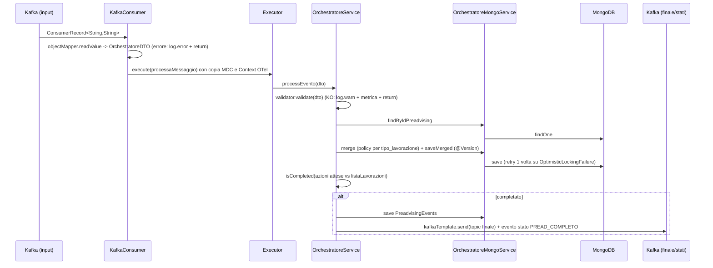
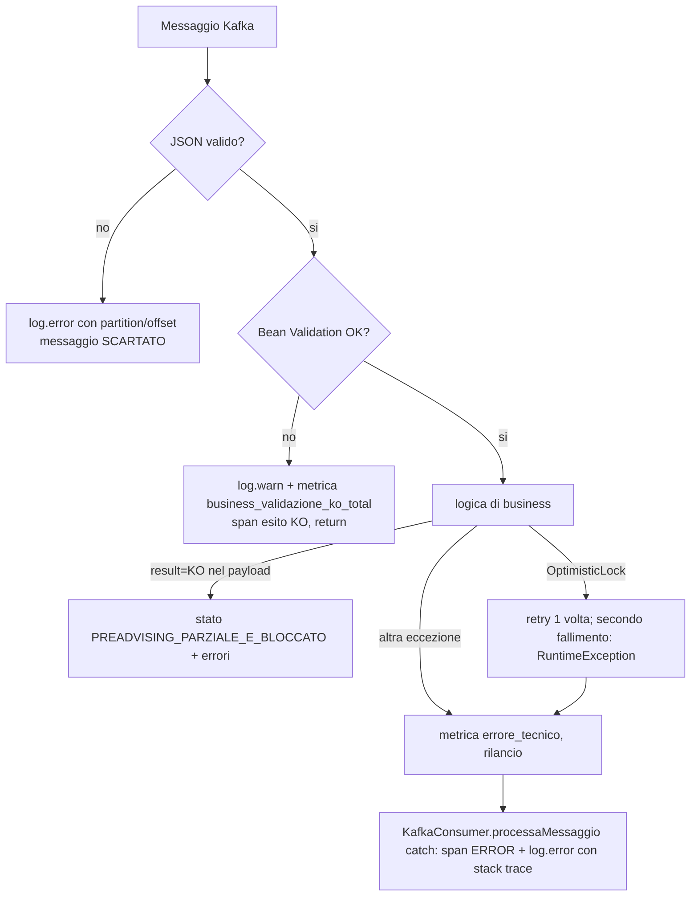

# MICROSERVICE TECHNICAL BLUEPRINT — `ce-dichiarato-orchestratore`

> Documento di riferimento tecnico ricavato dall'analisi del repository (branch `develop`, HEAD `4f8f16e`).
> Ogni affermazione è riferita a file reali. Dove un aspetto **non è presente** o **non è verificabile** è dichiarato esplicitamente.
> Nessun segreto è riportato: le credenziali trovate nel repository sono segnalate in §19 senza i valori.

**Legenda dei livelli di standard** (usata in tutto il documento)

| Etichetta | Significato |
|---|---|
| **[OBBLIGATORIO]** | Convenzione consolidata e verificata nel repository |
| **[CONSIGLIATO]** | Buona pratica non (completamente) presente nel progetto |
| **[DOMINIO]** | Specifico del dominio "dichiarato/preadvising": da ridefinire |
| **[NON VERIFICATO]** | Prove insufficienti |
| **[ANOMALIA]** | Incongruenza/anti-pattern: da NON replicare |

---

## Indice

1. [Sintesi esecutiva e caratteristica fondamentale](#1-sintesi-esecutiva-e-caratteristica-fondamentale)
2. [Fase A — Inventario e struttura del repository](#2-fase-a--inventario-e-struttura-del-repository)
3. [Stack tecnologico e dipendenze](#3-stack-tecnologico-e-dipendenze)
4. [Architettura applicativa](#4-architettura-applicativa)
5. [Convenzioni di naming e organizzazione delle classi](#5-convenzioni-di-naming-e-organizzazione-delle-classi)
6. [Analisi delle classi principali](#6-analisi-delle-classi-principali)
7. [Gestione delle eccezioni](#7-gestione-delle-eccezioni)
8. [Configurazione `application.yaml`](#8-configurazione-applicationyaml)
9. [Helm / Kubernetes e `values.yaml`](#9-helm--kubernetes-e-valuesyaml)
10. [Logging](#10-logging)
11. [Monitoring, metriche e observability](#11-monitoring-metriche-e-observability)
12. [Sicurezza](#12-sicurezza)
13. [Validazione e contratti](#13-validazione-e-contratti)
14. [Test e qualità del codice](#14-test-e-qualità-del-codice)
15. [Build, containerizzazione, CI/CD](#15-build-containerizzazione-cicd)
16. [Flussi operativi e integrazioni](#16-flussi-operativi-e-integrazioni)
17. [Guida: creare un nuovo microservizio coerente](#17-guida-creare-un-nuovo-microservizio-coerente)
18. [Template e scheletri di codice](#18-template-e-scheletri-di-codice)
19. [Inventario delle configurazioni e criticità](#19-inventario-delle-configurazioni-e-criticità)
20. [Checklist finale di conformità](#20-checklist-finale-di-conformità)
21. [Limitazioni e aspetti non verificabili](#21-limitazioni-e-aspetti-non-verificabili)

---

## 1. Sintesi esecutiva e caratteristica fondamentale

`ce-dichiarato-orchestratore` (artifactId `orchestratore-consumer`, `pom.xml`) **non è un servizio REST**: è un **orchestratore event-driven** (consumer/producer Apache Kafka con persistenza MongoDB) della pipeline *preadvising* di Corriere Espresso.

Cosa fa (dominio, `[DOMINIO]`):

1. Consuma eventi JSON dal topic di input (`kafka.consumer.topic.input`, `KafkaConsumer.execute`).
2. Se l'evento è di tipo `validato` (primo evento di un preadvising) → salva il documento su Mongo e fa **fan-out** delle lavorazioni previste per il canale (`azioni.mappings.<CANALE>`) verso i topic di routing (`routing.azioni.mappings.<azione>.topic`).
3. Se l'evento è il **ritorno** di una lavorazione (`normalizzazione`, `check-ldv`, `ldv-pdb`, …) → fa **merge** nel documento Mongo (con lock ottimistico e una policy di merge per lavorazione), verifica se tutte le azioni attese sono completate e, in caso positivo, pubblica sul topic `finale` (`preadvising.completed`) e sul topic degli eventi di stato.
4. Emette eventi di cambio stato (event store e topic stati) e metriche/tracce.

**Conseguenze per chi replica il blueprint:**

- Le sezioni "Controller", "REST client", "Spring Security", "`@ControllerAdvice`", "OpenAPI" **non hanno controparte nel codice** (vedi i capitoli relativi: "ASSENTE").
- Gli standard realmente replicabili sono: struttura Maven/Spring Boot, configurazione `@ConfigurationProperties`, Lombok, executor + metriche, tracing OTel con utility "mai-in-errore", logging JSON logstash, chart Helm del template ALM, pipeline Jenkins ALM, Dockerfile multi-stage con Sonar.
- Il progetto contiene diverse **anomalie** (§19) da non propagare nei nuovi servizi (credenziali in chiaro in un profilo, debug agent JDWP nei values, proprietà copiate da altro servizio, ecc.).

---

## 2. Fase A — Inventario e struttura del repository

Repository Git con 114 file tracciati (`git ls-files`), 411 commit, branch remoti `develop` (default), `master`, `feature/flusso-pdb`. Modulo Maven **singolo** (nessun multi-modulo). Nessun file inaccessibile.

### 2.1 Albero (percorsi verificati)

```text
ce-dichiarato-orchestratore/
├── pom.xml                         # build Maven (single-module), parent spring-boot-starter-parent 3.5.14
├── settings.xml                    # settings Maven per Nexus (server nexus / nexus-snapshot, credenziali da ARG Docker)
├── Dockerfile                      # multi-stage: build Maven -> Sonar scanner -> runtime UBI minimal JRE17
├── custom/run.sh                   # entrypoint container: calcolo JVM opts, truststore merge, keystore
├── pipeline.yaml                   # configurazione automazione Jenkins ALM (SVILUPPO / RELEASE)
├── .alm/                           # 5 Jenkinsfile (build, deploy, doc, microcks, release) — richiamano librerie condivise
├── .helm/                          # chart Helm "ce-dichiarato-orchestratore"
│   ├── Chart.yaml
│   ├── values.yaml                 # default (di fatto = ambiente sviluppo + debug)
│   ├── ci/ci-values.yaml, hpa-ci-values.yaml   # values per CI del chart (generici, NON allineati al servizio)
│   ├── config/files/application.properties, example.json  # esempi configmap del template (non usati: configMap.enabled=false)
│   ├── image/template.png
│   └── templates/ _helpers.tpl, deployment.yaml, service.yaml, route.yml, ingress.yaml, hpa.yaml,
│                  serviceaccount.yaml, configmap.yml, configmap-env-cm.yml, NOTES.txt, tests/test-connection.yaml
├── deploy-svil/values.yaml         # override sviluppo (usato da pipeline.yaml: PATH_CONF)
├── deploy-coll/values.yaml         # override collaudo (SOURCE_DIR per release)
├── deploy-config/values_TEMPLATE.yaml  # template con placeholder "_#NOME" per coll/cert/prod
├── test/put_here_yourDockerFile_forTest, put_here_yourDockerFile   # placeholder del template ALM (nessun Dockerfile di test reale)
├── kafka.md                        # tabella bootstrap server per ambiente (info infrastrutturali)
├── doc_utili/                      # decision table normalizzazione + payload JSON di esempio (norm*.json)
├── README.md                       # README standard del template ALM (non descrive il servizio)
└── src/
    ├── main/java/it/poste/dichiarato/orchestratore/
    │   ├── Application.java
    │   ├── configuration/          # AppConfig, AsyncProcessingConfig, MongoConfig, MetricsConfig, OpenTelemetryConfig,
    │   │                           # AzioneProperties, AzioneTopicProperties, MergeProperties
    │   ├── kafka/
    │   │   ├── consumer/KafkaConsumer.java
    │   │   ├── producer/stati/KafkaProducer.java ; producer/dto/*
    │   │   ├── service/ AzioneDeductionService, StepConditionEvaluator ; service/impl/ *Impl, OrchestratoreService,
    │   │   │            OrchestratoreMongoService, MacchinaStatiService
    │   │   └── enumerator/         # RuoliEnum, StatoOffertaEnum, StatoPraticaEnum, TipiIndirizzoEnum
    │   ├── dto/                    # DTO di dominio (*DTO), Azione, AzioneTopic ; dto/kafka/ ; dto/mongo/ (documenti)
    │   ├── metrics/                # ClienteTagProperties, ClienteTagResolver
    │   ├── repository/EnrichmentEventsRepository.java
    │   └── util/                   # OrchestratoreMapper, TraceUtil, Utils
    ├── main/resources/             # application.yaml, application-{test,svil,prod}.yaml, logback-spring.xml, logback-svil.xml
    └── test/java/.../              # 6 classi di test JUnit5/Mockito (53 @Test)
```

### 2.2 Ruolo, obbligatorietà e replica degli elementi

| Elemento | Ruolo architetturale | Utilizzatore | Stato | Come replicare |
|---|---|---|---|---|
| `pom.xml` | Build, BOM, override CVE | Maven / Dockerfile | **[OBBLIGATORIO]** | Copiare parent/BOM/plugin; rivedere dipendenze (§3) |
| `settings.xml` | Accesso Nexus aziendale | `Dockerfile` (`mvn -s`) | **[OBBLIGATORIO]** per build in pipeline | Copiare: username/password sono già riferimenti a variabili d'ambiente (`${…}`, verificato), valorizzate dal Dockerfile (`ENV username/password` da `ARG`); non committare valori |
| `Dockerfile` | Immagine + Sonar | Jenkins build job | **[OBBLIGATORIO]** | §15, §18 |
| `custom/run.sh` | Tuning JVM, truststore | `ENTRYPOINT` | **[OBBLIGATORIO]** (standard piattaforma) | Copiare invariato |
| `pipeline.yaml`, `.alm/*` | CI/CD ALM | Jenkins | **[OBBLIGATORIO]** | Sostituire solo nomi/immagine/path/namespace |
| `.helm/` | Chart di deploy | Jenkins deploy | **[OBBLIGATORIO]** | Rinominare chart/helper; §9 |
| `deploy-svil/`, `deploy-coll/`, `deploy-config/` | Values per ambiente | Jenkins | **[OBBLIGATORIO]** (processo ALM) | §9 |
| `src/main/resources/application*.yaml` | Config Spring | Spring Boot | **[OBBLIGATORIO]** | §8 |
| `logback-spring.xml` | Logging JSON | Logback | **[OBBLIGATORIO]** | §10 |
| `doc_utili/`, `kafka.md` | Documentazione di dominio | team | **[DOMINIO]** | Non replicare |
| `repository/EnrichmentEventsRepository` | Spring Data Mongo | `OrchestratoreMongoService` | **[DOMINIO]** (pattern replicabile) | §6.3 |

---

## 3. Stack tecnologico e dipendenze

### 3.1 Versioni (da `pom.xml`)

| Elemento | Valore | Fonte |
|---|---|---|
| Java | 17 (`java.version`); immagini `caat-maven-jdk-17`, `caat-ubi-minimal-jre-17` | `pom.xml`, `Dockerfile` |
| Spring Boot | 3.5.14 (parent `spring-boot-starter-parent`) | `pom.xml` |
| spring-kafka | 3.3.16 (property override) | `pom.xml` `<spring-kafka.version>` |
| Tomcat | 10.1.52 (override) | `pom.xml` |
| Jackson BOM | 2.21.6 (property `jackson-bom.version`) | `pom.xml` |
| OpenTelemetry BOM | 1.54.1 (import in `dependencyManagement`) | `pom.xml` |
| Build tool | Maven; versione Maven: **[NON VERIFICATO]** (fornita dall'immagine `caat-maven-jdk-17:9`); nessun `mvnw` nel repo | Dockerfile |
| Artifact | `it.poste.ce:orchestratore-consumer:0.0.1-SNAPSHOT` (la versione reale dell'immagine è imposta da `versions:set -DnewVersion=${VERSION}` nel Dockerfile) | `pom.xml`, `Dockerfile` |

### 3.2 Dipendenze

| Dipendenza | Finalità | Dove usata | Implicazione per un nuovo servizio |
|---|---|---|---|
| `spring-boot-starter-web` | Tomcat + MVC; **nessun controller**. Serve di fatto a Actuator/springdoc su server | – | **[ANOMALIA]** se il servizio è solo Kafka: valutare di rimuoverla (ma attenzione: `management.server.port` e probe HTTP dipendono dal web server) |
| `spring-kafka` | `@KafkaListener`, `KafkaTemplate<String,String>` | `KafkaConsumer`, `OrchestratoreService`, `MacchinaStatiService`, `KafkaProducer` | Auto-configurazione via `spring.kafka.*`; payload sempre `String` + Jackson manuale |
| `spring-boot-starter-data-mongodb` (+ override `spring-data-mongodb 4.5.12`) | `MongoTemplate`, `MongoRepository`, `@Version`, auditing | `OrchestratoreMongoService`, `AppConfig` (`@EnableMongoAuditing`) | URI da `spring.data.mongodb.uri` |
| `spring-boot-starter-validation` | Bean Validation (Hibernate Validator) | `AppConfig.validator()`, `OrchestratoreService` | Validazione **programmatica** dei messaggi Kafka |
| `spring-boot-starter-actuator` + `micrometer-registry-prometheus` (runtime) | Health + `/actuator/prometheus` | `application*.yaml`, Helm | Obbligatorio per probe e scraping |
| `opentelemetry-api/sdk/exporter-otlp/sdk-extension-autoconfigure` | Tracing manuale, propagazione W3C su header Kafka | `OpenTelemetryConfig`, `TraceUtil`, `KafkaConsumer` | Si usa `GlobalOpenTelemetry` (agente/autoconfigure via env `OTEL_*`, `-Dotel.java.global-autoconfigure.enabled=true`) |
| `logstash-logback-encoder` 8.0 | Log JSON | `logback-spring.xml` | Standard per i log |
| `logback-core` 1.5.38 / `logback-classic` | Backend SLF4J | – | Override esplicito di versione per CVE |
| `lombok` (optional, escluso dal jar) | `@Data`, `@Slf4j`, `@RequiredArgsConstructor`, `@UtilityClass` | ovunque | **[OBBLIGATORIO]** |
| `springdoc-openapi-starter-webmvc-ui` 2.5.0 | Swagger UI | **nessun uso** (non ci sono endpoint REST) | **[ANOMALIA]** dipendenza inutilizzata |
| `httpclient5` (5.6.3 gestito), `commons-lang3` 3.18.0, `spring-data-commons` 3.5.13 (versione esplicita) | Utility/HTTP | Nessun uso di client HTTP verificato nel codice | `httpclient5` commentata "se usato": **[NON VERIFICATO]** l'uso; `spring-data-commons` esplicito è ridondante rispetto al BOM |
| `spring-boot-starter-test` (test) | JUnit 5, Mockito, AssertJ | `src/test` | Standard |

**Override di sicurezza in `dependencyManagement`** (commentati con riferimento CVE): `httpcore5`/`httpcore5-h2` 5.4.3, `httpclient5` 5.6.3, `log4j-api` 2.25.5, `spring-retry` 2.0.13, `spring-data-mongodb` 4.5.12. **[OBBLIGATORIO]** pattern: forzare le versioni patchate in `dependencyManagement` con commento `FIX CVE-…`.

**Plugin di build**: solo `spring-boot-maven-plugin` (con `<image><builder>paketobuildpacks/builder-jammy-base:latest</builder>`, esclusione di lombok). **Assenti**: Surefire/Failsafe configurati, JaCoCo, Checkstyle, Spotless, PMD, OWASP dependency-check, enforcer.

Non presenti: Spring Security, JPA/JDBC, client REST (RestTemplate/WebClient/Feign), Resilience4j/Spring Retry usati, cache, Testcontainers.

---

## 4. Architettura applicativa

### 4.1 Pattern

- **Event-driven orchestrator / process manager** con stato su Mongo. Organizzazione **per layer tecnico + sottodominio** (`kafka/consumer`, `kafka/service`, `kafka/producer`, `repository`, `dto`, `configuration`, `util`, `metrics`).
- **Config-driven routing**: il grafo delle lavorazioni è interamente nello YAML (`azioni.mappings`, `routing.azioni.mappings`, `merge.policies`), letto tramite `@ConfigurationProperties` (`AzioneProperties`, `AzioneTopicProperties`, `MergeProperties`).
- Concorrenza esplicita: listener thread → `processingExecutor` (parallelo) oppure `multicolloExecutor` (single-thread sequenziale per i canali in `kafka.multicollo.canali`).
- Transazioni: **assenti** (`@Transactional` non usato); la coerenza è affidata al **lock ottimistico** Mongo (`@Version` in `EnrichmentEvents`, `OptimisticLockingFailureException` gestita in `OrchestratoreService.manageMerge` con un solo retry).

### 4.2 Diagramma componenti

```mermaid
flowchart LR
    subgraph Kafka
        TIN[(topic input<br/>kafka.consumer.topic.input)]
        TR[(topic routing<br/>routing.azioni.mappings.*.topic)]
        TC[(topic finale<br/>preadvising.completed)]
        TS[(topic stati<br/>kafka.producer.topic.stati)]
        TE[(event store<br/>kafka.producer.topic.event-store-topic)]
    end
    subgraph Servizio
        KC[KafkaConsumer<br/>@KafkaListener]
        PE[processingExecutor]
        ME[multicolloExecutor<br/>single thread]
        OS[OrchestratoreService]
        AD[AzioneDeductionServiceImpl<br/>+ StepConditionEvaluator]
        OM[OrchestratoreMongoService]
        MS[MacchinaStatiService]
        KP[KafkaProducer]
        TU[TraceUtil / MDC]
    end
    DB[(MongoDB<br/>enrichment_events<br/>preadvising_events...)]
    TIN --> KC
    KC -->|canali sequenziali| ME
    KC -->|altri| PE
    PE --> OS
    ME --> OS
    OS --> AD
    OS --> OM --> DB
    OS -->|fan-out| TR
    OS -->|completato| TC
    OS --> MS --> TE
    OS -.-> KP --> TS
    KC -.-> TU
    OS -.-> TU
    ACT[Actuator :8091<br/>/health /prometheus] -.-> OS
```

### 4.3 Sequenza rappresentativa (ritorno di una lavorazione)



### 4.4 Confini

- **Infrastruttura**: `configuration/*`, `util/TraceUtil`, `kafka/producer/*`, `kafka/consumer/*`.
- **Business**: `OrchestratoreService` (flusso), `OrchestratoreMongoService` (merge), `AzioneDeductionServiceImpl`/`StepConditionEvaluator` (regole di completezza), `OrchestratoreMapper`/normalizzazione indirizzi.
- **[ANOMALIA]** `OrchestratoreService` (~860 righe) mescola orchestrazione, metriche, regole di normalizzazione indirizzi e costruzione header Kafka: in un nuovo servizio separare le responsabilità.

| Elemento architetturale | Stato |
|---|---|
| Config via `@ConfigurationProperties` per mappature dinamiche | **[OBBLIGATORIO]** |
| Executor dedicati con metriche `ExecutorServiceMetrics` | **[OBBLIGATORIO]** per carichi asincroni |
| Nessun errore di instrumentation deve rompere il business (`TraceUtil`) | **[OBBLIGATORIO]** |
| Routing config-driven, merge policy, lock ottimistico | **[DOMINIO]** |

---

## 5. Convenzioni di naming e organizzazione delle classi

Base package: `it.poste.dichiarato.orchestratore` (derivato da `it.poste.<dominio>.<servizio>`).

| Tipo | Convenzione osservata | Esempi |
|---|---|---|
| Package | minuscolo, per layer: `configuration`, `dto`, `kafka.{consumer,producer,service,enumerator}`, `repository`, `util`, `metrics` | – |
| Classe main | `Application` | `Application.java` |
| Configuration | `*Config` | `AppConfig`, `MongoConfig`, `AsyncProcessingConfig` |
| Properties | `*Properties`, `@Component` + `@ConfigurationProperties(prefix=…)` + `@Data` | `AzioneProperties` |
| Service | interfaccia `*Service` + `impl/*ServiceImpl` **solo** per `AzioneDeductionService`; gli altri sono classi concrete (`OrchestratoreService`, `OrchestratoreMongoService`, `MacchinaStatiService`) | – |
| Consumer/Producer | `KafkaConsumer`, `KafkaProducer` (annotati `@Service`) | – |
| DTO | suffisso `DTO` (`SpedizioneDTO`) ma anche senza (`Azione`, `Errore`, `Record`, `Stato`); campi JSON in **snake_case nei nomi Java** (`id_preadvising`, `tipo_lavorazione`) con eccezioni `@JsonProperty` (`flagAutoproduttore`↔`flag_autoproduttore`) | – |
| Documenti Mongo | `dto/mongo/*` con `@Document` (nome plurale in inglese: `EnrichmentEvents`) | – |
| Repository | `*Repository extends MongoRepository<T,String>` | `EnrichmentEventsRepository` |
| Util | `@UtilityClass` Lombok (`Utils`) o classe statica (`TraceUtil`) | – |
| Enum | `*Enum` | `StatoPraticaEnum` |
| Test | `<Classe>Test`, metodi `snake_case` descrittivi in italiano | `deduciAzioni_restituisce_set_vuoto_per_canale_sconosciuto` |
| Lingua | nomi di dominio e commenti in **italiano**; infrastruttura in inglese | – |

Dependency injection (**incoerente** nel progetto — [ANOMALIA]): costruttore (`@RequiredArgsConstructor` su campi `final`) in `AzioneDeductionServiceImpl`, `ClienteTagResolver`; **mix** costruttore + `@Autowired` su campo in `OrchestratoreService`, `OrchestratoreMongoService`, `KafkaProducer`, `KafkaConsumer`. **Standard consigliato**: solo constructor injection con `final` (come `AzioneDeductionServiceImpl`).

Lombok: `@Data` su DTO/properties/documenti, `@Slf4j` per logger (mai `LoggerFactory` diretto), `@RequiredArgsConstructor`, `@UtilityClass`. Immutabilità: **non** adottata per i DTO (mutabili); `record` privati usati per valori interni (`IsCompleted`, `MergePolicy`).

Dipendenze circolari: nessuna rilevata; direzione: `consumer → service → (mongo service | producer | properties) → repository/dto`; `util` e `dto` non dipendono dai service.

---

## 6. Analisi delle classi principali

### 6.1 Controller — **ASSENTI**

`grep` su `@RestController`, `@Controller`, `@RequestMapping` e `@ControllerAdvice`: nessuna occorrenza in `src/main/java`. Nessun endpoint applicativo; gli unici endpoint HTTP sono quelli di Actuator (porta di management 8091). Il punto di ingresso è `KafkaConsumer`.

### 6.2 Entry point: `KafkaConsumer` (`kafka/consumer/KafkaConsumer.java`)

- Annotazioni: `@Service`, `@Slf4j`; `@KafkaListener(topics = "${kafka.consumer.topic.input}")` su `execute(ConsumerRecord<String,String>)`.
- Dipendenze: `OrchestratoreService`, `Tracer`, due `Executor` con `@Qualifier` (`processingExecutor`, `multicolloExecutor`), `ObjectMapper` (campo `@Autowired`), `@Value("${kafka.multicollo.canali:IF}") Set<String>`.
- Flusso: cattura `Context.current()` e copia MDC → deserializza JSON (errore ⇒ `log.error` e **scarto** del messaggio, nessun DLT) → sceglie executor (`richiedeElaborazioneSequenziale`: canale in `kafka.multicollo.canali`, `id_canale != TWS`, `tipo_lavorazione` ∈ {`validato`,`check-ldv`}) → `processaMessaggio`: crea span consumer (`TraceUtil.BuildSpan`), ripristina MDC, `orchestratoreService.processEvento`, `catch (Exception)` ⇒ `recordExceptionSafe` + `log.error`, `finally` chiude span e `MDC.clear()`.
- **Semantica di consegna**: `spring.kafka.listener.ack-mode: record` e `enable-auto-commit: false`, ma l'elaborazione è asincrona su executor: l'offset viene committato quando `execute` ritorna, non quando la lavorazione termina. Gli errori sono inghiottiti (nessun retry/DLT). Per `multicolloExecutor` la backpressure bloccante (`accodaBloccando`) mitiga la perdita (commento in `AsyncProcessingConfig`). **[ANOMALIA/rischio]** da valutare per nuovi servizi che richiedono at-least-once reale.

### 6.3 Service

| Classe | Responsabilità | Note |
|---|---|---|
| `OrchestratoreService` | `processEvento(OrchestratoreDTO)`: validazione, duplicati, fan-out, merge, completezza, pubblicazione finale, metriche, normalizzazione indirizzi | Crea span figli con `TraceUtil.callInChildSpan/runInChildSpan`; errore ⇒ incrementa metrica `…errore_tecnico` e **rilancia** (`throw e`) |
| `AzioneDeductionService` / `…Impl` | Deduce le azioni attese per canale dalla config, filtrando per condizione | Unico caso interfaccia+impl; testato con Mockito |
| `StepConditionEvaluator` | Valuta `Azione.condizione` (`ha-spedizione`); condizione ignota ⇒ step incluso (fail-safe, `log.warn`) | `@Component` stateless |
| `OrchestratoreMongoService` | Insert, find, merge JSON-tree con `MergePolicy`, `saveMerged` (repository, `@Version`), `save` di `PreadvisingEvents` + update `PreadvisingHistory` | `insertRecord` **inghiotte** le eccezioni (`log.error`); `merge` le incapsula in `RuntimeException` con id nel messaggio |
| `MacchinaStatiService` | Costruisce e invia gli eventi di cambio stato sul topic event store (`inviaEventoLdv`) | `@Value("${kafka.producer.topic.event-store-topic:preadvising.event.store}")` |
| `KafkaProducer` (`kafka/producer/stati`) | Invia `PreAdvisingMonitoraggioDto` sul topic stati con span producer + header | Errori ⇒ `log.error`, non rilanciati |

### 6.4 Repository e accesso ai dati

- Tecnologia: Spring Data MongoDB. `EnrichmentEventsRepository extends MongoRepository<EnrichmentEvents,String>` (solo `save` usato); query custom via `MongoTemplate` + `Query/Criteria/Update` (`findByIdPreadvising`, `findMadreByRifSpedizione`, `getPreadvisingEvent`).
- Collezioni/documenti: `EnrichmentEvents` (`@Document(collection="enrichment_events")`, `@Id id_preadvising`, `@Version version`, `@LastModifiedDate`), `PreadvisingEvents`, `PreadvisingHistory` in `dto/mongo/`.
- Nomi campi query come costanti (`FIELD_ID_PREADVISING`) — **[OBBLIGATORIO]** per le query ricorrenti.
- Pool: `MongoConfig` (`MongoClientSettingsBuilderCustomizer`) con env `MONGO_MAX_POOL_SIZE` (200), `MONGO_MIN_POOL_SIZE` (5), `MONGO_MAX_WAIT_QUEUE_MS` (2000), `MONGO_MAX_CONN_IDLE_MS` (60000).
- Transazioni Mongo: assenti. Auditing: `@EnableMongoAuditing` in `AppConfig`.
- **Anomalia**: il bean `mongoInsertExecutor` è definito in `AsyncProcessingConfig` ma **non è referenziato** da nessun componente (grep).

### 6.5 DTO e modelli

- Nessuna separazione API/contratto: gli stessi `*DTO` sono usati come contratto Kafka in/out e (via mapper) come documenti Mongo. `OrchestratoreDTO` (`dto/kafka`) = input; `OrchestratoreOutputDTO` = output; `EnrichmentEvents` = documento.
- Mapper: classe statica manuale `util/OrchestratoreMapper` (`toMongoEntity`, `toOutputDTOEnrichemtEvents`, `toOutputDTOPreadvisingEvents`); anche `objectMapper.convertValue` tra tipi. Nessun MapStruct.
- Null/opzionali: `ObjectMapper` con `NON_NULL`, `FAIL_ON_UNKNOWN_PROPERTIES=false` (bean in `AppConfig`) e `@JsonIgnoreProperties(ignoreUnknown = true)` sull'input; `@JsonMerge` per merge Jackson; `ACCEPT_SINGLE_VALUE_AS_ARRAY` per `spedizione`.
- Il JSON pubblicato su `finale` riceve una **canary property** casuale (`Utils.addCanaryUnknownProperty`, flag `orchestratore.completed.canary-property.enabled`) per costringere i consumer a tollerare campi sconosciuti. **[DOMINIO]** ma pattern interessante per l'evoluzione dei contratti.

### 6.6 Client e integrazioni esterne

Nessun client HTTP/REST. Integrazioni: Kafka (SASL_SSL/SCRAM-SHA-512), MongoDB, OTLP collector (via env). Timeout/retry/circuit breaker: **assenti**. Mappatura errori remoti: assente. Per Kafka producer: `kafkaTemplate.send` è fire-and-forget (nessuna gestione del `CompletableFuture`).

### 6.7 Configuration e Properties

| Classe | Bean/binding | Note |
|---|---|---|
| `AppConfig` | `Validator`, `ObjectMapper` (`@Bean`, **sostituisce** quello di Boot), `@EnableMongoAuditing` | `JavaTimeModule`, date non come timestamp |
| `AsyncProcessingConfig` | `processingExecutor` (12/50/5, `CallerRunsPolicy`), `mongoInsertExecutor` (inutilizzato), `multicolloExecutor` (1 thread, coda 500, drain 25 s) | Parametri da `System.getenv` con default (non da `application.yaml`) |
| `MongoConfig` | pool Mongo | idem |
| `MetricsConfig` | tag comune `service=ce-dichiarato-orchestratore` | nome servizio **hard-coded** |
| `OpenTelemetryConfig` | `OpenTelemetry` e `Tracer` da `GlobalOpenTelemetry` | tracer name `orchestratore-consumer` |
| `AzioneProperties` / `AzioneTopicProperties` / `MergeProperties` / `ClienteTagProperties` | `azioni`, `routing.azioni`, `merge`, `metrics.cliente-tag` | Registrati sia con `@Component` sia (i primi due) con `@EnableConfigurationProperties` in `Application`: ridondante. **Nessuna** validazione `@Validated` delle properties |

**Standard [CONSIGLIATO]** (non presente): leggere i parametri degli executor/pool da `application.yaml` con `@ConfigurationProperties` anziché da `System.getenv`.

---

## 7. Gestione delle eccezioni

### 7.1 Stato reale

- **Eccezioni custom**: **nessuna** (nessuna classe `extends Exception/RuntimeException`).
- **`@ControllerAdvice` / `@RestControllerAdvice` / `@ExceptionHandler`**: **assenti** (non c'è layer REST). Nessun filtro/interceptor.
- **Error handler del listener Kafka** (`DefaultErrorHandler`, DLT, `CommonErrorHandler`): **assenti**; gli errori sono catturati nel `KafkaConsumer`.
- Eccezioni usate: `RuntimeException` generiche con messaggio descrittivo (`merge`, `Utils.serialize`, `manageMerge`: *"Impossibile sincronizzare: conflitto tra applicativi"*), `OptimisticLockingFailureException` (Spring Data), `RejectedExecutionException` (executor), `JsonProcessingException` (convertita).
- Formato "risposta di errore" verso il chiamante: **non esiste** (nessun chiamante sincrono). Gli errori "funzionali" viaggiano come evento: `Stato.PREADVISING_PARZIALE_E_BLOCCATO` con mappa `errori` (`Utils.gestisciErroreLavorazione`) su topic stati/event store e documento `PreadvisingEvents` (stato 2 = KO definitivo).

### 7.2 Flusso errori (ricostruito)



### 7.3 Tabella errore → gestione → logging

| Tipologia | Dove gestita | Esito sul flusso | Payload verso l'esterno | Livello log |
|---|---|---|---|---|
| JSON non deserializzabile | `KafkaConsumer.execute` | messaggio scartato | nessuno | ERROR (con stack) |
| Violazioni Bean Validation | `OrchestratoreService.processEvento` | return anticipato, metrica | nessuno | WARN |
| Evento `validato` duplicato | `processEvento` | evento stato `PREAD_DUPLICATO` | evento stato | WARN |
| Conflitto di versione Mongo (1°) | `manageMerge` | retry | – | WARN |
| Conflitto persistente (2°) | `manageMerge` | `RuntimeException` rilanciata | – | ERROR |
| Errore merge | `OrchestratoreMongoService.merge` | `RuntimeException` con id_preadvising | – | ERROR |
| Insert Mongo fallita | `insertRecord` | **inghiottita** | – | ERROR |
| Lavorazione con `result=KO` | `processEvento` | stato `PREADVISING_PARZIALE_E_BLOCCATO` | evento stato con `errori` | (INFO/…) |
| Errore invio topic stati | `KafkaProducer.sendEvento` | inghiottito | – | ERROR |
| Errore generico non previsto | `KafkaConsumer.processaMessaggio` | catturato, span ERROR | – | ERROR (con stack) |
| Errore instrumentation (OTel/MDC/Micrometer) | `TraceUtil`, `try/catch(Throwable)` | ignorato | – | – / WARN |

### 7.4 Regole su dati sensibili

- Stack trace: loggati solo nei log (JSON) — mai esposti (non c'è canale di risposta).
- **Rischio** (**[ANOMALIA]**): `log.debug("Messaggio ricevuto da Kafka: {}", record.value())` e `KafkaProducer` (debug con `payload`) registrano l'intero payload, che contiene dati anagrafici di mittente/destinatario. Il profilo `test` imposta root `DEBUG` (`logback-spring.xml`) → in `test` i payload vengono loggati. In `prod` root è `INFO`. I commit recenti (`fd9a6ef`) hanno portato i log payload a `debug`.
- Non esiste mascheramento dei dati personali nel codice.

### 7.5 Procedura per introdurre una nuova eccezione

Poiché il progetto non ha uno standard, si definisce uno **[CONSIGLIATO]** coerente con lo stile esistente:

1. Creare package `exception/` e la classe `XxxException extends RuntimeException` (costruttori `(String)` e `(String, Throwable)`; **messaggio senza dati personali**, ma con l'identificativo tecnico, come `Errore nel merge Mongo [id_preadvising=…]`).
2. Lanciarla dal service dove oggi si lancia `RuntimeException` (es. `OrchestratoreMongoService.merge`).
3. Intercettarla **una sola volta** nel punto di confine (`KafkaConsumer.processaMessaggio`) per evitare doppio log; i layer intermedi non fanno `log.error` + rilancio.
4. Se il servizio espone REST: aggiungere `@RestControllerAdvice` con `@ExceptionHandler` (payload standard `{timestamp,status,code,message,traceId}`) — **non esiste nel repo, template in §18**.
5. Aggiungere una metrica `business_tecnico_<nome>_total` (convenzione §11) e un test.

---

## 8. Configurazione `application.yaml`

### 8.1 File

| File | Contenuto |
|---|---|
| `application.yaml` | Base: Kafka (consumer/producer/listener), `management.*`, `logging.level`, `metrics.cliente-tag`, `azioni`, `kafka.*`, `routing`, `merge`, `orchestratore.completed.*`; **`spring.profiles.active: test` hard-coded** |
| `application-test.yaml` | Profilo locale/test (porta `server.port: 8099`, truststore/ jaas, mapping ridotti) |
| `application-svil.yaml` | Solo `logging.config: classpath:logback-svil.xml` (log testuale) |
| `application-prod.yaml` | Profilo effettivamente usato nei cluster (`SPRING_PROFILES_ACTIVE=prod` nei values): Mongo, Kafka SASL_SSL, management, tracing |

Nessun `application-coll/cert` separato: tutti i cluster usano `prod` e differiscono per **env var** dei values Helm.

### 8.2 Proprietà significative

| Proprietà | Finalità | Valore/sorgente | Obbl. | Configurazione |
|---|---|---|---|---|
| `spring.application.name` | Nome app | `orchestratore-consumer` | sì | yaml |
| `spring.profiles.active` | Profilo | `test` in yaml (commentata variante `${SPRING_PROFILES_ACTIVE:prod}`); **sovrascritta dall'env `SPRING_PROFILES_ACTIVE=prod`** nei values | sì | env (Helm `envFrom`) |
| `spring.data.mongodb.uri` | Connessione Mongo | base: URI locale; prod: `${MONGO_STRING_CONNECTION}` | sì (prod) | Secret → env |
| `spring.kafka.bootstrap-servers` | Broker | base `${BOOTSTRAP_SERVERS:localhost:9092}`; prod `${KAFKA_BOOTSTRAP_SERVERS}` | sì | env |
| `spring.kafka.security.protocol` / `properties.security.protocol` | `SASL_SSL` | prod | sì (prod) | yaml |
| `spring.kafka.properties.sasl.mechanism` | `SCRAM-SHA-512` | prod | sì | yaml |
| `spring.kafka.properties.sasl.jaas.config` | JAAS con `${KAFKA_SCRAM_USERNAME}`/`${KAFKA_SCRAM_PASSWORD}` | prod | sì | Secret → env |
| `spring.kafka.properties.ssl.truststore.location/password` | Truststore | `${TRUSTSTORE_CA_POSTE_LOCATION:}`, `${TRUSTSTORE_PASSWORD:}` | sì | env + volume secret (`/custom/ssl/`) |
| `spring.kafka.properties.ssl.endpoint.identification.algorithm` | `""` (verifica hostname **disabilitata**) | prod | – | **[ANOMALIA di sicurezza]** da valutare |
| `spring.kafka.consumer.group-id` | Consumer group | base `orchestratore-consumer-test`; prod `ce-dichiarato-smistatore-group` (nome non coerente col servizio) | sì | yaml |
| `spring.kafka.consumer.enable-auto-commit` / `listener.ack-mode` | `false` / `record` | base e prod | sì | yaml |
| `spring.kafka.consumer.auto-offset-reset` | `earliest` | base (non in prod) | no | yaml |
| `kafka.consumer.topic.input` | Topic input | `${KAFKA_TOPIC_INPUT:messaggi-validi}` | sì | env |
| `kafka.producer.topic.stati` | Topic stati | `${KAFKA_TOPIC_STATI:evento-stati}` | sì | env |
| `kafka.producer.topic.event-store-topic` | Event store | `${KAFKA_TOPIC_EVENT_STORE:preadvising.evensource}` | sì | env |
| `kafka.multicollo.partition` / `.canali` | Partizione dedicata / canali sequenziali | `${KAFKA_MULTICOLLO_PARTITION:0}` / `${KAFKA_MULTICOLLO_CANALI:IF}` | no | env |
| `azioni.mappings.<CANALE>[]` (`nome`, `condizione`) | Lavorazioni attese per canale | yaml base (≈20 canali) | sì **[DOMINIO]** | yaml |
| `routing.azioni.mappings.<azione>.topic` | Topic di destinazione per azione + `finale` | yaml base (valori **hard-coded**, non da env) | sì **[DOMINIO]** | yaml |
| `merge.policies.<lavorazione>.campi-inclusi / campi-esclusi` | Policy di merge | yaml base | sì **[DOMINIO]** | yaml |
| `metrics.cliente-tag.whitelist` | Clienti con tag dedicato nelle metriche (cardinalità) | `${METRICS_CLIENTE_TAG_WHITELIST:…}` | no | env |
| `orchestratore.completed.canary-property.enabled` | Canary sul topic finale | `${ORCHESTRATORE_COMPLETED_CANARY_ENABLED:true}` | no | env |
| `management.endpoints.web.exposure.include` | `"*"` (**tutti** gli endpoint) | base e prod | – | **[ANOMALIA]** vedi §12 |
| `management.endpoint.health.show-details` | `always` | base e prod | – | idem |
| `management.server.port` | `8091` | base, test, prod | sì | yaml (allineata a probe e a `observability.metrics.port`) |
| `management.tracing.sampling.probability` | `1.0` | prod | – | yaml |
| `server.port` | **non impostata in base/prod** ⇒ default 8080 (coerente con `containerPort: 8080`); `8099` in `test` | – | – | – |
| `logging.level.org.springframework.kafka` / `org.apache.kafka` | `WARN` | base | – | yaml |
| `logging.config` | `classpath:logback-svil.xml` | profilo `svil` | – | yaml |

Variabili d'ambiente **lette direttamente dal codice** (non da yaml): `EXECUTOR_CORE_POOL_SIZE` (12), `EXECUTOR_MAX_POOL_SIZE` (50), `EXECUTOR_QUEUE_CAPACITY` (5), `MONGO_INSERT_EXECUTOR_*` (5/10/50, executor inutilizzato), `MULTICOLLO_QUEUE_CAPACITY` (500), `MONGO_MAX_POOL_SIZE`, `MONGO_MIN_POOL_SIZE`, `MONGO_MAX_WAIT_QUEUE_MS`, `MONGO_MAX_CONN_IDLE_MS`.

Non presenti: configurazioni di Jackson in yaml (usato bean), CORS, datasource SQL, cache, circuit breaker, OpenAPI (nonostante la dipendenza), `spring.mvc`.

### 8.3 Risoluzione variabili e profili

- Sintassi `${NOME:default}` risolta da Spring (Environment). Precedenza: variabili d'ambiente > `application-<profilo>.yaml` > `application.yaml`. Perciò `SPRING_PROFILES_ACTIVE=prod` (env da ConfigMap `…-env-cm` via `envFrom`) prevale su `spring.profiles.active: test` dello yaml base.
- Con profilo `prod` il file effettivo = `application.yaml` + `application-prod.yaml` (il secondo sovrascrive chiavi in conflitto, es. `spring.kafka.consumer.group-id`).
- `application-test.yaml` rimane attivo per sviluppo locale (default).

### 8.4 Proprietà obsolete / duplicate / non usate (**[ANOMALIA]**)

- `application-prod.yaml`: `kafka.consumer.topic.ce-contratti-stato`, `sa.codici.esito.ko`, `rest.ce-contratti.*`, `rest.service-activator.base-url`, `rest.request-timeout`, `ssl.truststore-path/password` — **nessun riferimento nel codice** (probabilmente copiati da un altro servizio, `ce-contratti`).
- `application-test.yaml`: stesse proprietà `rest.*`, `sa.*`, `ssl.*`, `opentracing.*`, `kafka.producer.topic.normalizzazione/check-ldv` non usate; **contiene credenziali in chiaro** (truststore, SCRAM) — vedi §19; contiene inoltre un percorso locale di un utente.
- `application.yaml`: `management.metrics.export.prometheus.enabled` e `management.endpoint.prometheus.enabled` (formato Boot 2; in Boot 3 è `management.prometheus.metrics.export.enabled`/`management.endpoint.prometheus.enabled`) ; `management.zipkin.tracing.endpoint` e `opentracing.jaeger.*` non usati (Zipkin/OTLP autoconfig sono **esclusi** in `Application`); `management.tracing.otlp.tracing: {}` vuoto.
- `management.server:` blank line con `port` indentato dopo righe vuote: valido ma fragile.
- Mapping `azioni`/`routing` duplicati e divergenti tra base e `test` (ordine diverso di `check-ldv`/`normalizzazione`).
- Topic dei values (`KAFKA_TOPIC_OUTPUT_*`) non letti dal codice (§9).

### 8.5 Esempio riutilizzabile

```yaml
# ===== VERIFICATO: struttura e stile dal repository (application.yaml / application-prod.yaml) =====
spring:
  application:
    name: your-service                       # sostituire
  profiles:
    active: ${SPRING_PROFILES_ACTIVE:test}   # [CONSIGLIATO] default esplicito con override da env (nel repo è "test" fisso)
  data:
    mongodb:
      uri: ${MONGO_STRING_CONNECTION:mongodb://localhost:27017/your_db}   # solo se si usa Mongo
  kafka:
    bootstrap-servers: ${KAFKA_BOOTSTRAP_SERVERS:localhost:9092}
    listener:
      ack-mode: record
    consumer:
      group-id: ${KAFKA_CONSUMER_GROUP:your-service-group}   # [CONSIGLIATO] da env (nel repo è fisso)
      key-deserializer: org.apache.kafka.common.serialization.StringDeserializer
      value-deserializer: org.apache.kafka.common.serialization.StringDeserializer
      enable-auto-commit: false
    producer:
      key-serializer: org.apache.kafka.common.serialization.StringSerializer
      value-serializer: org.apache.kafka.common.serialization.StringSerializer

kafka:
  consumer:
    topic:
      input: ${KAFKA_TOPIC_INPUT:your-input-topic}
  producer:
    topic:
      output: ${KAFKA_TOPIC_OUTPUT:your-output-topic}

management:
  server:
    port: 8091
  endpoints:
    web:
      exposure:
        include: health,info,prometheus   # [CONSIGLIATO] il repo usa "*"
  endpoint:
    health:
      show-details: never                 # [CONSIGLIATO] il repo usa "always"
      probes:
        enabled: true                     # [CONSIGLIATO] abilita /actuator/health/liveness|readiness (non presente nel repo)

logging:
  level:
    org.springframework.kafka: WARN
    org.apache.kafka: WARN

---
# ===== SOLO profilo prod (VERIFICATO nello schema; i valori sono placeholder) =====
spring:
  config:
    activate:
      on-profile: prod
  kafka:
    properties:
      security.protocol: SASL_SSL
      sasl.mechanism: SCRAM-SHA-512
      sasl.jaas.config: org.apache.kafka.common.security.scram.ScramLoginModule required username="${KAFKA_SCRAM_USERNAME}" password="${KAFKA_SCRAM_PASSWORD}";
      ssl.truststore.location: ${TRUSTSTORE_CA_POSTE_LOCATION:}
      ssl.truststore.password: ${TRUSTSTORE_PASSWORD:}
```

(Nel repo i profili sono file separati `application-<profilo>.yaml`; il multi-document sopra è solo per brevità.)

---

## 9. Helm / Kubernetes e `values.yaml`

### 9.1 Chart (`.helm/`)

- `Chart.yaml`: `apiVersion v2`, `name: ce-dichiarato-orchestratore`, `type: application`, `version`/`appVersion: 0.1.0`, `home` (obbligatorio: richiesto dall'helper `assetAnnotation`). Description generica ("A Helm chart for Kubernetes") — il README del template impone di personalizzarla.
- Template presenti: `deployment.yaml`, `service.yaml`, `route.yml` (OpenShift), `ingress.yaml`, `hpa.yaml`, `serviceaccount.yaml`, `configmap.yml`, `configmap-env-cm.yml`, `_helpers.tpl`, `NOTES.txt`, `tests/test-connection.yaml`.
- **Assenti**: `Secret` (i secret sono pre-esistenti nel namespace e referenziati), `PodDisruptionBudget`, `NetworkPolicy`, `startupProbe`, strategia di rollout esplicita (default Kubernetes), `RoleBinding`.
- `ingress.yaml` usa `networking.k8s.io/v1beta1`/`extensions/v1beta1` (**obsoleti**, rimossi da K8s ≥1.22); l'esposizione reale avviene con `route` OpenShift (`route.enabled` false di default).

### 9.2 Flusso property → pod → Spring

```mermaid
flowchart LR
    V[values.yaml<br/>envFrom: map] --> CM[ConfigMap<br/>NAME-env-cm<br/>configmap-env-cm.yml]
    CM -->|envFrom.configMapRef| P[Container]
    V2[values.yaml<br/>env: map con valueFrom.secretKeyRef] -->|env| P
    S[(Secret pre-esistente<br/>ce-dichiarato-orchestratore-secret / ssl-secrets)] --> V2
    P --> E[Environment Spring<br/>${KAFKA_BOOTSTRAP_SERVERS}...]
    E --> Y[application-prod.yaml]
```

1. `envFrom` (valori in chiaro non sensibili) → `ConfigMap <fullname>-env-cm` (`tpl (toYaml .Values.envFrom)`) → montata come variabili d'ambiente (`envFrom.configMapRef`). Il checksum del ConfigMap è annotato sul pod (`checksum/config_env_cm`): una modifica **riavvia** i pod.
2. `env` (map nome → valore o `valueFrom`) → `env:` del container; i riferimenti `secretKeyRef` leggono secret **creati fuori dal chart**.
3. Spring legge le variabili d'ambiente tramite i placeholder `${…}` di `application-prod.yaml`.
4. Truststore: secret `ssl-secrets` montato in `/custom/ssl/` (`ssl.trustore.enabled`) → `TRUSTSTORE_CA_POSTE_LOCATION=/custom/ssl/trustore-file` → `spring.kafka.properties.ssl.truststore.location`. (Il nome `trustore` con una sola "s" è presente in chiave Secret e path: va rispettato così com'è.)

### 9.3 Proprietà dei values (`.helm/values.yaml`, `deploy-svil`, `deploy-coll`)

| Proprietà | Significato | Default (`.helm/values.yaml`) | Override | Collegamento Spring/pod |
|---|---|---|---|---|
| `goto.apcode/apname/pkcode/pkname` | Label obbligatorie piattaforma (helper `gotolabels`, `required`) | valori del servizio | per ambiente | label su Deployment/Pod |
| `goto.dto_account_l3`, `pm_tecnico_referente_progetto`, `codice_iniziativa_goto`, `documento_rilascio`, `nome_progetto` | Annotation pod (L3 e PM **obbligatori**) | valorizzati (contengono nominativi: non replicare, vedi §19) | – | annotation |
| `global.repository` | Registry (con `/` finale) | registry ACR sviluppo | coll: registry collaudo | `image` helper |
| `image.imageName`, `image.tag` (default = `appVersion`), `image.pullPolicy` (`Always`), `image.devkit` | Immagine. L'helper `image` controlla `.Values.image.dev` (non `devkit`) | `corriere-espresso/preadvising/ce-dichiarato-orchestratore` | pipeline imposta il tag | `image:` |
| `imagePullSecrets` | `{}` sviluppo; coll: secret del registry | – | per ambiente | `imagePullSecrets` |
| `replicaCount` | Repliche (ignorato se HPA) | `1` | coll/prod: placeholder `_#REPLICA_COUNT` (cert 3, prod 12 nei commenti) | – |
| `resources` | `limits` cpu 500m/mem 1Gi; `requests` 100m/256Mi (svil: limit cpu `2`, request `500m`) | – | template: placeholder `_#RESOURCES_*` | container resources |
| `livenessProbe`/`readinessProbe` | HTTP `GET /actuator/health` porta 8091; `initialDelaySeconds: 60`, `periodSeconds: 600`, `timeout 1`, `failureThreshold 3` | – | template: period 30/60, failure 5 | collegata a `management.server.port: 8091` |
| `envFrom.*` | Variabili non segrete (→ ConfigMap) | `SPRING_PROFILES_ACTIVE=prod`, `KAFKA_BOOTSTRAP_SERVERS`, `KAFKA_TOPIC_INPUT`, `KAFKA_TOPIC_STATI`, `KAFKA_TOPIC_EVENT_STORE`, `TRUSTSTORE_CA_POSTE_LOCATION`, `JAVA_TOOL_OPTIONS`, `KAFKA_TOPIC_OUTPUT_*` | per ambiente | placeholder Spring |
| `env.*` (secretKeyRef) | `TRUSTSTORE_PASSWORD` (secret `ssl-secrets`), `KAFKA_SCRAM_USERNAME`, `KAFKA_SCRAM_PASSWORD`, `MONGO_STRING_CONNECTION` (secret `<servizio>-secret`) | – | – | `application-prod.yaml` |
| `hostAliases` | Risoluzione statica host Kafka (raccomandato di NON usarlo in cert/prod, ma il template coll/cert/prod lo usa con placeholder) | host/IP sviluppo | per ambiente | `/etc/hosts` pod |
| `podAnnotations` | `poste-tracing/datadog`, `…/opensearch_aws`, `…/elasticsearch_local` = `'true'` | – | – | integrazione log/tracing piattaforma |
| `service` | `ClusterIP`, port 8080 → `targetPort: http` | – | – | Tomcat 8080 |
| `route` | OpenShift Route (disabilitata) | `enabled: false` | `route.enabled` templato | – |
| `observability.metrics` | path `/actuator/prometheus`, port `8091`, container; genera annotation `prometheus.io/*` | enabled | – | Actuator |
| `observability.tracing.opentelemetry.enabled` | Se true il deployment inietta `HOST_IP`, `OTEL_EXPORTER_OTLP_ENDPOINT=http://$(HOST_IP):4318`, `OTEL_TRACES_EXPORTER=otlp`, protocol `http/protobuf`, `OTEL_SERVICE_NAME` (= fullname in kebab-case), `OTEL_PROPAGATORS=tracecontext,baggage`, metrics/logs exporter `none` | true | `custom_settings` per sostituire il blocco | `GlobalOpenTelemetry` |
| `ssl.trustore.*` | Monta secret truststore in `/custom/ssl/` | enabled, secret `ssl-secrets` | – | volume |
| `serviceAccount.create` | `false` → usa `default` | – | – | – |
| `securityContext`, `podSecurityContext` | **vuoti** (`{}`) | – | solo `ci-values.yaml` imposta `runAsNonRoot`, `readOnlyRootFilesystem` | – |
| `autoscaling` | HPA (`autoscaling/v2`) disabilitato | `enabled: false` | `minReplicas/maxReplicas/target…` | – |
| `configMap.*` | ConfigMap file-based del template (non usata) | `enabled: false` | – | mount `/mock/example` |
| `tests.*` | Immagine di smoke test (placeholder) | `enabled: false` | – | `tests/test-connection.yaml` |

Differenze di ambiente verificate: `deploy-svil` aggiunge variabili **Datadog** (`DD_SERVICE`, `DD_ENV`, `DD_AGENT_HOST`, `DD_TRACE_*`, `DD_TAGS`) e cpu limit 2/request 500m; `deploy-coll` cambia registry/pull secret, bootstrap Kafka, `failureThreshold: 5`, topic `KAFKA_TOPIC_OUTPUT_POSTE/SDA/PALMARI`; `deploy-config/values_TEMPLATE.yaml` contiene i placeholder `_#…` da sostituire dal processo di promozione (coll/cert/prod).

### 9.4 Incongruenze Helm ↔ Kubernetes ↔ `application.yaml` (**[ANOMALIA]**)

1. `JAVA_TOOL_OPTIONS` in `.helm/values.yaml`, `deploy-svil`, `deploy-coll` abilita **`-agentlib:jdwp … address=*:5005`** (debug remoto aperto). Il `values_TEMPLATE.yaml` (cert/prod) lo omette correttamente. Verificare che non arrivi in collaudo/produzione.
2. `KAFKA_TOPIC_OUTPUT_LDV/NORMALIZZATORE/COMPLETE/POSTE/SDA/PALMARI` nei values **non sono letti** da nessun placeholder: i topic di routing sono hard-coded in `application.yaml` (`routing.azioni.mappings`). Inoltre `KAFKA_TOPIC_OUTPUT_NORMALIZZATORE` ha uno spazio iniziale nel valore.
3. Nome Secret: `ce-dichiarato-orchestratore-secret` e `ssl-secrets` sono referenziati ma non creati dal chart.
4. `containerPort` 8080 e `http-actuator` 8091 sono hard-coded nel template (non da values).
5. `livenessProbe` e `readinessProbe` puntano allo stesso `/actuator/health` con `periodSeconds: 600` (default/svil): rilevamento molto lento; **nessuna `startupProbe`**; non si usano gli endpoint `/health/liveness|readiness`.
6. `Dockerfile` `EXPOSE 8080`; `management` su 8091 non esposto nel Dockerfile (non necessario per K8s).
7. Il `DD_*`/agent Datadog: il Dockerfile scarica `dd-java-agent.jar` e lo copia nell'immagine, ma `custom/run.sh` **non** passa `-javaagent` e i values non lo fanno: l'agent è presente ma non attivato dal repo (**[NON VERIFICATO]** se attivato dalla piattaforma tramite `JAVA_TOOL_OPTIONS` esterne). Il template coll/cert/prod non ha `DD_*`.
8. `ci/ci-values.yaml` e `hpa-ci-values.yaml` sono del template (immagine `hello-world-api`, probe `/health:8080`, sidecar Jaeger): non rappresentano questo servizio.
9. `imagePullPolicy: Always`, `replicaCount: 1` in sviluppo.

### 9.5 Esempio `values.yaml` riutilizzabile

```yaml
# Ricavato dallo stile di .helm/values.yaml; i valori <...> sono placeholder.
goto:
  apcode: "<AP-CODE>"
  apname: "<ap_name_minuscolo_con_underscore>"
  pkcode: "<PK-CODE>"
  pkname: "<pk_name>"
  dto_account_l3: "<account-l3>"
  pm_tecnico_referente_progetto: "<referente>"
  codice_iniziativa_goto: ""
  documento_rilascio: ""
  nome_progetto: ""

global:
  repository: <registry-host>/

imagePullSecrets: {}          # solo se il cluster non è gen3
replicaCount: 1

image:
  imageName: <gruppo/progetto/your-service>
  pullPolicy: IfNotPresent    # [CONSIGLIATO] (repo: Always)
  tag: ""

resources:
  requests: { cpu: 100m, memory: 256Mi }
  limits:   { cpu: 500m, memory: 1Gi }

startupProbe:                 # [CONSIGLIATO] non presente nel repo (richiede estensione del template deployment.yaml)
  httpGet: { path: /actuator/health, port: 8091 }
  failureThreshold: 30
  periodSeconds: 5
livenessProbe:
  enabled: true
  failureThreshold: 3
  initialDelaySeconds: 60
  periodSeconds: 30           # repo: 600 (sconsigliato)
  successThreshold: 1
  timeoutSeconds: 1
  httpGet: { path: /actuator/health, port: 8091, scheme: HTTP }
readinessProbe:
  enabled: true
  failureThreshold: 3
  initialDelaySeconds: 60
  periodSeconds: 30
  successThreshold: 1
  timeoutSeconds: 1
  httpGet: { path: /actuator/health, port: 8091, scheme: HTTP }

envFrom:                      # non segrete -> ConfigMap <fullname>-env-cm
  SPRING_PROFILES_ACTIVE: 'prod'
  KAFKA_BOOTSTRAP_SERVERS: '<host1:9094,host2:9094,host3:9094>'
  KAFKA_TOPIC_INPUT: '<input-topic>'
  KAFKA_TOPIC_OUTPUT: '<output-topic>'
  TRUSTSTORE_CA_POSTE_LOCATION: '/custom/ssl/trustore-file'
  JAVA_TOOL_OPTIONS: '-Dotel.java.global-autoconfigure.enabled=true'   # SENZA jdwp

env:                          # segrete -> secretKeyRef (secret creati fuori dal chart)
  TRUSTSTORE_PASSWORD:
    valueFrom: { secretKeyRef: { name: ssl-secrets, key: trustore-password } }
  KAFKA_SCRAM_USERNAME:
    valueFrom: { secretKeyRef: { name: <service>-secret, key: kafka-scram-username } }
  KAFKA_SCRAM_PASSWORD:
    valueFrom: { secretKeyRef: { name: <service>-secret, key: kafka-scram-password } }
  MONGO_STRING_CONNECTION:
    valueFrom: { secretKeyRef: { name: <service>-secret, key: mongo-string-connection } }

service: { enabled: true, type: ClusterIP, port: 8080 }
route:   { enabled: false }
observability:
  metrics:
    path: /actuator/prometheus
    port: 8091
    container: <your-service>
    prometheus: { enabled: true }
  tracing:
    opentelemetry: { enabled: true }
ssl:
  trustore: { enabled: true, sslsecretname: ssl-secrets, secretname: ssl-secrets }
securityContext:              # [CONSIGLIATO] vuoto nel repo
  runAsNonRoot: true
autoscaling: { enabled: false }
```

---

## 10. Logging

**Verificato**

- Facade: SLF4J via Lombok `@Slf4j` (nessun `LoggerFactory` diretto). Backend: **Logback** (`logback-spring.xml`).
- `logback-spring.xml`: `scan="true" scanPeriod="30 seconds"`; appender `STDOUT_ROOT` (`ConsoleAppender`) con `LoggingEventCompositeJsonEncoder` (logstash) e provider `timestamp, level, threadName, loggerName, message, mdc`. **Nessun** provider `stackTrace` esplicito (il default dell'encoder composito non lo include se non dichiarato: **[NON VERIFICATO]** l'effetto sugli stack trace) né `traceId`/`spanId` espliciti (arrivano solo se presenti in MDC).
- Per profilo: `prod` ⇒ root `INFO`; `test` ⇒ root `DEBUG` + `io.micrometer.tracing`/`io.opentelemetry*` DEBUG. **Nessun blocco per `svil`/altri**: con profilo non `prod`/`test` il file non definisce alcun root appender (uscita di default Spring).
- Profilo `svil` (`application-svil.yaml`) usa `logback-svil.xml`: output **testuale** Spring (`console-appender.xml`), root `INFO`. Non attivato da nessun values.
- Libs rumorose: `logging.level.org.springframework.kafka=WARN`, `org.apache.kafka=WARN` (yaml; non si applicano al logger root DEBUG del profilo `test` del file logback? Le due fonti coesistono: il livello dei logger esplicito prevale).
- MDC: chiavi `partition`, `offset`, `id_preadvising`, `id_file` (impostate in `KafkaConsumer`/`TraceUtil.populateMdc`); MDC copiato dal thread del listener a quello dell'executor (`MDC.getCopyOfContextMap()` → `MDC.setContextMap`) e pulito in `finally`. `traceId` letto da MDC in `KafkaProducer` (`MDC.get("traceId")`): esiste solo se un agent OTel lo popola — **[NON VERIFICATO]**.
- Correlazione tra servizi: header Kafka `trace-id` (= `id_preadvising`), `event-id`, `file-id`, `source`, `event-type`, `content-type`, `time`, più W3C `traceparent` (`TraceUtil.injectContext`). In consumo, se manca `traceparent`, si ricostruisce un contesto deterministico dall'header `trace-id` (SHA-256). **Incongruenza**: `KafkaProducer` (topic stati) scrive `trace_id` (underscore) mentre il resto usa `trace-id` (trattino).
- Mascheramento dati sensibili: **assente**. Payload completo a livello `DEBUG` (vedi §7.4).
- Doppio log: nessun handler globale ⇒ rischio duplicazioni solo di fatto (log+rilancio in `OrchestratoreMongoService.merge` e poi `KafkaConsumer`: l'errore di merge viene loggato **due volte**).

**Formato riga (JSON, verificabile da config)**

```json
{"@timestamp":"2026-10-26T10:15:30.123Z","level":"INFO","thread_name":"dichiarato-proc-3","logger_name":"it.poste.dichiarato.orchestratore.kafka.service.impl.OrchestratoreService","message":"Avvio processEvento per id_preadvising=<ID>","partition":"2","offset":"1042","id_preadvising":"<ID>","id_file":"<ID_FILE>"}
```

(Esempio ricostruito dai provider configurati; i nomi esatti dei campi dipendono dal default del logstash encoder 8.0.)

**Convenzioni dei messaggi (osservate)**: italiano, `chiave=valore` per gli id (`id_preadvising={}`), livello INFO per inizio/fine lavorazione, WARN per anomalie gestite (validazione, duplicato, conflitto versione), ERROR con eccezione come ultimo argomento (stack trace) per errori tecnici, DEBUG per payload.

**Esempi corretti (stile del progetto, con correzione sui dati sensibili)**

```java
// Entry point (consumer)
log.error("Payload Kafka non deserializzabile (partition={}, offset={}): {}",
        record.partition(), record.offset(), e.getMessage(), e);   // OK: nessun payload

// Service
log.info("Avvio processEvento per id_preadvising={}", dto.getId_preadvising());
log.warn("Evento duplicato per id_preadvising={}", dto.getId_preadvising());

// Client esterno / producer
log.error("Errore durante l'invio dell'evento a Kafka", e);

// [CONSIGLIATO] non loggare il payload: loggare solo metadati
log.debug("Messaggio ricevuto da Kafka (partition={}, offset={}, bytes={})",
        record.partition(), record.offset(), record.value().length());
```

Non esiste un exception handler globale: l'equivalente è `KafkaConsumer.processaMessaggio` (§7).

---

## 11. Monitoring, metriche e observability

| Componente | Stato | Evidenza |
|---|---|---|
| Spring Boot Actuator | **Presente** | `spring-boot-starter-actuator`, `management.*` |
| Micrometer + Prometheus | **Presente** | `micrometer-registry-prometheus`; `/actuator/prometheus`; annotation `prometheus.io/*` nel Deployment |
| Health probe K8s | **Presente (basica)** | liveness+readiness su `/actuator/health:8091`; **startup assente**; `management.endpoint.health.probes.enabled` non impostato |
| Metriche JVM/executor | **Presente** | `ExecutorServiceMetrics.monitor(...)` per `processingExecutor`, `multicolloExecutor` (e `mongoInsertExecutor`) |
| Metriche HTTP/DB/client | Non configurate in modo custom (default Boot per HTTP server; metriche driver Mongo non verificate) |
| OpenTelemetry tracing | **Presente (manuale + autoconfigure)** | `TraceUtil`, `OpenTelemetryConfig`, env `OTEL_*` iniettate dal chart; **autoconfigure Spring `OtlpAutoConfiguration`/`ObservationAutoConfiguration`/`ZipkinAutoConfiguration` esclusi** in `Application` |
| Propagazione trace tra servizi | **Presente** | W3C `traceparent` su header Kafka + fallback `trace-id` |
| Datadog | **Predisposto parzialmente** | env `DD_*` solo in `deploy-svil`; agent scaricato nel Dockerfile ma non attivato nel repo |
| Grafana/dashboard/alert | **Non presenti nel repo** |
| Health indicator custom | **Non presenti** |
| `management.tracing.sampling.probability: 1.0` | prod (campiona il 100%) — **[NON VERIFICATO]** l'effetto, visto che l'autoconfig di tracing Boot è esclusa; il campionamento effettivo dipende da `OTEL_TRACES_SAMPLER` |

**Metriche custom** (nomi verificati in `OrchestratoreService`, `KafkaProducer`, `TraceUtil`; tag comune `service`):

| Nome | Tipo | Tag principali |
|---|---|---|
| `kafka_message_consumed_total`, `…_total_ok`, `…_total_ko`, `…_total_errore_tecnico` | Counter | canale, tipo, cliente (via `ClienteTagResolver`), `con_id_file` |
| `kafka_message_produced_total` | Counter | `topic_output` (+ canale) |
| `business_stato_lavorazione_total` | Counter | `esito` ∈ OK/KO/KO_VALIDAZIONE/ERRORE_TECNICO/DUPLICATO |
| `business_validazione_ko_total` | Counter | `motivo` |
| `business_tecnico_mongo_optimistic_lock_total` | Counter | `tentativo` (`primo`/`secondo_fallito`) |
| `business_indirizzo_normalizzazione_{descrizione,entita,qualita}_total`, `business_indirizzo_normalizzato_tipo_total` | Counter | dominio |
| `business_timer_processevento_duration_seconds`, `business_timer_processevento_canale_duration_seconds`, `business_timer_publish_completed_duration_seconds` | Timer | canale/tipo |
| `business_timer_client_call_duration` | Timer (su `Metrics.globalRegistry`) | `operation`, `status` |
| `business_timer_publish_duration_parse_error_total` | Counter | `metric` |

**Convenzione di naming** (**[OBBLIGATORIO]**, osservata): `snake_case`, prefisso `kafka_…` per messaggistica e `business_<area>_…` (`business_tecnico_*` per errori tecnici); suffisso `_total` per counter, `_seconds` per timer. **Cardinalità**: il tag cliente è limitato da una whitelist (`metrics.cliente-tag.whitelist`), altrimenti `altro`/`n/a`.

**Sicurezza di management**: porta separata 8091, ma `exposure.include: "*"` e `health.show-details: always` senza Spring Security → endpoint (es. `env`, `heapdump`, `loggers`) potenzialmente esposti nella rete del cluster. **[ANOMALIA]**. Limitare a `health,info,prometheus`.

**Differenza probe** (**[CONSIGLIATO]**): *startup* = protegge l'avvio lento (disabilita le altre finché non passa); *liveness* = riavvia il pod se bloccato (non deve dipendere da Kafka/Mongo); *readiness* = rimuove dal traffico (per un consumer Kafka ha effetto limitato). Usare `/actuator/health/liveness` e `/readiness` con `management.endpoint.health.probes.enabled=true`.

---

## 12. Sicurezza

| Area | Stato verificato |
|---|---|
| Spring Security / OAuth2 / JWT / ruoli / CORS / CSRF | **Assenti** (nessuna dipendenza `spring-boot-starter-security`; nessun endpoint applicativo) |
| Actuator | **Non protetto** (`exposure.include: "*"`, details `always`) |
| TLS verso Kafka | `SASL_SSL` + `SCRAM-SHA-512` con truststore montato da Secret; `ssl.endpoint.identification.algorithm: ""` **disabilita la verifica hostname** |
| Segreti runtime | Secret Kubernetes → env (`secretKeyRef`); `JAAS` costruito da placeholder |
| Truststore/keystore | `custom/run.sh` unisce i certificati (`TRUSTSTORE_CERTIFICATES_PATH_LIST`, `TRUSTSTORE_PASSWORD`, default password pubblico `changeit` se non valorizzata) e supporta keystore (`KEYSTORE_FILE_PATH`, `KEYSTORE_PASSWORD`) |
| Container | Immagine runtime UBI minimal, utente non root `USER 185` (Dockerfile); `securityContext` K8s vuoto; `wget --no-check-certificate` nel build per scaricare l'agent Datadog (**[ANOMALIA]**) |
| Debug remoto | JDWP aperto in values di sviluppo/collaudo (**[ANOMALIA]**, §9.4) |
| Dati personali | Payload con dati anagrafici loggati a DEBUG (§7.4) |
| Scansione vulnerabilità | Override CVE in `pom.xml`; Sonar nel Dockerfile; nessun report/OWASP dependency-check nel repo |
| Credenziali nel repo | `application-test.yaml` contiene truststore password e credenziali SCRAM **in chiaro** (valori non riprodotti) — **da ruotare e rimuovere dal controllo di versione**; `settings.xml` usa solo riferimenti `${…}` (verificato) |

**Come replicare il modello di sicurezza senza trasferire segreti**: (1) tutti i segreti solo in `env` → `secretKeyRef`; (2) negli yaml solo placeholder `${VAR}` (o `${VAR:}` per opzionali); (3) profilo locale con valori fittizi/`localhost` e **nessuna** credenziale reale; (4) `settings.xml` con `${env.username}`/`${env.password}` (nel Dockerfile i valori arrivano da `ARG user/password` → `ENV username/password`); (5) aggiungere **[CONSIGLIATO]**: Spring Security solo se si espongono API, restrizione degli endpoint Actuator, `securityContext` (`runAsNonRoot`, `readOnlyRootFilesystem`), `NetworkPolicy`.

---

## 13. Validazione e contratti

- **Bean Validation programmatica**: `Validator` bean (`AppConfig`) → `validator.validate(dto)` in `OrchestratoreService.processEvento`; messaggio errori `path: message` concatenati per il log; metrica per `motivo`.
- Annotazioni effettivamente usate sui DTO: `@Size(max = …)` (es. `MittenteDTO`, `DestinatarioDTO`, `PuntoRitiroDTO`, `FrazionarioDiInesito`); `@NotNull/@NotBlank` **commentati** in `HeaderDTO`. `@Valid` **non è usato** in nessun punto (grep): la validazione non scende nei DTO annidati, quindi i `@Size` dei figli (es. `MittenteDTO`) non sono applicati alla validazione del DTO radice. **[ANOMALIA]** probabile.
- Validazioni custom (`ConstraintValidator`): **assenti**.
- Contratto: JSON snake_case verso Kafka (campi Java con underscore), `FAIL_ON_UNKNOWN_PROPERTIES=false`, null omessi. Nessun OpenAPI/AsyncAPI/JSON Schema nel repo (la `springdoc` non ha endpoint da documentare). `doc_utili/norm*.json` sono esempi di payload.
- Versionamento: campo `versione_tracciato` nel payload; header `event-type: it.poste.ce.dichiarato.validated.v1`.
- Date: `LocalDateTime`, `Instant`, `ZonedDateTime` in uso; `Utils.getUtcTimestamp()` e `getCurrentZonedTime()`; `WRITE_DATES_AS_TIMESTAMPS` disabilitato (ISO-8601). Numerici: `BigDecimal` con `WRITE_BIGDECIMAL_AS_PLAIN` e normalizzazione (`normalizeNumericNode`).
- Paginazione/ordinamento/codici HTTP: **non applicabili**.

**Come aggiungere un campo/evento mantenendo lo standard**: aggiungere il campo ai DTO (snake_case, `@Size` dove c'è un limite del tracciato), se deve sopravvivere al merge inserirlo/escluderlo nella `merge.policies.<lavorazione>`, aggiornare `OrchestratoreMapper` se serve, aggiungere test (§14).

**Se si aggiunge un endpoint REST** (non presente): `@RestController` + DTO request/response con `@Valid`, `@RestControllerAdvice` (§18), `springdoc` (già a classpath v2.5.0).

---

## 14. Test e qualità del codice

| Test | Tipo | Tecnologia |
|---|---|---|
| `AzioneDeductionServiceImplTest` (7) | unitario service | `@ExtendWith(MockitoExtension)`, `@Mock AzioneProperties`, AssertJ |
| `StepConditionEvaluatorTest` (10) | unitario | JUnit 5 |
| `OrchestratoreMongoServiceMergeTest` (24) | unitario merge/policy | Mockito, ObjectMapper reale |
| `OrchestratoreServiceNormalizzazioneArTest` (4) | unitario regole di normalizzazione | Mockito (`verify`/`when`) |
| `OrchestratoreMapperTest` (3), `NuoviCampiPdwTest` (5) | unitario mapper/DTO | JUnit 5 |

Totale: 6 classi, 53 `@Test` (conteggio `grep @Test`). **Assenti**: `@SpringBootTest`, test del `KafkaConsumer`, test con Kafka embedded/Testcontainers/Mongo, test di `application*.yaml`, `TraceUtil`, `MacchinaStatiService`, `KafkaProducer`. Nessun controller/handler da testare.

Qualità: Sonar scanner nel `Dockerfile` (progetto/quality gate passati come `ARG`; soglie **[NON VERIFICABILI]**). **Assenti** nel repo: JaCoCo (nessuna misura di coverage), Checkstyle, Spotless, PMD. Il Dockerfile compila con `-DskipTests`: i test **non** sono eseguiti nel build dell'immagine; non risulta nessuno stage di test nella pipeline (**[ANOMALIA]**, **[NON VERIFICATO]** se eseguiti altrove — le librerie Jenkins condivise non sono nel repo).

Convenzioni: classe `<Classe>Test`; metodi `soggetto_comportamento_atteso`, in snake_case italiano; costanti per i valori ricorrenti; `@BeforeEach` che istanzia la classe sotto test con le dipendenze reali stateless e i mock per le properties.

Esempio (stile reale, adattato):

```java
@ExtendWith(MockitoExtension.class)
class ExampleServiceImplTest {

    @Mock
    private ExampleProperties properties;

    private ExampleServiceImpl service;

    @BeforeEach
    void setUp() {
        service = new ExampleServiceImpl(properties);
    }

    @Test
    void calcola_restituisce_vuoto_per_chiave_sconosciuta() {
        when(properties.getMappings()).thenReturn(Map.of());

        assertThat(service.calcola("SCONOSCIUTA")).isEmpty();
    }
}
```

Test di controller/exception handler: non presenti; se si introducono, **[CONSIGLIATO]** `@WebMvcTest` + `MockMvc`.

---

## 15. Build, containerizzazione, CI/CD

### 15.1 Comandi (dedotti da `pom.xml`/`Dockerfile`; **non eseguiti** in questa analisi)

```bash
mvn -s settings.xml clean package -DskipTests      # come nel Dockerfile (richiede accesso a Nexus)
mvn clean verify                                    # esegue i 53 test (Surefire di default di Boot)
java -jar target/orchestratore-consumer-0.0.1-SNAPSHOT.jar   # profilo "test" di default; richiede Kafka e Mongo locali (localhost:9092, localhost:27017)
```

Esecuzione locale completa: richiede broker Kafka e MongoDB raggiungibili e **un OTel collector facoltativo** (senza `OTEL_*` il `GlobalOpenTelemetry` è no-op). Con il profilo `test` la porta HTTP è 8099 e management 8091. **[NON VERIFICATO]**: avvio effettivo e percorso Nexus (`settings.xml` contiene solo i server; i repository sono ereditati da altro `settings` o dalla piattaforma).

### 15.2 Dockerfile (multi-stage)

| Stage | Base | Azioni |
|---|---|---|
| `build` | `caat-maven-jdk-17:9` | copia `src`, `pom.xml`, `settings.xml`; `dependency:go-offline`; `versions:set -DnewVersion=${VERSION}`; `clean package -DskipTests`; scarica `dd-java-agent.jar`; rinomina il jar in `fatjar.jar` |
| `sonarscanner` | `sonar-scanner-cli:4` | `sonar-scanner` con ARG `projectKey, version, qualityGates, token, server, branch, commit` (usa `-Dsonar.login`, parametro deprecato nelle versioni recenti) |
| runtime | `caat-ubi-minimal-jre-17:9` | aggiorna pacchetti OS con fallback microdnf/dnf/yum; `USER 185`; copia jar in `/deployments/` e `fatjar.jar`; `COPY custom/run.sh /opt`; `EXPOSE 8080`; `ENTRYPOINT ["sh","/opt/run.sh"]` |

`custom/run.sh` calcola `-Xms/-Xmx` da `CONTAINER_MAX_MEMORY` (95%/20% meno metaspace e thread), imposta `-XX:MaxRAMPercentage=60`, `-XX:+UseStringDeduplication`, `TOMCAT_SERVER_MAX_THREADS` (da core limit × 256), e avvia `java … -jar fatjar.jar`. Nota: `-XX:+PrintFlagsFinal` e `echo` di variabili (incluse quelle contenenti password nei `JAVA_OPTIONS` con `trustStorePassword`) finiscono nei log all'avvio — **[ANOMALIA]** (stampa `JAVA_OPTIONS`/`JAVA_OPTS` con password truststore/keystore se configurate).

Il `settings.xml` **non** è copiato nell'immagine finale; le credenziali Nexus sono passate come `ARG` (visibili nella history dello stage di build, non dell'immagine finale).

### 15.3 Pipeline (Jenkins ALM)

| Fase | File | Input | Output |
|---|---|---|---|
| Build (SVILUPPO) | `.alm/build.jenkinsFile` → `svilHelmPipelineBuildSingleChart` | `pipeline.yaml` `SVILUPPO.BUILD` (`IMAGE_NAME`, `CHART_PATH: .helm`, `DOCKER_FILE`, `DEPLOY: true`, `DEPLOY_JOB`) | immagine + chart pubblicati |
| Deploy | `.alm/deploy.jenkinsFile` → `svilHelmPipelineDeploySingleChart` | `SVILUPPO.DEPLOY` (`VERSION_TO_INSTALL: 0.0.1+SNAPSHOT`, cluster/namespace, `PATH_CONF: deploy-svil/`, `CHART_RELEASE_NAME`, `TIMEOUT: 300`) | release Helm |
| Doc | `.alm/doc.jenkinsFile` → `svilHelmPipelineDocsValues` | `DOC` (`PATH_VALUES_TEMPLATE: deploy-config`) | documentazione dei values |
| Microcks | `.alm/microcks.jenkinsFile` → `svilMicrocksPublishPipeline` | – (nessun contratto OpenAPI nel repo) | **[NON VERIFICATO]** utilità |
| Release | `.alm/release.jenkinsFile` → `releaseHelmPipeline` | `RELEASE.BUILD` (`SOURCE_DIR: deploy-coll`, `BUILD_DOCKER_IMAGE: true`, `MERGE: false`, `APP_CONF_GIT_URL` repo collaudo) | immagine/chart release |

Le librerie Jenkins (`jenkins-lib-utility`, `jenkins-pipeline-sviluppo`, `jks-pipeline-release`) **non sono nel repo**: il comportamento interno (scansione dipendenze, tagging, test) non è verificabile. Il tag immagine di sviluppo risulta `0.0.1+SNAPSHOT` da `VERSION_TO_INSTALL`, che deve coincidere con la versione di build (commento nel file). Il campo `CSPRJ_NAME: "<CSPROJ FILE PATH AND NAME>"` è un placeholder .NET non pertinente.

Gestione ambienti: `deploy-svil` (sviluppo), `deploy-coll` (collaudo, "one-click"), `deploy-config/values_TEMPLATE.yaml` (promozione coll/cert/prod con placeholder `_#…`); README del template descrive il processo ALM.

---

## 16. Flussi operativi e integrazioni

**Messaggistica**: il servizio è il fulcro di un grafo di topic (nomi dagli yaml, `[DOMINIO]`):

| Direzione | Config | Esempi di valori in repo |
|---|---|---|
| Input | `kafka.consumer.topic.input` ← `KAFKA_TOPIC_INPUT` | `preadvising.enrichment` (values), `messaggi-validi` (default yaml) |
| Fan-out per lavorazione | `routing.azioni.mappings.{normalizzazione,check-ldv,ldv-pdb,ldv-bep-sync}.topic` | `Preadvising.enrichment.normalizzatore`, `preadvising.enrichment.ldv`, `preadvising.enrichment.pdb`, `preadvising.enrichment.bepsync` |
| Completamento | `routing.azioni.mappings.finale.topic` | `preadvising.completed` |
| Stati / event store | `kafka.producer.topic.{stati,event-store-topic}` | `PRE-ADV.MONITORAGGIO-CAMBIO-STATO`, `preadvising.evensource` |

Lavorazione senza topic configurato (`enrichment_bep`): ignorata senza errore (`avviaLavorazioni`).

**Scheduler / `@Async` / `@Scheduled`**: assenti. **Concorrenza**: executor (§6.7). **Ordinamento**: partizione dedicata `kafka.multicollo.partition` per i canali sequenziali verso `check-ldv` e `finale`; `multicolloExecutor` per mantenere l'ordine; backpressure con coda limitata e shutdown con drain (25 s, sotto i 30 s di `terminationGracePeriodSeconds`).

**Dipendenze esterne**: Kafka (SASL_SSL), MongoDB, OTLP (agent/env), Nexus/Sonar solo in build. Nessun servizio REST chiamato.

Flusso end-to-end (propagazione della correlazione): header W3C + `trace-id` (=id_preadvising) → span `consumer` root → span figli (`validazioneEvento`, `findByIdPreadvising`, `manageMerge`, `savePreavisingEvents`, `invioTopicCompleted`, …) → header ripropagati sulle pubblicazioni → metriche per canale/esito.

---

## 17. Guida: creare un nuovo microservizio coerente

Legenda: **[OB]** obbligatorio, **[CO]** consigliato, **[DO]** dominio, **[NV]** non verificato.

| # | Passo | File / posizione | Contenuto minimo | Dipende da | Verifica |
|---|---|---|---|---|---|
| 1 | Definire progetto e versioni **[OB]** | – | Java 17, Spring Boot 3.5.x, Maven, base package `it.poste.<dominio>.<servizio>`, nome servizio kebab-case `ce-<…>` | – | `mvn -v` |
| 2 | Struttura directory **[OB]** | root | `src/main/java`, `src/main/resources`, `src/test/java`, `.helm/`, `.alm/`, `deploy-svil/`, `deploy-coll/`, `deploy-config/`, `custom/`, `test/` | 1 | albero come §2.1 |
| 3 | Maven **[OB]** | `pom.xml`, `settings.xml` | parent Boot, `spring-boot-maven-plugin` (exclude lombok), BOM OTel, override CVE commentati, Lombok `optional`; **[CO]** JaCoCo/Surefire, rimuovere dipendenze inutilizzate | 1 | `mvn clean verify` |
| 4 | Classe main **[OB]** | `<base>/Application.java` | `@SpringBootApplication` (+ esclusioni autoconfig se OTel manuale) | 3 | avvio |
| 5 | Package **[OB]** | `<base>/{configuration,dto,kafka|controller,service,repository,util,metrics}` | come §5 | 4 | – |
| 6 | Entry point **[DO]** | `kafka/consumer` o `controller` | `@KafkaListener` che delega a service su executor; **[CO]** `DefaultErrorHandler` + DLT | 5 | test |
| 7 | Service **[OB/DO]** | `service/` | interfaccia+impl per logica riusabile, constructor injection **[CO]** | 5 | unit test |
| 8 | Persistenza **[DO]** | `repository/`, `dto/mongo` | `MongoRepository`, `@Version` per lock ottimistico | 5 | test |
| 9 | DTO e mapper **[OB]** | `dto/`, `util/` | Lombok `@Data`, `@JsonIgnoreProperties(ignoreUnknown = true)` in ingresso | 5 | test mapper |
| 10 | Validazione **[OB]** | DTO + `AppConfig.validator()` | `@Size/@NotNull`; validazione programmatica o `@Valid` | 9 | test |
| 11 | Gestione eccezioni **[CO]** | `exception/`, handler | §7.5, §18 | 7 | test |
| 12 | `application.yaml` **[OB]** | `src/main/resources` | §8.5; `${VAR:default}`; profili `-test`/`-prod` | 3 | avvio con profilo |
| 13 | Variabili d'ambiente **[OB]** | values `envFrom`/`env` | non segrete → ConfigMap; segrete → secretKeyRef | 12 | `kubectl describe pod` |
| 14 | Logging **[OB]** | `logback-spring.xml` | encoder JSON logstash, root INFO prod; MDC con id di correlazione; **[CO]** nessun payload personale, includere `stackTrace`, `traceId` | 3 | log JSON in console |
| 15 | Monitoring **[OB]** | yaml + `MetricsConfig` | Actuator + Prometheus su porta 8091, tag comune `service`, naming metriche §11; **[CO]** limitare `exposure.include` | 12 | `/actuator/prometheus` |
| 16 | Sicurezza **[CO]** | – | nessun segreto nel repo; truststore da secret; Spring Security se REST | 12 | scan segreti |
| 17 | Test **[OB]** | `src/test/java` | JUnit5+Mockito+AssertJ; **[CO]** test del consumer/handler e di integrazione | 6–11 | `mvn verify` |
| 18 | Docker **[OB]** | `Dockerfile`, `custom/run.sh` | multi-stage come §15.2; **[CO]** abilitare test e non usare `--no-check-certificate` | 3 | build immagine |
| 19 | Helm/values **[OB]** | `.helm/`, `deploy-*` | §9.5; label `goto.*` obbligatorie; `helm lint` + `helm template` | 18 | `helm template` |
| 20 | Probe **[OB/CO]** | values | liveness+readiness su porta di management; **[CO]** startupProbe e periodi ≤ 30 s | 19 | pod Ready |
| 21 | CI/CD **[OB]** | `pipeline.yaml`, `.alm/*.jenkinsFile` | sostituire `IMAGE_NAME`, `NAMESPACE`, `CHART_NAME`, URL repo | 19 | job build/deploy |
| 22 | Verifica finale | – | checklist §20 | tutti | tutte spuntate |

---

## 18. Template e scheletri di codice

> Template **[CONSIGLIATI]** compatibili con lo stack (Java 17, Spring Boot 3.5, Lombok, Jackson). Le parti REST usano `spring-boot-starter-web` e `-validation`, già a classpath nello stack; **nel repository analizzato non esistono controller/handler**: sono segnalati come estensione.

**Classe principale**

```java
@SpringBootApplication
public class YourServiceApplication {
    static void main(String[] args) {
        SpringApplication.run(YourServiceApplication.class, args);
    }
}
```

**Properties (stile `AzioneProperties`)**

```java
@Component
@ConfigurationProperties(prefix = "example")
@Data
public class ExampleProperties {
    private final Map<String, String> mappings = new HashMap<>();
}
```

**Consumer Kafka (stile `KafkaConsumer`)**

```java
@Service
@Slf4j
public class ExampleConsumer {
    private final ExampleService exampleService;
    private final ObjectMapper objectMapper;
    private final Executor processingExecutor;

    public ExampleConsumer(ExampleService exampleService, ObjectMapper objectMapper,
                           @Qualifier("processingExecutor") Executor processingExecutor) {
        this.exampleService = exampleService;
        this.objectMapper = objectMapper;
        this.processingExecutor = processingExecutor;
    }

    @KafkaListener(topics = "${kafka.consumer.topic.input}")
    public void execute(ConsumerRecord<String, String> record) {
        Map<String, String> mdc = MDC.getCopyOfContextMap();
        ExampleRequest payload;
        try {
            payload = objectMapper.readValue(record.value(), ExampleRequest.class);
        } catch (Exception e) {
            log.error("Payload non deserializzabile (partition={}, offset={}): {}",
                    record.partition(), record.offset(), e.getMessage(), e);
            return;
        }
        processingExecutor.execute(() -> {
            try {
                if (mdc != null) MDC.setContextMap(mdc);
                exampleService.process(payload);
            } catch (Exception e) {
                log.error("Errore durante la gestione dell'evento: {}", e.getMessage(), e);
            } finally {
                MDC.clear();
            }
        });
    }
}
```

**Executor con metriche (stile `AsyncProcessingConfig`)**

```java
@Configuration
@Slf4j
public class AsyncProcessingConfig {
    @Bean(name = "processingExecutor")
    public ThreadPoolTaskExecutor processingExecutor(MeterRegistry meterRegistry) {
        ThreadPoolTaskExecutor executor = new ThreadPoolTaskExecutor();
        executor.setCorePoolSize(Integer.parseInt(System.getenv().getOrDefault("EXECUTOR_CORE_POOL_SIZE", "4")));
        executor.setMaxPoolSize(Integer.parseInt(System.getenv().getOrDefault("EXECUTOR_MAX_POOL_SIZE", "8")));
        executor.setQueueCapacity(Integer.parseInt(System.getenv().getOrDefault("EXECUTOR_QUEUE_CAPACITY", "50")));
        executor.setThreadNamePrefix("your-proc-");
        executor.setRejectedExecutionHandler(new ThreadPoolExecutor.CallerRunsPolicy());
        executor.initialize();
        ExecutorServiceMetrics.monitor(meterRegistry, executor.getThreadPoolExecutor(), "processingExecutor");
        return executor;
    }
}
```

**ObjectMapper e Validator (stile `AppConfig`)**

```java
@Configuration
public class AppConfig {
    @Bean
    public Validator validator() {
        return Validation.buildDefaultValidatorFactory().getValidator();
    }

    @Bean
    public ObjectMapper objectMapper() {
        ObjectMapper mapper = new ObjectMapper();
        mapper.configure(DeserializationFeature.FAIL_ON_UNKNOWN_PROPERTIES, false);
        mapper.setSerializationInclusion(JsonInclude.Include.NON_NULL);
        mapper.disable(SerializationFeature.WRITE_DATES_AS_TIMESTAMPS);
        mapper.registerModule(new JavaTimeModule());
        return mapper;
    }
}
```

**Tag comune metriche (stile `MetricsConfig`)**

```java
@Configuration
public class MetricsConfig {
    private static final String SERVICE_NAME = "your-service";
    @Bean
    public MeterRegistryCustomizer<MeterRegistry> commonServiceTag() {
        return registry -> registry.config().meterFilter(
                MeterFilter.commonTags(Tags.of("service", SERVICE_NAME)));
    }
}
```

**Service + implementazione (stile `AzioneDeductionService`)**

```java
public interface ExampleService {
    void process(ExampleRequest request);
}

@Service
@RequiredArgsConstructor
@Slf4j
public class ExampleServiceImpl implements ExampleService {
    private final ExampleProperties properties;
    private final Validator validator;

    @Override
    public void process(ExampleRequest request) {
        Set<ConstraintViolation<ExampleRequest>> violations = validator.validate(request);
        if (!violations.isEmpty()) {
            log.warn("Errore validazione evento: {}", violations.stream()
                    .map(v -> v.getPropertyPath() + ": " + v.getMessage())
                    .collect(Collectors.joining(", ")));
        }
        // logica di business [DOMINIO]
    }
}
```

**DTO**

```java
@Data
@JsonIgnoreProperties(ignoreUnknown = true)
public class ExampleRequest {
    @Size(max = 40)
    private String example_field;
}
```

**Repository (stile `EnrichmentEventsRepository`)**

```java
public interface ExampleRepository extends MongoRepository<ExampleDocument, String> {
}
```

**Eccezione custom + handler REST** (non presenti nel repo; richiedono un layer REST)

```java
public class ExampleBusinessException extends RuntimeException {
    public ExampleBusinessException(String message) { super(message); }
    public ExampleBusinessException(String message, Throwable cause) { super(message, cause); }
}

@RestControllerAdvice
@Slf4j
public class GlobalExceptionHandler {

    public record ErrorResponse(Instant timestamp, int status, String code, String message) {}

    @ExceptionHandler(ExampleBusinessException.class)
    public ResponseEntity<ErrorResponse> handleBusiness(ExampleBusinessException ex) {
        log.warn("Errore di business: {}", ex.getMessage());
        return ResponseEntity.status(HttpStatus.UNPROCESSABLE_ENTITY)
                .body(new ErrorResponse(Instant.now(), 422, "EXAMPLE_BUSINESS", ex.getMessage()));
    }

    @ExceptionHandler(Exception.class)
    public ResponseEntity<ErrorResponse> handleUnexpected(Exception ex) {
        log.error("Errore non previsto", ex);       // stack trace solo nel log
        return ResponseEntity.status(HttpStatus.INTERNAL_SERVER_ERROR)
                .body(new ErrorResponse(Instant.now(), 500, "INTERNAL_ERROR", "Errore interno"));
    }
}
```

**Test unitario**: vedi §14. **`logback-spring.xml`**

```xml
<configuration scan="true" scanPeriod="30 seconds">
    <include resource="org/springframework/boot/logging/logback/defaults.xml"/>
    <appender name="STDOUT_ROOT" class="ch.qos.logback.core.ConsoleAppender">
        <encoder class="net.logstash.logback.encoder.LoggingEventCompositeJsonEncoder">
            <providers>
                <timestamp/><level/><threadName/><loggerName/><message/><mdc/>
                <stackTrace/>  <!-- [CONSIGLIATO] esplicito -->
            </providers>
        </encoder>
    </appender>
    <springProfile name="prod"><root level="INFO"><appender-ref ref="STDOUT_ROOT"/></root></springProfile>
    <springProfile name="test"><root level="DEBUG"><appender-ref ref="STDOUT_ROOT"/></root></springProfile>
</configuration>
```

**`pipeline.yaml` (schema)**

```yaml
SVILUPPO:
  BUILD:
    <your-service>:
      IMAGE_NAME: "<gruppo/progetto/your-service>"
      CHART_PATH: ".helm"
      DOCKER_FILE: "Dockerfile"
      DEPLOY: true
      DEPLOY_JOB: "<your-service>-deploy"
  DEPLOY:
    <your-service>:
      VERSION_TO_INSTALL: "0.0.1+SNAPSHOT"
      OCP_CLUSTER_URL: "<cluster-url>"
      NAMESPACE: "<namespace>"
      PATH_CONF: "deploy-svil/"
      CHART_RELEASE_NAME: "<your-service>"
      CHART_NAME: "<your-service>"
      TIMEOUT: "300"
```

**`.alm/build.jenkinsFile`**

```groovy
@Library('jenkins-lib-utility')
@Library('jenkins-pipeline-sviluppo')
def envTarget = "SVILUPPO"
def APP_GIT_URL = "<git-url-repo>.git"
svilHelmPipelineBuildSingleChart(APP_GIT_URL, envTarget)
```

**Dockerfile e Helm** (deployment/service/hpa/probes/envFrom): usare come base i file reali `Dockerfile`, `.helm/templates/*` (descritti in §9 e §15.2); sostituire `ce-dichiarato-orchestratore` con il nome del nuovo chart nell'helper `_helpers.tpl` (`define "<chart>.fullname"` ecc.).

---

## 19. Inventario delle configurazioni e criticità

| Percorso | Finalità | Ambiente | Proprietà principali | Usato da | Obbl. | Da adattare | Criticità |
|---|---|---|---|---|---|---|---|
| `pom.xml` | Build/BOM | tutti | parent 3.5.14, Java 17, override CVE, OTel BOM | Maven | sì | artifactId, deps | springdoc/httpclient5/spring-data-commons non necessarie; nessun quality plugin |
| `settings.xml` | Nexus | build | `server` nexus/nexus-snapshot | Dockerfile | sì | id/URL | `username/password` sono riferimenti a variabili d'ambiente (verificato): nessun segreto |
| `src/main/resources/application.yaml` | Config base | tutti | Kafka, management, `azioni`, `routing`, `merge` | Spring | sì | tutto il dominio | `profiles.active: test` fisso; proprietà Boot2 obsolete; routing hard-coded |
| `application-test.yaml` | Locale | locale | server.port 8099, mapping ridotti | Spring | no | – | **credenziali in chiaro + path utente**; proprietà non usate |
| `application-svil.yaml` | Log testuale | svil | `logging.config` | Spring | no | – | non attivato da nessun values |
| `application-prod.yaml` | Cluster | svil/coll/cert/prod | Mongo, SASL_SSL, tracing | Spring | sì | – | proprietà non usate (`rest.*`, `sa.*`, `ssl.*`, `ce-contratti-stato`); group-id con nome altro servizio; verifica hostname disabilitata |
| `logback-spring.xml` | Log JSON | prod/test | encoder logstash | Logback | sì | – | nessun blocco per altri profili; stackTrace non esplicito |
| `logback-svil.xml` | Log testo | svil | console | Logback | no | – | inutilizzato |
| `.helm/Chart.yaml` | Metadati chart | tutti | name, version, home | Helm | sì | name, description | description generica |
| `.helm/values.yaml` | Default | svil | vedi §9.3 | Helm | sì | tutto | JDWP aperto; probe period 600; securityContext vuoto |
| `deploy-svil/values.yaml` | Override svil | svil | + Datadog, cpu 2 | Jenkins deploy | sì | – | `DD_VERSION` fisso; JDWP |
| `deploy-coll/values.yaml` | Override coll | coll | registry, Kafka, topic `OUTPUT_*` | Jenkins release | sì | – | JDWP; `OUTPUT_PALMARI` = stesso valore di `OUTPUT_SDA`; variabili non lette dal codice |
| `deploy-config/values_TEMPLATE.yaml` | Promozione cert/prod | coll/cert/prod | placeholder `_#…` | processo ALM | sì | – | corretto (no JDWP); non include `SPRING_PROFILES_ACTIVE`, `KAFKA_TOPIC_*`: affidati al default `.helm/values.yaml` |
| `.helm/templates/*` | Manifest | tutti | deployment/service/route/hpa… | Helm | sì | nome helper | ingress su API obsolete; no PDB/NetworkPolicy/startupProbe |
| `.helm/ci/*.yaml`, `.helm/config/files/*` | Template ALM | CI | valori generici | CI chart | no | – | non allineati al servizio; `application.properties` di esempio contiene sintassi `{{-=` non valida (se `configMap.enabled` fosse true fallirebbe) |
| `Dockerfile` | Immagine | CI | multi-stage + Sonar | Jenkins | sì | nomi/ARG | `-DskipTests`, `--no-check-certificate`, `sonar.login` deprecato, agent DD non attivato |
| `custom/run.sh` | Entrypoint | runtime | JVM opts, truststore | container | sì | – | stampa opzioni JVM (password truststore) nei log |
| `pipeline.yaml`, `.alm/*` | CI/CD | svil/release | build/deploy/doc/release | Jenkins | sì | tutti i nomi | `CSPRJ_NAME` placeholder; microcks senza contratti |
| `src/test/**` | Test | CI/locale | 6 classi | Surefire | sì | – | nessun test di integrazione/config |
| `kafka.md`, `doc_utili/*`, `README.md` | Documentazione | – | – | team | no | – | `kafka.md` contiene IP/host interni; README è quello del template |

**Credenziali/segreti rilevati (valori NON riportati)**: `application-test.yaml` (password truststore, JAAS SCRAM con username/password), `settings.xml` non contiene segreti (solo `${…}`). Azione: ruotare le credenziali, rimuoverle dalla history git e sostituirle con placeholder.

**Altri dati sensibili/personali nel repo**: `.helm/values.yaml`, `deploy-*/values.yaml` contengono il nominativo di un referente di progetto e un account L3 (non riportati nel blueprint; in un nuovo servizio usare i propri riferimenti).

**Variabili definite ma non usate**: `KAFKA_TOPIC_OUTPUT_LDV`, `KAFKA_TOPIC_OUTPUT_NORMALIZZATORE`, `KAFKA_TOPIC_OUTPUT_COMPLETE`, `KAFKA_TOPIC_OUTPUT_POSTE/SDA/PALMARI`; env `MONGO_INSERT_EXECUTOR_*` (executor mai usato); `REST_*`, `SERVICE_ACTIVATOR_BASE_URL` (yaml prod senza uso); `BOOTSTRAP_SERVERS` (base) vs `KAFKA_BOOTSTRAP_SERVERS` (prod): due nomi per lo stesso concetto.

**Proprietà in conflitto**: `spring.kafka.consumer.group-id` (base vs prod); `azioni`/`routing` base vs test; `spring.kafka.security.protocol` e `spring.kafka.properties.security.protocol` duplicate in prod.

---

## 20. Checklist finale di conformità

Per un **nuovo** microservizio. Stato "Verificato su questo repo" indica l'esito dell'analisi sul servizio originale (non del nuovo servizio); gli altri controlli vanno eseguiti sul nuovo progetto.

| Area | Controllo | File / risultato atteso | Su questo repo |
|---|---|---|---|
| Struttura | Esistono `.helm/`, `.alm/`, `deploy-svil/`, `deploy-coll/`, `deploy-config/`, `custom/run.sh`, `pipeline.yaml`, `Dockerfile` | presenti | ✔ verificato |
| Struttura | `src/main/java/<base>` con package `configuration`, `dto`, `util` | presenti | ✔ |
| Architettura | Nessuna dipendenza circolare tra package | grafo `consumer→service→repository/dto` | ✔ (ispezione) |
| Naming | Classi `*Config`, `*Properties`, `*Service(Impl)`, `*Repository`, `*Test` | coerenti | ✔ |
| Classi | Solo constructor injection (`final` + `@RequiredArgsConstructor`) | nessun `@Autowired` su campo | ✘ (presenti `@Autowired` su campo) |
| Eccezioni | Eccezioni custom e punto unico di gestione | classi in `exception/` + handler | ✘ (assenti) |
| API/validazione | Validazione di ogni input esterno con Bean Validation | `validator.validate` / `@Valid` | ✔ (programmatica); ✘ nessun `@Valid` sui campi annidati |
| `application.yaml` | Nessun segreto in chiaro | `grep` su password/token in `src/main/resources` | ✘ (`application-test.yaml`) |
| `application.yaml` | Tutte le proprietà referenziate nel codice; nessuna orfana | – | ✘ (proprietà orfane §8.4) |
| `application.yaml` | `management.endpoints.web.exposure.include` ristretto | `health,info,prometheus` | ✘ (`*`) |
| Helm | `goto.*` obbligatorie valorizzate; `helm lint` OK | – | ✔ valori presenti; `helm lint` **non eseguito** |
| Helm | Nessun `jdwp` nei values di cert/prod | `JAVA_TOOL_OPTIONS` | ✔ nel template cert/prod; ✘ in svil/coll |
| Helm | Segreti solo via `secretKeyRef` | `env:` | ✔ |
| Helm | Probe liveness+readiness+startup con periodi ragionevoli | values | ✘ (no startup, period 600) |
| Helm | `securityContext` `runAsNonRoot` | values | ✘ (vuoto) |
| Logging | Logback JSON con MDC di correlazione | `logback-spring.xml` | ✔ |
| Logging | Nessun payload personale a INFO/DEBUG in prod | – | ✘ (DEBUG payload; root prod INFO ⇒ non emesso in prod) |
| Monitoring | `/actuator/prometheus` su 8091 e annotation `prometheus.io/*` | – | ✔ configurato; endpoint **non** verificato a runtime |
| Monitoring | Metriche con tag `service` e naming §11 | `MetricsConfig` | ✔ |
| Sicurezza | Nessuna credenziale committata, `settings.xml` con variabili | – | ✘ (`application-test.yaml`); ✔ `settings.xml` |
| Test | `mvn verify` verde, ≥ 1 test per service | – | **non eseguito** (53 test presenti) |
| Test | Coverage misurata | JaCoCo | ✘ assente |
| Build | Jar eseguibile + versione da `versions:set` | Dockerfile | ✔ (dichiarato) / non eseguito |
| Container | `USER` non root, base immagine ufficiale piattaforma | Dockerfile | ✔ (`USER 185`) |
| CI/CD | `pipeline.yaml` aggiornato con nomi del nuovo servizio | – | ✔ |
| CI/CD | I test vengono eseguiti in pipeline | – | ✘/**non verificabile** |
| Deployment | `VERSION_TO_INSTALL` = versione di build | `pipeline.yaml` | **non verificato** |
| Documentazione | README descrive il servizio (non solo il template) | `README.md` | ✘ (README del template) |

---

## 21. Limitazioni e aspetti non verificabili

1. **Nessuna esecuzione**: build Maven, test, `helm lint/template`, avvio del servizio e del container **non sono stati eseguiti**; le affermazioni su runtime (endpoint effettivamente esposti, formato esatto delle righe di log, effetto dei campionamenti OTel) derivano dalla lettura di codice e configurazione.
2. **Librerie Jenkins condivise** (`jenkins-lib-utility`, `jenkins-pipeline-sviluppo`, `jks-pipeline-release`) non sono nel repository: scansione dipendenze, esecuzione dei test, tagging, pubblicazione sono **non verificabili**.
3. **Sonar**: soglie del quality gate e regole non verificabili (parametri passati come `ARG` dalla pipeline).
4. **Versione Maven e repository Nexus**: non presenti nel repo (dipendono dall'immagine `caat-maven-jdk-17:9` e dal settings della piattaforma).
5. **Datadog/OTel agent**: l'attivazione dell'agent Java (nonostante il download nel Dockerfile) non risulta dal repository; potrebbe essere imposta dalla piattaforma.
6. **Secret Kubernetes** (`ce-dichiarato-orchestratore-secret`, `ssl-secrets`) non sono nel repo: contenuto e processo di creazione non verificabili.
7. **Consumatori/produttori a valle** (normalizzatore, ldv, bep, completed) non sono nel repo: contratti verificati solo lato questo servizio.
8. La propagazione di `traceId` in MDC non è verificata (dipende da un agent OTel esterno).
9. Non esiste documentazione di architettura/API nel repo (README del template, `kafka.md`, `doc_utili/`).
10. L'analisi del file `OrchestratoreService` (≈860 righe) e di `OrchestratoreMapper` è stata approfondita sul flusso, sulle metriche e sulla configurazione; le regole puntuali di normalizzazione indirizzi sono dominio specifico e non sono descritte riga per riga (vedi `doc_utili/decision-table-normalizzazione-indirizzo.md`).
11. Cronologia git (411 commit): consultati solo gli ultimi 5 per contesto; non è stata cercata la presenza storica di segreti.
