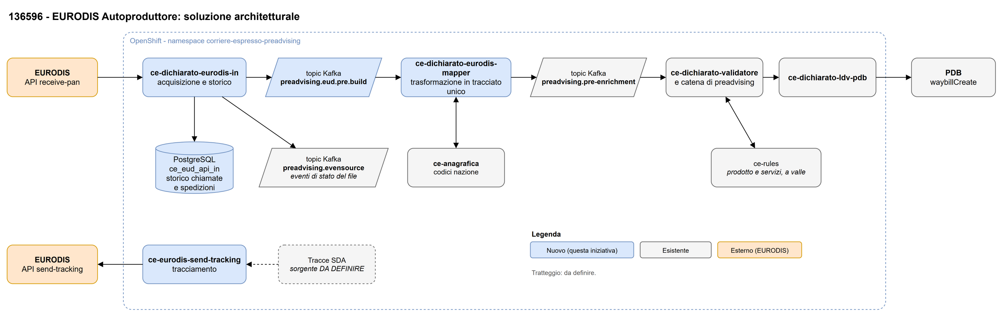
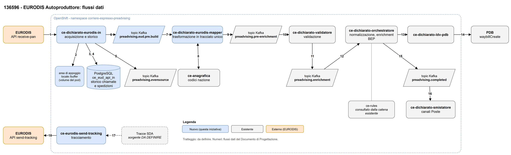

# Architettura Applicativa

L'iniziativa ha lo scopo di prendere in carico le spedizioni del consorzio EURODIS in modalità autoproduttore: la lettera di vettura è assegnata da EURODIS e i dati di spedizione (PAN) vengono prelevati dall'API EURODIS `receive-pan`, invece che dal dichiarato tradizionale. Le spedizioni acquisite vengono convertite nel tracciato unico del preadvising e immesse nella catena di preadvising esistente, che le valida e le crea su PDB; SDA restituisce infine a EURODIS le tracce delle spedizioni prese in carico. Le regole funzionali sono descritte nella Specifica Funzionale dell'iniziativa (allegato SF_136596_Eurodis_autoproduttore).

## Business Architecture – Preadvising EURODIS autoproduttore

| Processo | Fase | Sistema Applicativo (AP) / Applicazione (PK) | Ruolo dell'Applicativo | Impatto Applicativo (S/N) | Applicativo esistente o nuovo |
|---|---|---|---|---|---|
| Preadvising | Acquisizione spedizioni | EURODIS / API `receive-pan` | Piattaforma del partner: espone le spedizioni affidate a SDA | N | Esistente (esterno) |
| Preadvising | Acquisizione e storicizzazione | CE (AP-00988) / `ce-dichiarato-eurodis-in` (PK DA DEFINIRE) | Scarica periodicamente le spedizioni da `receive-pan`, ne salva lo storico su MongoDB e pubblica una spedizione per messaggio sul topic `preadvising.eud.pre.build` | S | Nuovo |
| Preadvising | Trasformazione nel tracciato unico | CE (AP-00988) / `ce-dichiarato-eurodis-mapper` (PK DA DEFINIRE) | Converte la spedizione EURODIS nel tracciato unico (ICD v11) e la pubblica sul topic `preadvising.pre-enrichment` | S | Nuovo |
| Preadvising | Validazione del tracciato unico | CE (AP-00988) / `ce-dichiarato-validatore` (PK DA DEFINIRE) | Consuma il tracciato unico da `preadvising.pre-enrichment` e lo valida come per gli altri canali; deve accettare i valori oltre le dimensioni ICD (vincolo 2 della SF) | DA DEFINIRE | Esistente |
| Preadvising | Arricchimento | F1 (AP DA DEFINIRE) | Fornisce contratto, codice cliente e AUC; componente che lo interroga DA DEFINIRE | N | Esistente |
| Preadvising | Arricchimento | CE (AP-00988) / ce-rules (PK DA DEFINIRE) | Determinazione di prodotto e servizi; componente che lo interroga DA DEFINIRE | N | Esistente |
| Preadvising | Propagazione verso PDB | CE (AP-00988) / `ce-dichiarato-ldv-pdb` (PK DA DEFINIRE) | Converte il tracciato unico nella richiesta PDB e crea la spedizione con `waybillCreate`. Nessuno sviluppo previsto: verifica delle osservazioni della SF, eventuali correzioni a carico del responsabile | N | Esistente |
| Preadvising | Creazione spedizione | PDB (AP DA DEFINIRE) / servizio `waybillCreate` | Crea la spedizione con la LDV assegnata da EURODIS | N | Esistente |
| Preadvising | Ricezione LDV | BEP (AP DA DEFINIRE) | Riceve la LDV dal tracciato unico; da verificare il valore del canale | N | Esistente |
| Tracciamento | Invio tracce al partner | CE (AP-00988) / `ce-eurodis-send-tracking` (PK DA DEFINIRE) | Invia a EURODIS le tracce SDA delle spedizioni prese in carico | S | Nuovo |
| Tracciamento | Ricezione tracce | EURODIS / API `send-tracking` | Piattaforma del partner: riceve gli eventi di tracciamento | N | Esistente (esterno) |

Tabella 1: Business Architecture – Preadvising EURODIS autoproduttore

## Information System Architecture

Il dato nasce sulla piattaforma EURODIS e viene letto da `ce-dichiarato-eurodis-in`, che lo storicizza su MongoDB e lo pubblica, una spedizione per messaggio, sul topic `preadvising.eud.pre.build`. `ce-dichiarato-eurodis-mapper` lo converte nel tracciato unico e lo pubblica su `preadvising.pre-enrichment`, da cui la catena di preadvising esistente lo valida (`ce-dichiarato-validatore`) e lo porta fino a `ce-dichiarato-ldv-pdb` e a PDB. Le tracce SDA tornano a EURODIS tramite `ce-eurodis-send-tracking`.

| Flusso dati | Descrizione |
|---|---|
| Flusso dati 1 | `ce-dichiarato-eurodis-in` invoca periodicamente `GET /shipments/v1` dell'API EURODIS `receive-pan` e riceve le spedizioni nuove non ancora consegnate al partner. Su richiesta da configurazione invoca anche la rilettura puntuale `GET /shipment/{edReference}/v1`. |
| Flusso dati 2 | `ce-dichiarato-eurodis-in` salva su MongoDB (collezione `eurodis_scarichi`) ogni chiamata con esito HTTP, orari e risposta integrale, prima di qualsiasi elaborazione; oltre 10 MB la risposta è salvata su GridFS. |
| Flusso dati 3 | `ce-dichiarato-eurodis-in` scompone la risposta e registra su MongoDB (collezione `eurodis_spedizioni`) un record per spedizione, identificato da `edReference`, con stato di invio e ora di invio. |
| Flusso dati 4 | `ce-dichiarato-eurodis-in` pubblica ogni spedizione, così come ricevuta, sul topic `preadvising.eud.pre.build`, con chiave `edReference` e metadati della presa in carico negli header. |
| Flusso dati 5 | `ce-dichiarato-eurodis-mapper` consuma la spedizione dal topic `preadvising.eud.pre.build`. |
| Flusso dati 6 | `ce-dichiarato-eurodis-mapper` pubblica il tracciato unico (ICD v11) sul topic `preadvising.pre-enrichment`. |
| Flusso dati 7 | `ce-dichiarato-validatore` consuma il tracciato unico dal topic `preadvising.pre-enrichment` e lo valida, come per gli altri canali del preadvising. |
| Flusso dati 8 | Il tracciato validato prosegue nella catena di preadvising esistente fino a `ce-dichiarato-ldv-pdb`. |
| Flusso dati 9 | `ce-dichiarato-ldv-pdb` crea la spedizione su PDB invocando il servizio sincrono `waybillCreate`. |
| Flusso dati 10 | Un componente DA DEFINIRE consulta F1 (contratto, codice cliente, AUC) e ce-rules (prodotto e servizi) per arricchire il tracciato. |
| Flusso dati 11 | `ce-eurodis-send-tracking` acquisisce le tracce SDA delle spedizioni EURODIS da una sorgente DA DEFINIRE. |
| Flusso dati 12 | `ce-eurodis-send-tracking` invia le tracce a EURODIS tramite l'API `send-tracking` (`POST /event/shipment/v1`, `/event/parcel/v1` e le varianti a lotti), con la stessa chiave API del partner. Eventi SDA da trasmettere e loro codifica sono DA DEFINIRE. |

Tabella 2: Information System Architecture – Flussi dati

# Architettura Tecnica

## Application Technical Architecture

I nuovi microservizi seguono lo stack standard dei microservizi `ce-` del preadvising: Java 17 e Spring Boot 3.5.14, deploy su OpenShift con chart Helm e pipeline Jenkins ALM, integrazione via Kafka e persistenza su MongoDB. Frequenze e dimensioni non ancora note sono indicate come stima o `DA DEFINIRE`, in attesa dei volumi da EURODIS.

| Pacchetto Applicativo | Software | Versione | Layer Applicativo | Applicativo nuovo o esistente |
|---|---|---|---|---|
| `ce-dichiarato-eurodis-in` | Microservizio Java 17 / Spring Boot 3.5.14 | 1.0 | Application | Nuovo |
| `ce-dichiarato-eurodis-mapper` | Microservizio Java 17 / Spring Boot 3.5.14 | 1.0 | Application | Nuovo |
| `ce-eurodis-send-tracking` | Microservizio Java 17 / Spring Boot 3.5.14 | 1.0 | Application | Nuovo |
| `preadvising.eud.pre.build` | Topic Kafka | 1.0 | Integration | Nuovo |
| `preadvising.pre-enrichment` | Topic Kafka | Non applicabile | Integration | Esistente (nuovo produttore) |
| `eurodis_scarichi`, `eurodis_spedizioni` (con GridFS e collezione di lock `shedLock`) | MongoDB | Non applicabile | Data | Nuovo (collezioni) |
| `ce-dichiarato-validatore` | Microservizio | DA DEFINIRE | Application | Esistente |
| `ce-dichiarato-ldv-pdb` | Microservizio | DA DEFINIRE | Application | Esistente |
| PDB `waybillCreate` | Servizio applicativo | Non applicabile | Application | Esistente |
| EURODIS `receive-pan` | API REST esterna (Release v1) | v1 | Integration | Esistente (esterno) |
| EURODIS `send-tracking` | API REST esterna (Release v1) | v1 | Integration | Esistente (esterno) |

Tabella 3: Preadvising EURODIS autoproduttore – dettaglio applicativi

| Flusso dati | Protocollo | Origine | Destinazione | Tipologia | Frequenza | Frequenza di picco | Dimensione media dei messaggi | Dimensione massima dei messaggi | Flusso nuovo o esist. |
|---|---|---|---|---|---|---|---|---|---|
| Flusso 1 | https | `ce-dichiarato-eurodis-in` | EURODIS `receive-pan` | Sincrona | Ogni 2 minuti (720 chiamate al giorno); rilettura puntuale su richiesta | Ogni 2 minuti: una sola chiamata per ciclo, nessun nuovo tentativo automatico | DA DEFINIRE | DA DEFINIRE (soglia di guardia del servizio: 100 MB) | Nuovo |
| Flusso 2 | MongoDB | `ce-dichiarato-eurodis-in` | MongoDB `eurodis_scarichi` | Sincrona | Ogni 2 minuti (un documento per chiamata, anche senza spedizioni) | Ogni 2 minuti | DA DEFINIRE | 16 MB per documento; oltre 10 MB su GridFS | Nuovo |
| Flusso 3 | MongoDB | `ce-dichiarato-eurodis-in` | MongoDB `eurodis_spedizioni` | Sincrona | Ogni 2 minuti, 30 secondi dopo lo scarico; un record per spedizione | DA DEFINIRE (volumi) | DA DEFINIRE | DA DEFINIRE | Nuovo |
| Flusso 4 | Kafka | `ce-dichiarato-eurodis-in` | Topic `preadvising.eud.pre.build` | Asincrona | Ogni 2 minuti; un messaggio per spedizione | DA DEFINIRE (volumi) | stima: circa 3 KB (esempio di spedizione EURODIS monocollo) | DA DEFINIRE (limite del topic) | Nuovo |
| Flusso 5 | Kafka | Topic `preadvising.eud.pre.build` | `ce-dichiarato-eurodis-mapper` | Asincrona | A evento | DA DEFINIRE (volumi) | stima: circa 3 KB | DA DEFINIRE | Nuovo |
| Flusso 6 | Kafka | `ce-dichiarato-eurodis-mapper` | Topic `preadvising.pre-enrichment` | Asincrona | A evento, un tracciato per spedizione | DA DEFINIRE (volumi) | stima: 3-4 KB (tracciato unico del flusso `EUD_INVIOFILE`) | DA DEFINIRE | Nuovo |
| Flusso 7 | Kafka | Topic `preadvising.pre-enrichment` | `ce-dichiarato-validatore` | Asincrona | A evento | DA DEFINIRE (volumi) | stima: 3-4 KB | DA DEFINIRE | Esistente |
| Flusso 8 | Kafka | `ce-dichiarato-validatore` | `ce-dichiarato-ldv-pdb`, tramite la catena di preadvising esistente | Asincrona | A evento | DA DEFINIRE (volumi) | DA DEFINIRE | DA DEFINIRE | Esistente |
| Flusso 9 | DA DEFINIRE | `ce-dichiarato-ldv-pdb` | PDB `waybillCreate` | Sincrona | A evento, una chiamata per spedizione | DA DEFINIRE (volumi) | DA DEFINIRE | DA DEFINIRE | Esistente |
| Flusso 10 | DA DEFINIRE | DA DEFINIRE | F1, ce-rules | DA DEFINIRE | DA DEFINIRE | DA DEFINIRE | DA DEFINIRE | DA DEFINIRE | Esistente |
| Flusso 11 | DA DEFINIRE | Sorgente delle tracce SDA (DA DEFINIRE) | `ce-eurodis-send-tracking` | DA DEFINIRE | DA DEFINIRE | DA DEFINIRE | DA DEFINIRE | DA DEFINIRE | Nuovo |
| Flusso 12 | https | `ce-eurodis-send-tracking` | EURODIS `send-tracking` | Sincrona | DA DEFINIRE | DA DEFINIRE | DA DEFINIRE | DA DEFINIRE | Nuovo |

Tabella 4: Preadvising EURODIS autoproduttore – dettaglio flussi

# Scheda HW

L'iniziativa non richiede server dedicati, mainframe, HW periferico né risorse cloud IaaS: i tre nuovi microservizi sono deployati su OpenShift nel namespace esistente `corriere-espresso-preadvising`. La collocazione del cluster (on prem o cloud) è DA DEFINIRE: i dimensionamenti sono riportati nella tabella Openshift on prem e vanno spostati nella tabella Openshift cloud se il cluster è in cloud. In assenza di indicazioni, request, limit e pod sono una proposta minima. Topic `preadvising.eud.pre.build` (partizioni e retention) e collezioni MongoDB (spazio e conservazione) sono su infrastruttura esistente, con dimensionamento DA DEFINIRE sui volumi.

## Risorse on Prem

| (AP/PK) | Ambiente | Server Fisico/Virtuale | Layer | Tipologia | Data Center | Cluster | RAM | Storage | CPU | Core | SO | SW |
|---|---|---|---|---|---|---|---|---|---|---|---|---|
| Non applicabile | Non applicabile | Non applicabile | Non applicabile | Non applicabile | Non applicabile | Non applicabile | Non applicabile | Non applicabile | Non applicabile | Non applicabile | Non applicabile | Non applicabile |

Tabella 5: Risorse on Prem (HW dedicato o Private Cloud)

| Componente | Ambiente | MIPS | Tipologia elaborazione | Capacità di storage | Storage Tape |
|---|---|---|---|---|---|
| Non applicabile | Non applicabile | Non applicabile | Non applicabile | Non applicabile | Non applicabile |

Tabella 6: Mainframe

| Tipologia | Marca | Modello | Caratteristica tecnica 1 | Caratteristica tecnica 2 | Caratteristica tecnica 3 | Caratteristica tecnica 4 |
|---|---|---|---|---|---|---|
| Non applicabile | Non applicabile | Non applicabile | Non applicabile | Non applicabile | Non applicabile | Non applicabile |

Tabella 7: HW Periferico

### Openshift

Namespace esistente `corriere-espresso-preadvising`, condiviso con gli altri microservizi del preadvising. Valori di request, limit e pod: proposta, da confermare con l'infrastruttura.

| (AP/PK) | Ambiente | Nome Cluster | Tipologia cluster | Namespace | Gen | Request Core (millicore) | Request Ram (MB) | Limit Core (core) | Limit Ram (MB) | Pod | BlobStorage (GB) |
|---|---|---|---|---|---|---|---|---|---|---|---|
| AP-00988 / `ce-dichiarato-eurodis-in` (PK DA DEFINIRE) | Sviluppo | DA DEFINIRE (esistente) | DA DEFINIRE | `corriere-espresso-preadvising` (esistente) | DA DEFINIRE | proposta: 250 | proposta: 512 | proposta: 1 | proposta: 1024 | proposta: 1 | Non applicabile |
| AP-00988 / `ce-dichiarato-eurodis-in` (PK DA DEFINIRE) | Collaudo | DA DEFINIRE | DA DEFINIRE | `corriere-espresso-preadvising` (esistente) | DA DEFINIRE | proposta: 250 | proposta: 512 | proposta: 1 | proposta: 1024 | proposta: 1 | Non applicabile |
| AP-00988 / `ce-dichiarato-eurodis-in` (PK DA DEFINIRE) | Produzione | DA DEFINIRE | DA DEFINIRE | `corriere-espresso-preadvising` (esistente) | DA DEFINIRE | proposta: 250 | proposta: 512 | proposta: 1 | proposta: 1024 | proposta: 1 | Non applicabile |
| AP-00988 / `ce-dichiarato-eurodis-mapper` (PK DA DEFINIRE) | Sviluppo | DA DEFINIRE (esistente) | DA DEFINIRE | `corriere-espresso-preadvising` (esistente) | DA DEFINIRE | proposta: 250 | proposta: 512 | proposta: 1 | proposta: 1024 | proposta: 1 | Non applicabile |
| AP-00988 / `ce-dichiarato-eurodis-mapper` (PK DA DEFINIRE) | Collaudo | DA DEFINIRE | DA DEFINIRE | `corriere-espresso-preadvising` (esistente) | DA DEFINIRE | proposta: 250 | proposta: 512 | proposta: 1 | proposta: 1024 | proposta: 1 | Non applicabile |
| AP-00988 / `ce-dichiarato-eurodis-mapper` (PK DA DEFINIRE) | Produzione | DA DEFINIRE | DA DEFINIRE | `corriere-espresso-preadvising` (esistente) | DA DEFINIRE | proposta: 250 | proposta: 512 | proposta: 1 | proposta: 1024 | proposta: 1 | Non applicabile |
| AP-00988 / `ce-eurodis-send-tracking` (PK DA DEFINIRE) | Sviluppo | DA DEFINIRE (esistente) | DA DEFINIRE | `corriere-espresso-preadvising` (esistente) | DA DEFINIRE | proposta: 250 | proposta: 512 | proposta: 1 | proposta: 1024 | proposta: 1 | Non applicabile |
| AP-00988 / `ce-eurodis-send-tracking` (PK DA DEFINIRE) | Collaudo | DA DEFINIRE | DA DEFINIRE | `corriere-espresso-preadvising` (esistente) | DA DEFINIRE | proposta: 250 | proposta: 512 | proposta: 1 | proposta: 1024 | proposta: 1 | Non applicabile |
| AP-00988 / `ce-eurodis-send-tracking` (PK DA DEFINIRE) | Produzione | DA DEFINIRE | DA DEFINIRE | `corriere-espresso-preadvising` (esistente) | DA DEFINIRE | proposta: 250 | proposta: 512 | proposta: 1 | proposta: 1024 | proposta: 1 | Non applicabile |

Tabella 8: Openshift on Prem

N.B. `ce-dichiarato-eurodis-in` esegue lo scarico su una sola istanza alla volta anche con più repliche (lock su MongoDB): il numero di pod in Produzione può essere aumentato per disponibilità senza chiamate concorrenti a EURODIS. Il limit di memoria proposto va verificato sulla dimensione massima delle risposte EURODIS, oggi non nota.

## Risorse Cloud

| (AP/PK) | Ambiente | Risorsa | Tipologia | Cloud Provider | Region | Resource Group | FQDN Front Door | FQDN Backend | RAM | Storage | CPU | Core | SO | SW |
|---|---|---|---|---|---|---|---|---|---|---|---|---|---|---|
| Non applicabile | Non applicabile | Non applicabile | Non applicabile | Non applicabile | Non applicabile | Non applicabile | Non applicabile | Non applicabile | Non applicabile | Non applicabile | Non applicabile | Non applicabile | Non applicabile | Non applicabile |

Tabella 9: Risorse Cloud IaaS

### Openshift

| (AP/PK) | Ambiente | Nome Cluster | Tipologia cluster | Namespace | Gen | Request Core (millicore) | Request Ram (MB) | Limit Core (core) | Limit Ram (MB) | Pod | BlobStorage (GB) |
|---|---|---|---|---|---|---|---|---|---|---|---|
| DA DEFINIRE: da compilare con i valori della Tabella 8 se il cluster è in cloud | Non applicabile | Non applicabile | Non applicabile | Non applicabile | Non applicabile | Non applicabile | Non applicabile | Non applicabile | Non applicabile | Non applicabile | Non applicabile |

Tabella 10: Openshift Cloud

# Allegati

| Codice Documento | Nome |
|---|---|
| SF_136596_Eurodis_autoproduttore | Specifica Funzionale dell'iniziativa 136596 - EURODIS Autoproduttore, versione 0.2 |
| ICD_PREADVISING_LDV_EVENT_SOURCE_v11 | ICD v11 del tracciato unico preadvising, con il mapping EURODIS |
| eurodis-receive-pan-swagger-v1 | Specifica OpenAPI dell'API EURODIS `receive-pan`, Release v1 |
| eurodis-send-tracking-swagger-v1 | Specifica OpenAPI dell'API EURODIS `send-tracking`, Release v1 |
| fig-1-architettura | Schema drawio della soluzione: pagina "Architettura" (Figura 1) e pagina "Flussi dati" (Figura 2) |
