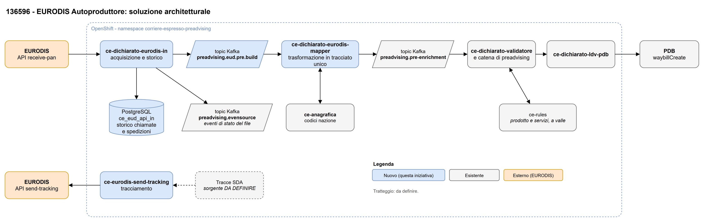

# Introduzione

## Scopo

Il presente documento contiene l'analisi degli impatti funzionali relativi all'Iniziativa "136596 - EURODIS Autoproduttore".

## Definizione, Acronimi e Abbreviazioni

| Sigla | Significato esteso |
|---|---|
| ADR | Accordo europeo sul trasporto internazionale di merci pericolose su strada |
| API | Application Programming Interface |
| APT | Codice del servizio accessorio nel formato PDB (es. `APT000918`) |
| BEP | Sistema SDA di gestione delle lettere di vettura |
| CLS | Central Label Service, servizio EURODIS di assegnazione dei barcode del partner di consegna |
| CE | Corriere Espresso |
| F1 | Anagrafica commerciale (contratto, codice cliente, AUC) |
| HTTP | HyperText Transfer Protocol |
| ICD | Interface Control Document |
| ISO2 / ISO3 / ISO4 | Codifica del paese a due, tre e quattro caratteri; la codifica a quattro caratteri è quella attesa da PDB |
| JSON | JavaScript Object Notation |
| LDV | Lettera Di Vettura |
| ms | Microservizio |
| PAN | Dati di spedizione che EURODIS trasmette al partner tramite l'API `receive-pan` |
| PDB | Poste Delivery Business |
| PDS | Codice di postazione associato al contratto per canale di prenotazione (`pds_code`), usato come seme delle LDV |
| PUDO | Pick Up Drop Off, punto di ritiro |
| UUID | Universally Unique Identifier |

## Riferimenti

| Id. Documento | Tipo di Documento | Titolo Documento | Allegato |
|---|---|---|---|
| 1 | Specifica | Specifica dei servizi accessori nei flussi PDB (FlussiPreadvisingInfo.csv) | non disponibile |
| 2 | Riscontro | Riscontro SDA sul perimetro dei servizi EURODIS del 11/09/2026 (flusso via file) | non disponibile |
| 3 | Mapping | Mapping dal tracciato unico alla richiesta LDV verso BEP (mapping-tracciatoDTO-bep.md) | non disponibile |
| 4 | SF | SF_138972(PRJ0042827) Reply v1.0, processo di preadvising | non disponibile |
| 5 | SF | SF_138972(PRJ0042827) PRJTASK0609165 SI, gestione unificata preadvising clienti | non disponibile |
| 6 | Riscontro | Risposte EURODIS sul comportamento dell'API `receive-pan` del 10/11/2026 | Allegato 5 |
| 7 | Analisi | 127558_EURODIS_Analisi_Mapping_ImportPAN_BEP_v1_7, con la minuta di riunione del 29/07/2026 (nazione `ITA1` del mittente) | cartella SharePoint EURODIS, PRJ0039590-127558-EURODIS Inbound (SD-1)-ImportPanBEP |
| 8 | ICD | ICD Mediation BEP v2.5 (codici LDV del canale INVIOSYSTEM staccati da range prestabiliti) | non disponibile |

## Vincoli, Assunzioni, Esclusioni ed Open Point

| Id | Tipo | Descrizione | Riferimento |
|---|---|---|---|
| 1 | Vincolo | L'API `receive-pan` restituisce solo le spedizioni non ancora consegnate al partner, non prevede conferma di ricezione (ack), filtri o paginazione, e non offre un canale per rifiutare una spedizione. | Acquisizione; EURODIS |
| 2 | Vincolo | La validazione a valle deve accettare i valori che eccedono le dimensioni dichiarate nell'ICD, che non vengono troncati: `id_preadvising` (UUID, 36 caratteri contro 15), `data_spedizione` (10 contro 8), `id_ldv_associata` (24 contro 3), oltre a email, SMS, civico, nome del contatto, note e codice TARIC. | Trasformazione; responsabile `ce-dichiarato-validatore` |
| 3 | Vincolo | EURODIS considera consegnata una spedizione nel momento in cui la restituisce e non la ripropone nelle chiamate successive. Se la risposta va persa, SDA può chiedere a EURODIS di reinserire tutti i dati nella richiesta successiva, oppure recuperare le singole spedizioni con la rilettura puntuale per `edReference`. Confermato da EURODIS il 10/11/2026 (documento di riferimento ID 6). | Acquisizione; EURODIS |
| 4 | Assunzione | La rilettura puntuale (`GET /shipment/{edReference}/v1`) restituisce una spedizione già consegnata per 60 giorni (EURODIS, 10/11/2026); si assume che non abbia effetti collaterali. | Recupero delle spedizioni; EURODIS |
| 5 | Assunzione | Il destinatario è sempre in Italia ed è sempre presente in `consigneeAddress` (confermato da Poste il 10/11/2026; `returnAddress` è l'indirizzo di rientro, non di consegna); il mittente può essere estero. Le spedizioni sono trattate come nazionali e i dati internazionali richiesti da BEP non sono necessari. | Trasformazione; SDA |
| 6 | Esclusione | Spedizioni di tipo pickup (P), che transitano via FTP e non dall'API; Locker, Uffici Postali, Time Definite ore 9, reverse a domicilio e abbandono. Perimetro definito per il flusso via file (documento di riferimento ID 2), da confermare per l'API. | Servizi accessori; SDA, EURODIS |
| 7 | Chiuso | Modello di consegna di `receive-pan` e recupero in caso di errore fra la risposta e il salvataggio: confermati da EURODIS il 10/11/2026 (vincolo 3). Resta da concordare con EURODIS la modalità di richiesta del reinserimento dei dati. | Acquisizione; EURODIS (Chiapponi) |
| 8 | Chiuso | Contenuto della prima chiamata: solo le spedizioni non ancora ricevute, senza arretrato storico (EURODIS, 10/11/2026). | Acquisizione; EURODIS |
| 9 | Chiuso | Comportamento dell'API (EURODIS, 10/11/2026): modifiche e annullamenti sono possibili solo prima dell'attivazione e non arrivano a SDA; nessun limite di spedizioni per risposta né paginazione; fuso orario dei timestamp uguale a quello dello scambio file via FTP; la chiave API non ruota. EURODIS consiglia una chiamata ogni 15-20 minuti: in produzione lo scarico è ogni 10 minuti. | Acquisizione; EURODIS |
| 10 | Open Point | Restituzione a EURODIS di un esito negativo (spedizione non valida o non lavorabile). Si propone di valutare l'invio di un evento di eccezione tramite l'API di tracking. | Tracciamento; EURODIS (Chiapponi) |
| 11 | Open Point | Chiave API di produzione e payload di esempio di produzione, con i dati sensibili oscurati. | Acquisizione; EURODIS (Chiapponi) |
| 12 | Open Point | Volumi attesi (spedizioni per giorno e per chiamata). EURODIS non indica limiti e li ritiene sostenibili con una chiamata ogni 15-20 minuti. | Acquisizione; EURODIS (Chiapponi) |
| 13 | Open Point | Avvio graduale: perimetro di ogni fase (per mittente, ufficio o volume) e chi lo applica (EURODIS tramite chiave API, o SDA). Un filtro lato SDA non è possibile senza perdita, perché le spedizioni lette risultano già consegnate. | Acquisizione; EURODIS (Chiapponi) |
| 14 | Open Point | LDV del collo: conferma che l'API valorizzi `deliveryPartnerBarcode`, il numero di LDV PDB Express del collo (campo dello schema non referenziato dagli endpoint, compilato solo con il servizio CLS), secondo la regola del vincolo 37; valorizzazione di LDV madre, figlia e `collo.id_collo` nel multicollo (il collo figlio PDB ha 22 caratteri: 9 del figlio e 13 della madre). Deciso: `europlateBarcode` vuoto o `0` è assente; con più colli si usa il primo valorizzato. | Trasformazione; EURODIS (Chiapponi), SDA |
| 15 | Open Point | Conferma della traduzione proposta dei servizi accessori EURODIS nei codici PDB, e trattamento dei valori non coperti (`D`, `7`, `T`; `W` come appuntamento) o fuori perimetro (`A`, Locker, assicurazione, tipo P): servizio, spedizione ordinaria o scarto. | Servizi accessori; EURODIS (Chiapponi), SDA |
| 16 | Open Point | Punto Poste: sorgente del nome del punto, obbligatorio per PDB e non garantito da EURODIS, e comportamento se assente. | Servizi accessori; EURODIS (Chiapponi) |
| 17 | Open Point | Contrassegno: formato e valuta dell'importo e codifica del tipo di incasso (3 → `CON`, 5 → `ABM`). | Servizi accessori; EURODIS (Chiapponi) |
| 18 | Esclusione | Spedizioni con merci pericolose (ADR): non sono gestite da SDA (confermato da EURODIS, 12/11/2026). I dati `hazardousADRServices` e `hazardousCollis` non vengono trasformati. | Trasformazione; EURODIS (Chiapponi) |
| 19 | Open Point | Tracciamento verso EURODIS: disponibilità del nome di chi ritira, richiesto da EURODIS per la consegna (codice `1100`); conferma che il topic `PACCHI.TRACKING` porti in produzione tutti gli stati SDA delle spedizioni EURODIS. Deciso: API `send-tracking`, codifica degli stati secondo il foglio "Decodifica Eurodis IN-BOUND" (allegato 6), sorgente `PACCHI.TRACKING`, invio a evento. | Tracciamento; SDA, team ACN |
| 20 | Open Point | Codice PRJ dell'iniziativa: DA DEFINIRE. | Introduzione; Poste |
| 21 | Open Point | Durata di conservazione dello storico delle chiamate e delle spedizioni: DA DEFINIRE. Si propongono 30 giorni per le chiamate senza spedizioni e 180 giorni per le altre. | Acquisizione; Poste |
| 22 | Open Point | Conferma che in produzione EURODIS generi le LDV secondo la regola del vincolo 37 (prefisso secondo il contrassegno, seme `pds_code` INVIOSYSTEM del contratto) e con quale criterio di univocità della numerazione. | Trasformazione; SDA (Marzilli), EURODIS |
| 23 | Chiuso | Valore del `canale`: confermato `EUD_INVIOSYSTEM`, coerente con il mapping verso BEP che trasmette `collo.id_ldv` solo per il canale INVIOSYSTEM. Verso BEP il canale è trasmesso come `INVIOSYSTEM`, riconosciuto da BEP (verifica in sviluppo del 18/11/2026); dal canale dipende anche il criterio della verifica di duplicato. | Trasformazione; SDA |
| 24 | Open Point | Valorizzazione di `id_canale`: DA DEFINIRE. Deciso: `id_file` è l'identificativo del file fittizio della chiamata, `id_partner` vale `EURODIS`. | Trasformazione; SDA |
| 25 | Open Point | Data di spedizione: si usa `entranceTimestamp`, facoltativo nell'API; se manca si propone `clearanceTimestamp`. In verifica con EURODIS se il campo arriva sempre in produzione. | Trasformazione; SDA, EURODIS |
| 26 | Chiuso | Codice nazione: l'ISO2 EURODIS va in `nazione` e `codice_nazione_iso_2`; ISO3 e ISO4 (`codice_nazione`, `codice_nazione_poste`) sono ricavati dal servizio `ce-anagrafica`, come nella catena esistente. | Trasformazione; SDA |
| 27 | Open Point | Assicurazione: si propone di considerarla fuori perimetro e di non valorizzarla anche se EURODIS invia il valore della merce. | Servizi accessori; SDA |
| 28 | Open Point | Reso (rientro al mittente): necessità del servizio `APT000930` e semantica dei valori; riconoscimento di resi e rettifiche. | Servizi accessori; SDA |
| 29 | Open Point | Preavviso: si propone di non mappare i flag di preavviso EURODIS, perché SDA notifica il destinatario in presenza dei contatti. Il preavviso telefonico non ha un campo nell'ICD. | Trasformazione; SDA |
| 30 | Open Point | Dati del cliente EURODIS in produzione: contratto, centro di costo, identificativo, ragione sociale, partita IVA e codice fiscale del cliente sono ricavati dalla postazione del seme LDV; codice login, codice AUC e i valori di riserva sono gli stessi del flusso EURODIS via file (canale `EUD_INVIOFILE`): da confermare che valgano anche per il flusso via API in produzione. Negli eventi di stato del file la ragione sociale è `EURODIS GmbH`; partita IVA e nominativo, non configurati, sono omessi. | Trasformazione; Poste |
| 31 | Open Point | Campi EURODIS senza corrispondenza nell'ICD o con semantica diversa: secondo numero di telefono, `region` (testo libero) contro `provincia` (sigla), valore della merce in valuta diversa da EUR. | Trasformazione; SDA |
| 32 | Open Point | Osservazioni su `ce-dichiarato-ldv-pdb`, oggi in test: canale (`POU` o `WEBSERVICE`), nome del Punto Poste omesso se vuoto, contrassegno con importo 0 non scartato. È in preparazione una correzione per i canali `EUD_*` e per la LDV autoproduttore. | Propagazione verso PDB; responsabile `ce-dichiarato-ldv-pdb` |
| 33 | Chiuso | Arricchimento: il ms di trasformazione non consulta F1; i dati del cliente sono ricavati dalla postazione del seme LDV tramite `ce-vendite`, con la configurazione come riserva (Open Point 30); il prodotto è determinato a valle. | Trasformazione; team ACN |
| 34 | Open Point | Coda di scarto per i messaggi non trasformabili: creazione del topic dedicato DA DEFINIRE. Deciso: i messaggi non trasformabili non vengono pubblicati e restano visibili con il motivo. | Trasformazione; team ACN |
| 35 | Chiuso | Sorgente delle tracce SDA: topic Kafka `PACCHI.TRACKING`, con il filtro delle spedizioni EURODIS descritto in "Tracciamento verso EURODIS". | Tracciamento; team ACN |
| 36 | Open Point | Dati di dogana (`customsService`) e spedizioni ricevute con dati ADR nonostante l'esclusione 18. Si propone di non trasformare i dati di dogana, perché valorizzare la sezione internazionale del tracciato farebbe trattare la spedizione come internazionale. Una spedizione con dati ADR oggi prosegue come spedizione ordinaria, senza i dati ADR: da confermare se va invece scartata o segnalata. | Trasformazione; SDA, EURODIS (Chiapponi) |
| 37 | Vincolo | La LDV del collo è una LDV PDB di 13 caratteri: prefisso `4U` se la spedizione ha il contrassegno, `3U` se non lo ha (indicazione di Poste del 18/11/2026), seguito dal seme di 5 caratteri e da 6 cifre. Il seme è il `pds_code` del contratto EURODIS per il canale di prenotazione INVIOSYSTEM (documento di riferimento ID 8); un seme di postazione o un prefisso diverso sono rifiutati da BEP con l'errore 131 "Barcode non utilizzabile". Verificato in sviluppo con prefisso `4U` e contrassegno; il caso `3U` è da verificare. | Trasformazione; SDA |
| 38 | Vincolo | Verso BEP la nazione del mittente è `ITA1` costante anche per i mittenti esteri, perché il prodotto è nazionale e il contratto EURODIS non ha nazioni estere abilitate (documento di riferimento ID 7); una nazione estera è rifiutata da BEP con l'errore 101. Vale anche per il flusso `EUD_INVIOFILE`. | Propagazione verso PDB; SDA |
| 39 | Open Point | Componente in cui si applica la nazione `ITA1` del mittente (vincolo 38): nella creazione su PDB, solo per i canali `EUD_*`, conservando la nazione reale nel tracciato unico, oppure nella trasformazione; valori della descrizione della nazione (`Italia`) e della provincia del mittente estero (`EE`, da confermare con BEP). | Propagazione verso PDB; SDA, responsabile `ce-dichiarato-ldv-pdb` |

# Obiettivo dell'iniziativa

EURODIS è un consorzio di corrieri europei che affida a SDA spedizioni da consegnare in Italia. Già oggi esiste un flusso EURODIS in cui la lettera di vettura è prodotta da SDA (canale `EUD_INVIOFILE`). Con questa iniziativa EURODIS diventa autoproduttore del dato di spedizione: la LDV arriva già assegnata da EURODIS e i dati delle spedizioni (PAN) vengono prelevati direttamente dalla piattaforma EURODIS, tramite l'API `receive-pan`, invece che dal dichiarato tradizionale.

La presa in carico deve avvenire senza perdita di spedizioni, nonostante l'API non preveda una conferma di ricezione, e deve inserirsi nel processo di preadvising esistente tramite il tracciato unico, in modo che le spedizioni seguano la stessa catena di validazione e di creazione su PDB. SDA deve inoltre restituire a EURODIS le tracce delle spedizioni ricevute.

Gli obiettivi sono:

- acquisire le spedizioni EURODIS dall'API `receive-pan`, conservandone lo storico integrale;
- trasformare ogni spedizione nel tracciato unico del preadvising (ICD v11), con la LDV fornita da EURODIS e i servizi accessori nel formato atteso da PDB;
- pubblicare il tracciato unico verso la catena di preadvising esistente;
- inviare a EURODIS le tracce SDA delle spedizioni prese in carico.

# Soluzione

La soluzione descritta di seguito tratta i seguenti temi:

- acquisizione delle spedizioni dall'API EURODIS;
- trasformazione delle spedizioni nel tracciato unico;
- propagazione verso PDB tramite la catena esistente;
- tracciamento verso EURODIS.

La soluzione è riportata nella figura successiva e nell'allegato 4.



La figura mostra la sequenza: l'API EURODIS `receive-pan` è interrogata dal ms `ce-dichiarato-eurodis-in`, che salva lo storico su PostgreSQL, pubblica gli eventi di stato della presa in carico sul topic `preadvising.evensource` e una spedizione per messaggio sul topic Kafka `preadvising.eud.pre.build`; il ms `ce-dichiarato-eurodis-mapper` consuma il topic, trasforma la spedizione nel tracciato unico, ricavando i codici nazione dal servizio `ce-anagrafica`, e la pubblica sul topic `preadvising.pre-enrichment`; da qui la catena di preadvising, adeguata al nuovo canale `EUD_INVIOSYSTEM`, valida il tracciato (ms `ce-dichiarato-validatore`), lo normalizza e lo arricchisce (ms `ce-dichiarato-orchestratore`), crea la spedizione su PDB tramite il ms `ce-dichiarato-ldv-pdb` e smista il tracciato completato (ms `ce-dichiarato-smistatore`). Il ms `ce-eurodis-send-tracking` invia le tracce SDA a EURODIS.

Di seguito sono descritti funzionalmente i processi che compongono la soluzione.

## Acquisizione delle spedizioni da EURODIS

Questa fase è responsabile di prelevare le spedizioni che EURODIS affida a SDA e di consegnarle, una per messaggio, alla fase di trasformazione. Il suo obiettivo principale è non perdere nessuna spedizione: poiché l'API `receive-pan` considera consegnata una spedizione nel momento in cui la restituisce (vincolo 3), la risposta viene salvata integralmente prima di qualsiasi altra elaborazione.

In questa fase le spedizioni non vengono validate né interpretate: dell'intera spedizione si legge solo l'identificativo EURODIS `edReference`, mentre il contenuto viene conservato e inoltrato così come è stato ricevuto. Validazione e trasformazione sono a carico delle fasi successive.

### Scarico dall'API `receive-pan`

Il microservizio invoca periodicamente il servizio EURODIS `GET /shipments/v1`, autenticandosi con la chiave API assegnata al partner SDA (header `X-API-Key`). Il servizio restituisce tutte le spedizioni nuove non ancora consegnate al partner. La chiamata non viene mai ripetuta automaticamente: un nuovo tentativo potrebbe restituire una risposta diversa e far perdere le spedizioni della prima. Lo scarico è eseguito da una sola istanza del microservizio alla volta, anche in presenza di più repliche, ogni 10 minuti in produzione (EURODIS consiglia 15-20 minuti) e ogni 2 minuti negli ambienti di sviluppo e collaudo.

| Passo | Descrizione |
|---|---|
| 1 | Il ms `ce-dichiarato-eurodis-in` registra l'avvio dello scarico nello storico. |
| 2 | Il ms invoca `GET /shipments/v1` dell'API `receive-pan`. |
| 3 | Con esito `404` (nessuna spedizione nuova) lo scarico si chiude regolarmente, senza errori. |
| 4 | Con esito `200` il ms scrive la risposta integrale, così come ricevuta, in un'area di appoggio locale, la salva nello storico e cancella la copia locale. |
| 5 | Con esito di errore o in assenza di risposta, lo scarico si chiude in errore con il relativo esito (vedi "Comportamento in caso di errore"). |

Se lo storico non è disponibile, la risposta resta nell'area di appoggio locale: un processo di recupero la salva nello storico appena possibile e solo dopo la cancella, senza richiedere nulla a EURODIS. L'area di appoggio contiene dati personali e conserva la risposta solo fino al salvataggio.

N.B. Lo scarico è rilasciato disattivato e viene attivato per ambiente, per consentire un avvio graduale (Open Point 13).

### Storicizzazione e scomposizione

Lo storico è un database PostgreSQL dedicato e conserva, per ogni chiamata a EURODIS, l'esito, gli orari e la risposta integrale; per ogni spedizione, un record identificato da `edReference` con il testo della singola spedizione, la provenienza (chiamata e posizione nella risposta), lo stato di invio e il numero di ricezioni. La durata di conservazione dello storico è DA DEFINIRE (Open Point 21).

Le risposte salvate vengono poi elaborate in un passo distinto, così che un problema nella pubblicazione non comprometta il salvataggio.

| Passo | Descrizione |
|---|---|
| 1 | Il ms legge dallo storico le risposte da elaborare, in ordine di arrivo. |
| 2 | Il ms divide la risposta nelle singole spedizioni, ciascuna identica al testo ricevuto. |
| 3 | Se la risposta contiene almeno una spedizione, il ms la tratta come un file: le assegna un identificativo (`idFile`) e un nome (`SCARICO_EURODIS_<data e ora>`), registra il file fittizio nell'archivio dei file del preadvising (collection MongoDB `preadvising_file`, come `ce-dichiarato-builder` per i file caricati) e pubblica sul topic `preadvising.evensource` gli eventi di stato `FILE_PRESO_IN_CARICO` (`ST_F0002`) e `FILE_IN_ELABORAZIONE` (`ST_F0005`). |
| 4 | Per ogni spedizione il ms legge `edReference` e lo normalizza a numero intero senza decimali (es. `1000000000001.0` diventa `1000000000001`). |
| 5 | Il ms registra la spedizione nello storico con stato `DA_INVIARE` e la pubblica sul topic `preadvising.eud.pre.build`. |
| 6 | Ricevuta la conferma dal broker, il ms porta la spedizione in stato `INVIATA` con l'ora di invio. |
| 7 | Il ms registra l'esito complessivo dello scarico. |

Gli eventi di stato hanno lo stesso formato dei flussi a file del preadvising e permettono di seguire la presa in carico dal monitoraggio, che ammette il canale `EUD_INVIOSYSTEM`; ogni evento è inviato una sola volta per risposta, e se non può essere inviato le spedizioni della risposta non vengono pubblicate fino al ciclo successivo. Negli eventi e nel file fittizio il cliente è indicato con il codice login e la ragione sociale `EURODIS GmbH`; i dati del cliente non configurati sono omessi.

La chiusura del file fittizio segue quella dei file del preadvising: quando tutte le spedizioni del file risultano elaborate, con esito positivo o negativo, il ms `ce-dichiarato-state-machine-handler` invia l'evento di stato finale del file. Un file con sole spedizioni non identificabili resta aperto e viene chiuso dal processo esistente di chiusura dei file non completati.

Una spedizione già ricevuta che EURODIS restituisce di nuovo viene registrata sullo stesso record e inoltrata nuovamente: la verifica di duplicato è svolta dalla validazione a valle (sezione "Propagazione verso PDB"). Una spedizione priva di `edReference` valido non viene scartata in silenzio: resta nello storico con il motivo e non viene inoltrata.

### Pubblicazione delle spedizioni

Ogni spedizione viene pubblicata in un messaggio dedicato, mai in un unico messaggio con l'intera risposta. Il messaggio ha:

- chiave: `edReference` normalizzato, in modo che tutte le versioni della stessa spedizione siano lette in ordine;
- corpo: la spedizione EURODIS (elemento `GetShipmentResponse2` dell'API) così come ricevuta, senza trasformazioni;
- intestazioni: i metadati della presa in carico, descritti nella tabella seguente.

| Intestazione | Descrizione |
|---|---|
| `edReference` | Identificativo EURODIS della spedizione, uguale alla chiave |
| `idEsecuzione` | Identificativo della chiamata a EURODIS nello storico |
| `idFile` | Identificativo del file della chiamata, uguale a quello degli eventi di stato; diventa `id_file` del tracciato unico |
| `ricevutoIl` | Istante di ricezione da EURODIS |
| `fonte` | `receive-pan/shipments/v1` per lo scarico, `receive-pan/shipment/v1` per la rilettura puntuale |
| `rifGrezzo` | Riferimento alla risposta integrale nello storico |
| `ambiente` | `TEST` o `PROD` |
| `schemaVersion` | Versione del contratto del messaggio |
| `traceparent` | Contesto di tracciamento della richiesta |

#### Schema del messaggio

Esempio con valori fittizi; il corpo è abbreviato.

```
Topic:  preadvising.eud.pre.build
Chiave: 1000000000001
Intestazioni:
  edReference:  1000000000001
  idEsecuzione: 00000000-0000-0000-0000-000000000001
  idFile:       00000000-0000-0000-0000-0000000000f1
  ricevutoIl:   2026-11-04T09:00:02.000Z
  fonte:        receive-pan/shipments/v1
  rifGrezzo:    eurodis_scarichi/00000000-0000-0000-0000-000000000001
  ambiente:     TEST
  schemaVersion: 1
Corpo:
{
  "edReference": 1000000000001.0,
  "dispatchPartnersDomesticShipmentNumber": "PARTNER-0001",
  "entranceTimestamp": "2026-11-04T08:30:00",
  "numberOfHandlingUnits": 1,
  "consigneeAddress": { "companyName": "DESTINATARIO DI PROVA", "city": "ROMA", "zipcode": "00100", "countryCode": "IT", ... },
  "shipperAddress":   { "companyName": "MITTENTE DI PROVA", "countryCode": "AT", ... },
  "deliveryService":  { "deliveryService": "6", ... },
  "consigneePreAdvice": { "smsPreAdvice": false, "eMailPreAdvice": true, "telephonePreAdvice": false },
  "collis": [ { "europlateBarcode": "000000000000000000000001", "deliveryPartnerBarcode": "LDV0000000001", "weightOfUnit": 2.5, ... } ]
}
```

#### Esiti dello scarico e stati della spedizione

| Esito/Stato | Descrizione |
|---|---|
| Nessuna spedizione | EURODIS non ha spedizioni nuove: esito regolare |
| Spedizioni acquisite | Risposta salvata e tutte le spedizioni pubblicate |
| Acquisizione parziale | Risposta salvata, ma alcune spedizioni non sono ancora pubblicate o non sono identificabili |
| Chiamata in errore | EURODIS ha risposto con un errore o non ha risposto; se la risposta è andata persa dopo l'invio da parte di EURODIS, le spedizioni contenute vanno recuperate (vincolo 3) |

Tabella 1: Esiti dello scarico

| Esito/Stato | Descrizione |
|---|---|
| `DA_INVIARE` | Spedizione salvata, pubblicazione non ancora confermata. Torna in questo stato anche quando EURODIS la restituisce di nuovo |
| `INVIATA` | Pubblicazione confermata dal broker, con l'ora di invio |
| `ERRORE_INVIO` | Pubblicazione non riuscita dopo i tentativi automatici; si sblocca con il reinvio manuale |
| `NON_IDENTIFICABILE` | Spedizione senza `edReference` valido: conservata con il motivo, non pubblicata |

Tabella 2: Stati della spedizione

### Comportamento in caso di errore e recupero

| Esito/Stato | Descrizione |
|---|---|
| Chiave non valida (`401`) | Scarico in errore; nessuna spedizione persa. Si verifica la chiave con EURODIS |
| Partner non determinabile o senza accesso (`424`, `451`) | Scarico in errore; si verifica la configurazione del partner presso EURODIS |
| Errore generico EURODIS (`500`) | Scarico in errore, senza ripetizione; si riprova allo scarico successivo |
| Nessuna risposta (timeout, connessione caduta, interruzione del servizio durante la chiamata) | Scarico in errore con rischio di perdita: si chiede a EURODIS di reinserire i dati nella richiesta successiva, oppure gli `edReference` del periodo per la rilettura puntuale |
| Storico non disponibile al salvataggio della risposta | La risposta resta nell'area di appoggio locale e viene salvata automaticamente appena lo storico torna disponibile |
| Area di appoggio locale non disponibile | Gli `edReference` contenuti nella risposta vengono registrati nel log applicativo, per il recupero con la rilettura puntuale o con il reinserimento da parte di EURODIS |
| Interruzione durante la pubblicazione | L'elaborazione della risposta viene ripresa automaticamente; le spedizioni già pubblicate possono essere ripubblicate |
| Broker Kafka non disponibile | Le spedizioni restano `DA_INVIARE` e vengono ripubblicate automaticamente; esauriti i tentativi passano in `ERRORE_INVIO` |
| Topic degli eventi di stato non disponibile | Le spedizioni della risposta non vengono pubblicate; l'elaborazione riprende al ciclo successivo, senza ripetere gli eventi già inviati |
| Risposta non in formato JSON | La risposta resta nello storico per l'analisi |
| Spedizione senza `edReference` valido | La spedizione resta `NON_IDENTIFICABILE`; le altre della stessa risposta proseguono |

Tabella 3: Comportamento in caso di errore

Sono inoltre previste due operazioni di recupero, attivate tramite la configurazione del microservizio e senza servizi esposti:

- rilettura puntuale: per un elenco di `edReference`, il microservizio invoca `GET /shipment/{edReference}/v1` e tratta la risposta come uno scarico ordinario, con `fonte` di rilettura;
- reinvio: per un elenco di `edReference`, il microservizio ripubblica la spedizione salvata nello storico, senza invocare EURODIS.

Per le spedizioni perse in una chiamata non andata a buon fine le strade sono due: chiedere a EURODIS di reinserire tutti i dati nella richiesta successiva, oppure la rilettura puntuale, possibile per 60 giorni e solo conoscendo gli `edReference` del periodo interessato (vincolo 3, assunzione 4).

Ulteriori dettagli: per l'implementazione delle funzionalità sopra descritte viene realizzato un nuovo microservizio, denominato `ce-dichiarato-eurodis-in`, all'interno del namespace OpenShift `corriere-espresso-preadvising`. Il microservizio invoca l'API EURODIS `receive-pan` (allegato 2), salva lo storico sul database PostgreSQL `ce_eud_api_in`, registra il file fittizio nella collection MongoDB `preadvising_file` del preadvising, pubblica le spedizioni sul topic Kafka `preadvising.eud.pre.build` e gli eventi di stato sul topic `preadvising.evensource`. Non legge alcun topic.

## Trasformazione nel tracciato unico

Questa fase converte ogni spedizione EURODIS nel tracciato unico del preadvising (ICD v11, allegato 1) e la pubblica verso la catena esistente. Il flusso di riferimento è quello EURODIS già in esercizio (canale `EUD_INVIOFILE`, allegato 3): il flusso autoproduttore se ne discosta principalmente perché la LDV arriva già assegnata da EURODIS.

Il mapping campo per campo, con la categoria di ogni campo (diretto, trasformato, costante, generato, da configurazione, da `ce-anagrafica`, da ce-rules, a valle, non applicabile), è riportato nell'allegato 1. Di seguito le regole funzionali principali.

| Passo | Descrizione |
|---|---|
| 1 | Il ms `ce-dichiarato-eurodis-mapper` legge la spedizione dal topic `preadvising.eud.pre.build`, con le intestazioni della presa in carico. |
| 2 | Il ms converte la spedizione nel tracciato unico secondo le regole di questo paragrafo e dell'allegato 1. |
| 3 | Il ms pubblica il tracciato unico sul topic `preadvising.pre-enrichment`. |

### Regole generali di trasformazione

- Le convenzioni del flusso `EUD_INVIOFILE` vengono replicate: stringhe assenti valorizzate con `""`, importi assenti con `0`, date nel formato `yyyy-MM-dd`, peso del collo in grammi.
- I valori EURODIS più lunghi del limite ICD vengono passati interi, senza troncamento (vincolo 2); l'adeguamento ai limiti di BEP è svolto dalla validazione a valle.
- Il tracciato è contrassegnato come autoproduttore (`flag_autoproduttore` = `"S"`), con `versione_tracciato` = `1`. Poiché ogni messaggio contiene una sola spedizione, `progressivo` vale `1`.
- Mittente e destinatario sono riportati dagli indirizzi EURODIS (`shipperAddress`, `consigneeAddress`); il cellulare deriva dal contatto SMS. Il destinatario è obbligatorio: una spedizione senza `consigneeAddress`, o senza CAP o località, non viene trasformata (vedi "Messaggi non trasformabili"). `returnAddress` non è mai usato come destinatario.
- Data e ora di spedizione derivano da `entranceTimestamp`; se manca si usa `clearanceTimestamp` (Open Point 25).
- Il codice paese EURODIS (ISO2) è riportato in `nazione` e `codice_nazione_iso_2`; ISO3 e ISO4 (`codice_nazione`, `codice_nazione_poste`) sono ricavati dal servizio `ce-anagrafica`, come nella catena esistente. Le risposte di `ce-anagrafica` sono riutilizzate per lo stesso codice paese per un periodo limitato. Se `ce-anagrafica` non risponde il tracciato viene pubblicato comunque: per l'Italia con le codifiche italiane (`ITA`, `ITA1`), per gli altri paesi con il solo ISO2. In quest'ultimo caso la validazione a valle rifiuta il mittente estero per codice nazione mancante. Verso BEP la nazione del mittente è comunque `ITA1` (vincolo 38, Open Point 39).
- La consegna senza firma deriva dal tipo di consegna EURODIS (`deliveryType` `S` → `no_firma` `"N"`, `N` → `"S"`).
- Le note di consegna sono la concatenazione delle note del destinatario e del mittente.
- Sono costanti: `flag_stampa_ldv` = `"N"`, `flag_attivazione_ritiro` = `"N"`, `internazionale.vettore` = `"EURODIS"`.
- Il valore del `canale` è `EUD_INVIOSYSTEM` (confermato; Open Point 23).

### Identificativi e lettera di vettura

| Campo ICD | Valorizzazione |
|---|---|
| `id_preadvising` | UUID generato dal microservizio per ogni tracciato |
| `spedizione.rif_spedizione` | `edReference`, come stringa senza decimali |
| `collo.id_ldv` | `collis[].deliveryPartnerBarcode`, il numero di LDV PDB Express del collo assegnato da EURODIS (servizio CLS), nel formato del vincolo 37. `consignorsColloBarcode`, riferimento del mittente, non è utilizzato |
| `internazionale.id_ldv_itz` | `collis[].europlateBarcode`, barcode internazionale a 24 cifre; vuoto o `0` vale assente; con più colli si usa il primo valorizzato |
| `id_ldv_partner_master` | `dispatchPartnersDomesticShipmentNumber`, numero della spedizione presso il partner mittente |
| `spedizione.numero_colli` | `numberOfHandlingUnits` |
| `link_file_fisico_inviato`, `upload_time` | Dalle intestazioni `rifGrezzo` e `ricevutoIl` del messaggio |
| `id_file` | Intestazione `idFile`: identificativo del file della chiamata, uguale a quello degli eventi di stato |
| `id_partner` | `EURODIS` |
| `id_canale` | DA DEFINIRE (Open Point 24) |

Il ms accetta solo LDV PDB: la LDV del collo deve avere 13 caratteri, iniziare con una cifra da 1 a 8 seguita da `U`, poi il seme di 5 caratteri (dal terzo al settimo carattere) e 6 caratteri di numerazione. Una spedizione con una LDV valorizzata di formato diverso viene scartata (vedi "Messaggi non trasformabili"). Il ms non verifica prefisso e seme rispetto al contrassegno e al contratto: la verifica è svolta da BEP alla creazione della spedizione (vincolo 37). La conferma che EURODIS segua questa regola in produzione è DA DEFINIRE (Open Point 22); il trattamento del multicollo (LDV madre e figlia, `collo.id_collo`) è DA DEFINIRE (Open Point 14).

### Servizi accessori

I servizi accessori vengono passati a PDB tramite `codici_servizi` (codici APT separati da `|`, es. `APT000910|APT000918`) e, dove previsto, tramite i campi ICD delle sottochiavi, come per i flussi PDB (documento di riferimento ID 1). La sezione del tracciato dedicata al servizio non è sufficiente: il mapping verso BEP legge i servizi solo da `codici_servizi` (documento di riferimento ID 3).

Si propone la seguente traduzione, ricavata dal riscontro SDA sul flusso via file (documento di riferimento ID 2) e da confermare per l'API (Open Point 15).

| Servizio | Dato EURODIS | Codice in `codici_servizi` | Campi ICD delle sottochiavi |
|---|---|---|---|
| Consegna al sabato | `deliveryService` = `6` | `APT000910` | nessuno |
| Consegna di sera | `deliveryService` = `E` | `APT000911` | nessuno |
| Time Definite ore 10 | `deliveryService` = `F` | `APT000906` | nessuno |
| Time Definite ore 12 | `deliveryService` = `M` | `APT000907` | nessuno |
| Consegna su appuntamento | `deliveryService` = `B` (e `W`, da confermare) | `APT000908` | nessuno; richiede il telefono del destinatario |
| Punto Poste | `deliveryService` = `Z` e `consigneeAddress.pudoID` | `APT000947` | `consegna.codice_frazionario` = PUDO ID; `consegna.denominazione_frazionario` = nome del punto (Open Point 16) |
| Contrassegno | presenza di `cashOnDeliveryService` | `APT000918` | `contrassegno.flag` = `S`; `contrassegno.importo_contrassegno` = importo (> 0, max 999999.99); `contrassegno.tipo_pagamento_contrassegno`: 3 → `CON`, 5 → `ABM` (Open Point 17) |
| Multicollo | più elementi in `collis[]` | nessuno | aggiunto da `ce-dichiarato-ldv-pdb` (`APT000945`) |
| Consegna pomeriggio | `deliveryService` = `A` | nessuno | spedizione ordinaria |

Una spedizione ha al massimo un servizio di consegna, combinabile con contrassegno e multicollo. Il contrassegno non è ammesso con la consegna a Punto Poste.

I valori `D` (giorno), `7` (domenica) e `T` (giorno e orario definito, senza codice APT) non hanno una traduzione: il loro trattamento è DA DEFINIRE (Open Point 15). Si propone di non valorizzare l'assicurazione (Open Point 27), il reso (Open Point 28) e i flag di preavviso (Open Point 29).

Le spedizioni con merci pericolose (ADR) sono escluse dal perimetro (esclusione 18): i dati `hazardousADRServices` e `hazardousCollis` non vengono trasformati. Anche i dati di dogana (`customsService`) non vengono riportati nel tracciato (Open Point 36).

### Cliente, prodotto e arricchimento

I dati del cliente sono ricavati dalla postazione a cui appartiene il seme della LDV del collo, senza consultare F1. Il ms estrae il seme dalla LDV e legge la configurazione della postazione dal servizio `ce-vendite` (anagrafica clienti, comprese le postazioni PDB); la postazione trovata viene registrata nella tabella `eurodis_postazioni` del database `ce_eud_api_in`, con l'indicazione se appartiene al contratto EURODIS, e riutilizzata per le spedizioni successive con lo stesso seme, con una riverifica periodica su `ce-vendite`. Dalla postazione si valorizzano:

| Campo ICD | Valorizzazione |
|---|---|
| `codice_contratto`, `centro_costo` | contratto e centro di costo della postazione |
| `id_cliente` | identificativo anagrafico della postazione |
| `ragione_sociale`, `partita_iva`, `cod_fiscale` | dati del titolare della postazione; se la ragione sociale manca si usa quella del mittente |
| `codice_login_cliente`, `codice_auc` | configurazione del microservizio (la postazione non ha campi corrispondenti) |

Se la postazione non si ricava (postazione non trovata, dati incompleti, `ce-vendite` o database non disponibili) la spedizione non viene scartata: i campi mancanti sono valorizzati con i valori di configurazione per ambiente, gli stessi che la catena esistente usa per il flusso EURODIS via file (canale `EUD_INVIOFILE`), e il caso è segnalato nelle metriche del microservizio. Resta da confermare che questi valori valgano anche in produzione (Open Point 30). In assenza di `rif_prodotto_cliente`, il prodotto viene determinato a valle (in `ce-dichiarato-ldv-pdb` il prodotto di default è `APT000901`).

N.B. La valorizzazione dalla postazione è in rilascio (novembre 2026); fino al rilascio i dati del cliente sono quelli di configurazione.

### Messaggi non trasformabili

Un messaggio non viene trasformato né pubblicato quando il corpo non è leggibile, quando `edReference` manca o non è un numero intero, quando manca il destinatario, oppure quando la LDV di un collo è valorizzata ma non è una LDV PDB. Una LDV assente non blocca la trasformazione. Il messaggio viene registrato con il motivo, contato nelle metriche del microservizio e inviato alla coda di scarto, se configurata (Open Point 34). Gli errori tecnici, per esempio la pubblicazione non riuscita, vengono ritentati prima dello scarto. Le altre mancanze non bloccano la trasformazione: il campo resta vuoto e la verifica è svolta dalla validazione a valle. Non è previsto un canale per comunicare l'esito a EURODIS (vincolo 1, Open Point 10).

Ulteriori dettagli: per l'implementazione delle funzionalità sopra descritte viene realizzato un nuovo microservizio, denominato `ce-dichiarato-eurodis-mapper`, all'interno del namespace OpenShift `corriere-espresso-preadvising`. Il microservizio consuma il topic Kafka `preadvising.eud.pre.build`, consulta il servizio `ce-anagrafica` per i codici nazione e il servizio `ce-vendite` per la postazione del seme LDV, legge e aggiorna la tabella `eurodis_postazioni` del database PostgreSQL `ce_eud_api_in` e pubblica il tracciato unico sul topic Kafka `preadvising.pre-enrichment`.

## Propagazione verso PDB

Il tracciato unico pubblicato su `preadvising.pre-enrichment` segue la catena di preadvising esistente, descritta nei documenti di riferimento ID 4 e ID 5. I componenti della catena vengono adeguati per riconoscere il nuovo canale `EUD_INVIOSYSTEM`; le regole applicate restano quelle del processo di preadvising.

| Passo | Descrizione |
|---|---|
| 1 | Il ms `ce-dichiarato-validatore` consuma il tracciato da `preadvising.pre-enrichment` e lo valida con le regole del canale `EUD_INVIOSYSTEM`, che riprendono quelle del canale `PDB_INVIOSYSTEM`; il tracciato validato è pubblicato sul topic `preadvising.enrichment`. |
| 2 | Il ms `ce-dichiarato-orchestratore` esegue per il canale `EUD_INVIOSYSTEM` la normalizzazione e l'arricchimento BEP, poi invia il tracciato al ms `ce-dichiarato-ldv-pdb` tramite il topic `preadvising.enrichment.pdb`. |
| 3 | Il ms `ce-dichiarato-ldv-pdb` converte il tracciato nella richiesta PDB e crea la spedizione con il servizio sincrono `waybillCreate`. |
| 4 | Il ms `ce-dichiarato-orchestratore` pubblica il tracciato completato sul topic `preadvising.completed`. |
| 5 | Il ms `ce-dichiarato-smistatore` consuma il tracciato da `preadvising.completed` e lo instrada fra i canali Poste, con l'esclusione dei palmari. |

Gli interventi su questi componenti sono:

- `ce-dichiarato-validatore`: regole di validazione del canale `EUD_INVIOSYSTEM`;
- `ce-dichiarato-orchestratore`: percorso del canale `EUD_INVIOSYSTEM` (normalizzazione, arricchimento BEP, creazione su PDB);
- `ce-dichiarato-smistatore`: canale `EUD_INVIOSYSTEM` fra i canali Poste ed esclusione dei palmari;
- `ce-dichiarato-ldv-pdb`: riconoscimento dei canali `EUD_*` e trattamento della LDV autoproduttore (Open Point 32); il canale `EUD_INVIOSYSTEM` è trasmesso a BEP come `INVIOSYSTEM`;
- `ce-event-handler-monitoring`: canale `EUD_INVIOSYSTEM` fra i canali ammessi al monitoraggio.

Gli esiti della creazione su BEP tornano alla catena tramite il ms `ce-dichiarato-adapter`, senza modifiche: BEP restituisce il canale di prenotazione ricevuto e l'adapter riconduce l'esito al tracciato del canale `EUD_INVIOSYSTEM`.

In particolare, la validazione a valle svolge per le spedizioni EURODIS:

- la verifica di duplicato: una spedizione ricevuta più volte da EURODIS produce più tracciati, ciascuno con un nuovo `id_preadvising`, e i duplicati vengono riconosciuti dalla validazione secondo le regole del processo di preadvising;
- l'applicazione dei default di peso e dimensioni quando EURODIS li invia a 0;
- l'adeguamento dei valori che eccedono i limiti di BEP (città 30, nome 35, indirizzo 40, civico 4, telefono 15).

Il ms `ce-dichiarato-ldv-pdb` legge i servizi da `codici_servizi`, aggiunge il servizio multicollo e applica prodotto, contratto e centro di costo di default se assenti.

BEP verifica la LDV del collo (vincolo 37) e la nazione del mittente, che per EURODIS deve essere `ITA1` (vincolo 38). In sviluppo la creazione su BEP è stata verificata con una LDV `4U` su una spedizione con contrassegno.

N.B. La validazione deve accettare i valori oltre le dimensioni dell'ICD (vincolo 2). Il ms `ce-dichiarato-ldv-pdb` è in fase di test: le osservazioni emerse sono riportate nell'Open Point 32; il componente in cui si applica la nazione `ITA1` è DA DEFINIRE (Open Point 39).

## Tracciamento verso EURODIS

Questa fase restituisce a EURODIS le tracce SDA delle spedizioni prese in carico, tramite l'API EURODIS `send-tracking` (allegato 7), autenticata con la chiave API del partner come `receive-pan`. Gli eventi sono di collo e sono identificati dalla LDV SDA del collo.

Lo stato SDA di ogni traccia viene tradotto nel codice evento EURODIS secondo il foglio "Decodifica Eurodis IN-BOUND" (allegato 6): 76 stati SDA corrispondono a 24 codici EURODIS, e più stati SDA possono avere lo stesso codice (per esempio tutte le consegne riuscite corrispondono a `1100`). Uno stato SDA non presente nella tabella non viene inviato ed è segnalato nelle metriche del microservizio. Per la consegna EURODIS richiede il nome di chi ritira.

Le tracce SDA sono lette dal topic Kafka `PACCHI.TRACKING` e inviate a EURODIS a evento, senza storico. Del traffico del topic vengono considerate solo le tracce delle spedizioni EURODIS, con i passi seguenti; ogni passo scarta la traccia senza eseguire i successivi.

| Passo | Descrizione |
|---|---|
| 1 | Lo stato SDA deve essere presente nella codifica dell'allegato 6. |
| 2 | La LDV della traccia deve essere una LDV PDB (stessa regola della trasformazione) e il suo seme deve essere fra i semi EURODIS configurati (`pds_code` INVIOSYSTEM del contratto EURODIS dell'ambiente). |
| 3 | Il seme deve essere registrato nella tabella `eurodis_postazioni` come postazione del contratto EURODIS; la tabella è scritta dalla trasformazione, quindi passano solo le LDV entrate da questo flusso. |
| 4 | La LDV deve appartenere a un tracciato del canale `EUD_INVIOSYSTEM` presente nell'archivio del preadvising, da cui si ricava `edReference`. |
| 5 | Lo stato SDA viene tradotto nel codice EURODIS e l'evento viene inviato all'API `send-tracking`. |

Se il database o l'archivio del preadvising non sono disponibili la traccia non viene scartata: l'elaborazione si ferma e riprende quando tornano disponibili, per non perdere tracce EURODIS. È prevista l'elaborazione in parallelo delle tracce, per sostenere i volumi del topic. Resta DA DEFINIRE la disponibilità del nome di chi ritira (Open Point 19).

La correlazione fra la spedizione SDA e quella EURODIS è disponibile: l'identificativo EURODIS `edReference` è riportato in `spedizione.rif_spedizione` del tracciato unico ed è la chiave dello storico dell'acquisizione.

Si propone di valutare la stessa API anche per restituire a EURODIS un esito negativo sulle spedizioni non lavorabili (Open Point 10).

Ulteriori dettagli: per l'implementazione delle funzionalità sopra descritte viene realizzato un nuovo microservizio, denominato `ce-eurodis-send-tracking`, all'interno del namespace OpenShift `corriere-espresso-preadvising`. Il microservizio consuma il topic Kafka `PACCHI.TRACKING`, legge la tabella `eurodis_postazioni` del database PostgreSQL `ce_eud_api_in` e la collection MongoDB `dichiarato_events` del preadvising, e invoca l'API EURODIS `send-tracking`.

# Elenco Sistemi Impattati

| Sistema | Componente | Tipo intervento | Nuovo/Esistente |
|---|---|---|---|
| EURODIS | API `receive-pan` | Integrazione in lettura (ambienti TEST e PROD) | Esistente (esterno) |
| EURODIS | API `send-tracking` | Integrazione in scrittura | Esistente (esterno) |
| Preadvising (OpenShift) | `ce-dichiarato-eurodis-in` | Nuovo sviluppo | Nuovo |
| Preadvising (OpenShift) | `ce-dichiarato-eurodis-mapper` | Nuovo sviluppo | Nuovo |
| Preadvising (OpenShift) | `ce-eurodis-send-tracking` | Nuovo sviluppo | Nuovo |
| PostgreSQL | Database `ce_eud_api_in`: storico delle chiamate e delle spedizioni EURODIS; tabella `eurodis_postazioni` delle postazioni EURODIS per seme LDV | Nuovo database e nuove tabelle | Nuovo |
| MongoDB preadvising | Collection `preadvising_file` (file fittizio dello scarico) e `dichiarato_events` (lettura da parte del tracciamento) | Nuovo produttore e nuovo lettore | Esistente |
| Kafka | Topic `PACCHI.TRACKING` | Nuovo consumatore | Esistente |
| Kafka | Topic `preadvising.eud.pre.build` | Nuovo topic | Nuovo |
| Kafka | Topic `preadvising.pre-enrichment` | Nuovo produttore | Esistente |
| Kafka | Topic `preadvising.evensource` | Nuovo produttore (eventi di stato del file) | Esistente |
| Kafka | Topic `preadvising.enrichment`, `preadvising.enrichment.pdb`, `preadvising.completed` | Nuovo canale `EUD_INVIOSYSTEM` sui topic della catena esistente | Esistente |
| Preadvising (OpenShift) | `ce-anagrafica` | Consultazione dei codici nazione | Esistente |
| Preadvising (OpenShift) | `ce-vendite` | Consultazione della postazione per seme LDV, nessuna modifica | Esistente |
| Preadvising (OpenShift) | `ce-dichiarato-state-machine-handler` | Chiusura del file fittizio come per i file del preadvising, nessuna modifica | Esistente |
| Preadvising (OpenShift) | `ce-dichiarato-adapter` | Esiti BEP del canale `EUD_INVIOSYSTEM`, nessuna modifica | Esistente |
| Preadvising (OpenShift) | `ce-event-handler-monitoring` | Canale `EUD_INVIOSYSTEM` fra i canali ammessi (configurazione) | Esistente |
| Preadvising (OpenShift) | `ce-dichiarato-validatore` | Regole di validazione del nuovo canale `EUD_INVIOSYSTEM`; accettazione dei valori oltre le dimensioni ICD (vincolo 2); deduplica, default e adeguamento ai limiti BEP secondo le regole esistenti | Esistente |
| Preadvising (OpenShift) | `ce-dichiarato-orchestratore` | Percorso del canale `EUD_INVIOSYSTEM`: normalizzazione, arricchimento BEP, creazione su PDB, pubblicazione su `preadvising.completed` | Esistente |
| Preadvising (OpenShift) | `ce-dichiarato-ldv-pdb` | Riconoscimento dei canali `EUD_*` e della LDV autoproduttore; verifica delle osservazioni (Open Point 32) | Esistente |
| Preadvising (OpenShift) | `ce-dichiarato-smistatore` | Canale `EUD_INVIOSYSTEM` fra i canali Poste, esclusione dei palmari | Esistente |
| PDB | Servizio `waybillCreate` | Nessuna modifica prevista | Esistente |
| BEP | Ricezione della LDV dal tracciato unico | Nessuna modifica: canale `INVIOSYSTEM`, LDV secondo il vincolo 37, nazione del mittente `ITA1` (vincolo 38) | Esistente |
| ce-rules | Prodotto e servizi | Consultazione da parte della catena a valle, nessuna modifica | Esistente |

# Allegati

| ID Documento | Tipo Documento | Titolo e Contenuto | Allegato |
|---|---|---|---|
| 1 | ICD | ICD v11 con il mapping EURODIS: fogli "Mapping EURODIS" (una riga per campo ICD), "Mapping inverso EURODIS" (una riga per campo EURODIS), "EURODIS non mappati", "Legenda mapping" | ICD_PREADVISING_LDV_EVENT_SOURCE_v11.xlsx |
| 2 | Specifica API | Specifica OpenAPI dell'API EURODIS `receive-pan`, Release v1 | eurodis-receive-pan-swagger-v1.json |
| 3 | Esempio | Tracciato unico del flusso EURODIS esistente, canale `EUD_INVIOFILE`, con dati di test | esempio-eud-inviofile.json |
| 4 | Architettura | Schema architetturale della soluzione (Figura 1) | fig-1-architettura.drawio |
| 5 | Riscontro | Risposte EURODIS sul comportamento dell'API `receive-pan` del 10/11/2026 | risposte-eurodis-2026-11-10.md |
| 6 | Codifica | Codifica degli stati SDA nei codici evento EURODIS, foglio "Decodifica Eurodis IN-BOUND" | Elenco codici status.xlsx |
| 7 | Specifica API | Specifica OpenAPI dell'API EURODIS `send-tracking`, Release v1 | eurodis-send-tracking-swagger-v1.json |
