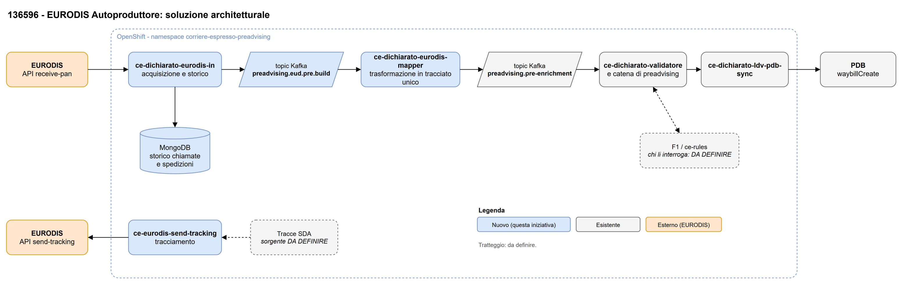

# Introduzione

## Scopo

Il presente documento contiene l'analisi degli impatti funzionali relativi all'Iniziativa "136596 - EURODIS Autoproduttore".

## Definizione, Acronimi e Abbreviazioni

| Sigla | Significato esteso |
|---|---|
| ADR | Accordo europeo sul trasporto internazionale di merci pericolose su strada |
| API | Application Programming Interface |
| APT | Codice del servizio accessorio nel formato PDB (es. `APT000918`) |
| BEP | Sistema SDA di gestione delle lettere di vettura |
| CE | Corriere Espresso |
| F1 | Anagrafica commerciale (contratto, codice cliente, AUC) |
| HTTP | HyperText Transfer Protocol |
| ICD | Interface Control Document |
| ISO2 / ISO4 | Codifica del paese a due caratteri / codifica a quattro caratteri attesa da PDB |
| JSON | JavaScript Object Notation |
| LDV | Lettera Di Vettura |
| ms | Microservizio |
| PAN | Dati di spedizione che EURODIS trasmette al partner tramite l'API `receive-pan` |
| PDB | Poste Delivery Business |
| PUDO | Pick Up Drop Off, punto di ritiro |
| UUID | Universally Unique Identifier |

## Riferimenti

| Id. Documento | Tipo di Documento | Titolo Documento | Allegato |
|---|---|---|---|
| 1 | Specifica | Specifica dei servizi accessori nei flussi PDB (FlussiPreadvisingInfo.csv) | non disponibile |
| 2 | Riscontro | Riscontro SDA sul perimetro dei servizi EURODIS del 11/09/2026 (flusso via file) | non disponibile |
| 3 | Mapping | Mapping dal tracciato unico alla richiesta LDV verso BEP (mapping-tracciatoDTO-bep.md) | non disponibile |
| 4 | SF | SF_138972(PRJ0042827) Reply v1.0, processo di preadvising | non disponibile |
| 5 | SF | SF_138972(PRJ0042827) PRJTASK0609165 SI, gestione unificata preadvising clienti | non disponibile |

## Vincoli, Assunzioni, Esclusioni ed Open Point

| Id | Tipo | Descrizione | Riferimento |
|---|---|---|---|
| 1 | Vincolo | L'API `receive-pan` restituisce solo le spedizioni non ancora consegnate al partner, non prevede conferma di ricezione (ack), filtri o paginazione, e non offre un canale per rifiutare una spedizione. | Acquisizione; EURODIS |
| 2 | Vincolo | La validazione a valle deve accettare i valori che eccedono le dimensioni dichiarate nell'ICD, che non vengono troncati: `id_preadvising` (UUID, 36 caratteri contro 15), `data_spedizione` (10 contro 8), `id_ldv_associata` (24 contro 3), oltre a email, SMS, civico, nome del contatto, note e codice TARIC. | Trasformazione; responsabile `ce-dichiarato-validatore` |
| 3 | Assunzione | EURODIS considera consegnata una spedizione nel momento in cui la restituisce: una risposta persa (timeout, interruzione del servizio) comporta la perdita delle spedizioni contenute, recuperabili solo con la rilettura puntuale per `edReference`. Da confermare con EURODIS (Open Point 7). | Acquisizione; EURODIS (Chiapponi) |
| 4 | Assunzione | La rilettura puntuale (`GET /shipment/{edReference}/v1`) non ha effetti collaterali e funziona anche su spedizioni già scaricate. Da confermare con EURODIS. | Recupero delle spedizioni; EURODIS (Chiapponi) |
| 5 | Assunzione | Il destinatario è sempre in Italia; il mittente può essere estero. Le spedizioni sono trattate come nazionali e i dati internazionali richiesti da BEP non sono necessari. | Trasformazione; SDA |
| 6 | Esclusione | Spedizioni di tipo pickup (P), che transitano via FTP e non dall'API; Locker, Uffici Postali, Time Definite ore 9, reverse a domicilio e abbandono. Perimetro definito per il flusso via file (documento di riferimento ID 2), da confermare per l'API. | Servizi accessori; SDA, EURODIS |
| 7 | Open Point | Conferma del modello di consegna di `receive-pan` (assunzione 3) e comportamento in caso di errore fra la risposta e il salvataggio. | Acquisizione; EURODIS (Chiapponi) |
| 8 | Open Point | Contenuto della prima chiamata: tutto lo storico arretrato o solo da una certa data. | Acquisizione; EURODIS (Chiapponi) |
| 9 | Open Point | Comportamento dell'API: gestione di aggiornamenti e annullamenti, numero massimo di spedizioni per risposta, limiti di chiamata, fuso orario dei timestamp, rotazione della chiave. | Acquisizione; EURODIS (Chiapponi) |
| 10 | Open Point | Restituzione a EURODIS di un esito negativo (spedizione non valida o non lavorabile). Si propone di valutare l'invio di un evento di eccezione tramite l'API di tracking. | Tracciamento; EURODIS (Chiapponi) |
| 11 | Open Point | Chiave API di produzione e payload di esempio di produzione, con i dati sensibili oscurati. | Acquisizione; EURODIS (Chiapponi) |
| 12 | Open Point | Volumi attesi (spedizioni per giorno e per chiamata). | Acquisizione; EURODIS (Chiapponi) |
| 13 | Open Point | Avvio graduale: perimetro di ogni fase (per mittente, ufficio o volume) e chi lo applica (EURODIS tramite chiave API, o SDA). Un filtro lato SDA non è possibile senza perdita, perché le spedizioni lette risultano già consegnate. | Acquisizione; EURODIS (Chiapponi) |
| 14 | Open Point | LDV nel multicollo: conferma che `consignorsColloBarcode` contenga la LDV anche nelle spedizioni ordinarie; quale `europlateBarcode` usare per `internazionale.id_ldv_itz` con più colli (si propone il primo valorizzato); valorizzazione di LDV madre, figlia e `collo.id_collo`; trattamento del valore `0` di `europlateBarcode`. | Trasformazione; EURODIS (Chiapponi), SDA |
| 15 | Open Point | Conferma della traduzione proposta dei servizi accessori EURODIS nei codici PDB, e trattamento dei valori non coperti (`D`, `7`, `T`; `W` come appuntamento) o fuori perimetro (`A`, Locker, assicurazione, tipo P): servizio, spedizione ordinaria o scarto. | Servizi accessori; EURODIS (Chiapponi), SDA |
| 16 | Open Point | Punto Poste: sorgente del nome del punto, obbligatorio per PDB e non garantito da EURODIS, e comportamento se assente. | Servizi accessori; EURODIS (Chiapponi) |
| 17 | Open Point | Contrassegno: formato e valuta dell'importo e codifica del tipo di incasso (3 → `CON`, 5 → `ABM`). | Servizi accessori; EURODIS (Chiapponi) |
| 18 | Open Point | Spedizioni con dogana e con merci pericolose (ADR): rientrano nel perimetro? | Trasformazione; EURODIS (Chiapponi) |
| 19 | Open Point | Tracciamento verso EURODIS: API da invocare, eventi SDA da trasmettere e loro codifica, sorgente delle tracce, frequenza. | Tracciamento; EURODIS (Chiapponi) |
| 20 | Open Point | Codice PRJ dell'iniziativa: DA DEFINIRE. | Introduzione; Poste |
| 21 | Open Point | Durata di conservazione dello storico delle chiamate e delle spedizioni: DA DEFINIRE. | Acquisizione; Poste |
| 22 | Open Point | Regole di validità e di univocità secondo SDA delle LDV generate da EURODIS. | Trasformazione; SDA (Marzilli), EURODIS |
| 23 | Chiuso | Valore del `canale`: confermato `EUD_INVIOSYSTEM`, coerente con il mapping verso BEP che trasmette `collo.id_ldv` solo per il canale INVIOSYSTEM. Da verificare che BEP riconosca il valore; dal canale dipende anche il criterio della verifica di duplicato. | Trasformazione; SDA |
| 24 | Open Point | Valorizzazione di `id_canale`, `id_file` e `id_partner`. | Trasformazione; SDA |
| 25 | Open Point | Campo sorgente della data di spedizione (`entranceTimestamp` oppure `clearanceTimestamp`, come nel riscontro SDA) e regola se il campo è assente. | Trasformazione; SDA, EURODIS |
| 26 | Open Point | Codice nazione: campo ICD in cui scrivere l'ISO2 (`codice_nazione` come nel flusso `EUD_INVIOFILE`, oppure solo `codice_nazione_iso_2`) e componente che produce l'ISO4 richiesto da PDB. | Trasformazione; SDA, responsabile `ce-dichiarato-ldv-pdb-sync` |
| 27 | Open Point | Assicurazione: si propone di considerarla fuori perimetro e di non valorizzarla anche se EURODIS invia il valore della merce. | Servizi accessori; SDA |
| 28 | Open Point | Reso (rientro al mittente): necessità del servizio `APT000930` e semantica dei valori; riconoscimento di resi e rettifiche. | Servizi accessori; SDA |
| 29 | Open Point | Preavviso: si propone di non mappare i flag di preavviso EURODIS, perché SDA notifica il destinatario in presenza dei contatti. Il preavviso telefonico non ha un campo nell'ICD. | Trasformazione; SDA |
| 30 | Open Point | `rif_prodotto_cliente` e `centro_costo` (obbligatorio per BEP): costanti di contratto o valori da derivare. | Trasformazione; SDA |
| 31 | Open Point | Campi EURODIS senza corrispondenza nell'ICD o con semantica diversa: secondo numero di telefono, `region` (testo libero) contro `provincia` (sigla), valore della merce in valuta diversa da EUR. | Trasformazione; SDA |
| 32 | Open Point | Osservazioni su `ce-dichiarato-ldv-pdb-sync`, oggi in test: canale (`POU` o `WEBSERVICE`), ISO4 non risolto, nome del Punto Poste omesso se vuoto, contrassegno con importo 0 non scartato. | Propagazione verso PDB; responsabile `ce-dichiarato-ldv-pdb-sync` |
| 33 | Open Point | Componente che esegue l'arricchimento da F1 (contratto, codice cliente, AUC) e la determinazione del prodotto con ce-rules: il ms di trasformazione o la catena a valle. | Trasformazione; team ACN |
| 34 | Open Point | Trattamento dei messaggi non trasformabili o non validi (scarto, coda di errore o altro), cause di scarto e visibilità dell'esito. | Trasformazione; team ACN |
| 35 | Open Point | Topic letti e scritti da `ce-eurodis-send-tracking`: DA DEFINIRE. | Tracciamento; team ACN |

# Obiettivo dell'iniziativa

EURODIS è un consorzio di corrieri europei che affida a SDA spedizioni da consegnare in Italia. Già oggi esiste un flusso EURODIS in cui la lettera di vettura è prodotta da SDA (canale `EUD_INVIOFILE`). Con questa iniziativa EURODIS diventa autoproduttore del dato di spedizione: la LDV arriva già assegnata da EURODIS e i dati delle spedizioni (PAN) vengono prelevati direttamente dalla piattaforma EURODIS, tramite l'API `receive-pan`, invece che dal dichiarato tradizionale.

La presa in carico deve avvenire senza perdita di spedizioni, nonostante l'API non preveda una conferma di ricezione, e deve inserirsi nel processo di preadvising esistente tramite il tracciato unico, in modo che le spedizioni seguano la stessa catena di validazione e di creazione su PDB. SDA deve inoltre restituire a EURODIS le tracce delle spedizioni ricevute.

Gli obiettivi sono:

- acquisire le spedizioni EURODIS dall'API `receive-pan`, conservandone lo storico integrale;
- trasformare ogni spedizione nel tracciato unico del preadvising (ICD v11), con la LDV fornita da EURODIS e i servizi accessori nel formato atteso da PDB;
- pubblicare il tracciato unico verso la catena di preadvising esistente;
- inviare a EURODIS le tracce SDA delle spedizioni prese in carico.

# Soluzione

La soluzione descritta di seguito tratta i seguenti temi:

- acquisizione delle spedizioni dall'API EURODIS;
- trasformazione delle spedizioni nel tracciato unico;
- propagazione verso PDB tramite la catena esistente;
- tracciamento verso EURODIS.

La soluzione è riportata nella figura successiva e nell'allegato 4.



La figura mostra la sequenza: l'API EURODIS `receive-pan` è interrogata dal ms `ce-dichiarato-eurodis-in`, che salva lo storico su MongoDB e pubblica una spedizione per messaggio sul topic Kafka `preadvising.eud.pre.build`; il ms `ce-dichiarato-eurodis-mapper` consuma il topic, trasforma la spedizione nel tracciato unico e la pubblica sul topic `preadvising.pre-enrichment`; da qui la catena di preadvising esistente, a partire dalla validazione del ms `ce-dichiarato-validatore`, porta alla creazione della spedizione su PDB tramite il ms `ce-dichiarato-ldv-pdb-sync`. Il ms `ce-eurodis-send-tracking` invia le tracce SDA a EURODIS.

Di seguito sono descritti funzionalmente i processi che compongono la soluzione.

## Acquisizione delle spedizioni da EURODIS

Questa fase è responsabile di prelevare le spedizioni che EURODIS affida a SDA e di consegnarle, una per messaggio, alla fase di trasformazione. Il suo obiettivo principale è non perdere nessuna spedizione: poiché l'API `receive-pan` considera consegnata una spedizione nel momento in cui la restituisce (assunzione 3), la risposta viene salvata integralmente prima di qualsiasi altra elaborazione.

In questa fase le spedizioni non vengono validate né interpretate: dell'intera spedizione si legge solo l'identificativo EURODIS `edReference`, mentre il contenuto viene conservato e inoltrato così come è stato ricevuto. Validazione e trasformazione sono a carico delle fasi successive.

### Scarico dall'API `receive-pan`

Il microservizio invoca periodicamente il servizio EURODIS `GET /shipments/v1`, autenticandosi con la chiave API assegnata al partner SDA (header `X-API-Key`). Il servizio restituisce tutte le spedizioni nuove non ancora consegnate al partner. La chiamata non viene mai ripetuta automaticamente: un nuovo tentativo potrebbe restituire una risposta diversa e far perdere le spedizioni della prima. Lo scarico è eseguito da una sola istanza del microservizio alla volta, anche in presenza di più repliche.

| Passo | Descrizione |
|---|---|
| 1 | Il ms `ce-dichiarato-eurodis-in` registra l'avvio dello scarico nello storico. |
| 2 | Il ms invoca `GET /shipments/v1` dell'API `receive-pan`. |
| 3 | Con esito `404` (nessuna spedizione nuova) lo scarico si chiude regolarmente, senza errori. |
| 4 | Con esito `200` il ms salva nello storico la risposta integrale, così come ricevuta, prima di qualsiasi elaborazione. |
| 5 | Con esito di errore o in assenza di risposta, lo scarico si chiude in errore con il relativo esito (vedi "Comportamento in caso di errore"). |

N.B. Lo scarico è rilasciato disattivato e viene attivato per ambiente, per consentire un avvio graduale (Open Point 13).

### Storicizzazione e scomposizione

Lo storico conserva, per ogni chiamata a EURODIS, l'esito, gli orari e la risposta integrale; per ogni spedizione, un record identificato da `edReference` con il testo della singola spedizione, la provenienza (chiamata e posizione nella risposta), lo stato di invio e il numero di ricezioni. La durata di conservazione dello storico è DA DEFINIRE (Open Point 21).

Le risposte salvate vengono poi elaborate in un passo distinto, così che un problema nella pubblicazione non comprometta il salvataggio.

| Passo | Descrizione |
|---|---|
| 1 | Il ms legge dallo storico le risposte da elaborare, in ordine di arrivo. |
| 2 | Il ms divide la risposta nelle singole spedizioni, ciascuna identica al testo ricevuto. |
| 3 | Per ogni spedizione il ms legge `edReference` e lo normalizza a numero intero senza decimali (es. `1000000000001.0` diventa `1000000000001`). |
| 4 | Il ms registra la spedizione nello storico con stato `DA_INVIARE` e la pubblica sul topic `preadvising.eud.pre.build`. |
| 5 | Ricevuta la conferma dal broker, il ms porta la spedizione in stato `INVIATA` con l'ora di invio. |
| 6 | Il ms registra l'esito complessivo dello scarico. |

Una spedizione già ricevuta che EURODIS restituisce di nuovo viene registrata sullo stesso record e inoltrata nuovamente: la verifica di duplicato è svolta dalla validazione a valle (sezione "Propagazione verso PDB"). Una spedizione priva di `edReference` valido non viene scartata in silenzio: resta nello storico con il motivo e non viene inoltrata.

### Pubblicazione delle spedizioni

Ogni spedizione viene pubblicata in un messaggio dedicato, mai in un unico messaggio con l'intera risposta. Il messaggio ha:

- chiave: `edReference` normalizzato, in modo che tutte le versioni della stessa spedizione siano lette in ordine;
- corpo: la spedizione EURODIS (elemento `GetShipmentResponse2` dell'API) così come ricevuta, senza trasformazioni;
- intestazioni: i metadati della presa in carico, descritti nella tabella seguente.

| Intestazione | Descrizione |
|---|---|
| `edReference` | Identificativo EURODIS della spedizione, uguale alla chiave |
| `idEsecuzione` | Identificativo della chiamata a EURODIS nello storico |
| `ricevutoIl` | Istante di ricezione da EURODIS |
| `fonte` | `receive-pan/shipments/v1` per lo scarico, `receive-pan/shipment/v1` per la rilettura puntuale |
| `rifGrezzo` | Riferimento alla risposta integrale nello storico |
| `ambiente` | `TEST` o `PROD` |

#### Schema del messaggio

Esempio con valori fittizi; il corpo è abbreviato.

```
Topic:  preadvising.eud.pre.build
Chiave: 1000000000001
Intestazioni:
  edReference:  1000000000001
  idEsecuzione: 000000000000000000000001
  ricevutoIl:   2026-11-04T09:00:02.000Z
  fonte:        receive-pan/shipments/v1
  rifGrezzo:    <riferimento alla risposta 000000000000000000000001>
  ambiente:     TEST
Corpo:
{
  "edReference": 1000000000001.0,
  "dispatchPartnersDomesticShipmentNumber": "PARTNER-0001",
  "entranceTimestamp": "2026-11-04T08:30:00",
  "numberOfHandlingUnits": 1,
  "consigneeAddress": { "companyName": "DESTINATARIO DI PROVA", "city": "ROMA", "zipcode": "00100", "countryCode": "IT", ... },
  "shipperAddress":   { "companyName": "MITTENTE DI PROVA", "countryCode": "AT", ... },
  "deliveryService":  { "deliveryService": "6", ... },
  "consigneePreAdvice": { "smsPreAdvice": false, "eMailPreAdvice": true, "telephonePreAdvice": false },
  "collis": [ { "europlateBarcode": "000000000000000000000001", "consignorsColloBarcode": "LDV0000000001", "weightOfUnit": 2.5, ... } ]
}
```

#### Esiti dello scarico e stati della spedizione

| Esito/Stato | Descrizione |
|---|---|
| Nessuna spedizione | EURODIS non ha spedizioni nuove: esito regolare |
| Spedizioni acquisite | Risposta salvata e tutte le spedizioni pubblicate |
| Acquisizione parziale | Risposta salvata, ma alcune spedizioni non sono ancora pubblicate o non sono identificabili |
| Chiamata in errore | EURODIS ha risposto con un errore o non ha risposto; se la risposta è andata persa dopo l'invio da parte di EURODIS, le spedizioni contenute vanno recuperate (assunzione 3) |

Tabella 1: Esiti dello scarico

| Esito/Stato | Descrizione |
|---|---|
| `DA_INVIARE` | Spedizione salvata, pubblicazione non ancora confermata. Torna in questo stato anche quando EURODIS la restituisce di nuovo |
| `INVIATA` | Pubblicazione confermata dal broker, con l'ora di invio |
| `ERRORE_INVIO` | Pubblicazione non riuscita dopo i tentativi automatici; si sblocca con il reinvio manuale |
| `NON_IDENTIFICABILE` | Spedizione senza `edReference` valido: conservata con il motivo, non pubblicata |

Tabella 2: Stati della spedizione

### Comportamento in caso di errore e recupero

| Esito/Stato | Descrizione |
|---|---|
| Chiave non valida (`401`) | Scarico in errore; nessuna spedizione persa. Si verifica la chiave con EURODIS |
| Partner non determinabile o senza accesso (`424`, `451`) | Scarico in errore; si verifica la configurazione del partner presso EURODIS |
| Errore generico EURODIS (`500`) | Scarico in errore, senza ripetizione; si riprova allo scarico successivo |
| Nessuna risposta (timeout, connessione caduta, interruzione del servizio durante la chiamata) | Scarico in errore con rischio di perdita: si chiedono a EURODIS gli `edReference` del periodo e si recuperano con la rilettura puntuale |
| Storico non disponibile al salvataggio della risposta | Gli `edReference` contenuti nella risposta vengono registrati nel log applicativo, per il recupero con la rilettura puntuale |
| Interruzione durante la pubblicazione | L'elaborazione della risposta viene ripresa automaticamente; le spedizioni già pubblicate possono essere ripubblicate |
| Broker Kafka non disponibile | Le spedizioni restano `DA_INVIARE` e vengono ripubblicate automaticamente; esauriti i tentativi passano in `ERRORE_INVIO` |
| Risposta non in formato JSON | La risposta resta nello storico per l'analisi |
| Spedizione senza `edReference` valido | La spedizione resta `NON_IDENTIFICABILE`; le altre della stessa risposta proseguono |

Tabella 3: Comportamento in caso di errore

Sono inoltre previste due operazioni di recupero, attivate tramite la configurazione del microservizio e senza servizi esposti:

- rilettura puntuale: per un elenco di `edReference`, il microservizio invoca `GET /shipment/{edReference}/v1` e tratta la risposta come uno scarico ordinario, con `fonte` di rilettura;
- reinvio: per un elenco di `edReference`, il microservizio ripubblica la spedizione salvata nello storico, senza invocare EURODIS.

La rilettura puntuale è l'unico modo per recuperare spedizioni perse in una chiamata non andata a buon fine, e richiede che EURODIS comunichi gli `edReference` del periodo interessato (assunzioni 3 e 4).

Ulteriori dettagli: per l'implementazione delle funzionalità sopra descritte viene realizzato un nuovo microservizio, denominato `ce-dichiarato-eurodis-in`, all'interno del namespace OpenShift `corriere-espresso-preadvising`. Il microservizio invoca l'API EURODIS `receive-pan` (allegato 2), salva lo storico su MongoDB e pubblica sul topic Kafka `preadvising.eud.pre.build`. Non legge alcun topic.

## Trasformazione nel tracciato unico

Questa fase converte ogni spedizione EURODIS nel tracciato unico del preadvising (ICD v11, allegato 1) e la pubblica verso la catena esistente. Il flusso di riferimento è quello EURODIS già in esercizio (canale `EUD_INVIOFILE`, allegato 3): il flusso autoproduttore se ne discosta principalmente perché la LDV arriva già assegnata da EURODIS.

Il mapping campo per campo, con la categoria di ogni campo (diretto, trasformato, costante, generato, da F1, da ce-rules, a valle, non applicabile), è riportato nell'allegato 1. Di seguito le regole funzionali principali.

| Passo | Descrizione |
|---|---|
| 1 | Il ms `ce-dichiarato-eurodis-mapper` legge la spedizione dal topic `preadvising.eud.pre.build`, con le intestazioni della presa in carico. |
| 2 | Il ms converte la spedizione nel tracciato unico secondo le regole di questo paragrafo e dell'allegato 1. |
| 3 | Il ms pubblica il tracciato unico sul topic `preadvising.pre-enrichment`. |

### Regole generali di trasformazione

- Le convenzioni del flusso `EUD_INVIOFILE` vengono replicate: stringhe assenti valorizzate con `""`, importi assenti con `0`, date nel formato `yyyy-MM-dd`, peso del collo in grammi.
- I valori EURODIS più lunghi del limite ICD vengono passati interi, senza troncamento (vincolo 2); l'adeguamento ai limiti di BEP è svolto dalla validazione a valle.
- Il tracciato è contrassegnato come autoproduttore (`flag_autoproduttore` = `"S"`), con `versione_tracciato` = `1`. Poiché ogni messaggio contiene una sola spedizione, `progressivo` vale `1`.
- Mittente e destinatario sono riportati dagli indirizzi EURODIS (`shipperAddress`, `consigneeAddress`); il cellulare deriva dal contatto SMS.
- Data e ora di spedizione derivano da `entranceTimestamp` (Open Point 25).
- Il codice paese EURODIS è in formato ISO2; il campo ICD di destinazione e la produzione dell'ISO4 richiesto da PDB sono DA DEFINIRE (Open Point 26).
- La consegna senza firma deriva dal tipo di consegna EURODIS (`deliveryType` `S` → `no_firma` `"N"`, `N` → `"S"`).
- Le note di consegna sono la concatenazione delle note del destinatario e del mittente.
- Sono costanti: `flag_stampa_ldv` = `"N"`, `flag_attivazione_ritiro` = `"N"`, `internazionale.vettore` = `"EURODIS"`.
- Il valore del `canale` è `EUD_INVIOSYSTEM` (confermato; Open Point 23).

### Identificativi e lettera di vettura

| Campo ICD | Valorizzazione |
|---|---|
| `id_preadvising` | UUID generato dal microservizio per ogni tracciato |
| `spedizione.rif_spedizione` | `edReference`, come stringa senza decimali |
| `collo.id_ldv` | `collis[].consignorsColloBarcode`, la LDV assegnata da EURODIS |
| `internazionale.id_ldv_itz` | `collis[].europlateBarcode`; con più colli si propone il primo valorizzato (Open Point 14) |
| `id_ldv_partner_master` | `dispatchPartnersDomesticShipmentNumber`, numero della spedizione presso il partner mittente |
| `spedizione.numero_colli` | `numberOfHandlingUnits` |
| `link_file_fisico_inviato`, `upload_time` | Dalle intestazioni `rifGrezzo` e `ricevutoIl` del messaggio |
| `id_file` | Si propone l'identificativo della chiamata (`idEsecuzione`); con `id_canale` e `id_partner` DA DEFINIRE (Open Point 24) |

La validità e l'univocità delle LDV generate da EURODIS secondo le regole SDA sono DA DEFINIRE (Open Point 22); il trattamento del multicollo (LDV madre e figlia, `collo.id_collo`) è DA DEFINIRE (Open Point 14).

### Servizi accessori

I servizi accessori vengono passati a PDB tramite `codici_servizi` (codici APT separati da `|`, es. `APT000910|APT000918`) e, dove previsto, tramite i campi ICD delle sottochiavi, come per i flussi PDB (documento di riferimento ID 1). La sezione del tracciato dedicata al servizio non è sufficiente: il mapping verso BEP legge i servizi solo da `codici_servizi` (documento di riferimento ID 3).

Si propone la seguente traduzione, ricavata dal riscontro SDA sul flusso via file (documento di riferimento ID 2) e da confermare per l'API (Open Point 15).

| Servizio | Dato EURODIS | Codice in `codici_servizi` | Campi ICD delle sottochiavi |
|---|---|---|---|
| Consegna al sabato | `deliveryService` = `6` | `APT000910` | nessuno |
| Consegna di sera | `deliveryService` = `E` | `APT000911` | nessuno |
| Time Definite ore 10 | `deliveryService` = `F` | `APT000906` | nessuno |
| Time Definite ore 12 | `deliveryService` = `M` | `APT000907` | nessuno |
| Consegna su appuntamento | `deliveryService` = `B` (e `W`, da confermare) | `APT000908` | nessuno; richiede il telefono del destinatario |
| Punto Poste | `deliveryService` = `Z` e `consigneeAddress.pudoID` | `APT000947` | `consegna.codice_frazionario` = PUDO ID; `consegna.denominazione_frazionario` = nome del punto (Open Point 16) |
| Contrassegno | presenza di `cashOnDeliveryService` | `APT000918` | `contrassegno.flag` = `S`; `contrassegno.importo_contrassegno` = importo (> 0, max 999999.99); `contrassegno.tipo_pagamento_contrassegno`: 3 → `CON`, 5 → `ABM` (Open Point 17) |
| Multicollo | più elementi in `collis[]` | nessuno | aggiunto da `ce-dichiarato-ldv-pdb-sync` (`APT000945`) |
| Consegna pomeriggio | `deliveryService` = `A` | nessuno | spedizione ordinaria |

Una spedizione ha al massimo un servizio di consegna, combinabile con contrassegno e multicollo. Il contrassegno non è ammesso con la consegna a Punto Poste.

I valori `D` (giorno), `7` (domenica) e `T` (giorno e orario definito, senza codice APT) non hanno una traduzione: il loro trattamento è DA DEFINIRE (Open Point 15). Si propone di non valorizzare l'assicurazione (Open Point 27), il reso (Open Point 28) e i flag di preavviso (Open Point 29).

### Cliente, prodotto e arricchimento

Del cliente si valorizzano solo codice login, id cliente e codice AUC (uguali al codice cliente EURODIS) e il contratto, reperiti da F1; la ragione sociale del cliente coincide con quella del mittente. In assenza di `rif_prodotto_cliente`, il prodotto viene determinato a valle (in `ce-dichiarato-ldv-pdb-sync` il prodotto di default è `APT000901`). Restano DA DEFINIRE il componente che esegue l'arricchimento da F1 e la determinazione del prodotto con ce-rules (Open Point 33), e la valorizzazione di `rif_prodotto_cliente` e `centro_costo` (Open Point 30).

### Messaggi non trasformabili

Il trattamento dei messaggi non trasformabili o non validi è DA DEFINIRE (Open Point 34). Non è previsto un canale per comunicarne l'esito a EURODIS (vincolo 1, Open Point 10).

Ulteriori dettagli: per l'implementazione delle funzionalità sopra descritte viene realizzato un nuovo microservizio, denominato `ce-dichiarato-eurodis-mapper`, all'interno del namespace OpenShift `corriere-espresso-preadvising`. Il microservizio consuma il topic Kafka `preadvising.eud.pre.build` e pubblica il tracciato unico sul topic Kafka `preadvising.pre-enrichment`.

## Propagazione verso PDB

Il tracciato unico pubblicato su `preadvising.pre-enrichment` segue la catena di preadvising esistente, descritta nei documenti di riferimento ID 4 e ID 5, a partire dalla validazione svolta dal ms `ce-dichiarato-validatore`, e arriva al ms `ce-dichiarato-ldv-pdb-sync`, che lo converte nella richiesta PDB e crea la spedizione con il servizio sincrono `waybillCreate`. Questa iniziativa non prevede sviluppi su questi componenti, ma ne usa le regole.

In particolare, la validazione a valle svolge per le spedizioni EURODIS:

- la verifica di duplicato: una spedizione ricevuta più volte da EURODIS produce più tracciati, ciascuno con un nuovo `id_preadvising`, e i duplicati vengono riconosciuti dalla validazione secondo le regole del processo di preadvising;
- l'applicazione dei default di peso e dimensioni quando EURODIS li invia a 0;
- l'adeguamento dei valori che eccedono i limiti di BEP (città 30, nome 35, indirizzo 40, civico 4, telefono 15).

Il ms `ce-dichiarato-ldv-pdb-sync` legge i servizi da `codici_servizi`, aggiunge il servizio multicollo e applica prodotto, contratto e centro di costo di default se assenti.

N.B. La validazione deve accettare i valori oltre le dimensioni dell'ICD (vincolo 2). Il ms `ce-dichiarato-ldv-pdb-sync` è in fase di test: le osservazioni emerse sono riportate nell'Open Point 32 e le eventuali correzioni sono a carico del suo responsabile.

## Tracciamento verso EURODIS

Questa fase restituisce a EURODIS le tracce SDA delle spedizioni prese in carico. Tra le API EURODIS disponibili, quella con cui il partner trasmette gli eventi a EURODIS risulta essere `send-tracking`; per le prove di consegna esiste anche `send-pod`. L'API da invocare, gli eventi SDA da trasmettere e la loro codifica, la sorgente delle tracce e la frequenza di invio sono DA DEFINIRE (Open Point 19).

La correlazione fra la spedizione SDA e quella EURODIS è disponibile: l'identificativo EURODIS `edReference` è riportato in `spedizione.rif_spedizione` del tracciato unico ed è la chiave dello storico dell'acquisizione.

Si propone di valutare la stessa API anche per restituire a EURODIS un esito negativo sulle spedizioni non lavorabili (Open Point 10).

Ulteriori dettagli: per l'implementazione delle funzionalità sopra descritte viene realizzato un nuovo microservizio, denominato `ce-eurodis-send-tracking`, all'interno del namespace OpenShift `corriere-espresso-preadvising`. I topic letti e scritti sono DA DEFINIRE (Open Point 35).

# Elenco Sistemi Impattati

| Sistema | Componente | Tipo intervento | Nuovo/Esistente |
|---|---|---|---|
| EURODIS | API `receive-pan` | Integrazione in lettura (ambienti TEST e PROD) | Esistente (esterno) |
| EURODIS | API di tracking (`send-tracking`, DA DEFINIRE) | Integrazione in scrittura | Esistente (esterno) |
| Preadvising (OpenShift) | `ce-dichiarato-eurodis-in` | Nuovo sviluppo | Nuovo |
| Preadvising (OpenShift) | `ce-dichiarato-eurodis-mapper` | Nuovo sviluppo | Nuovo |
| Preadvising (OpenShift) | `ce-eurodis-send-tracking` | Nuovo sviluppo | Nuovo |
| MongoDB | Storico delle chiamate e delle spedizioni EURODIS | Nuove collezioni | Nuovo |
| Kafka | Topic `preadvising.eud.pre.build` | Nuovo topic | Nuovo |
| Kafka | Topic `preadvising.pre-enrichment` | Nuovo produttore | Esistente |
| Preadvising (OpenShift) | `ce-dichiarato-validatore` | Accettazione dei valori oltre le dimensioni ICD (vincolo 2); deduplica, default e adeguamento ai limiti BEP secondo le regole esistenti | Esistente |
| Preadvising (OpenShift) | `ce-dichiarato-ldv-pdb-sync` | Verifica ed eventuali correzioni (Open Point 32) | Esistente |
| PDB | Servizio `waybillCreate` | Nessuna modifica prevista | Esistente |
| BEP | Ricezione della LDV dal tracciato unico | Verifica del canale (Open Point 23) | Esistente |
| F1 | Contratto, codice cliente, AUC | Consultazione (Open Point 33) | Esistente |
| ce-rules | Prodotto e servizi | Consultazione (Open Point 33) | Esistente |

# Allegati

| ID Documento | Tipo Documento | Titolo e Contenuto | Allegato |
|---|---|---|---|
| 1 | ICD | ICD v11 con il mapping EURODIS: fogli "Mapping EURODIS" (una riga per campo ICD), "Mapping inverso EURODIS" (una riga per campo EURODIS), "EURODIS non mappati", "Legenda mapping" | ICD_PREADVISING_LDV_EVENT_SOURCE_v11.xlsx |
| 2 | Specifica API | Specifica OpenAPI dell'API EURODIS `receive-pan`, Release v1 | eurodis-receive-pan-swagger-v1.json |
| 3 | Esempio | Tracciato unico del flusso EURODIS esistente, canale `EUD_INVIOFILE`, con dati di test | esempio-eud-inviofile.json |
| 4 | Architettura | Schema architetturale della soluzione (Figura 1) | fig-1-architettura.drawio |
