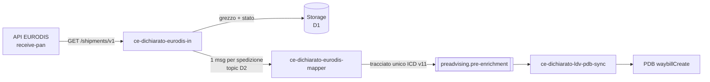
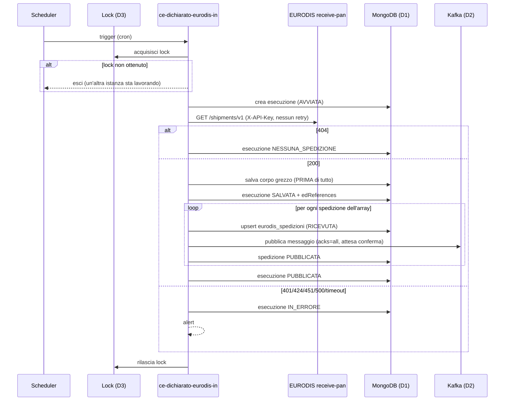
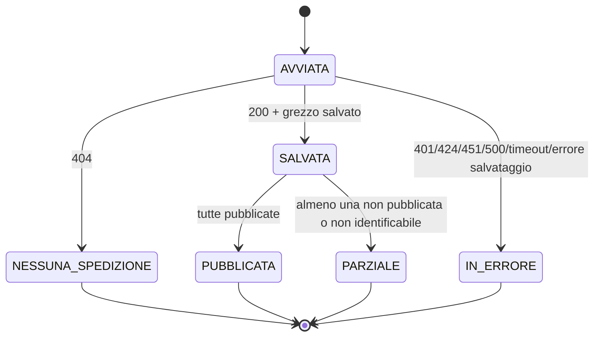

# `ce-dichiarato-eurodis-in` — Documento funzionale per lo sviluppo

**Iniziativa**: 136596 — Eurodis autoproduttore · **Versione**: 0.3 (bozza) · **Data**: 2026-11-04
**Autore**: Mary (analyst) · **Destinatario**: Amelia (dev) e team di sviluppo
**Repository**: https://posteitaliane.ghe.com/SVILUPPO/CORRIERE-ESPRESSO_PREADVISING_ce-dichiarato-eurodis-in
**Generato da**: [prompt-ce-dichiarato-eurodis-in.md](prompt-ce-dichiarato-eurodis-in.md)

Etichette usate nel documento:
- **[FATTO]**: scritto nella specifica EURODIS o verificato con una prova; la fonte è indicata.
- **[IPOTESI]**: non scritto nella specifica, da confermare.
- **[DECISO]**: decisione presa, con data e riferimento.
- **[DA DECIDERE]**: scelta aperta, con proposta e default provvisorio.

---

## 1. Scopo e responsabilità

`ce-dichiarato-eurodis-in` scarica le spedizioni che il consorzio EURODIS affida
a SDA, interrogando l'API EURODIS `receive-pan`, e le consegna, una per
messaggio, al microservizio `ce-dichiarato-eurodis-mapper`.

Il suo unico obiettivo è **non perdere nessuna spedizione**. In pratica:

1. interroga periodicamente `GET /shipments/v1`;
2. salva **subito** la risposta grezza, prima di qualsiasi altra elaborazione; note diego (serve salvare ogni run, e la risposta http, ed il paylod separato su un altra collection)
3. la divide in spedizioni singole;
4. salva lo stato di ogni spedizione; 
5. pubblica una spedizione per messaggio verso il mapper;
6. rende tracciabile e recuperabile tutto quello che ha ricevuto.

**Non fa**, e non deve fare:

| Fuori perimetro | Chi lo fa |
|---|---|
| Validazione di business (CAP, servizi, LDV, contrassegno...) | `ce-dichiarato-eurodis-mapper` |
| Mapping verso il tracciato unico ICD v11, generazione di `id_preadvising` | `ce-dichiarato-eurodis-mapper` |
| Pubblicazione su `preadvising.pre-enrichment` | `ce-dichiarato-eurodis-mapper` |
| Invio delle tracce a EURODIS | `ce-eurodis-send-tracking` |
| Comunicare esiti o errori a EURODIS | nessuno per ora: `receive-pan` non lo prevede (PA-08) |

**[DECISO 30-10, PA-26]** Il flusso è diviso in tre microservizi, e questo è il primo.

## 2. Posizione nella catena

**[DECISO 29-10]** Catena: lettura API → mapping verso ICD → ms sync → PDB.

Il confine con il mapper è il **messaggio** (sezione 3.2). Questo microservizio
garantisce che ogni spedizione ricevuta:
- sia salvata,
- finisca sul topic almeno una volta,
- arrivi così com'è, senza modifiche al contenuto.

## 3. Interfacce

### 3.1 In ingresso: API EURODIS `receive-pan`

| Voce | Valore | |
|---|---|---|
| URL TEST | `https://testapi.eurodis.com/receive-pan` | [FATTO] swagger `servers` |
| URL PROD | `https://api.eurodis.com/receive-pan` | [FATTO] raggiungibile, risponde `401` senza chiave (prova del 30-10) |
| Autenticazione | header `X-API-Key: <chiave del partner SDA>` | [FATTO] descrizione della pagina; **non** è nei `securitySchemes` dello swagger, quindi un client generato non la aggiunge |
| Formato | `application/json` | [FATTO] |
| Specifica | `../eurodis-receive-pan-swagger-v1.json` (OpenAPI 3.0, NSwag 14.6.3) | [FATTO] |

**Endpoint**

| Metodo e path | Uso | Risposte |
|---|---|---|
| `GET /shipments/v1` | Scarico batch. Nessun parametro: niente paginazione, filtri o cursore | `200` array di `GetShipmentResponse2` · `404` *"No new shipments available"* · `401` · `424` · `451` · `500` |
| `GET /shipment/{edReference}/v1` | Rilettura puntuale, usata solo per il recupero | `200` una spedizione · `400` edReference non valido · `401` · `404` non trovata · `424` · `451` · `500` |

Significato dei codici [FATTO, swagger]:
- `404` su `/shipments/v1` vuol dire "nessuna spedizione nuova": è un **esito normale**.
- `401`: chiave mancante o non valida. Il corpo è testo semplice (`Invalid API Key`), non JSON [FATTO, prova del 26-10].
- `424`: EURODIS non riesce a determinare il partner.
- `451`: il partner non ha accesso alla spedizione richiesta.
- `500`: errore generico.

**Modello di consegna**

- [FATTO] La descrizione dello swagger dice: *"Deploys all new shipments, that have not already been deployed to the partner"*.
- [FATTO] Non esiste un endpoint di conferma (acknowledge o commit).
- [IPOTESI I1, forte] EURODIS segna una spedizione come consegnata nel momento in cui la restituisce. La consegna è quindi **at-most-once**: una risposta persa per timeout, crash o retry di client, proxy o sidecar fa perdere le spedizioni. Le si può recuperare solo con la GET puntuale, e solo se si conosce l'`edReference` (PA-05, PA-09).
- [IPOTESI I2] La GET puntuale non ha effetti collaterali e funziona anche su spedizioni già scaricate.
- [IPOTESI I3] La risposta può essere molto grande: lo swagger non dichiara limiti (PA-27).

Ne segue che **`GET /shipments/v1` non è sicura né idempotente**, anche se è una GET. Va trattata come un'operazione che consuma i dati.

**Dati della spedizione che servono a questo microservizio**

Il microservizio **non** deserializza la spedizione in un DTO completo. Gli
serve solo:

| Campo | Tipo nello swagger | Uso |
|---|---|---|
| `edReference` | `number`/`decimal`, 1..9999999999999, obbligatorio | Chiave della spedizione: idempotenza, chiave del messaggio, recupero |

Il resto della spedizione si conserva **così com'è** (JSON grezzo) e si passa al mapper.

Perché non si deserializza tutto [FATTO]:
- lo swagger ha due schemi, `GetShipmentResponse2` (referenziato) e `GetShipmentResponse` (con campi in più), e non si sa quale arrivi;
- lo swagger non contiene esempi.

Leggere un JSON generico ed estrarre solo `edReference` rende il microservizio immune da queste incertezze.

### 3.2 In uscita: messaggio verso `ce-dichiarato-eurodis-mapper`

**[DECISO]** Un messaggio per spedizione, mai un unico messaggio con tutta la lista: messaggi sovradimensionati sono già stati visti in produzione.

**[DECISO 30-10]** Topic: **`preadvising.eud.pre.build`**.

**[DA DECIDERE D2, PA-31]** Il contratto del messaggio. Proposta, che unisce
quella di PA-31 con i metadati necessari al recupero:

- **Chiave**: `edReference` normalizzato a stringa senza decimali (RF-07). Così
  tutte le versioni della stessa spedizione finiscono nella stessa partizione,
  in ordine.
- **Corpo**: **l'elemento dell'array `GetShipmentResponse2` così com'è**, senza
  trasformazioni e senza buste (PA-31). Il mapper riceve esattamente la
  spedizione EURODIS.
- **Header Kafka** (metadati, fuori dal corpo):

| Header | Esempio | Uso |
|---|---|---|
| `edReference` | `7319003746401` | ridondante con la chiave, comodo per i filtri |
| `idEsecuzione` | `3f2b8c1e-5a7d-4c1b-9e2f-0a1b2c3d4e5f` | tracciabilità verso l'esecuzione e il grezzo |
| `ricevutoIl` | `2026-10-30T09:15:02.123Z` | istante di ricezione da EURODIS |
| `fonte` | `receive-pan/shipments/v1` oppure `receive-pan/shipment/v1` | distingue lo scarico normale dal recupero (sezione 7) |
| `rifGrezzo` | `eurodis_risposte_grezze/6720f1a2b3c4d5e6f7a8b9c0` | serve al mapper per `link_file_fisico_inviato`; formato secondo D1 |
| `ambiente` | `TEST` / `PROD` | |
| `schemaVersion` | `1` | versione del contratto |

Tenere i metadati negli header lascia il corpo identico al dato EURODIS (RF-14)
e non obbliga il mapper a conoscere una busta.

### 3.3 Persistenza

**[DECISO, PA-02]** Si salva lo storico.

**[DA DECIDERE D1]** Dove si salva il grezzo. Ci sono tre opzioni:

| Opzione | Pro | Contro |
|---|---|---|
| **a. MongoDB** (proposta del 26-10; "probabilmente Mongo" nel punto del 30-10) | Già nello stack; interrogabile; un solo sistema per grezzo e stato | Limite di 16 MB per documento: oltre serve GridFS |
| b. Topic Kafka dedicato con `acks=all` | Durevole, ripetibile | Limite di dimensione del messaggio; il grezzo intero può superarlo; meno comodo da interrogare |
| c. Blob storage | Coerente con `link_file_fisico_inviato` degli altri canali (gli esempi puntano a un blob Azure) | Un sistema in più da integrare |

**Default provvisorio: opzione a**, cioè MongoDB, con GridFS automatico sopra una soglia configurabile. Collezioni proposte:

**`eurodis_esecuzioni`**: una riga per ogni esecuzione del batch.

| Campo | Note |
|---|---|
| `_id` | `idEsecuzione` (UUID) |
| `istanza` | nome del pod che ha eseguito |
| `avviataIl`, `conclusaIl` | istanti UTC |
| `stato` | vedi sezione 6 |
| `httpStatus`, `durataMs` | esito della chiamata |
| `numeroSpedizioni` | elementi dell'array |
| `edReferences` | elenco degli `edReference` ricevuti |
| `rifGrezzo` | riferimento al grezzo |
| `errore` | classe e messaggio, senza dati personali |

**`eurodis_risposte_grezze`**: il corpo della risposta, intatto.

| Campo | Note |
|---|---|
| `_id` | |
| `idEsecuzione` | |
| `ricevutaIl` | |
| `httpStatus` | |
| `corpo` | stringa con il corpo esattamente come ricevuto (oppure riferimento GridFS) |
| `dimensioneByte`, `sha256` | per verifica e deduplica |

**`eurodis_spedizioni`**: stato per spedizione.

| Campo | Note |
|---|---|
| `_id` | `edReference` normalizzato (indice univoco) |
| `stato` | vedi sezione 6 |
| `primaRicezioneIl`, `ultimaRicezioneIl` | |
| `numeroRicezioni` | quante volte è arrivata |
| `idEsecuzione` | dell'ultima ricezione |
| `hashContenuto` | SHA-256 del JSON della spedizione |
| `spedizione` | JSON grezzo dell'ultima versione |
| `pubblicataIl`, `tentativiPubblicazione`, `ultimoErrore` | |

Indici: `eurodis_spedizioni.stato` (per il job di ripubblicazione) ed `eurodis_esecuzioni.avviataIl`. **[DA DECIDERE]** La conservazione (TTL): la proposta è di allinearla agli altri canali del preadvising.

## 4. Flusso di elaborazione

Passo per passo:

1. **Trigger.** Lo scheduler parte secondo il cron configurato. Il batch non parte se `eurodis.in.abilitato=false` (RF-01).
2. **Lock.** Ottiene il lock distribuito; se non ci riesce esce senza fare nulla (RF-02).
3. **Esecuzione.** Crea il record con stato `AVVIATA` e un nuovo `idEsecuzione`.
4. **Chiamata.** Chiama `GET /shipments/v1` una sola volta, senza retry (RF-04).
5. **Esito `404`.** Chiude l'esecuzione con stato `NESSUNA_SPEDIZIONE` (RF-05).
6. **Esito `200`.** Salva il corpo grezzo **prima** di analizzarlo (RF-06), poi:
   - analizza il JSON come array generico;
   - estrae e normalizza gli `edReference` (RF-07);
   - li registra nell'esecuzione e nel log (RF-12).
7. **Per ogni spedizione**, in ordine:
   - upsert in `eurodis_spedizioni` (RF-08, RF-09);
   - pubblicazione sincrona su Kafka (RF-10);
   - aggiornamento a `PUBBLICATA`.
8. **Chiusura.** Chiude l'esecuzione (`PUBBLICATA`, oppure `PARZIALE` se qualche pubblicazione è fallita) e rilascia il lock.
9. **Ripubblicazione.** Un job separato ripubblica le spedizioni rimaste `RICEVUTA` o `ERRORE_PUBBLICAZIONE` (RF-11). In pratica è il pattern outbox: copre il crash tra salvataggio e pubblicazione.

## 5. Regole funzionali

| ID | Regola |
|---|---|
| RF-01 | Il batch gira solo se `eurodis.in.abilitato=true`. Questo flag serve al rilascio incrementale [DECISO, PA-28]. |
| RF-02 | In ogni istante esegue il batch **una sola istanza**, anche con più repliche [DA DECIDERE D3]. Il lock ha una durata massima, così un pod morto non lo blocca per sempre. |
| RF-03 | Ogni chiamata invia l'header `X-API-Key`, letto da un secret. La chiave non compare mai nei log. |
| RF-04 | `GET /shipments/v1` si chiama **una volta per esecuzione e senza retry**, a nessun livello: client HTTP, Spring Retry, Resilience4j, proxy, service mesh. Un fallimento è un incidente da segnalare, non da ripetere. |
| RF-05 | `404` su `/shipments/v1` vuol dire "nessuna spedizione": l'esecuzione è regolare, senza eccezioni, senza alert e senza contare come errore per un eventuale circuit breaker. |
| RF-06 | Con `200`, il corpo si salva **integro e per primo**, prima del parsing di business e della pubblicazione. Se il salvataggio fallisce, l'esecuzione va `IN_ERRORE` con alert critico, e gli `edReference` estraibili vanno scritti nel log, così il recupero resta possibile con la GET puntuale. |
| RF-07 | `edReference` si legge come numero decimale e si normalizza a **stringa intera senza decimali**: `7319003746401.0` e `7319003746401` diventano `7319003746401`. Si usa `BigDecimal` (`stripTrailingZeros().toPlainString()`), mai `double`. Una parte decimale diversa da zero, un valore fuori intervallo o un valore assente rendono la spedizione **non identificabile** (RF-13). |
| RF-08 | L'elaborazione è **idempotente su `edReference`**: c'è un solo documento per spedizione, aggiornato a ogni ricezione (`numeroRicezioni`, `ultimaRicezioneIl`). |
| RF-09 | Se arriva un `edReference` già visto [DA DECIDERE D5]: se l'hash del contenuto è uguale, la ricezione si registra ma il messaggio **non** si ripubblica (stato invariato, contatore `duplicati`); se l'hash è diverso, si salva la nuova versione e si ripubblica. |
| RF-10 | La pubblicazione su Kafka usa `acks=all` e attende la conferma del broker prima di segnare la spedizione `PUBBLICATA`. Il producer è idempotente (`enable.idempotence=true`). |
| RF-11 | Un job di ripubblicazione rimanda le spedizioni in stato `RICEVUTA` da più di N minuti o in `ERRORE_PUBBLICAZIONE`, con un numero massimo di tentativi. Oltre il massimo la spedizione resta in errore e scatta un alert. |
| RF-12 | Ogni esecuzione registra numero e elenco degli `edReference` ricevuti, sia nel record dell'esecuzione sia nei log. Nei log non compaiono mai dati personali (nomi, indirizzi, telefoni, email). |
| RF-13 | Una spedizione non identificabile (senza `edReference` valido) non si scarta in silenzio. Resta nel grezzo, si registra nell'esecuzione con la sua posizione nell'array e fa scattare un alert. Non si pubblica, perché non ha una chiave. |
| RF-14 | Il microservizio non modifica il contenuto della spedizione: il campo `spedizione` del messaggio è identico all'elemento ricevuto. |
| RF-15 | I corpi di errore in testo semplice (per esempio `401 Invalid API Key`) si registrano come testo, senza tentare il parsing JSON. |
| RF-16 | Recupero puntuale: dato un `edReference`, si chiama `GET /shipment/{edReference}/v1`, si salva la risposta e si pubblica con `fonte` = rilettura. Qui il retry è ammesso, se vale I2. **Non ci sono endpoint amministrativi** [DECISO 04-11]: l'elenco degli `edReference` da recuperare si passa in configurazione (`eurodis.in.recupero.ed-references`) e lo elabora il job schedulato, una sola volta per valore, con traccia in MongoDB [DA DECIDERE D6, proposta]. |
| RF-17 | Ripubblicazione manuale: dato un `edReference`, si ripubblica l'ultima versione salvata, senza chiamare EURODIS. Stesso meccanismo di RF-16, con `eurodis.in.ripubblica.ed-references` [DA DECIDERE D6, proposta]. |

## 6. Stati

**Esecuzione**

**Spedizione**

| Stato | Significato | Transizioni |
|---|---|---|
| `RICEVUTA` | salvata, non ancora pubblicata | → `PUBBLICATA`, → `ERRORE_PUBBLICAZIONE` |
| `PUBBLICATA` | confermata da Kafka | → `RICEVUTA` se arriva una nuova versione con contenuto diverso (RF-09) |
| `ERRORE_PUBBLICAZIONE` | tentativi esauriti | → `PUBBLICATA` con ripubblicazione manuale (RF-17) |

## 7. Gestione errori e recupero

| Scenario | Comportamento | Alert | Recupero |
|---|---|---|---|
| `404` | Esecuzione `NESSUNA_SPEDIZIONE` | no | — |
| `401` (chiave) | `IN_ERRORE`; corpo registrato come testo | sì, alto | Verificare il secret o la chiave con EURODIS. Nessuna spedizione persa: non è stata restituita |
| `424` / `451` | `IN_ERRORE` | sì, alto | Problema di configurazione del partner presso EURODIS (Chiapponi) |
| `500` | `IN_ERRORE`, nessun retry | sì | Si attende la prossima esecuzione. [IPOTESI] Se EURODIS avesse già segnato le spedizioni come consegnate, servirebbe un recupero (PA-09) |
| Timeout o connessione caduta **durante la risposta** | `IN_ERRORE`, nessun retry; registrati i byte ricevuti, se ci sono | **critico** | **Rischio di perdita** (I1). Chiedere a EURODIS gli `edReference` del periodo e recuperarli con RF-16. Riconciliazione [IPOTESI] |
| Crash del pod **dopo** la risposta e **prima** del salvataggio | Esecuzione rimasta `AVVIATA` | **critico** (esecuzione non chiusa entro N minuti) | Come sopra: è la finestra critica da tenere più stretta possibile |
| Crash **dopo** il salvataggio e **prima** della pubblicazione | Spedizioni `RICEVUTA` | no, se il job le recupera | Automatico con RF-11 |
| Kafka non disponibile | Spedizioni `RICEVUTA` o `ERRORE_PUBBLICAZIONE`; esecuzione `PARZIALE` | sì, se persiste | Automatico con RF-11, poi manuale con RF-17 |
| MongoDB non disponibile al salvataggio del grezzo | `IN_ERRORE`; `edReference` nel log | **critico** | RF-16 per ogni `edReference` registrato nel log |
| Corpo `200` non JSON o non array | Grezzo salvato; esecuzione `IN_ERRORE` | sì | Analisi manuale del grezzo |
| Spedizione senza `edReference` valido | Registrata come non identificabile; esecuzione `PARZIALE` (RF-13) | sì | Analisi del grezzo con EURODIS |
| `edReference` duplicato, stesso contenuto | Contatore aggiornato, nessuna pubblicazione (RF-09) | no | — |
| `edReference` duplicato, contenuto diverso | Nuova versione, ripubblicata (RF-09) | no (metrica) | — |
| Risposta molto grande | Salvataggio su GridFS sopra soglia; pubblicazione in streaming per spedizione | se supera la soglia di guardia | Valutare con EURODIS i limiti (PA-27) |
| Prima esecuzione in produzione con un grande arretrato | Come sopra | metrica | [DA VERIFICARE, PA-06] Concordare con EURODIS il momento del primo avvio |

**Attenzione al service mesh e agli egress.** OpenShift Service Mesh (Istio) può applicare **retry di default** alle chiamate in uscita. Per l'host EURODIS vanno disattivati esplicitamente (`retries.attempts: 0` sulla route di egress), e lo stesso vale per eventuali proxy. È un requisito da verificare in ambiente (RNF-03).

## 8. Configurazione

| Parametro | Default proposto | Note |
|---|---|---|
| `eurodis.in.abilitato` | `false` | RF-01, rilascio incrementale |
| `eurodis.in.base-url` | TEST: `https://testapi.eurodis.com/receive-pan` | PROD: `https://api.eurodis.com/receive-pan` |
| `eurodis.in.api-key` | da secret OpenShift | mai in chiaro o nei log |
| `eurodis.in.cron` | ogni 5 minuti (**provvisorio**) | [DA DECIDERE D4, PA-14] |
| `eurodis.in.timeout.connect` | 10 s | |
| `eurodis.in.timeout.read` | 120 s (**provvisorio**) | da tarare sui volumi (PA-27) |
| `eurodis.in.lock.durata-max` | 15 min | RF-02 |
| `eurodis.in.topic` | `preadvising.eud.pre.build` | [DECISO 30-10] |
| `eurodis.in.grezzo.soglia-gridfs` | 10 MB | sotto il limite Mongo di 16 MB |
| `eurodis.in.grezzo.soglia-guardia` | 100 MB (**provvisorio**) | oltre: alert |
| `eurodis.in.ripubblicazione.cron` | ogni 2 minuti | RF-11 |
| `eurodis.in.ripubblicazione.attesa-min` | 5 min | età minima di una `RICEVUTA` da ripubblicare |
| `eurodis.in.ripubblicazione.tentativi-max` | 10 | |
| `eurodis.in.recupero.ed-references` | vuoto | RF-16: `edReference` da rileggere con la GET puntuale |
| `eurodis.in.ripubblica.ed-references` | vuoto | RF-17: `edReference` da ripubblicare dal salvato |
| `eurodis.in.alert.esecuzione-assente` | 3 × intervallo del cron | allarme se il batch non gira |

## 9. Osservabilità (Datadog)

**Metriche** (nomi proposti, tag `env`, `esito`):

| Metrica | Tipo | Significato |
|---|---|---|
| `eurodis.in.chiamata.count` | counter, tag `http_status` | chiamate a `/shipments/v1` per esito |
| `eurodis.in.chiamata.latenza` | histogram | durata della chiamata |
| `eurodis.in.risposta.byte` | histogram | dimensione della risposta |
| `eurodis.in.spedizioni.ricevute` | counter | spedizioni per esecuzione |
| `eurodis.in.spedizioni.pubblicate` | counter | |
| `eurodis.in.spedizioni.duplicate` | counter, tag `contenuto=uguale/diverso` | RF-09 |
| `eurodis.in.spedizioni.non_identificabili` | counter | RF-13 |
| `eurodis.in.spedizioni.in_attesa` | gauge | spedizioni `RICEVUTA` + `ERRORE_PUBBLICAZIONE` |
| `eurodis.in.esecuzione.ultima` | gauge (timestamp) | per l'allarme di batch fermo |

**Log**: uno strutturato (JSON) per esecuzione con `idEsecuzione`, `httpStatus`, `durataMs`, `numeroSpedizioni`, `edReferences`; uno per ogni spedizione pubblicata, con `edReference` e partizione/offset. **Mai** dati personali o la chiave API.

**Alert**:

| Gravità | Condizioni |
|---|---|
| Critico | timeout o connessione caduta su `/shipments/v1`; salvataggio del grezzo fallito; esecuzione rimasta `AVVIATA` oltre la durata massima del lock |
| Alto | `401`, `424`, `451`; batch fermo (`esecuzione.ultima` più vecchia della soglia) |
| Medio | `500`; `spedizioni.in_attesa` > 0 per più di 30 minuti; spedizioni non identificabili; risposta oltre la soglia di guardia |

## 10. Requisiti non funzionali

| ID | Requisito | Come si verifica |
|---|---|---|
| RNF-01 | Il grezzo è salvato prima di qualsiasi altra elaborazione | Test: crash simulato dopo il salvataggio → grezzo presente, spedizioni recuperate da RF-11 |
| RNF-02 | Zero retry su `GET /shipments/v1` | Test con mock che risponde `500` o va in timeout: una sola richiesta registrata dal mock |
| RNF-03 | Nessun retry da parte di service mesh o proxy verso EURODIS | Verifica della configurazione di egress in ogni ambiente |
| RNF-04 | `404` non genera errori, alert o eventi del circuit breaker | Test con coda vuota del mock |
| RNF-05 | Idempotenza su `edReference` | Test: la stessa spedizione ricevuta due volte → un solo documento, un solo messaggio se il contenuto è uguale |
| RNF-06 | Un messaggio per spedizione, dimensione del messaggio sotto il limite del topic | Test con 1.000 spedizioni in una risposta |
| RNF-07 | Lettura tollerante: campi sconosciuti accettati; `edReference` con e senza `.0`; timestamp non interpretati | Test con payload che contengono i campi di `GetShipmentResponse` |
| RNF-08 | Chiave API solo da secret, mai nei log | Ispezione dei log in test |
| RNF-09 | Nessun dato personale nei log | Ispezione dei log in test |
| RNF-10 | Una sola istanza attiva con N repliche | Test con 2 repliche contro il mock: una sola chiamata per ciclo |
| RNF-11 | Recupero completo dopo un riavvio a metà elaborazione | Test: kill del pod durante la pubblicazione → tutte le spedizioni `PUBBLICATA` dopo il riavvio |

## 11. Criteri di accettazione e casi di test

Si eseguono contro **`mock-eurodis`** (`../mock-eurodis/`). Il mock si comporta come EURODIS: consuma senza ack, risponde `404` a coda vuota, `401` con chiave errata (chiave valida `test-key-sda`) e `451` sulle spedizioni di un altro partner. Gli endpoint `/admin/genera`, `/admin/reset` e il blocco `anomalie` servono a preparare gli scenari.

| ID | Given | When | Then |
|---|---|---|---|
| AC-01 | Mock con 5 spedizioni in coda | il batch gira | 1 grezzo salvato, 5 spedizioni `PUBBLICATA`, 5 messaggi con chiave `edReference`, esecuzione `PUBBLICATA` |
| AC-02 | Coda vuota | il batch gira | esecuzione `NESSUNA_SPEDIZIONE`, nessun alert, nessun messaggio |
| AC-03 | Chiave errata | il batch gira | esecuzione `IN_ERRORE`, alert alto, corpo `Invalid API Key` registrato come testo, chiave assente dai log |
| AC-04 | Mock che risponde `500` | il batch gira | **una sola** richiesta ricevuta dal mock, esecuzione `IN_ERRORE`, alert |
| AC-05 | Mock che va in timeout | il batch gira | una sola richiesta, esecuzione `IN_ERRORE`, alert critico |
| AC-06 | 3 spedizioni in coda e Kafka spento | il batch gira, poi Kafka torna disponibile | dopo il job di ripubblicazione le 3 spedizioni sono `PUBBLICATA` |
| AC-07 | 3 spedizioni in coda | kill del pod dopo il salvataggio del grezzo, poi riavvio | tutte le spedizioni `PUBBLICATA`, nessuna persa |
| AC-08 | Una spedizione già pubblicata riproposta con contenuto uguale | il batch gira | nessun nuovo messaggio, `numeroRicezioni` = 2, contatore `duplicate{uguale}` |
| AC-09 | Una spedizione già pubblicata riproposta con contenuto diverso | il batch gira | nuovo messaggio, versione aggiornata |
| AC-10 | Spedizione con `edReference` `7319003746401.0` | il batch gira | chiave del messaggio `7319003746401` |
| AC-11 | Spedizione senza `edReference` (anomalia del mock) | il batch gira | spedizione registrata come non identificabile, esecuzione `PARZIALE`, alert, le altre spedizioni pubblicate |
| AC-12 | Spedizione con campi in più (`routingCode`, `colloFlexField1`) | il batch gira | pubblicata con i campi intatti nel messaggio |
| AC-13 | 2 repliche attive | arriva il cron | una sola chiamata al mock |
| AC-14 | `edReference` noto inserito in `eurodis.in.recupero.ed-references` | gira il job | grezzo salvato, messaggio con `fonte` = rilettura; al giro successivo lo stesso valore non viene rielaborato |
| AC-15 | `eurodis.in.abilitato=false` | arriva il cron | nessuna chiamata |
| AC-16 | 1.000 spedizioni in coda | il batch gira | 1.000 messaggi, ognuno sotto il limite del topic, grezzo su GridFS se sopra soglia |

**Il mock oggi non copre tutto.** Le anomalie del mock riguardano solo la LDV
(vuota, duplicata, con check errato). Per AC-04, AC-05, AC-10, AC-11 e AC-12
servono estensioni:
- risposta `500` e timeout configurabili;
- `edReference` con `.0` o assente;
- campi di `GetShipmentResponse`;
- corpo `401` in testo semplice come EURODIS.

Sono da aggiungere prima dei test.

## 12. Punti aperti e default provvisori

| Punto | Default per partire | Cosa cambia con la risposta | Rif. |
|---|---|---|---|
| D1. Dove salvare il grezzo | MongoDB + GridFS | Con Kafka o blob cambia solo l'adapter di salvataggio e il formato di `rifGrezzo` | PA-02, PA-26 |
| D2. Contratto del messaggio | Corpo = spedizione così com'è, metadati negli header (sezione 3.2); topic `preadvising.eud.pre.build` deciso | Eventuali header in più | PA-31 |
| D3. Istanza unica | Lock su MongoDB (per esempio ShedLock) | Eventuale leader election diversa, indicata da Tagliente | PA-01 |
| D4. Frequenza | Ogni 5 minuti, configurabile | Solo la configurazione | PA-14 |
| D5. Duplicati | RF-09 (ripubblica solo se il contenuto cambia) | Se EURODIS conferma rettifiche o annullamenti, servono regole dedicate | PA-27 |
| D6. Recupero | **Niente endpoint amministrativi** [DECISO 04-11]. Elenchi di `edReference` in configurazione (`eurodis.in.recupero.ed-references`, `eurodis.in.ripubblica.ed-references`), elaborati dal job schedulato una volta per valore | Eventuale procedura diversa indicata dal team | PA-09 |
| Ack o riconsegna EURODIS | Si assume che non esistano (I1) | Se esistono: conferma dopo il salvataggio, e la finestra critica si chiude | PA-05, PA-09 |
| Marcatura prima o dopo la trasmissione | Si assume che avvenga alla risposta (I1) | Se avviene dopo la trasmissione completa, il timeout in lettura diventa meno grave | PA-09 |
| Massimo di spedizioni per chiamata | Nessun limite assunto; soglie di guardia | Tarare timeout e soglie | PA-27 |
| Schema restituito | Lettura generica: entrambi gli schemi passano | Nessun impatto qui; impatta il mapper | — |
| Fuso dei timestamp | Non interpretati: passano al mapper così come sono | Nessun impatto qui | — |
| Prima chiamata e arretrato | Gestita come una chiamata grande | Pianificare il primo avvio con EURODIS | PA-06 |
| Chiave di produzione | Secret vuoto in PROD, flag disattivato | Configurazione | PA-12 |
| Riconciliazione con altre API EURODIS | Non sviluppata | Eventuale job aggiuntivo, dopo aver letto gli swagger di Receive Tracking e Receive Clearing | [IPOTESI] |

## 13. Riferimenti

- Specifica EURODIS: `../eurodis-receive-pan-swagger-v1.json` ([originale](https://testapi.eurodis.com/receive-pan/swagger/Release%20v1/swagger.json))
- Registro punti aperti e note per lo sviluppo: [../analisi.md](../analisi.md)
- Dubbi funzionali: [../punti-aperti-analisi-2026-10-23.md](../punti-aperti-analisi-2026-10-23.md)
- Mock dell'API: [../mock-eurodis/README.md](../mock-eurodis/README.md)
- Stato dell'iniziativa: [../PUNTO.md](../PUNTO.md)
- Convenzioni tecniche dei microservizi `ce-` (struttura, naming, eccezioni, logging, Helm, CI/CD): [../../../contesto/MICROSERVICE_TECHNICAL_BLUEPRINT.md](../../../contesto/MICROSERVICE_TECHNICAL_BLUEPRINT.md), ricavato da `ce-dichiarato-orchestratore`. **Il codice va scritto secondo queste convenzioni.**
- Documenti degli altri microservizi (da scrivere): `ce-dichiarato-eurodis-mapper.md`, `ce-eurodis-send-tracking.md`

---

## Domande per Diego prima di passare ad Amelia

1. **D1**: il punto del 30-10 dice "probabilmente Mongo": confermi? Gli altri canali usano il blob per `link_file_fisico_inviato`.
2. **D2**: il topic è deciso (`preadvising.eud.pre.build`). Va bene la proposta di corpo = spedizione così com'è e metadati negli header (PA-31)?
3. **D5**: va bene la regola sui duplicati (ripubblicare solo se il contenuto cambia)?
4. **D6**: gli endpoint amministrativi non esistono (04-11). Va bene il recupero tramite elenchi in configurazione, elaborati dal job?
5. **Cron di 5 minuti**: va bene come default provvisorio?
