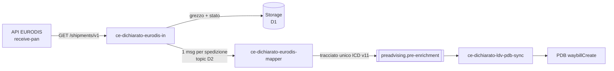
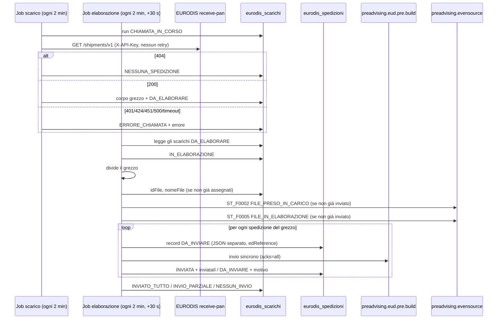
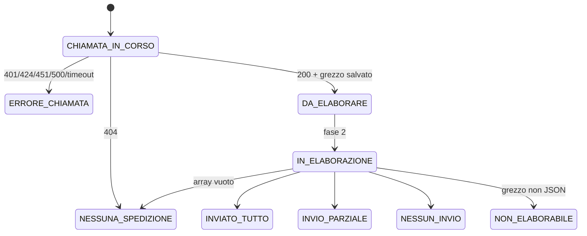

# `ce-dichiarato-eurodis-in` — Documento funzionale per lo sviluppo

**Iniziativa**: 136596 — Eurodis autoproduttore · **Versione**: 0.6.1 (persistenza su PostgreSQL, eventi di stato, risposte EURODIS; da implementare) · **Data**: 2026-11-10
**Autore**: Mary (analyst) · **Destinatario**: Amelia (dev) e team di sviluppo
**Repository**: https://posteitaliane.ghe.com/SVILUPPO/CORRIERE-ESPRESSO_PREADVISING_ce-dichiarato-eurodis-in
**Generato da**: [prompt-ce-dichiarato-eurodis-in.md](prompt-ce-dichiarato-eurodis-in.md)
**Implementazione**: branch `feature/eurodis-base-implementation`, commit `a53398c` (04-11, 53 test verdi).
Assessment: [assessment-ce-dichiarato-eurodis-in-2026-11-04.md](assessment-ce-dichiarato-eurodis-in-2026-11-04.md)

Etichette usate nel documento:
- **[FATTO]**: scritto nella specifica EURODIS o verificato con una prova; la fonte è indicata.
- **[IPOTESI]**: non scritto nella specifica, da confermare.
- **[DECISO]**: decisione presa, con data e riferimento.
- **[DA DECIDERE]**: scelta aperta, con proposta e default provvisorio.

---

## 1. Scopo e responsabilità

`ce-dichiarato-eurodis-in` scarica le spedizioni che il consorzio EURODIS affida
a SDA, interrogando l'API EURODIS `receive-pan`, e le consegna, una per
messaggio, al microservizio `ce-dichiarato-eurodis-mapper`.

Il suo unico obiettivo è **non perdere nessuna spedizione**. In pratica:

1. interroga periodicamente `GET /shipments/v1`;
2. salva **subito** il run, l'esito HTTP e la risposta grezza, prima di qualsiasi altra elaborazione;
3. la divide in spedizioni singole, ciascuna con il suo record e il suo JSON;
4. tratta ogni scarico come un **file fittizio** e ne pubblica gli avanzamenti di stato su
   `preadvising.evensource` (sezione 3.3);
5. pubblica una spedizione per messaggio verso il mapper, con l'`idFile` del file fittizio;
6. rende tracciabile e recuperabile tutto quello che ha ricevuto.

**Non fa**, e non deve fare:

| Fuori perimetro | Chi lo fa |
|---|---|
| Validazione di business (CAP, servizi, LDV, contrassegno...) | `ce-dichiarato-eurodis-mapper` |
| Mapping verso il tracciato unico ICD v11, generazione di `id_preadvising` | `ce-dichiarato-eurodis-mapper` |
| Pubblicazione su `preadvising.pre-enrichment` | `ce-dichiarato-eurodis-mapper` |
| Invio delle tracce a EURODIS | `ce-eurodis-send-tracking` |
| Comunicare esiti o errori a EURODIS | nessuno per ora: `receive-pan` non lo prevede (PA-08) |

**[DECISO 30-10, PA-26]** Il flusso è diviso in tre microservizi, e questo è il primo.

## 2. Posizione nella catena



**[DECISO 29-10]** Catena: lettura API → mapping verso ICD → ms sync → PDB.

Il confine con il mapper è il **messaggio** (sezione 3.2). Questo microservizio
garantisce che ogni spedizione ricevuta:
- sia salvata,
- finisca sul topic almeno una volta,
- arrivi così com'è, senza modifiche al contenuto.

## 3. Interfacce

### 3.1 In ingresso: API EURODIS `receive-pan`

| Voce | Valore | |
|---|---|---|
| URL TEST | `https://testapi.eurodis.com/receive-pan` | [FATTO] swagger `servers` |
| URL PROD | `https://api.eurodis.com/receive-pan` | [FATTO] raggiungibile, risponde `401` senza chiave (prova del 30-10) |
| Autenticazione | header `X-API-Key: <chiave del partner SDA>` | [FATTO] descrizione della pagina; **non** è nei `securitySchemes` dello swagger, quindi un client generato non la aggiunge |
| Formato | `application/json` | [FATTO] |
| Specifica | `../eurodis-receive-pan-swagger-v1.json` (OpenAPI 3.0, NSwag 14.6.3) | [FATTO] |

**Endpoint**

| Metodo e path | Uso | Risposte |
|---|---|---|
| `GET /shipments/v1` | Scarico batch. Nessun parametro: niente paginazione, filtri o cursore | `200` array di `GetShipmentResponse2` · `404` *"No new shipments available"* · `401` · `424` · `451` · `500` |
| `GET /shipment/{edReference}/v1` | Rilettura puntuale, usata solo per il recupero | `200` una spedizione · `400` edReference non valido · `401` · `404` non trovata · `424` · `451` · `500` |

Significato dei codici [FATTO, swagger]:
- `404` su `/shipments/v1` vuol dire "nessuna spedizione nuova": è un **esito normale**.
- `401`: chiave mancante o non valida. Il corpo è testo semplice (`Invalid API Key`), non JSON [FATTO, prova del 26-10].
- `424`: EURODIS non riesce a determinare il partner.
- `451`: il partner non ha accesso alla spedizione richiesta.
- `500`: errore generico.

**Modello di consegna**

- [FATTO] La descrizione dello swagger dice: *"Deploys all new shipments, that have not already been deployed to the partner"*.
- [FATTO] Non esiste un endpoint di conferma (acknowledge o commit).
- [FATTO I1, confermata da EURODIS il 10-11] `GET /shipments/v1` restituisce solo le spedizioni non ancora ricevute e non c'è ack: la consegna è **at-most-once**. Una risposta persa per timeout, crash o retry del client fa perdere le spedizioni. Due vie di recupero: la GET puntuale, se si conosce l'`edReference` (disponibile per **60 giorni**); oppure la **richiesta a EURODIS di rimettere tutti i dati** nella richiesta successiva (modalità da concordare in call). Vedi [risposte-eurodis-2026-11-10.md](../risposte-eurodis-2026-11-10.md) (PA-05, PA-09 chiusi).
- [IPOTESI I2] La GET puntuale non ha effetti collaterali e funziona anche su spedizioni già scaricate.
- [FATTO 10-11] Nessun limite né paginazione, per ora; EURODIS consiglia una chiamata ogni 15-20 minuti (frequenza decisa: sezione 8). Prima chiamata: solo il non ancora ricevuto, nessun arretrato storico. Nessuna rettifica dopo l'attivazione (PA-06, PA-27 chiusi).

Ne segue che **`GET /shipments/v1` non è sicura né idempotente**, anche se è una GET. Va trattata come un'operazione che consuma i dati.

**Dati della spedizione che servono a questo microservizio**

Il microservizio **non** deserializza la spedizione in un DTO completo. Gli
serve solo:

| Campo | Tipo nello swagger | Uso |
|---|---|---|
| `edReference` | `number`/`decimal`, 1..9999999999999, obbligatorio | Chiave della spedizione: idempotenza, chiave del messaggio, recupero |

Il resto della spedizione si conserva **così com'è** (JSON grezzo) e si passa al mapper.

Perché non si deserializza tutto [FATTO]:
- lo swagger ha due schemi, `GetShipmentResponse2` (referenziato) e `GetShipmentResponse` (con campi in più), e non si sa quale arrivi;
- lo swagger non contiene esempi.

Leggere un JSON generico ed estrarre solo `edReference` rende il microservizio immune da queste incertezze.

### 3.2 In uscita: messaggio verso `ce-dichiarato-eurodis-mapper`

**[DECISO]** Un messaggio per spedizione, mai un unico messaggio con tutta la lista: messaggi sovradimensionati sono già stati visti in produzione.

**[DECISO 30-10]** Topic: **`preadvising.eud.pre.build`**.

**[DECISO 04-11, D2, PA-31]** Il contratto del messaggio:

- **Chiave**: `edReference` normalizzato a stringa senza decimali (RF-07). Così
  tutte le versioni della stessa spedizione finiscono nella stessa partizione,
  in ordine.
- **Corpo**: **l'elemento dell'array `GetShipmentResponse2` così com'è**, senza
  trasformazioni e senza buste (PA-31). Il mapper riceve esattamente la
  spedizione EURODIS.
- **Header Kafka** (metadati, fuori dal corpo):

| Header | Esempio | Uso |
|---|---|---|
| `edReference` | `7319003746401` | ridondante con la chiave, comodo per i filtri |
| `idEsecuzione` | `6720f1a2b3c4d5e6f7a8b9c0` | id dello scarico in `eurodis_scarichi` |
| `ricevutoIl` | `2026-10-30T09:15:02.123Z` | istante di ricezione da EURODIS |
| `fonte` | `receive-pan/shipments/v1` oppure `receive-pan/shipment/v1` | distingue lo scarico normale dalla rilettura (RF-16) |
| `rifGrezzo` | `eurodis_scarichi/6720f1a2b3c4d5e6f7a8b9c0` | serve al mapper per `link_file_fisico_inviato` |
| `idFile` | `3f2b8c1e-5a7d-4c1b-9e2f-0a1b2c3d4e5f` | id del file fittizio dello scarico (sezione 3.3); il mapper lo scrive in `id_file`, così il tracciato è collegato agli eventi di stato [DECISO 06-11] |
| `ambiente` | `TEST` / `PROD` | |
| `schemaVersion` | `1` | versione del contratto |
| `traceparent` | W3C | contesto di tracing (span PRODUCER), per continuare la traccia nel mapper |

Tenere i metadati negli header lascia il corpo identico al dato EURODIS (RF-14)
e non obbliga il mapper a conoscere una busta.

### 3.3 In uscita: eventi di stato del file fittizio su `preadvising.evensource`

**[DECISO 06-11, Diego]** Il servizio che elabora il grezzo genera due eventi di avanzamento
di stato, nello stesso formato dei flussi a file. EURODIS non manda un file, quindi **ogni
scarico con almeno una spedizione è un file fittizio**, con un suo `idFile`. Lo stesso `idFile`
va negli eventi e nell'header `idFile` di ogni spedizione inviata al mapper (sezione 3.2), che
lo propaga in `id_file` del tracciato.

Ordine: prima **`ST_F0002` `FILE_PRESO_IN_CARICO`**, poi **`ST_F0005` `FILE_IN_ELABORAZIONE`**,
poi le spedizioni.

**[FATTO]** Modello: `ce-dichiarato-builder`, classi `EventSourceMessage.newWithDefault`,
`MonitoringMessageBuilder`, `EventSourceProducer`, `FilePreadvisingStateId`.

- **Topic**: `kafka.topics.event-store`, env `KAFKA_TOPIC_EVENT_STORE`. **[FATTO]** Builder,
  `ce-dichiarato-ldv` e i valori Helm di svil e coll usano **`preadvising.evensource`** (senza la
  "t"). Solo `ce-dichiarato-state-machine-handler` scrive `preadvising.eventsource`. Default
  `preadvising.evensource`: domanda 1.
- **Chiave**: nessuna, come il builder (commit `266b7da` "rimossa key con identificativo file").
- **Header**: `eventTime` = `dataStato`, `source` = `ce-dichiarato-eurodis-in`,
  `traceId` = `idFile`, più `traceparent`.
- **Corpo**: campi `null` omessi (`NON_NULL`, come il builder):

```json
{
  "id": "<idFile>",
  "aggregateId": "<idFile>",
  "aggregateType": "file",
  "eventData": {
    "idFile": "3f2b8c1e-5a7d-4c1b-9e2f-0a1b2c3d4e5f",
    "nomeFile": "eurodis.20261106091402123.json",
    "idStato": "ST_F0002",
    "stato": "FILE_PRESO_IN_CARICO",
    "dataStato": "2026-11-06T09:14:32.456+01:00",
    "codiceLoginCliente": "<da configurazione>",
    "nominativoCliente": "<da configurazione>",
    "partitaIVA": "<da configurazione>",
    "ragioneSociale": "<da configurazione>",
    "canale": "EUD_INVIOSYSTEM",
    "numeroRecord": 5,
    "esito": "OK",
    "linkFileFisicoInviato": "eurodis_scarichi/6720f1a2b3c4d5e6f7a8b9c0"
  },
  "metadata": {
    "timestamp": "2026-11-06T09:14:32.456108111+01:00",
    "correlationId": "<idFile>",
    "source": "ce-dichiarato-eurodis-in",
    "replay": false
  },
  "timestamp": "2026-11-06T09:14:32.456+01:00",
  "eventType": "ST_F0002"
}
```

Il secondo evento è identico, tranne `idStato`/`eventType` `ST_F0005`, `stato`
`FILE_IN_ELABORAZIONE` e i tempi.

| Campo | Valore | Rif. |
|---|---|---|
| `id`, `aggregateId`, `metadata.correlationId`, `eventData.idFile` | `idFile`, UUID generato quando lo scarico entra in fase 2 con almeno una spedizione, salvato sullo scarico; lo stesso per i due eventi | come il builder |
| `eventData.nomeFile` | `eurodis.<yyyyMMddHHmmssSSS>.json`, timestamp = `ricevutoIl` dello scarico in Europe/Rome; salvato sullo scarico | [DA DECIDERE] formato del nome: domanda 2 |
| `idStato`, `stato`, `eventType` | `ST_F0002` / `FILE_PRESO_IN_CARICO`, poi `ST_F0005` / `FILE_IN_ELABORAZIONE` | |
| `dataStato`, `timestamp` | istante dell'evento, Europe/Rome, `yyyy-MM-dd'T'HH:mm:ss.SSSXXX` | come il builder |
| `metadata.timestamp` | stesso istante, precisione piena (serializzazione standard di `ZonedDateTime`) | come il builder |
| `codiceLoginCliente`, `nominativoCliente`, `partitaIVA`, `ragioneSociale` | configurazione `eurodis.in.file.*`; vuoti = omessi | stessi valori del cliente del mapper (PA-33): domanda 3 |
| `canale` | `EUD_INVIOSYSTEM` (configurabile) | DF-04 |
| `numeroRecord` | numero di spedizioni del grezzo | come `addPdbMetadata` del builder |
| `esito` | `OK` | |
| `linkFileFisicoInviato` | `rifGrezzo` (`eurodis_scarichi/<idScarico>`) | |
| `metadata.source` | `spring.application.name` | |
| `metadata.replay` | `false` | |

Gli stati finali del file (`ST_F0006` `FILE_ELABORATO_CON_SUCCESSO`, `ST_F0008`
`FILE_COMPLETAMENTE_SCARTATO`) **non** si inviano: non richiesti (domanda 4).

### 3.4 Persistenza

**[DECISO 10-11, Diego]** PostgreSQL, database dedicato `ce_eud_api_in`, schema `public`, al posto
di MongoDB (supera D1 del 04-11). DDL complete, indici, conservazione, ambiente e guida al codice:
[ddl-ce-eurodis-api-in.md](ddl-ce-eurodis-api-in.md). Accesso con `spring-boot-starter-jdbc`
come gli altri servizi `ce-`; le tabelle le crea il DBA, il servizio non fa DDL.

Il grezzo e il JSON di ogni spedizione stanno in colonne `text`, non `jsonb`: il testo resta
**identico** a quello ricevuto (RF-06, RF-14). Niente più GridFS: `text` regge fino a 1 GB.

**`eurodis_scarichi`**: una riga per ogni run verso EURODIS (scarico o rilettura). Contiene il run,
l'esito HTTP e il grezzo, e dopo la fase 2 l'esito dell'invio.

| Colonna | Note |
|---|---|
| `id` | `uuid` generato dal servizio; è l'`idEsecuzione` negli header e la parte finale di `rifGrezzo` (`eurodis_scarichi/<id>`) |
| `tipo` | `SCARICO` (`/shipments/v1`) o `RILETTURA` (`/shipment/{edReference}/v1`) |
| `ed_reference_richiesto` | solo per le riletture |
| `istanza` | pod che ha eseguito |
| `avviato_il`, `ricevuto_il` | inizio del run, istante della risposta |
| `http_status`, `durata_ms`, `errore` | esito della chiamata; `errore` senza dati personali, max 300 caratteri |
| `corpo` | grezzo esattamente come ricevuto (`text`) |
| `dimensione_byte`, `sha256` | verifica del grezzo |
| `stato` | vedi sezione 6 (`CHECK` sui valori) |
| `numero_spedizioni`, `numero_inviate`, `numero_non_inviate` | esito della fase 2 |
| `id_file`, `nome_file` | file fittizio (sezione 3.3), assegnati alla prima presa in carico e mai più cambiati; `id_file` univoco |
| `evento_preso_in_carico_il`, `evento_in_elaborazione_il` | invio confermato degli eventi `ST_F0002` e `ST_F0005`: impediscono di rimandarli alla ripresa |
| `elaborazione_iniziata_il`, `elaborazione_conclusa_il` | fase 2 |

**`eurodis_spedizioni`**: una riga per spedizione, con il suo JSON.

| Colonna | Note |
|---|---|
| `id` | `edReference` normalizzato; per le spedizioni non identificabili `<idScarico>#<posizione>` |
| `ed_reference` | |
| `json` | JSON della singola spedizione, identico al testo ricevuto (`text`) |
| `id_scarico`, `id_file`, `posizione`, `fonte`, `rif_grezzo`, `ricevuto_il` | provenienza dell'ultima ricezione; `id_file` va nell'header anche nei reinvii |
| `stato_invio` | `DA_INVIARE`, `INVIATA`, `ERRORE_INVIO`, `NON_IDENTIFICABILE` |
| `inviata_il` | ora dell'invio confermato dal broker |
| `tentativi_invio`, `ultimo_errore` | perché non è partita |
| `numero_ricezioni`, `prima_ricezione_il`, `ultima_ricezione_il` | quante volte è arrivata; una nuova ricezione aggiorna la riga (`INSERT ... ON CONFLICT`) |

**`eurodis_richieste_manuali`**: traccia dei recuperi e reinvii già eseguiti (RF-16, RF-17),
chiave `(tipo, ed_reference)`.

**`shedlock`**: lock dei job (ShedLock JDBC, `usingDbTime()`).

Indici parziali per le query dei job (scarichi `DA_ELABORARE`/`IN_ELABORAZIONE`, spedizioni
`DA_INVIARE` ferme, spedizioni in attesa) e per periodo (`avviato_il`, `ultima_ricezione_il`).
**[DA DECIDERE]** La conservazione: ogni run viene salvato, anche i `404` (720 righe al giorno con il
cron a 2 minuti). Proposta di job di pulizia nel documento DDL, sezione 4.

## 4. Flusso di elaborazione

Due job distinti, ognuno con il suo lock: girano su un solo pod alla volta.



**Fase 1, scarico** (`ScaricoService`):
1. se `eurodis.in.abilitato=false` non fa nulla;
2. salva il run con stato `CHIAMATA_IN_CORSO`;
3. chiama `GET /shipments/v1` una volta sola;
4. `404` → `NESSUNA_SPEDIZIONE`; non-200 → `ERRORE_CHIAMATA` con esito ed errore; eccezione di
   rete → `ERRORE_CHIAMATA` senza esito HTTP;
5. `200` → salva il corpo grezzo in `corpo` e porta lo scarico a `DA_ELABORARE`.

**Fase 2, elaborazione** (`ElaborazioneService`):
1. prende gli scarichi `DA_ELABORARE` in ordine di arrivo, più quelli rimasti `IN_ELABORAZIONE`
   oltre la durata massima del lock (riavvio a metà);
2. porta lo scarico a `IN_ELABORAZIONE`;
3. divide il grezzo: un array (`/shipments/v1`) diventa N testi, uno per spedizione, identici a
   come sono arrivati; un oggetto (rilettura) è una spedizione sola; altro → `NON_ELABORABILE`;
   array vuoto → `NESSUNA_SPEDIZIONE`. In questi due casi nessun file fittizio e nessun evento;
4. con almeno una spedizione: assegna `idFile` e `nomeFile` se lo scarico non li ha già, poi
   invia `ST_F0002` e `ST_F0005`, ciascuno solo se non risulta già inviato (RF-20). Se un evento
   non parte, lo scarico torna `DA_ELABORARE` con l'errore e **nessuna spedizione viene inviata**:
   riprova il ciclo successivo (RF-21);
5. per ogni spedizione estrae `edReference`:
   - assente o non valido → record `NON_IDENTIFICABILE` con il motivo, nessun invio;
   - valido → record `DA_INVIARE`, invio sincrono con header `idFile`, poi `INVIATA` con `inviataIl`, oppure resta
     `DA_INVIARE` con tentativi e motivo;
6. chiude lo scarico: nessuna spedizione → `NESSUNA_SPEDIZIONE`; tutte inviate → `INVIATO_TUTTO`;
   nessuna inviata → `NESSUN_INVIO`; altrimenti `INVIO_PARZIALE`.

## 5. Regole funzionali

| ID | Regola | Implementazione |
|---|---|---|
| RF-01 | Lo scarico gira solo se `eurodis.in.abilitato=true` (default `false`, rilascio incrementale) [DECISO, PA-28]. La rilettura puntuale funziona anche con lo scarico disabilitato. | `ScaricoService.scarica` |
| RF-02 | Ogni job gira su **un solo pod** anche con più repliche (ShedLock su PostgreSQL, tabella `shedlock`, `lockAtMostFor` 15 min). | `EurodisScheduler`, `SchedulingConfig` |
| RF-03 | Ogni chiamata invia `X-API-Key` letto dal secret (`api-key`). La chiave non compare mai nei log. | `ReceivePanClient` |
| RF-04 | `GET /shipments/v1` si chiama **una volta per run e senza retry**: client Apache con `disableAutomaticRetries`, nessun Spring Retry. Il progetto non usa service mesh: nessun retry fuori dal codice. | `AppConfig` |
| RF-05 | `404` = nessuna spedizione: run regolare, nessun alert. | `ScaricoService` |
| RF-06 | Con `200` il corpo si salva **integro e per primo**. Se il salvataggio fallisce: log CRITICO con gli `edReference` estratti dal testo, per il recupero con RF-16. | `ScaricoService`, `GrezzoStore` |
| RF-07 | `edReference` si normalizza a stringa intera senza decimali (`7319003746401.0` → `7319003746401`), con `BigDecimal`. Parte decimale ≠ 0, fuori intervallo o assente → non identificabile. Accettato anche come testo numerico. | `EdReference` |
| RF-08 | Un record per `edReference` in `eurodis_spedizioni`, aggiornato a ogni ricezione (`numeroRicezioni`, `ultimaRicezioneIl`). | `SpedizioneService` |
| RF-09 | **Nessun filtro dei duplicati** [DECISO 04-11]: una spedizione ricevuta di nuovo si salva e si reinvia sempre. La deduplica è a valle. | `SpedizioneService` |
| RF-10 | Invio Kafka sincrono, `acks=all`, producer idempotente; l'esito si scrive sul record solo dopo la conferma del broker. | `SpedizioneProducer` |
| RF-11 | Il job di ripubblicazione reinvia i record `DA_INVIARE` fermi da più di 5 minuti. Dopo 10 tentativi il record va in `ERRORE_INVIO` (si sblocca con RF-17). | `RipubblicazioneService` |
| RF-12 | Ogni run lascia nel log `id_scarico`, esito HTTP, numero di spedizioni inviate e non inviate. Mai dati personali nei log. | servizi |
| RF-13 | Una spedizione non identificabile non si scarta in silenzio: record `NON_IDENTIFICABILE` con JSON e motivo, scarico `INVIO_PARZIALE`. | `SpedizioneService.registraNonIdentificabile` |
| RF-14 | Il corpo del messaggio è il testo della spedizione **identico** a quello ricevuto (non riserializzato). | `AnalizzatoreSpedizioni.elementi` |
| RF-15 | I corpi di errore in testo semplice (`401 Invalid API Key`) si registrano come testo nell'`errore` del run. | `ScaricoService` |
| RF-16 | Recupero puntuale: gli `edReference` in `eurodis.in.recupero.ed-references` si rileggono con `GET /shipment/{edReference}/v1` (run `RILETTURA`), una volta per valore. **[FATTO 10-11]** EURODIS tiene la spedizione rileggibile per **60 giorni**: oltre, resta solo il grezzo salvato; i fallimenti 5xx o di rete si ritentano al giro dopo. **Nessun endpoint applicativo** [DECISO 04-11]. | `RichiesteManualiService` |
| RF-17 | Reinvio manuale: gli `edReference` in `eurodis.in.ripubblica.ed-references` si reinviano dal record salvato, senza chiamare EURODIS, una volta per valore. | `RichiesteManualiService` |
| RF-18 | **Metriche e span su tutto** [DECISO 04-11]: ogni job, la chiamata EURODIS e l'invio Kafka hanno uno span OpenTelemetry e metriche Micrometer (sezione 9). Il contesto W3C va negli header Kafka. Il tracing non deve mai mandare in errore la lavorazione. | `TraceUtil`, `MetricheEurodisIn` |
| RF-19 | **File fittizio** [DECISO 06-11]: ogni scarico (o rilettura) con almeno una spedizione ha un `idFile` (UUID) e un `nomeFile`, assegnati una volta sola e salvati sullo scarico. L'`idFile` va nell'header `idFile` di ogni spedizione inviata, anche nei reinvii (RF-11, RF-17). | da implementare |
| RF-20 | Prima delle spedizioni si pubblicano su `preadvising.evensource`, in quest'ordine, `ST_F0002` `FILE_PRESO_IN_CARICO` e `ST_F0005` `FILE_IN_ELABORAZIONE` (sezione 3.3), con invio sincrono e `acks=all`. Ogni evento si invia **una volta sola** per scarico: l'invio confermato si scrive sullo scarico (`eventoPresoInCaricoIl`, `eventoInElaborazioneIl`) e alla ripresa non si ripete. | da implementare |
| RF-21 | Se un evento non parte, lo scarico torna `DA_ELABORARE` con l'errore, nessuna spedizione viene inviata e si riprova al ciclo successivo: un tracciato non arriva mai a valle prima del suo file. | da implementare |

## 6. Stati

**Scarico** (`eurodis_scarichi.stato`)



Uno scarico rimasto `CHIAMATA_IN_CORSO` vuol dire che il pod è caduto durante la chiamata: è la
finestra in cui si possono perdere spedizioni (I1).

**Spedizione** (`eurodis_spedizioni.statoInvio`)

| Stato | Significato | Transizioni |
|---|---|---|
| `DA_INVIARE` | salvata, invio non ancora confermato | → `INVIATA`; → `ERRORE_INVIO` dopo 10 tentativi |
| `INVIATA` | confermata dal broker (`inviataIl`) | → `DA_INVIARE` se la spedizione arriva di nuovo |
| `ERRORE_INVIO` | tentativi esauriti | → `INVIATA` con il reinvio manuale (RF-17) |
| `NON_IDENTIFICABILE` | senza `edReference` valido, mai inviata | stato finale; il JSON resta sul record |

## 7. Gestione errori e recupero

| Scenario | Comportamento | Dove si vede | Recupero |
|---|---|---|---|
| `404` | run `NESSUNA_SPEDIZIONE` | `eurodis_scarichi` | — |
| `401` (chiave) | run `ERRORE_CHIAMATA`, errore `HTTP 401: Invalid API Key` | `eurodis_scarichi`, span in errore | Verificare il secret `api-key` o la chiave con EURODIS. Nessuna spedizione persa |
| `424` / `451` | run `ERRORE_CHIAMATA` | idem | Configurazione del partner presso EURODIS (Chiapponi) |
| `500` | run `ERRORE_CHIAMATA`, nessun retry | idem | Prossimo run. Se EURODIS avesse già segnato le spedizioni come consegnate: richiesta di rimando a EURODIS, come sopra |
| Timeout o connessione caduta | run `ERRORE_CHIAMATA` senza esito HTTP, log CRITICO | idem | **Rischio di perdita** (I1): chiedere a EURODIS di **rimettere tutti i dati** nella richiesta successiva (risposte EURODIS del 10-11, modalità da concordare), oppure gli `edReference` del periodo da recuperare con RF-16 entro 60 giorni. I doppioni che ne derivano si filtrano a valle |
| Pod caduto durante la chiamata | run rimasto `CHIAMATA_IN_CORSO` | `eurodis_scarichi` | come sopra |
| PostgreSQL giù al salvataggio del grezzo | log CRITICO con gli `edReference` estratti dal testo | log | RF-16 per gli `edReference` del log |
| Pod caduto durante la fase 2 | scarico rimasto `IN_ELABORAZIONE` | `eurodis_scarichi` | Ripreso automaticamente dopo 15 minuti; i record già inviati vengono reinviati (la deduplica è a valle) |
| Kafka giù | record `DA_INVIARE` con motivo; scarico `INVIO_PARZIALE` o `NESSUN_INVIO` | `eurodis_spedizioni` | Automatico con RF-11, poi RF-17 |
| Grezzo non JSON | scarico `NON_ELABORABILE` con errore | `eurodis_scarichi` | Analisi del grezzo salvato |
| Spedizione senza `edReference` valido | record `NON_IDENTIFICABILE`, scarico `INVIO_PARZIALE` | `eurodis_spedizioni` | Analisi con EURODIS |
| Risposta molto grande | grezzo sempre in `corpo` (`text`, fino a 1 GB); warning e metrica sopra 100 MB | metrica | Limiti da chiarire con EURODIS (PA-27) |
| `preadvising.evensource` non disponibile, o utente senza permesso di scrittura | scarico di nuovo `DA_ELABORARE` con errore, nessuna spedizione inviata (RF-21) | `eurodis_scarichi.errore`, metrica `eurodis_in_evento_total{esito="ko"}`, span in errore | Automatico al ciclo successivo; gli eventi già confermati non si rimandano |
| Pod caduto tra un evento e le spedizioni | scarico rimasto `IN_ELABORAZIONE` | `eurodis_scarichi` | Ripresa dopo 15 minuti con lo stesso `idFile`: si inviano solo gli eventi mancanti, poi le spedizioni |


## 8. Configurazione

Variabili d'ambiente (Helm) → proprietà `eurodis.in.*` in `application.yaml`.

| Variabile | Proprietà | Default | Note |
|---|---|---|---|
| `EURODIS_IN_ABILITATO` | `abilitato` | `false` | RF-01 |
| `EURODIS_BASE_URL` | `base-url` | URL TEST | PROD: `https://api.eurodis.com/receive-pan` |
| `EURODIS_API_KEY` | `api-key` | secret `ce-dichiarato-eurodis-in-secret`, chiave `api-key` | |
| `EURODIS_AMBIENTE` | `ambiente` | `TEST` | header `ambiente` |
| `EURODIS_IN_CRON` | `cron` | `0 */2 * * * *` | scarico ogni 2 minuti in svil e coll; **in produzione ogni 10 minuti** (`0 */10 * * * *`, nel `values_TEMPLATE` di prod) [DECISO 10-11, Diego; EURODIS consiglia 15-20 minuti] |
| `EURODIS_ELABORAZIONE_CRON` | `elaborazione.cron` | `30 */2 * * * *` | invio 30 s dopo lo scarico: ogni 2 minuti in svil e coll, **in produzione ogni 10 minuti** (`30 */10 * * * *`) [DECISO 10-11] |
| `EURODIS_TIMEOUT_CONNECT` / `_READ` | `timeout.*` | 10 s / 120 s | |
| `EURODIS_LOCK_DURATA_MAX` | `lock.durata-max` | `PT15M` | anche soglia di ripresa degli scarichi `IN_ELABORAZIONE` |
| `EURODIS_GREZZO_SOGLIA_GUARDIA` | `grezzo.soglia-guardia` | 100 MB | warning e metrica; la soglia GridFS non esiste più |
| `KAFKA_TOPIC_OUTPUT` | `topic` | `preadvising.eud.pre.build` | |
| `KAFKA_TOPIC_EVENT_STORE` | `kafka.topics.event-store` | `preadvising.evensource` | eventi di stato (sezione 3.3), stesso nome di variabile del builder |
| `EURODIS_FILE_CODICE_LOGIN_CLIENTE` / `_NOMINATIVO_CLIENTE` / `_PARTITA_IVA` / `_RAGIONE_SOCIALE` | `file.*` | vuoti (campo omesso) | dati del cliente EURODIS negli eventi; valori per ambiente da ricevere |
| `EURODIS_FILE_CANALE` | `file.canale` | `EUD_INVIOSYSTEM` | |
| `KAFKA_PRODUCER_SEND_TIMEOUT` | `pubblicazione.timeout` | 10 s | |
| `EURODIS_RIPUBBLICAZIONE_CRON` / `_ATTESA_MIN` / `_TENTATIVI_MAX` | `ripubblicazione.*` | ogni 2 min / 5 min / 10 | RF-11 |
| `EURODIS_RECUPERO_CRON` | `recupero.cron` | `30 */5 * * * *` | job delle richieste manuali |
| `EURODIS_RECUPERO_ED_REFERENCES` | `recupero.ed-references` | vuoto | RF-16, separati da virgola |
| `EURODIS_RIPUBBLICA_ED_REFERENCES` | `ripubblica.ed-references` | vuoto | RF-17 |
| `DATASOURCE_URL` | `spring.datasource.url` | svil `jdbc:postgresql://strkevoldb01azwe.postgres.database.azure.com:5432/ce_eud_api_in`, coll `ttrkevoldb01azwe` | in `deploy-svil` e `deploy-coll` [DECISO 10-11] |
| `DATASOURCE_USERNAME` / `DATASOURCE_PASSWORD` | `spring.datasource.*` | secret `ce-postgres`, chiavi `datasource-name` / `data-source-password` | stesso secret di `ce-db-sync` [DECISO 10-11] |
| `DATASOURCE_HIKARI_MINIMUM_IDLE` / `_MAXIMUM_POOL_SIZE` / `_IDLE_TIMEOUT` | `spring.datasource.hikari.*` | 1 / 5 / 30000 | |
| `KAFKA_SCRAM_USERNAME` / `_PASSWORD` | SASL | secret | |

## 9. Osservabilità: metriche e span

Lo schema segue `ce-dichiarato-adapter`: OpenTelemetry (BOM 1.54.1, agent autoconfigurato con
`-Dotel.java.global-autoconfigure.enabled=true`, già in Helm), Micrometer/Prometheus su
`/actuator/prometheus` (porta 8091), tag comune `service=ce-dichiarato-eurodis-in`. Principio
invariante: l'instrumentation non manda mai in errore la lavorazione (`TraceUtil`).

**Span**

| Span | Tipo | Attributi | Errore se |
|---|---|---|---|
| `eurodis.scarico` | INTERNAL, radice del job | `id_scarico`, `tipo_scarico`, `stato_scarico`, `http_status` | `ERRORE_CHIAMATA` |
| `eurodis.rilettura` | INTERNAL, radice | come sopra | come sopra |
| `eurodis.receive_pan.get` | CLIENT, figlio | `http_status`, `durata_ms` | eccezione o HTTP diverso da 200/404 |
| `eurodis.elaborazione` | INTERNAL, radice del job | `scarichi` | — |
| `eurodis.elaborazione.scarico` | INTERNAL, figlio | `id_scarico`, `stato_scarico`, `spedizioni`, `inviate` | esito diverso da `INVIATO_TUTTO` / `NESSUNA_SPEDIZIONE` |
| `preadvising.eud.pre.build send` | PRODUCER | `topic_output`, `ed_reference` | invio fallito |
| `preadvising.evensource send` | PRODUCER, figlio di `eurodis.elaborazione.scarico` | `id_file`, `id_stato` | invio fallito |
| `eurodis.ripubblicazione` | INTERNAL, radice | `spedizioni` | — |
| `eurodis.richieste_manuali` | INTERNAL, radice | — | — |

Lo span PRODUCER inietta il contesto W3C (`traceparent`) negli header del messaggio: il mapper
può continuare la stessa traccia.

**Metriche** (nomi Prometheus)

| Metrica | Tipo | Tag | Significato |
|---|---|---|---|
| `eurodis_in_chiamata_total` | counter | `tipo`, `esito` (status HTTP o `errore`) | chiamate a EURODIS |
| `eurodis_in_chiamata_durata` | timer | `tipo` | durata delle chiamate |
| `eurodis_in_risposta_byte` | summary | — | dimensione delle risposte 200 |
| `eurodis_in_risposta_oltre_soglia_total` | counter | — | risposte oltre la soglia di guardia |
| `eurodis_in_scarico_total` | counter | `stato` | run per stato finale della fase 1 |
| `eurodis_in_scarico_ultimo_epoch_seconds` | gauge | — | ultimo run concluso: allarme di batch fermo |
| `eurodis_in_grezzo_salvataggio_ko_total` | counter | — | salvataggi del grezzo falliti (critico) |
| `eurodis_in_elaborazione_total` | counter | `stato` | scarichi elaborati per esito |
| `eurodis_in_spedizioni_ricevute_total` | counter | — | spedizioni lette dai grezzi |
| `eurodis_in_spedizioni_inviate_total` | counter | — | invii confermati |
| `eurodis_in_spedizioni_invio_ko_total` | counter | — | invii falliti |
| `eurodis_in_spedizioni_non_identificabili_total` | counter | — | spedizioni senza `edReference` valido |
| `eurodis_in_spedizioni_in_attesa` | gauge | — | record `DA_INVIARE` + `ERRORE_INVIO` |
| `eurodis_in_evento_total` | counter | `id_stato`, `esito` (`ok`/`ko`) | eventi di stato del file fittizio |

**Log**: JSON (logstash) con MDC `id_scarico`, `id_file` ed `ed_reference`. Mai dati personali né la chiave.

**Alert da configurare in Datadog** (non sono nel codice):

| Gravità | Condizione |
|---|---|
| Critico | `eurodis_in_chiamata_total{esito="errore"}` > 0; `eurodis_in_grezzo_salvataggio_ko_total` > 0; scarico rimasto `CHIAMATA_IN_CORSO` |
| Alto | `esito` 401, 424, 451; `eurodis_in_scarico_ultimo_epoch_seconds` più vecchio di 6 minuti |
| Medio | `esito` 500; `eurodis_in_spedizioni_in_attesa` > 0 per più di 30 minuti; non identificabili > 0; risposta oltre soglia |

## 10. Requisiti non funzionali

| ID | Requisito | Come si verifica |
|---|---|---|
| RNF-01 | Il grezzo è salvato prima di qualsiasi altra elaborazione | Test: crash simulato dopo il salvataggio → grezzo presente, spedizioni recuperate da RF-11 |
| RNF-02 | Zero retry su `GET /shipments/v1` | Test con mock che risponde `500` o va in timeout: una sola richiesta registrata dal mock |
| RNF-04 | `404` non genera errori, alert o eventi del circuit breaker | Test con coda vuota del mock |
| RNF-05 | Un record per `edReference` | Test: la stessa spedizione ricevuta due volte → un solo record con `numeroRicezioni` = 2 e due invii (nessun filtro duplicati, RF-09) |
| RNF-06 | Un messaggio per spedizione, dimensione del messaggio sotto il limite del topic | Test con 1.000 spedizioni in una risposta |
| RNF-07 | Lettura tollerante: campi sconosciuti accettati; `edReference` con e senza `.0`; timestamp non interpretati | Test con payload che contengono i campi di `GetShipmentResponse` |
| RNF-08 | Chiave API solo da secret, mai nei log | Ispezione dei log in test |
| RNF-09 | Nessun dato personale nei log | Ispezione dei log in test |
| RNF-10 | Una sola istanza attiva con N repliche | Test con 2 repliche contro il mock: una sola chiamata per ciclo |
| RNF-12 | Metriche e span su ogni job, chiamata e invio | `ScaricoServiceTracingTest`; verifica in Datadog |
| RNF-11 | Recupero completo dopo un riavvio a metà elaborazione | Test: kill del pod durante la pubblicazione → tutte le spedizioni `PUBBLICATA` dopo il riavvio |

## 11. Criteri di accettazione e casi di test

Test automatici nel repository (53, tutti verdi al commit `a53398c`): `ReceivePanClientTest`,
`ScaricoServiceTest`, `ScaricoServiceTracingTest`, `ElaborazioneServiceTest`,
`SpedizioneServiceTest`, `AnalizzatoreSpedizioniTest`, `EdReferenceTest`, `GrezzoStoreTest`,
`RipubblicazioneServiceTest`, `RichiesteManualiServiceTest`, `SpedizioneProducerTest`,
`EurodisInPropertiesTest`.

Criteri da verificare anche end-to-end contro `mock-eurodis` (`../mock-eurodis/`, chiave
`test-key-sda`):

| ID | Given | When | Then | Unit test |
|---|---|---|---|---|
| AC-01 | 5 spedizioni in coda | scarico + elaborazione | 1 scarico `INVIATO_TUTTO`, 5 record `INVIATA` con `inviataIl`, 5 messaggi con chiave `edReference` | ✅ |
| AC-02 | Coda vuota | scarico | scarico `NESSUNA_SPEDIZIONE`, nessun messaggio | ✅ |
| AC-03 | Chiave errata | scarico | `ERRORE_CHIAMATA`, errore `HTTP 401: Invalid API Key`, chiave assente dai log | ✅ |
| AC-04 | Mock che risponde `500` | scarico | **una sola** richiesta, `ERRORE_CHIAMATA` | ✅ |
| AC-05 | Mock in timeout | scarico | una sola richiesta, `ERRORE_CHIAMATA`, span in errore | ✅ |
| AC-06 | 3 spedizioni e Kafka spento | elaborazione, poi Kafka torna | scarico `NESSUN_INVIO`, record `DA_INVIARE` con motivo; dopo la ripubblicazione `INVIATA` | ✅ (unit) |
| AC-07 | Kill del pod durante l'elaborazione | riavvio | lo scarico `IN_ELABORAZIONE` si riprende dopo 15 minuti | ✅ (unit) |
| AC-08 | Spedizione già inviata riproposta | scarico + elaborazione | stesso record, `numeroRicezioni` = 2, nuovo invio | ✅ |
| AC-09 | Due spedizioni, una non parte | elaborazione | scarico `INVIO_PARZIALE`, motivo sul record | ✅ |
| AC-10 | `edReference` `7319003746401.0` | elaborazione | chiave e `id` `7319003746401`, corpo con `.0` intatto | ✅ (da rifare su PostgreSQL) |
| AC-11 | Spedizione senza `edReference` | elaborazione | record `NON_IDENTIFICABILE` `<idScarico>#<posizione>`, scarico `INVIO_PARZIALE`, le altre inviate | ✅ |
| AC-12 | Spedizione con campi in più (`routingCode`) | elaborazione | corpo del messaggio identico al ricevuto | ✅ |
| AC-13 | 2 repliche | cron | una sola chiamata al mock | da provare in ambiente |
| AC-14 | `edReference` in `eurodis.in.recupero.ed-references` | job richieste manuali | run `RILETTURA` `DA_ELABORARE`, poi invio con `fonte` = rilettura; non si ripete | ✅ |
| AC-15 | `eurodis.in.abilitato=false` | cron | nessuna chiamata | ✅ |
| AC-16 | Grezzo oltre 10 MB | scarico | grezzo intero in `corpo`, `sha256` uguale a quello del testo ricevuto | da rifare su PostgreSQL |
| AC-17 | 5 spedizioni in coda | scarico + elaborazione | su `preadvising.evensource` 2 eventi, `ST_F0002` poi `ST_F0005`, stesso `idFile`, `numeroRecord` 5, senza chiave; poi 5 messaggi su `preadvising.eud.pre.build` con header `idFile` uguale | da fare |
| AC-18 | Coda vuota, oppure array vuoto | scarico + elaborazione | nessun evento | da fare |
| AC-19 | `preadvising.evensource` non disponibile | elaborazione, poi il topic torna | primo ciclo: scarico `DA_ELABORARE` con errore, nessuna spedizione inviata; ciclo dopo: eventi e spedizioni inviati, stesso `idFile` | da fare |
| AC-20 | Kill del pod dopo `ST_F0002` | ripresa dopo 15 minuti | `ST_F0002` non ripetuto, `ST_F0005` e spedizioni inviati con lo stesso `idFile` | da fare |
| AC-21 | Spedizione in `eurodis.in.ripubblica.ed-references` | job richieste manuali | messaggio con l'header `idFile` dello scarico d'origine, nessun nuovo evento | da fare |

**Il mock va esteso** per gli end-to-end di AC-04, AC-05, AC-10, AC-11 e AC-12:
- `500` e timeout configurabili;
- `edReference` con `.0` o assente;
- campi di `GetShipmentResponse`;
- `401` in testo semplice.

## 12. Decisioni e punti aperti

| Punto | Stato | Rif. |
|---|---|---|
| D1. Dove salvare il grezzo | **DECISO 10-11** (supera il 04-11): PostgreSQL `ce_eud_api_in`, colonne `text`, niente GridFS; DDL in [ddl-ce-eurodis-api-in.md](ddl-ce-eurodis-api-in.md) | PA-02 |
| D2. Contratto del messaggio | **DECISO 04-11**: corpo = spedizione così com'è, chiave `edReference`, metadati negli header | PA-31 |
| D3. Istanza unica | **IMPLEMENTATO** con ShedLock su Mongo; da portare su ShedLock JDBC (tabella `shedlock`). La call con Tagliente resta utile per conferma | PA-01 |
| D4. Frequenza | **DECISO 10-11** (Diego): produzione ogni 10 minuti, svil e coll ogni 2 minuti, scarico e invio. EURODIS consiglia 15-20 minuti, nessun limite. Si cambia solo da configurazione (sezione 8) | PA-14 |
| D5. Duplicati | **DECISO 04-11**: nessun filtro in `-in`, si filtra a valle | — |
| D6. Recupero | **DECISO 04-11**: niente endpoint applicativi (cioè niente API REST esposte dal servizio per comandi dell'operatore); elenchi di `edReference` in configurazione | PA-09 |
| Disegno in due fasi | **DECISO 04-11**: scarico (run + esito + grezzo) ed elaborazione (record per spedizione + esito dello scarico) | — |
| Metriche e span | **DECISO 04-11**, implementati sul modello di `ce-dichiarato-adapter` | — |
| Versione Spring Boot | **DECISO 04-11**: 3.5.14, come blueprint e mapper | assessment AS-17 |
| Eventi di stato del file fittizio | **DECISO 06-11**: `ST_F0002` e `ST_F0005` su `preadvising.evensource`, `idFile` propagato al mapper (sezione 3.3, RF-19..RF-21) | — |
| Nome del topic degli eventi | APERTO: default `preadvising.evensource`, il nome in uso | domanda 1 |
| Stati finali del file (`ST_F0006`, `ST_F0008`) | APERTO: non inviati | domanda 4 |
| Credenziali del database | **DECISO 10-11**: secret `ce-postgres` di `ce-db-sync` | — |
| Conservazione dei dati | APERTO: proposta di job di pulizia (DDL, sezione 4) | — |
| Alert Datadog | APERTO, da fare più avanti (sezione 9) | assessment AS-19 |
| Ack o riconsegna EURODIS | **CHIUSO 10-11**: nessun ack (I1 confermata); su richiesta EURODIS rimette tutti i dati nella richiesta successiva. Resta da concordare **come** si chiede il rimando | PA-05, PA-09 |
| Log parallelo consigliato da EURODIS | APERTO: nei log applicativi no (dati personali); la difesa è il grezzo salvato per primo (RF-06). Se Diego lo vuole, file o volume dedicato | risposte EURODIS, punto 1 |
| Massimo di spedizioni per chiamata, fuso orario, `consigneeAddress` null | **CHIUSO 10-11**: nessun limite; fuso dello scambio FTP esistente; destinatario in `consigneeAddress` in produzione. Nessun impatto su `-in`, che non interpreta i dati | PA-27 |
| Prima chiamata e arretrato | **CHIUSO 10-11**: nessun arretrato storico, solo il non ancora ricevuto | PA-06 |
| Chiave di produzione | APERTO | PA-12 |
| Riconciliazione con altre API EURODIS | [IPOTESI], non sviluppata | — |

## 13. Riferimenti

- Specifica EURODIS: `../eurodis-receive-pan-swagger-v1.json` ([originale](https://testapi.eurodis.com/receive-pan/swagger/Release%20v1/swagger.json))
- Registro punti aperti e note per lo sviluppo: [../analisi.md](../analisi.md)
- Dubbi funzionali: [../punti-aperti-analisi-2026-10-23.md](../punti-aperti-analisi-2026-10-23.md)
- Mock dell'API: [../mock-eurodis/README.md](../mock-eurodis/README.md)
- Stato dell'iniziativa: [../PUNTO.md](../PUNTO.md)
- Convenzioni tecniche dei microservizi `ce-` (struttura, naming, eccezioni, logging, Helm, CI/CD): [../../../contesto/MICROSERVICE_TECHNICAL_BLUEPRINT.md](../../../contesto/MICROSERVICE_TECHNICAL_BLUEPRINT.md), ricavato da `ce-dichiarato-orchestratore`. **Il codice va scritto secondo queste convenzioni.**
- Documenti degli altri microservizi: [ce-dichiarato-eurodis-mapper.md](ce-dichiarato-eurodis-mapper.md), [ce-eurodis-send-tracking.md](ce-eurodis-send-tracking.md)
- DDL e ambiente PostgreSQL: [ddl-ce-eurodis-api-in.md](ddl-ce-eurodis-api-in.md)
- Eventi di stato: `ce-dichiarato-builder` (`EventSourceMessage`, `MonitoringMessageBuilder`, `EventSourceProducer`, `FilePreadvisingStateId`)

---

## Storia del documento

- 0.1 (30-10): prima stesura (Mary).
- 0.2 (02-11): topic `preadvising.eud.pre.build`, metadati negli header, blueprint.
- 0.3 (04-11): niente endpoint amministrativi, recupero da configurazione.
- 0.4 (04-11): allineata all'implementazione `a53398c`. Disegno in due fasi, D1/D2/D4/D5 decisi,
  nessun filtro duplicati, cron a 2 minuti, metriche e span (Amelia).
- 0.5 (06-11): file fittizio per scarico, eventi `ST_F0002` e `ST_F0005` su `preadvising.evensource`,
  header `idFile` verso il mapper (Diego). Ripristinata la 0.4, sovrascritta per errore il 04-11
  da una copia della 0.2 (commit `c35093d`).
- 0.6 (10-11): persistenza su PostgreSQL (`ce_eud_api_in`) al posto di MongoDB, niente GridFS,
  ShedLock JDBC, credenziali del secret `ce-postgres` (Diego; DDL di Winston).
- 0.6.1 (10-11): risposte di EURODIS (I1 confermata, rimando dei dati su richiesta, rilettura per
  60 giorni, nessun limite, nessun arretrato) e frequenza: produzione 10 minuti, svil e coll 2 (Mary).

## Domande per Diego (0.5)

1. **Topic degli eventi.** Hai scritto `preadvising.eventsource`, ma builder, `ce-dichiarato-ldv`
   e Helm svil e coll usano `preadvising.evensource`. Il default è quello in uso: confermi?
   Inoltre l'utente SCRAM di `-in` deve avere il permesso di scrittura sul topic.
2. **Nome del file fittizio.** Proposta: `eurodis.<yyyyMMddHHmmssSSS>.json`, dall'istante di
   ricezione. Va bene, o serve un formato riconoscibile dal monitoraggio?
3. **Dati del cliente negli eventi** (`codiceLoginCliente`, `ragioneSociale`, `partitaIVA`,
   `nominativoCliente`): sono gli stessi del mapper. Me li passi per svil?
4. **Stati finali.** Serve anche `ST_F0006` (elaborato) o `ST_F0008` (scartato) a fine invio,
   o bastano i due eventi?
