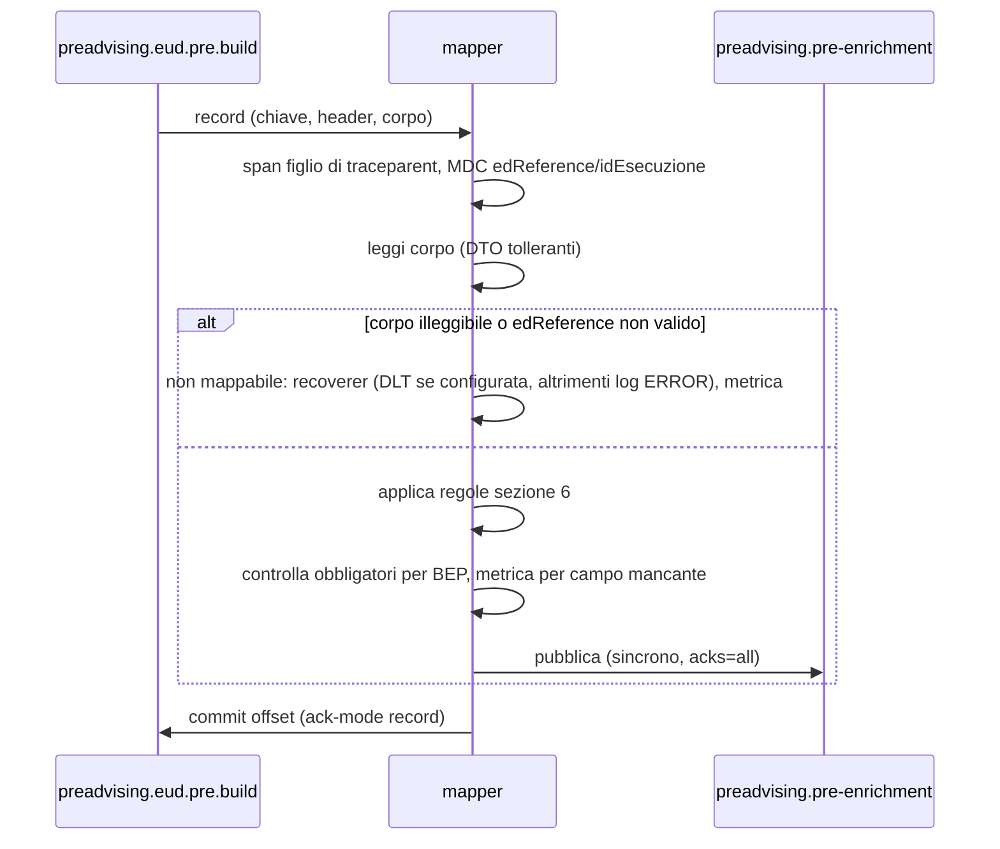

# `ce-dichiarato-eurodis-mapper` — Documento funzionale per lo sviluppo

**Iniziativa**: 136596 — Eurodis autoproduttore · **Versione**: 0.5 (bozza) · **Data**: 2026-11-10
**Autore**: Mary (analyst) · **Destinatario**: Amelia (dev) e team di sviluppo
**Repository**: https://posteitaliane.ghe.com/SVILUPPO/CORRIERE-ESPRESSO_PREADVISING_ce-dichiarato-eurodis-mapper
**Generato da**: [prompt-ce-dichiarato-eurodis-mapper.md](prompt-ce-dichiarato-eurodis-mapper.md)
**Implementazione** (10-11): branch `develop`, commit `dbb3b59` (tracciato completo, canale, LDV, destinatario) e `474c8ef` (`ce-anagrafica`, header di `-in`, error handler con DLT, metriche e span); 94 test verdi. Scostamenti: `collo.articolo: []` presente e `codici_servizi` ripetuto alla radice, come nell'esempio EUD (AC-14); tolta la bean validation su `dispatchPartnersDomesticShipmentNumber` (bloccano solo JSON, `edReference` e destinatario, RF-06). Spring Boot del repo a 4.1.2 (azzurrazezza), contro la decisione 3.5.14: da chiarire.
**Implementazione** (18-11): commit `5a5faf1` su `develop`: cliente, contratto e centro di costo dalla postazione della LDV del collo (sezione 6.2.1), configurazione solo come fallback; 159 test verdi. Commit `507736a`: solo LDV PDB (tolto `ce-ldv`), LDV non PDB scartata (`ldv_non_pdb`); 156 test verdi.

Etichette usate nel documento:
- **[FATTO]**: scritto nella specifica EURODIS, nel codice o verificato in ambiente; la fonte è indicata.
- **[IPOTESI]**: non scritto da nessuna parte, da confermare.
- **[DECISO]**: decisione presa, con data e riferimento.
- **[DA DECIDERE]**: scelta aperta, con proposta e **default con cui si sviluppa**.

---

## 1. Scopo e responsabilità

Il mapper riceve da `ce-dichiarato-eurodis-in` **una spedizione EURODIS per
messaggio**, così come EURODIS l'ha restituita, la converte nel **tracciato
unico ICD v11** e la pubblica su `preadvising.pre-enrichment`.

**[DECISO 30-10, PA-26]** Il mapping vive **solo** qui. `-in` non trasforma
niente; il ms sync a valle non conosce EURODIS.

**Cosa fa**
- Legge corpo, chiave e header del messaggio di `-in`.
- Applica le regole della sezione 6, campo per campo.
- Pubblica un tracciato con la stessa forma di quello del flusso EUD esistente
  (`esempio-eud-inviofile.json`).
- Rende tracciabile ogni spedizione: esito, campi obbligatori mancanti, metriche, span.

**Cosa non fa**
- Non scarica da EURODIS e non tiene lo storico: lo fa `-in`.
- **Non filtra i duplicati** **[DECISO 04-11]**: si filtra a valle.
- Non chiama F1 né ce-rules **[DECISO 06-11]**: i dati di cliente e contratto
  arrivano da configurazione per ambiente (sezione 8). Chiama invece
  `ce-anagrafica` per i codici nazione, come `ce-dichiarato-adapter` (sezione 6.4).
- Non mappa, in questa fase, dogana, ADR, assicurazione, ritiro e pickup, Punto
  Poste (sezione 6.10).
- Non risponde a EURODIS: non esiste un canale di rifiuto (PA-08).

## 2. Posizione nella catena


**[FATTO]** Il ms sync (`ce-dichiarato-ldv-pdb`) è in test e ha
osservazioni aperte che toccano i nostri dati: paese ISO4 non risolto, nessun
default per peso e dimensioni, nessun troncamento (PA-30, DF-26, DF-27). L'ISO4
glielo passiamo già risolto noi (sezione 6.4).

Dipendenza sincrona: `ce-anagrafica` (namespace `corriere-espresso-preadvising`),
`GET /anagrafica/indirizzi/nazione/{codice}`.

## 3. Interfacce

### 3.1 In ingresso: `preadvising.eud.pre.build`

**[DECISO 04-11, PA-31]** Contratto, implementato in `-in` (`SpedizioneProducer`):

- **Chiave**: `edReference` normalizzato, stringa senza decimali.
- **Corpo**: un elemento di `GetShipmentResponse2` **così com'è**, byte per
  byte come EURODIS l'ha mandato. Schema: `eurodis-receive-pan-swagger-v1.json`.
- **Header**:

| Header | Esempio | Uso nel mapper |
|---|---|---|
| `edReference` | `7319003746401` | log e MDC |
| `idEsecuzione` | `6720f1a2b3c4d5e6f7a8b9c0` | log e MDC |
| `idFile` | `3f2b8c1e-5a7d-4c1b-9e2f-0a1b2c3d4e5f` | → `id_file`: id del file fittizio dello scarico, lo stesso degli eventi di stato su `preadvising.evensource` (specifica di `-in` 0.5, sezione 3.3) |
| `ricevutoIl` | `2026-11-05T09:14:02.123Z` | → `upload_time`, `dataInizioFlusso`, `instantInizioFlusso` |
| `fonte` | `receive-pan/shipments/v1` | log |
| `rifGrezzo` | `eurodis_scarichi/6720f1a2b3c4d5e6f7a8b9c0` | → `link_file_fisico_inviato` |
| `ambiente` | `TEST` | log |
| `schemaVersion` | `1` | se diverso da `1`: log di warning, si prosegue |
| `traceparent` | W3C | lo span del mapper è figlio di quello di `-in` |

**[FATTO, 05-11]** In TEST EURODIS arrivano spedizioni con `consigneeAddress`,
`shipperAddress`, `remunerationAddress` e `bookingInAddress` a `null`,
`consignorsColloBarcode` vuoto e senza `deliveryPartnerBarcode`
(`esempio-eurodis-spedizione.json`). Lo swagger dichiara `nullable` tutti gli
indirizzi, senza dire quando mancano.

**[FATTO]** `deliveryPartnerBarcode`, la LDV del collo (sezione 6.6), esiste
solo nello schema `GetShipmentColliDataResponse` (dentro `GetShipmentResponse`),
che gli endpoint **non** referenziano: "Delivery partner barcode from the central
label service (CLS). Only filled, when the delivery partner is using this
service", string 50. Nello schema dichiarato (`GetShipmentColliDataResponse2`)
non c'è. Il DTO lo legge comunque (RF-03, proprietà sconosciute tollerate).

### 3.2 In uscita: `preadvising.pre-enrichment`

**A valle** (verificato il 10-11, vedi [integrazione-ldv-pdb-sync.md](integrazione-ldv-pdb-sync.md)):
validatore → `preadvising.enrichment` → orchestratore. Per `EUD_INVIOSYSTEM` l'orchestratore
esegue normalizzazione, `enrichment_bep` e `ldv-bep-sync`, cioè l'evento verso
`ce-dichiarato-ldv-pdb-sync` su `preadvising.enrichment.bepsync`. Oggi su `develop` l'orchestratore
manda il canale a `ldv-pdb`; la correzione è sul branch `feature/eurodis-canale-eud-inviosystem`.
L'evento verso `ldv-pdb-sync` non lo pubblica il mapper.

- **Chiave**: `rif_spedizione` (= `edReference` normalizzato).
- **Header**: `traceparent` (span del mapper) e `edReference`.
- **Corpo**: tracciato unico ICD v11, una spedizione (`spedizione` è un array
  di un elemento).

**Forma del tracciato** (RF-05). Il tracciato ha la stessa forma di
`esempio-eud-inviofile.json`, il flusso EUD che oggi funziona:
- ogni campo presente in quell'esempio è presente anche da noi;
- un valore assente si scrive `""` se stringa e `0` se numero, mai `null` e
  mai campo omesso;
- in più ci sono i campi delle tabelle della sezione 6;
- le sezioni `ritiro`, `spedizione.pickup` e `collo.articolo` sono assenti.

Oggi il DTO ha 8 campi e `NON_NULL` omette il resto: è la differenza principale
con l'output atteso.

## 4. Flusso di elaborazione



## 5. Regole funzionali generali

| # | Regola |
|---|---|
| RF-01 | Un messaggio in ingresso produce **al più un** messaggio in uscita. |
| RF-02 | `edReference` si legge come numero esatto (`BigDecimal`), mai `double`. `7319003746401.0` vale `7319003746401`. Una parte decimale diversa da zero (`…401.5`) rende il messaggio **non mappabile** (risolve MAP-5: oggi si tronca in silenzio). |
| RF-03 | Il corpo si legge con DTO tolleranti: proprietà sconosciute ignorate, oggetti e liste `null` gestiti senza eccezioni. `collis: null` dà `collo: []`, non NullPointerException (bug della verifica del 04-11). |
| RF-04 | Nessun troncamento **[DECISO 22-10, PA-16]**: ogni valore passa intero, anche oltre la dimensione ICD. |
| RF-05 | Forma del tracciato come nella sezione 3.2. |
| RF-06 | Messaggio non mappabile (corpo non JSON, `edReference` assente o non intero, **destinatario assente**: RF-14, **LDV non PDB**: RF-17) → recoverer (sezione 7), nessuna pubblicazione. **Ogni altra mancanza non blocca**: si pubblica con `""`/`0`, con un warning e una metrica per campo (RF-07). La validazione di business è a valle (PA-32, da confermare). |
| RF-07 | Obbligatori per BEP, controllati dopo il mapping: `data_spedizione`, `collo[].id_ldv`, `collo[].peso`. Se vuoti: warning con il **nome** del campo e del campo EURODIS sorgente (mai il valore, sezione 7.1) e metrica `eurodis_mapper_campo_mancante_total{campo}`. |
| RF-08 | `id_preadvising` = `UUID.randomUUID()` a ogni elaborazione **[DECISO 22-10]**. Una rielaborazione produce un secondo preadvising con lo stesso `rif_spedizione`: la deduplica è a valle (MAP-2). |
| RF-09 | Date e ore si prendono **come arrivano**, senza conversioni di fuso (PA-27: fuso orario non dichiarato). Con o senza `Z` finale, il risultato è lo stesso. |
| RF-10 | Pesi: kg → grammi (×1000), arrotondamento `HALF_UP` all'intero. |
| RF-11 | Header mancanti: i campi derivati restano `""`, warning, si pubblica. |
| RF-12 | Nessun dato personale nei log: solo `edReference`, `idEsecuzione`, esito, nomi dei campi mancanti. |
| RF-13 | Nessun riferimento a PA/DF o a documenti di analisi nei commenti del codice (MAP-7): le regole aperte stanno in questo documento. |
| RF-14 | **Il destinatario deve essere presente** **[DECISO 06-11, Diego, DF-30; confermato 10-11: in produzione il destinatario è in `consigneeAddress`, il TEST non è rappresentativo]**: `consigneeAddress` assente, oppure `zipcode` o `city` vuoti (obbligatori per ICD e BEP) → messaggio **non mappabile**, motivo `destinatario_assente`. `returnAddress` non lo sostituisce. |
| RF-16 | Cliente, contratto e centro di costo si ricavano dalla **postazione della LDV del collo** (sezione 6.2.1). Se la postazione non si ricava (LDV vuota, postazione non trovata, risposta incompleta, errore di `ce-vendite` o del database) **non si scarta**: si pubblica con i valori di configurazione, con avviso e metrica. **[DECISO 18-11, Diego]** |
| RF-17 | **Nel flusso entrano solo LDV PDB** **[DECISO 18-11, Diego]**: una `collis[].deliveryPartnerBarcode` valorizzata che non è una LDV PDB (regola della sezione 6.2.1, passo 1) rende il messaggio **non mappabile**, motivo `ldv_non_pdb`, con le posizioni dei colli nel campo dello scarto; metrica dedicata `eurodis_mapper_ldv_non_pdb_total`. Nessuna chiamata esterna. La LDV vuota non scarta: è un campo mancante (RF-07) e il cliente va in fallback (RF-16). |
| RF-15 | Errore o risposta vuota di `ce-anagrafica` non blocca: si pubblica, con errore sullo span e avviso `anagrafica_ko`. Se il codice paese è IT, ITA o ITA1 si usano le codifiche italiane di configurazione (`mapper.nazione.italia.*`: IT / ITA / ITA1) con l'avviso `nazione_default_italia`; per gli altri paesi ISO3 e ISO4 restano vuoti. Gli errori non entrano in cache (sezione 6.4). **[DECISO 10-11, Diego]** |

## 6. Regole di mapping

Fonte: foglio "Mapping EURODIS" dell'ICD v11, con i commenti di Diego del 23-10.
**Fase 1** = da fare subito, con i default indicati. Dove la colonna Default
dice `""`/`0` il campo è presente ma vuoto finché il punto non si chiude.

### 6.1 Testata

| Campo ICD | Sorgente | Regola | Rif. |
|---|---|---|---|
| `progressivo` | — | `1` (un messaggio = una spedizione) | MAP-1. Il foglio dice "1..n nel batch": da allineare |
| `versione_tracciato` | — | `1` | |
| `canale` | config `mapper.canale` | default `EUD_INVIOSYSTEM` | **[DECISO 05-11, DF-04, PA-25]**. BEP passa `collo.id_ldv` solo per INVIOSYSTEM; da verificare che `BepChannel.fromCanale` riconosca il valore |
| `id_canale` | — | `""` | [DA DECIDERE PA-15] |
| `id_preadvising` | — | UUID | RF-08 |
| `flag_autoproduttore` | — | `"S"` | |
| `id_file` | header `idFile` | così com'è | **[DECISO 06-11]** id del file fittizio generato da `-in` per ogni scarico, uguale a quello degli eventi `ST_F0002`/`ST_F0005` |
| `upload_time` | header `ricevutoIl` | così com'è (ISO-8601) | |
| `dataInizioFlusso`, `instantInizioFlusso` | header `ricevutoIl` | così com'è | [DA DECIDERE] nessun header porta l'inizio dello scarico: default `ricevutoIl` |
| `link_file_fisico_inviato` | header `rifGrezzo` | così com'è | |
| `errori` | — | assente | a valle |

### 6.2 Cliente

| Campo ICD | Sorgente | Regola | Rif. |
|---|---|---|---|
| `codice_contratto` | postazione `idContratto` | trim; se vuoto o postazione non ricavata: config `mapper.cliente.codice-contratto` (`SFA-00633620`) | **[DECISO 18-11]** sezione 6.2.1 |
| `id_cliente` | postazione `idAnagrafico` | trim; se vuoto o postazione non ricavata: config `mapper.cliente.id-cliente` (`""`) | **[DECISO 18-11]** l'anagrafico della postazione (per le postazioni PDB in formato `OU…`) |
| `ragione_sociale` | postazione `ragioneSociale` | trim; se vuota o postazione non ricavata: `shipperAddress.companyName` | **[DECISO 18-11]** il cliente è il titolare del contratto, non il mittente |
| `partita_iva` | postazione `partitaIva` | trim; se postazione non ricavata `""` | **[DECISO 18-11]** |
| `cod_fiscale` | postazione `codiceFiscale` | trim; se postazione non ricavata `""` | **[DECISO 18-11]** |
| `codice_login_cliente` | config `mapper.cliente.codice-login` | `cli_c49353` | **[DECISO 10-11]** stessi valori che `ce-dichiarato-builder` imposta per il flusso a file EURODIS (`EUD_INVIOFILE`): `clientId` del file e `cli_c49353.ini`. Niente chiamata a F1 (PA-33). La configurazione postazione non ha un campo corrispondente |
| `codice_auc` | config `mapper.cliente.codice-auc` | `1335062583` | idem (`cli_c49353.ini`, `Codice_AUC`); nessun campo corrispondente nella postazione |
| `no_firma` | `deliveryService.deliveryType` | `S` → `"N"`; `N` → `"S"`; altro o assente → `""` | commento Diego 23-10 |
| altri campi dell'esempio EUD | — | `""` | |

### 6.2.1 Postazione dalla LDV del collo **[DECISO 18-11, Diego]**

La LDV è `collis[].deliveryPartnerBarcode` del primo collo che ne ha una (i colli di una spedizione
condividono il seme). Ordine di risoluzione:

1. **Seme e tipo seme, solo con la regola locale.** LDV PDB (13 caratteri, trim e maiuscolo,
   `[1-8]U[A-Z0-9]{5}[0-9A-Z]{6}`): seme = caratteri 3-7, tipo `PPTT` (copia del ramo PDB di `LdvSemanticaUtil`
   di `ce-ldv`, identica a `LdvPdb` di `ce-eurodis-send-tracking`), nessuna chiamata. Esempio:
   `4UW2308123456` → `W2308`/`PPTT`. **[DECISO 18-11, Diego]** in questo flusso entrano solo LDV PDB: `ce-ldv`
   non si chiama e una LDV non PDB scarta la spedizione prima della risoluzione (RF-17).
2. **Cache in memoria** (Caffeine) per seme + tipo seme (trim, maiuscolo). Una postazione trovata resta
   `client.postazione.cache.ttl` (default 1 ora), un "non trovata" `ttl-non-trovata` (default 5 minuti),
   al massimo `dimensione-massima` semi (default 1000). Gli errori non entrano in cache: la spedizione
   successiva riprova. In cache non si legge la tabella e non si chiama `ce-vendite`.
3. **Tabella `public.eurodis_postazioni`** (database `ce_eud_api_in`, DDL: script
   `sql/ddl/07_ddl_eurodis_postazioni.sql` di `ce-dichiarato-eurodis-in`, da eseguire **prima** del rilascio del
   mapper). Se c'è la riga del seme e `verificata_il` è più recente di `client.postazione.riverifica-giorni`
   (default 7), vale la riga.
4. **`ce-vendite`** `GET /vendite/configurazione-postazione-da-seme?idSemeLdv=&idTipoSemeLdv=` se la riga
   manca o è da riverificare (da `cen_postazioni`, altrimenti da `sfa_postazioni_ou`: vedi
   [ce-vendite-postazione-sfa-postazioni-ou.md](ce-vendite-postazione-sfa-postazioni-ou.md)). 404 = postazione
   non trovata.
5. **Upsert** della riga: `INSERT … ON CONFLICT (id_seme_ldv, id_tipo_seme_ldv) DO UPDATE`, con
   `inserita_il` invariata e `verificata_il` = ora; `eurodis` = `id_contratto` (trim, senza distinzione di
   maiuscole) uguale a `mapper.cliente.codice-contratto` (`SFA-00633620`). Se `ce-vendite` non trova la
   postazione non si scrive niente.

Fallback, sempre senza scartare la spedizione (RF-16):

| Caso | Tracciato | Avviso / metrica |
|---|---|---|
| LDV vuota in tutti i colli | valori di configurazione | `postazione_ldv_vuota` (da confermare: vedi decisioni del 18-11, punto 5) |
| `ce-vendite` non trova la postazione | idem | `postazione_non_trovata` |
| Errore o timeout di `ce-vendite` (anche con una riga vecchia in tabella) | idem | `postazione_ko` + `eurodis_mapper_postazione_errori_total{componente=ce_vendite}` |
| Postazione senza `idContratto` o `idCentroCosto` | i campi vuoti da configurazione, gli altri dalla postazione | `postazione_incompleta` |
| Errore di lettura della tabella | si chiede a `ce-vendite` | `eurodis_mapper_postazione_errori_total{componente=db_lettura}` |
| Errore di scrittura della tabella | vale la risposta di `ce-vendite` | `eurodis_mapper_postazione_errori_total{componente=db_scrittura}` |

Gli avvisi sono in `eurodis_mapper_avvisi_total{motivo}` e nel WARN della spedizione. Con
`client.postazione.abilitata=false` non si chiama niente e si usano i valori di configurazione, senza avviso.
Nei log solo seme, tipo seme e tipo di errore: mai ragione sociale, partita IVA o codice fiscale della postazione.
Span CLIENT `getConfigurazionePostazioneDaSeme` solo per le chiamate vere a `ce-vendite`.

### 6.3 Spedizione

| Campo ICD | Sorgente | Regola | Rif. |
|---|---|---|---|
| `rif_spedizione` | `edReference` | stringa senza decimali (RF-02) | **[DECISO 22-10]** |
| `numero_colli` | `numberOfHandlingUnits` | diretto; `0` se assente. Se diverso dal numero di `collis`: warning, vale `numberOfHandlingUnits` | |
| `id_ldv_partner_master` | `dispatchPartnersDomesticShipmentNumber` | diretto | MAP-6 |
| `id_partner` | config `mapper.id-partner` | default `EURODIS` | [DA DECIDERE PA-15] |
| `codici_servizi` | `deliveryService`, `cashOnDeliveryService` | sezione 6.8 | [DA DECIDERE PA-03] |
| `flag_stampa_ldv` | — | `"N"` (etichetta prodotta da EURODIS) | |
| `flag_attivazione_ritiro` | — | `"N"` | |
| `centro_costo` | postazione `idCentroCosto` | trim; se vuoto o postazione non ricavata: config `mapper.centro-costo` (`CDC-00000014`) | **[DECISO 18-11]** sezione 6.2.1; il valore di configurazione è quello del builder per EURODIS (`cli_c49353.ini`, `Centro_Costo`) |
| `rif_prodotto_cliente` | config `mapper.rif-prodotto-cliente` | `""` | come il builder, che non lo imposta: il servizio a valle usa il prodotto di default |
| `data_spedizione` | `entranceTimestamp` | `yyyy-MM-dd` (RF-09) | commento Diego 23-10 |
| `ora_spedizione` | `entranceTimestamp` | `HH:mm:ss` | |
| | se `entranceTimestamp` è assente | stessa regola su `clearanceTimestamp` (obbligatorio in EURODIS), con warning | **[DA DECIDERE DF-01]** Diego: `clearanceTimestamp` si ignora; ma `data_spedizione` è obbligatoria per BEP |
| `id_ldv_associata` | `collis[].referencedEuroplateBarcode` | `""` in fase 1 | [DA DECIDERE DF-10] campo di 3 caratteri, barcode di 24, per collo; senza `shipmentTypeIndicator` non si riconosce un reso |
| `codice_tipo_spedizione` | — | `""` | DA DEFINIRE nel foglio |
| `descrizione_contenuto`, `valore` | `customsService` | `""` / `0` in fase 1 | dogana, sezione 6.10 |
| `notifiche_sms`, `notifiche_email` | `consigneePreAdvice` | `""` | [DA DECIDERE DF-09] proposta 29-10: SDA notifica da sola, non si mappa |
| campi CE-RULES (`codice_prodotto`, `servizi_spedizione`, `codice_servizio`…) | — | `""` | ce-rules da `id_ldv`, a valle (PA-03, PA-33) |
| altri campi dell'esempio EUD | — | `""` / `0` | |

### 6.4 Mittente (`spedizione.mittente`) da `shipperAddress`

| Campo ICD | Sorgente | Regola |
|---|---|---|
| `ragione_sociale` | `companyName` | diretto |
| `rif_contatto` | `contactName` | diretto, intero |
| `email` | `contactEMail` | diretto, intero |
| `cellulare` | `contactSMS` | diretto, prefisso compreso |
| `telefono` | `contactTelephone` | diretto |
| `indirizzo` | `street` | diretto |
| `numero_civico` | `streetNumber` | diretto, intero |
| `cap` | `zipcode` | diretto (CAP esteri ammessi) |
| `localita` | `city` | diretto |
| `provincia` | `region` | solo se `countryCode` = `IT` e `region` è una sigla di 2 lettere (maiuscolo); altrimenti `""` (PA-22) |
| `nazione` | `countryCode` | diretto (ISO2), come fa l'adapter |
| `codice_nazione_iso_2` | `countryCode`, poi `ce-anagrafica` | diretto; sovrascritto da `codNazione2` se `ce-anagrafica` risponde |
| `codice_nazione` | `ce-anagrafica` → `codNazione` | ISO3 (es. `DEU`); `""` se `ce-anagrafica` non risponde |
| `codice_nazione_poste` | `ce-anagrafica` → `codNazionePoste` | ISO4 Poste (es. `ITA1`); `""` se `ce-anagrafica` non risponde |
| `note1`, `note2` | `additionalAddressInfo1`, `additionalAddressInfo2` | diretto, intero |

`shipperAddress` assente → tutti i campi `""`, nessuna chiamata a `ce-anagrafica`.

**Codici nazione da `ce-anagrafica`** **[DECISO 06-11, Diego]**. Sostituisce la
regola del 23-10 "solo `codice_nazione_iso_2`" (DF-12, DF-27). Si fa come
`ce-dichiarato-adapter` (`PdbMapper`, `AnagraficaClient.getCodiciNazione`):

- `GET {client.anagrafica.base-url}/anagrafica/indirizzi/nazione/{countryCode}`:
  una chiamata per il mittente e una per il destinatario, solo se `countryCode`
  non è vuoto.
- **[FATTO]** dal codice di `ce-anagrafica` (`IndirizziRepository.getCodNazione`):
  - accetta un codice di 2 (ISO2), 3 o 4 caratteri;
  - risponde `{ "codNazione": ISO3, "codNazionePoste": ISO4, "codNazione2": ISO2 }`;
  - con un codice sconosciuto risponde 200 senza corpo; con un codice vuoto `400`.
- Ogni chiamata ha uno span figlio (`getCodiciNazioneMittente`,
  `getCodiciNazioneDestinatario`), come nell'adapter.
- **Cache** **[DECISO 10-11, Diego]**: la chiamata si fa sempre, anche per IT, ma è
  in cache per parametro (codice normalizzato: trim + maiuscolo). A parità di codice
  non si ripete fino alla scadenza (`client.anagrafica.cache-ttl`, default 24 ore).
  Entrano in cache solo le risposte valide: errori, timeout e risposte vuote no, così
  il messaggio successivo riprova. Metrica `eurodis_mapper_anagrafica_cache_total{esito=hit|miss}`;
  lo span della chiamata c'è solo quando la chiamata si fa davvero.
- Errore, timeout o corpo vuoto: RF-15. Per IT, ITA e ITA1 si usano le codifiche
  italiane di configurazione (non messe in cache come risposta valida).
- `RestTemplate` con pool di connessioni e timeout di connessione e lettura,
  come `AppConfig` dell'adapter. Nessun retry: il messaggio si pubblica comunque.

### 6.5 Destinatario (`spedizione.destinatario`) da `consigneeAddress`

Stesse regole del mittente, sugli stessi campi, più:

| Campo ICD | Regola |
|---|---|
| `prefisso_cellulare` | `""`: `contactSMS` va tutto in `cellulare` (commento Diego 23-10) |
| `cap`, `localita` | obbligatori: se vuoti, RF-14 |
| codici nazione | come per il mittente, da `ce-anagrafica` |

`consigneeAddress` assente → **non mappabile** (RF-14). `returnAddress` non si
usa al posto del destinatario: è l'indirizzo di rientro.

### 6.6 Colli (`spedizione.collo[]`): un elemento per ogni `collis[]`, nello stesso ordine

| Campo ICD | Sorgente | Regola | Rif. |
|---|---|---|---|
| `id_ldv` | `deliveryPartnerBarcode` | diretto; `""` se assente, con metrica (RF-07) | **[DECISO 10-11, Diego]**: supera `consignorsColloBarcode` (decisione del 22-10). `consignorsColloBarcode` non si mappa; `europlateBarcode` non sostituisce la LDV: va solo in `internazionale.id_ldv_itz`. Il campo è dello schema non referenziato (sezione 3.1): domanda 5. **Formato atteso (18-11):** LDV PDB di 13 caratteri, `4U` con contrassegno o `3U` senza + seme (5) + 6 cifre, semantica `PPTT` di `ce-ldv`; il seme è il `pds_code` del contratto `SFA-00633620` per il canale di prenotazione (`contract_ps_data.pds`): `W2308` per `INVIOSYSTEM` (`W2307` INVIOFILE, `W2319` WEBSERVICES). Con un seme di postazione (`W0008`) o un prefisso non coerente con il contrassegno (`1U`) BEP risponde `131` "Barcode non utilizzabile"; `4UW2308` + 6 cifre con contrassegno passa (18-11). Il mapper controlla solo che sia una LDV PDB (RF-17: altrimenti scarto `ldv_non_pdb`), poi la passa così com'è |
| `numero_colli_parz` | posizione | 1..n | |
| `peso` | `weightOfUnit` | ×1000 (RF-10); `0` se assente | |
| `lunghezza` | `length` | diretto, cm; `0` se assente | |
| `altezza` | `height` | diretto | |
| `profondita` | `width` | diretto | |
| `codice_imballo` | `identifierPalletOrCollo` | `P`, `P+` → `"PL"`; `C`, `C+` → `"CL"`; altro → `""` | proposta del foglio |
| `tipo_collo`, `id_ldv_madre`, `id_ldv_figlio`, `id_collo` | — | `""` | [DA DECIDERE PA-11, DF-03] |

### 6.7 Internazionale (`spedizione.internazionale`)

| Campo ICD | Sorgente | Regola | Rif. |
|---|---|---|---|
| `id_ldv_itz` | `collis[].europlateBarcode` | il primo non vuoto e diverso da `"0"`; se tutti sono vuoti o `"0"` → `""` | **[DECISO 22-10, confermato 06-11 e 10-11]**. Barcode internazionale a 24 cifre, nei sistemi SDA è `ldv_partner_collo`; opzionale in API perché la LDV SDA è in `deliveryPartnerBarcode`. `"0"` = assente, come il vuoto (DF-18 chiuso). Con più colli, default di DF-03 |
| `peso` | `shipmentWeight` | ×1000 (RF-10) | |
| `vettore` | — | `"EURODIS"` | |
| `descrizione`, `valuta`, `valore_spedizione` | `customsService` | `""` / `0` in fase 1 | sezione 6.10 |
| altri campi dell'esempio EUD | — | `""` / `0` | |

### 6.8 Codici servizi (`spedizione.codici_servizi`)

**[FATTO]** BEP legge i servizi **solo** da `codici_servizi`, non dalle sezioni
`contrassegno`, `consegna` e `assicurata` (DF-07). Senza questo campo il
contrassegno non arriva a PDB.

**[DA DECIDERE PA-03]** Diego (23-10) ha indicato ce-rules da `id_ldv` per
prodotto e servizi e ha lasciato aperti i codici servizi. La proposta del 29-10
li valorizza nel mapper. **Default di fase 1**: valorizzati secondo la tabella,
disattivabili con `mapper.codici-servizi.abilitati=false` (domanda 1).

Stringa di codici separati da `|`: prima il servizio di consegna, poi il
contrassegno. Vuota (`""`) se non c'è nessun servizio.

| Condizione | Codice |
|---|---|
| `deliveryService.deliveryService` = `6` (sabato) | `APT000910` |
| = `E` (sera) | `APT000911` |
| = `F` (entro le 10) | `APT000906` |
| = `M` (entro le 12) | `APT000907` |
| = `B` (su prenotazione) oppure `W` (finestra) | `APT000908` (`W` da confermare, DF-21) |
| = `Z` (PUDO) | nessuno: Punto Poste non mappato (commento Diego 23-10, DF-14, DF-23) |
| = `A`, `D`, `7`, `T`, `N` o altro | nessuno (DF-21, DF-22) |
| `cashOnDeliveryService` presente | `APT000918` |
| più di un collo | nessuno: `APT000945` lo aggiunge il ms sync |

### 6.9 Contrassegno e consegna

| Campo ICD | Sorgente | Regola | Rif. |
|---|---|---|---|
| `contrassegno.flag` | `cashOnDeliveryService` | `"S"` se presente, altrimenti `"N"` | |
| `contrassegno.importo_contrassegno` | `amount` | diretto, 2 decimali; `0` se assente. Se `currency` ≠ `EUR`: si mappa lo stesso, warning e metrica | [DA DECIDERE DF-24] |
| `contrassegno.tipo_pagamento_contrassegno` | `identifierForCODCollection` | `3` → `"CON"`, `5` → `"ABM"`, altro → `""` con warning | [DA DECIDERE DF-24] riscontro SDA, mai `ACM` |
| `consegna.data_consegna` | `deliveryService.deliveryDateWindowStart` | `yyyy-MM-dd` | commento Diego 23-10; DF-06 |
| `consegna.inizio_ora_consegna` | `deliveryTimeWindowStart` | `HH:mm:ss` → `HH:mm` | |
| `consegna.fine_ora_consegna` | `deliveryTimeWindowEnd` | `HH:mm:ss` → `HH:mm` | |
| `consegna.note` | `consigneeAddress.additionalConsigneeInfo`, `shipperAddress.additionalConsigneeInfo` | concatenati in quest'ordine con separatore `mapper.consegna.separatore-note` (default uno spazio); uno solo presente → quello; nessuno → `""` | commento Diego 23-10; separatore [DA DECIDERE] |
| `consegna.modalita` | `deliveryType` | `""` | [DA DECIDERE PA-17] |
| `consegna.codice_frazionario`, `denominazione_frazionario` | `pudoID` | `""` | Punto Poste non mappato (DF-14, DF-23) |
| `consegna.mancata_consegna` | — | `""` | [DA DECIDERE DF-25] |

### 6.10 Fuori dalla fase 1

| Area | Campi EURODIS | Perché | Rif. |
|---|---|---|---|
| Dogana | `customsService.*` → `descrizione_contenuto`, `valore`, `internazionale.descrizione/valuta/valore_spedizione`, `collo.articolo[]` | perimetro non confermato; valorizzare la sezione internazionale può far trattare la spedizione come internazionale da BEP (DF-20) | PA-13 |
| ADR | `hazardousADRServices[]`, `hazardousCollis[]` | nessun campo ICD | PA-13 |
| Assicurazione | `commercialValueOfGoods` → `assicurata.*` | fuori perimetro (riscontro SDA) | DF-08 |
| Punto Poste | `pudoID`, `deliveryService = Z` | commento Diego: non mappare | DF-14, DF-23 |
| Ritiro e pickup | — | EURODIS consegna in hub SDA | |
| Ignorati per decisione | `shipmentTypeIndicator`, `lineHaulIndicator`, `truckLicensePlate`, `termsOfDeliveryText`, `gatewayAssigned`, `alternativeContactTelephone` | commenti Diego 23-10 | DF-15 |

## 7. Gestione errori e recupero

**[FATTO]** Oggi non c'è un error handler esplicito: vale quello di default di
Spring, cioè 9 tentativi senza attesa, poi log e salto del messaggio (MAP-3).

| Scenario | Comportamento | Metrica / log | Recupero |
|---|---|---|---|
| Corpo non JSON | non mappabile, niente tentativi | `eurodis_mapper_spedizioni_total{esito=non_mappabile}`, ERROR senza payload | DLT se configurata; altrimenti ripubblicazione da `-in` (`eurodis.in.ripubblica.ed-references`, env `EURODIS_RIPUBBLICA_ED_REFERENCES`) |
| `edReference` assente o non intero | come sopra | idem | idem |
| Destinatario assente, o senza cap o località (RF-14) | non mappabile, niente tentativi | `esito=non_mappabile`, `motivo=destinatario_assente`, WARN | correzione lato EURODIS, poi ripubblicazione da `-in` |
| LDV di un collo non PDB (RF-17) | non mappabile, niente tentativi, nessuna chiamata a `ce-vendite` | `esito=non_mappabile`, `motivo=ldv_non_pdb`, `eurodis_mapper_ldv_non_pdb_total`, ERROR con `collis[].deliveryPartnerBarcode (non PDB nei colli [n] di m) -> spedizione.collo[].id_ldv` | DLT se configurata; correzione lato EURODIS, poi ripubblicazione da `-in` |
| `ce-anagrafica` in errore o lenta | si pubblica; per IT/ITA/ITA1 con le codifiche italiane di configurazione, per gli altri paesi senza ISO3/ISO4 (RF-15) | avviso `anagrafica_ko` (+ `nazione_default_italia`), errore sullo span | al messaggio successivo si riprova (gli errori non sono in cache) |
| Postazione non ricavata (LDV vuota, postazione non trovata, risposta incompleta, `ce-vendite`/database in errore) | **si pubblica** con cliente, contratto e centro di costo di configurazione (RF-16, sezione 6.2.1) | avvisi `postazione_*`, `eurodis_mapper_postazione_errori_total{componente}`, WARN con seme e tipo seme | gli errori non sono in cache: la spedizione successiva riprova |
| Spedizione incompleta (data, LDV, peso) | **si pubblica** (RF-06) | `campo_mancante{campo}`, WARN | a valle |
| Kafka in uscita non disponibile, timeout | eccezione → `DefaultErrorHandler` con backoff (default 3 tentativi, 2 s), poi recoverer | `esito=errore_tecnico`, ERROR | offset non committato durante i tentativi; dopo, DLT o ripubblicazione da `-in` |
| Errore inatteso nel mapping | come Kafka giù | idem | idem |

**[DA DECIDERE PA-32]** Coda di scarto (DLT). Default: topic in
`mapper.dlt.topic`; vuoto = disabilitata: log ERROR, metrica, offset avanti.
Proposta: `preadvising.eud.pre.build.DLT`, da far creare se si decide.

### 7.1 Campi nei log di scarti, avvisi e campi mancanti

**[FATTO]** (16-11, branch `136596_dettaglio_scarti_mapper`). Ogni scarto, avviso e campo
mancante dice **quale campo EURODIS** (o header Kafka) manca o non è valido e **quale campo del
tracciato** alimenta, nella forma `<campo EURODIS> (causa) -> <campo tracciato>`. Solo nomi di
campi, mai valori (RF-12). Le metriche non cambiano: il tag `motivo` dello scarto e i tag
`motivo`/`campo` di avvisi e campi mancanti restano quelli della sezione 9 (bassa cardinalità);
il dettaglio sta solo nei log e nel messaggio dell'eccezione (che con la DLT finisce
nell'header `kafka_dlt-exception-message`).

Scarti (log ERROR del recoverer `Messaggio scartato, non mappabile (motivo=…, campi=[…], partition=…,
offset=…, chiave=…, dlt=…)` e WARN del consumer con `motivo=…, campi=[…]`). Sul destinatario si
elencano tutti i campi mancanti, non solo il primo.

| Motivo (tag metrica) | Caso | `campi` |
|---|---|---|
| `json` | corpo vuoto o non leggibile | `[]`: il messaggio di Jackson non si registra, contiene parti del payload |
| `ed_reference` | assente | `edReference (assente) -> spedizione.rif_spedizione` |
| `ed_reference` | parte decimale diversa da zero | `edReference (non intero) -> spedizione.rif_spedizione` |
| `destinatario_assente` | oggetto assente | `consigneeAddress (oggetto assente) -> spedizione.destinatario` |
| `destinatario_assente` | cap assente o vuoto | `consigneeAddress.zipcode (assente\|vuoto) -> spedizione.destinatario.cap` |
| `destinatario_assente` | località assente o vuota | `consigneeAddress.city (assente\|vuoto) -> spedizione.destinatario.localita` |
| `destinatario_assente` | entrambi | le due righe sopra, nello stesso scarto |

`edReference` alimenta `spedizione.rif_spedizione`, che è anche la chiave Kafka in uscita;
`id_preadvising` è un UUID generato e non dipende da `edReference` (RF-08).

Avvisi (WARN `Spedizione EURODIS ed_reference=… mappata con avvisi [<motivo>: <campo>, …]`) e
campi mancanti (WARN `… con campi obbligatori per BEP vuoti [<campo>: <dettaglio>, …]`). Un avviso
che riguarda più campi (es. `anagrafica_ko` su mittente e destinatario) compare una volta per
campo nel log, una volta sola nella metrica, come prima.

| Tag metrica | Dettaglio nel log |
|---|---|
| `header_mancante` | `header idFile (assente) -> id_file`; `header ricevutoIl (assente) -> upload_time/dataInizioFlusso/instantInizioFlusso`; `header rifGrezzo (assente) -> link_file_fisico_inviato` (solo quelli mancanti) |
| `colli_incoerenti` | `numberOfHandlingUnits (diverso dal numero di collis[]) -> spedizione.numero_colli` |
| `fallback_data` | `entranceTimestamp (assente, si usa clearanceTimestamp) -> spedizione.data_spedizione/ora_spedizione` |
| `anagrafica_ko` | `shipperAddress.countryCode (ce-anagrafica non risponde) -> spedizione.mittente.codice_nazione/codice_nazione_poste/codice_nazione_iso_2`; idem `consigneeAddress.countryCode -> spedizione.destinatario.…` |
| `nazione_default_italia` | `<shipperAddress\|consigneeAddress>.countryCode (codifiche italiane di configurazione) -> spedizione.<mittente\|destinatario>.codice_nazione/codice_nazione_poste/codice_nazione_iso_2` |
| `valuta_non_eur` | `cashOnDeliveryService.currency (non EUR) -> spedizione.contrassegno.importo_contrassegno` |
| `tipo_cod_sconosciuto` | `cashOnDeliveryService.identifierForCODCollection (assente) -> spedizione.contrassegno.tipo_pagamento_contrassegno`, oppure `(diverso da 3 e 5)` |
| campo `data_spedizione` | `entranceTimestamp e clearanceTimestamp (assenti) -> spedizione.data_spedizione`; oppure `entranceTimestamp (non nel formato yyyy-MM-dd)`; oppure `clearanceTimestamp (entranceTimestamp assente; non nel formato yyyy-MM-dd)` |
| campo `collo[].id_ldv` | `collis[].deliveryPartnerBarcode (vuoto nei colli [1, 3] di 3) -> spedizione.collo[].id_ldv`; senza colli `collis[] (assente o vuoto) -> spedizione.collo[].id_ldv` |
| campo `collo[].peso` | `collis[].weightOfUnit (assente o zero nei colli [2] di 3) -> spedizione.collo[].peso`; senza colli `collis[] (assente o vuoto) -> spedizione.collo[].peso` |

Le posizioni dei colli partono da 1, come `numero_colli_parz`. I campi sorgente sono quelli del
foglio "Mapping EURODIS" dell'ICD v11.

Esempio (spedizione di svil con chiave `8888888888001` senza `consigneeAddress`):

```
Messaggio scartato, non mappabile (motivo=destinatario_assente, campi=[consigneeAddress (oggetto assente) -> spedizione.destinatario], partition=2, offset=0, chiave=8888888888001, dlt=false)
```

## 8. Configurazione

| Parametro | Env | Default | Note |
|---|---|---|---|
| `kafka.consumer.topic.input` | `KAFKA_TOPIC_INPUT` | `preadvising.eud.pre.build` | esistente |
| `kafka.producer.topic.output` | `KAFKA_TOPIC_OUTPUT` | `preadvising.pre-enrichment` | esistente |
| `mapper.canale` | `MAPPER_CANALE` | `EUD_INVIOSYSTEM` | deciso 05-11 |
| `mapper.id-partner` | `MAPPER_ID_PARTNER` | `EURODIS` | PA-15 |
| `mapper.cliente.codice-login` | `MAPPER_CLIENTE_CODICE_LOGIN` | `cli_c49353` | → `codice_login_cliente` (sempre: la postazione non ha il campo); valori del builder per EURODIS (anche in `.helm/values.yaml`) |
| `mapper.cliente.codice-auc` | `MAPPER_CLIENTE_CODICE_AUC` | `1335062583` | → `codice_auc` (sempre: la postazione non ha il campo) |
| `mapper.cliente.id-cliente` | `MAPPER_CLIENTE_ID` | `""` | → `id_cliente` solo come fallback (sezione 6.2.1) |
| `mapper.cliente.codice-contratto` | `MAPPER_CLIENTE_CONTRATTO` | `SFA-00633620` | → `codice_contratto` solo come fallback; è anche il contratto EURODIS per la colonna `eurodis` della tabella |
| `mapper.centro-costo` | `MAPPER_CENTRO_COSTO` | `CDC-00000014` | → `centro_costo` solo come fallback |
| `client.postazione.abilitata` | `POSTAZIONE_ABILITATA` | `true` | `false` = valori di configurazione, nessuna chiamata |
| `client.postazione.riverifica-giorni` | `POSTAZIONE_RIVERIFICA_GIORNI` | `7` | oltre, la riga di `eurodis_postazioni` si riverifica su `ce-vendite` |
| `client.postazione.vendite.base-url` | `VENDITE_URL` | `http://ce-vendite.corriere-espresso-preadvising.svc.cluster.local:8080` | |
| `client.postazione.vendite.connect-timeout-ms`, `read-timeout-ms` | `VENDITE_CONNECT_TIMEOUT_MS`, `VENDITE_READ_TIMEOUT_MS` | `1000`, `2000` | nessun retry |
| `client.postazione.cache.ttl` | `POSTAZIONE_CACHE_TTL` | `1h` | postazione trovata |
| `client.postazione.cache.ttl-non-trovata` | `POSTAZIONE_CACHE_TTL_NON_TROVATA` | `5m` | "non trovata" da `ce-vendite` |
| `client.postazione.cache.dimensione-massima` | `POSTAZIONE_CACHE_DIMENSIONE_MASSIMA` | `1000` | semi in cache |
| `spring.datasource.url` | `DATASOURCE_URL` | `jdbc:postgresql://localhost:5432/ce_eud_api_in` | per ambiente in `deploy-*/values.yaml`, stesso server di `-in` (svil `strkevoldb01azwe`, collaudo `ttrkevoldb01azwe`) |
| `spring.datasource.username`, `password` | `DATASOURCE_USERNAME`, `DATASOURCE_PASSWORD` | — | secret `ce-postgres` (`datasource-name`, `data-source-password`), come `-in` |
| `spring.datasource.hikari.*` | `DATASOURCE_HIKARI_MINIMUM_IDLE`, `…_MAXIMUM_POOL_SIZE`, `…_IDLE_TIMEOUT`, `…_CONNECTION_TIMEOUT` | `1`, `3`, `30000`, `3000` | pool piccolo: una query per seme non in cache |
| `mapper.rif-prodotto-cliente` | `MAPPER_RIF_PRODOTTO_CLIENTE` | `""` | |
| `mapper.codici-servizi.abilitati` | `MAPPER_CODICI_SERVIZI` | `true` | PA-03 |
| `mapper.consegna.separatore-note` | — | `" "` | |
| `mapper.dlt.topic` | `MAPPER_DLT_TOPIC` | `""` | PA-32 |
| `mapper.errori.tentativi`, `mapper.errori.attesa-ms` | — | `3`, `2000` | backoff dell'error handler |
| `client.anagrafica.base-url` | `ANAGRAFICA_URL` | `http://ce-anagrafica.corriere-espresso-preadvising.svc.cluster.local:8080` | come l'adapter |
| `client.anagrafica.connect-timeout-ms`, `read-timeout-ms` | — | `2000`, `3000` | proposta |
| `client.anagrafica.cache-ttl` | `ANAGRAFICA_CACHE_TTL` | `24h` | durata in cache delle risposte valide |
| `mapper.nazione.italia.codici` | `MAPPER_NAZIONE_ITALIA_CODICI` | `IT,ITA,ITA1` | codici per cui vale il default italiano su errore |
| `mapper.nazione.italia.iso2`, `iso3`, `iso4` | `MAPPER_NAZIONE_ITALIA_ISO2/ISO3/ISO4` | `IT`, `ITA`, `ITA1` | codifiche italiane usate se `ce-anagrafica` non risponde |

**Dipendenze di rete (network policy).** In uscita il mapper raggiunge: Kafka (bootstrap dell'ambiente),
`ce-anagrafica` (`8080`), **`ce-vendite`** (`ce-vendite.corriere-espresso-preadvising.svc.cluster.local:8080`) e
**PostgreSQL** `ce_eud_api_in` (`5432`, stesso server di `-in`: svil `strkevoldb01azwe`, collaudo
`ttrkevoldb01azwe`). `ce-ldv` non serve (RF-17).

Producer: `acks=all`, `enable.idempotence=true`, invio sincrono. Consumer:
`ack-mode: record`, `enable-auto-commit: false`. Sono già così.
`management.endpoint.health.show-details`: `never`, come in `-in`.

## 9. Osservabilità

Modello: `ce-dichiarato-adapter` e `ce-dichiarato-eurodis-in` (`TraceUtil`,
`MetricheEurodisIn`).

| Metrica | Tag | Significato |
|---|---|---|
| `kafka_message_consumed_total`, `…_ok`, `…_ko`, `…_errore_tecnico` | — | esistenti, si tengono |
| `eurodis_mapper_spedizioni_total` | `esito` = `pubblicata`, `non_mappabile`, `errore_tecnico`; `motivo` per i non mappabili (`json`, `ed_reference`, `destinatario_assente`, `ldv_non_pdb`) | esito per messaggio |
| `eurodis_mapper_ldv_non_pdb_total` | — | spedizioni scartate per LDV non PDB (RF-17): deve restare a zero |
| `eurodis_mapper_campo_mancante_total` | `campo` | RF-07 |
| `eurodis_mapper_avvisi_total` | `motivo` = `colli_incoerenti`, `fallback_data`, `valuta_non_eur`, `tipo_cod_sconosciuto`, `header_mancante`, `anagrafica_ko`, `nazione_default_italia`, `postazione_ldv_vuota`, `postazione_non_trovata`, `postazione_ko`, `postazione_incompleta` | regole con warning |
| `eurodis_mapper_postazione_cache_total` | `esito` = `hit`, `miss` | cache della postazione per seme |
| `eurodis_mapper_postazione_total` | `sorgente` = `tabella`, `ce_vendite`, `non_trovata` | da dove arriva la postazione di un seme non in cache |
| `eurodis_mapper_postazione_errori_total` | `componente` = `ce_vendite`, `db_lettura`, `db_scrittura` | errori tecnici della risoluzione (sezione 6.2.1) |
| `eurodis_mapper_durata_seconds` | — | timer dall'ingresso alla pubblicazione |

I tag restano a bassa cardinalità: il campo EURODIS sorgente di scarti, avvisi e campi mancanti
sta solo nei log (sezione 7.1), mai nei tag.

Span: `eurodis.mapper.elabora`, figlio del `traceparent` di `-in`, con
attributi `edReference`, `idEsecuzione`, `esito`; `traceparent` propagato in
uscita. MDC: `ed_reference`, `id_esecuzione`, `partition`, `offset`.

**Catena degli span (verificata il 10-11 sul codice).** Tutta la catena usa il contesto W3C
(`traceparent`) negli header Kafka:
1. `-in`: lo span PRODUCER inietta il contesto.
2. Mapper: estrae il contesto (lo span consumer è figlio di `-in`) e lo reinietta sullo span PRODUCER
   verso `preadvising.pre-enrichment`.
3. `ce-dichiarato-validatore`: `TraceUtil.extractContext` W3C, reinietta in uscita.
4. `ce-dichiarato-orchestratore`: estrae; reinietta su ogni passo, compreso `ldv-bep-sync`.
5. `ce-dichiarato-ldv-pdb-sync`: estrae e reinietta.

La traccia è unica dal mapper al validatore e oltre: non servono modifiche. Da verificare in Datadog
nei test integrati (un solo `trace_id` per `edReference`). Dettaglio in
[integrazione-ldv-pdb-sync.md](integrazione-ldv-pdb-sync.md).

Alert Datadog: rimandati come per `-in` (AS-19). Proposta da tenere pronta:
`non_mappabile` > 0, `errore_tecnico` > 0 per 10 minuti,
`non_mappabile{motivo=destinatario_assente}` in crescita, `anagrafica_ko` > 0.

## 10. Requisiti non funzionali

| # | Requisito |
|---|---|
| RNF-01 | At-least-once: offset committato solo dopo la pubblicazione confermata. |
| RNF-02 | Nessun dato personale nei log, nelle metriche e negli attributi degli span. |
| RNF-03 | Numeri EURODIS letti come `BigDecimal` o interi, mai `double`. |
| RNF-04 | Ogni regola della sezione 6 ha almeno un test unitario; test con dati inventati, mai di produzione. |
| RNF-05 | Il mapping è una funzione pura (spedizione + header + configurazione → tracciato), testabile senza Kafka. |

## 11. Criteri di accettazione

**AC-01 — esempio TEST del 05-11, con destinatario.** Given il corpo
`esempio-eurodis-spedizione.json` in cui `consigneeAddress` (null nell'originale)
è sostituito da un indirizzo inventato:
`{"companyName": "Destinatario Prova", "contactName": "Mario Prova", "contactSMS": "+390000000001", "street": "Via di Prova", "streetNumber": "1", "zipcode": "40121", "city": "BOLOGNA", "countryCode": "IT", "additionalConsigneeInfo": "Citofono 1"}`,
e il collo con in più `"deliveryPartnerBarcode": "SDA0000000000001"` (inventato),
`ce-anagrafica` simulato che per `IT` risponde `ITA` / `ITA1` / `IT`, header `idEsecuzione=E1`, `idFile=F1`,
`ricevutoIl=2026-11-05T09:14:02.123Z`, `rifGrezzo=eurodis_scarichi/E1` e
configurazione di default. When il mapper lo elabora. Then pubblica, con
chiave `7319003746401`, un tracciato con la forma della sezione 3.2 e questi
valori (gli altri campi `""`/`0`):

```json
{
  "progressivo": 1,
  "versione_tracciato": 1,
  "canale": "EUD_INVIOSYSTEM",
  "id_canale": "",
  "id_preadvising": "<uuid>",
  "flag_autoproduttore": "S",
  "id_file": "F1",
  "upload_time": "2026-11-05T09:14:02.123Z",
  "dataInizioFlusso": "2026-11-05T09:14:02.123Z",
  "instantInizioFlusso": "2026-11-05T09:14:02.123Z",
  "link_file_fisico_inviato": "eurodis_scarichi/E1",
  "cliente": { "ragione_sociale": "", "no_firma": "N", "codice_contratto": "" },
  "spedizione": [{
    "rif_spedizione": "7319003746401",
    "numero_colli": 1,
    "id_ldv_partner_master": "30151111",
    "id_partner": "EURODIS",
    "codici_servizi": "APT000918",
    "flag_stampa_ldv": "N",
    "flag_attivazione_ritiro": "N",
    "data_spedizione": "2024-03-29",
    "ora_spedizione": "06:53:55",
    "mittente": { "ragione_sociale": "", "codice_nazione_iso_2": "" },
    "destinatario": {
      "ragione_sociale": "Destinatario Prova", "rif_contatto": "Mario Prova", "cellulare": "+390000000001",
      "indirizzo": "Via di Prova", "numero_civico": "1", "cap": "40121", "localita": "BOLOGNA", "provincia": "",
      "nazione": "IT", "codice_nazione_iso_2": "IT", "codice_nazione": "ITA", "codice_nazione_poste": "ITA1",
      "prefisso_cellulare": ""
    },
    "internazionale": { "id_ldv_itz": "123459000003770904301090", "peso": 15000, "vettore": "EURODIS" },
    "contrassegno": { "flag": "S", "importo_contrassegno": 1111.50, "tipo_pagamento_contrassegno": "CON" },
    "consegna": { "data_consegna": "2024-04-01", "inizio_ora_consegna": "08:00", "fine_ora_consegna": "18:00", "note": "Citofono 1" },
    "collo": [{
      "id_ldv": "SDA0000000000001", "numero_colli_parz": 1, "peso": 15000,
      "lunghezza": 33, "altezza": 55, "profondita": 44, "codice_imballo": "CL"
    }]
  }]
}
```

E la metrica `campo_mancante` non cresce; nessuna chiamata a
`ce-anagrafica` per il mittente (`shipperAddress` null).

**AC-01b — esempio TEST del 05-11 così com'è** (`consigneeAddress` null). Then
non mappabile, motivo `destinatario_assente`, nessuna pubblicazione (RF-14).

| # | Given | When | Then |
|---|---|---|---|
| AC-01c | come AC-01 ma senza `deliveryPartnerBarcode` (come la spedizione TEST originale), con `consignorsColloBarcode` valorizzato | elaborazione | pubblicato con `collo[].id_ldv` = `""` (`consignorsColloBarcode` ignorato), `campo_mancante{campo=collo[].id_ldv}` |
| AC-02 | `collis: null` | elaborazione | pubblica con `collo: []`, nessuna eccezione, `campo_mancante` per `collo[].id_ldv` e `collo[].peso` |
| AC-03 | `consigneeAddress` completo con `streetNumber` di 40 caratteri | elaborazione | destinatario valorizzato, civico intero (RF-04) |
| AC-03b | `consigneeAddress` con `zipcode` vuoto | elaborazione | non mappabile, motivo `destinatario_assente` |
| AC-03c | `ce-anagrafica` risponde 500, oppure 200 senza corpo | elaborazione | pubblicato, `codice_nazione_iso_2` = `countryCode`, `codice_nazione` e `codice_nazione_poste` vuoti, avviso `anagrafica_ko` |
| AC-03d | mittente `DE`, destinatario `IT` | elaborazione | due chiamate a `ce-anagrafica`, mittente `DEU` / `DEU1`, destinatario `ITA` / `ITA1` (valori del simulatore) |
| AC-04 | `entranceTimestamp` assente, `clearanceTimestamp` = `2024-03-28T10:00:00Z` | elaborazione | `data_spedizione` `2024-03-28`, `ora_spedizione` `10:00:00`, avviso `fallback_data` |
| AC-05 | `deliveryType` `N` / `S` / `D` | elaborazione | `no_firma` `"S"` / `"N"` / `""` |
| AC-06 | `deliveryService` `6` + contrassegno | elaborazione | `codici_servizi` = `APT000910\|APT000918` |
| AC-07 | `deliveryService` `Z`, `A`, `D`, `7`, `T` senza contrassegno | elaborazione | `codici_servizi` = `""` |
| AC-08 | `mapper.codici-servizi.abilitati=false` | elaborazione | `codici_servizi` = `""` sempre |
| AC-09 | 3 colli, il primo con `europlateBarcode` `"0"` | elaborazione | 3 elementi `collo`, `numero_colli_parz` 1..3, `id_ldv_itz` dal secondo collo |
| AC-09b | `europlateBarcode` `"0"` o vuoto su tutti i colli | elaborazione | `id_ldv_itz` = `""`, nessun avviso |
| AC-10 | `edReference` `7319003746401.0` / `7319003746401.5` / assente | elaborazione | `"7319003746401"` / non mappabile / non mappabile, nessuna pubblicazione |
| AC-11 | corpo non JSON | elaborazione | non mappabile, offset avanti, DLT se configurata |
| AC-12 | output Kafka non disponibile | elaborazione | 3 tentativi con attesa, offset non committato durante i tentativi, poi recoverer |
| AC-13 | header assenti | elaborazione | `id_file`, `upload_time`, `link_file_fisico_inviato` = `""`, avviso `header_mancante`, pubblicato |
| AC-14 | qualunque spedizione | elaborazione | ogni chiave di `esempio-eud-inviofile.json` è presente nell'output; nessun `null` |
| AC-15 | qualunque spedizione | log | nessun nome, indirizzo, telefono o email |

## 12. Punti aperti e default provvisori

| Punto | Default per partire | Quando arriva la risposta | Rif. |
|---|---|---|---|
| LDV del collo: `deliveryPartnerBarcode` assente in TEST e nello schema dichiarato | `deliveryPartnerBarcode` (deciso 10-11), `""` + metrica se assente | EURODIS conferma che l'API lo valorizza e manda dati di test con il campo | DF-02, DF-29, PA-29 |
| Codici servizi | tabella 6.8, disattivabile | si toglie o si completa la tabella | PA-03, DF-05, DF-21 |
| Valori di cliente, contratto, centro di costo, prodotto | configurazione per ambiente (deciso 06-11), default vuoti | si impostano i valori per svil, coll, prod | PA-10, PA-33, DF-11 |
| Data spedizione senza `entranceTimestamp` | `clearanceTimestamp` | si toglie il fallback o si scarta | DF-01 |
| Contrassegno: valuta e tipo | si mappa tutto, warning | eventuale scarto | DF-24 |
| Messaggi non mappabili | DLT disattivata, log ERROR | si configura il topic | PA-32 |
| Duplicati e `id_preadvising` | UUID casuale, deduplica a valle | eventuale id deterministico | MAP-2 |
| Multicollo madre/figlio, `id_collo` | vuoti | regola LDV | PA-11, DF-03 |
| Dogana, ADR | non mappati | fase 2 | PA-13 |
| `progressivo` | `1` | allineare il foglio | MAP-1 |

## 13. Riferimenti

- Mapping: `ICD_PREADVISING_LDV_EVENT_SOURCE_v11.xlsx` (fogli "Mapping EURODIS", "Mapping inverso EURODIS").
- `verifica-mapper-2026-11-04.md`, `rapporto-amelia-2026-11-02.md`.
- [ce-dichiarato-eurodis-in.md](ce-dichiarato-eurodis-in.md), sezione 3.2.
- `accessori-eurodis-pdb-proposta.md`, `analisi.md`, `punti-aperti-analisi-2026-10-23.md`.
- `esempio-eud-inviofile.json`, `esempio-eurodis-spedizione.json`, `eurodis-receive-pan-swagger-v1.json`.

## Decisioni di Diego del 06-11

1. LDV: `europlateBarcode` → `internazionale.id_ldv_itz` (confermata la decisione
   del 22-10). La LDV del collo: superata il 10-11, vedi sotto.
2. Il destinatario deve essere presente: altrimenti non mappabile (RF-14, DF-30).
3. Codici nazione: il mapper chiama `ce-anagrafica` come `ce-dichiarato-adapter`
   (sezione 6.4; DF-12, DF-27).
4. Cliente e contratto da configurazione per ambiente (PA-33).
5. `id_file` = header `idFile`, il file fittizio di `-in` che compare anche negli eventi di stato.

## Decisioni di Diego del 10-11

1. **La LDV del collo è `collis[].deliveryPartnerBarcode`**, non `consignorsColloBarcode`
   come supposto il 22-10 (DF-02, PA-11). EURODIS ci mette il numero di lettera di
   vettura PDB Express.
2. **`consignorsColloBarcode` non si mappa e non influisce sull'elaborazione**: è un
   riferimento del mittente per identificare il collo, senza corrispondenza nei sistemi
   SDA. Può arrivare valorizzato o vuoto: in nessun caso genera avvisi o scarti (DF-02 chiuso).
3. **`europlateBarcode`** (24 cifre, `ldv_partner_collo` nei sistemi SDA) resta in
   `internazionale.id_ldv_itz`; `"0"` e vuoto valgono "assente" → `""` (DF-18 chiuso).
4. **Destinatario**: in produzione è in `consigneeAddress`; `returnAddress` è l'indirizzo
   di rientro di una spedizione non consegnabile, non di consegna. RF-14 confermata
   (DF-30 chiuso; la verifica con EURODIS resta come conferma).
5. **Data spedizione**: `entranceTimestamp` ancora in verifica con EURODIS; resta il
   default con fallback (DF-01 aperto).

## Decisioni di Diego del 10-11 (cliente e codici nazione)

1. **Cliente fisso come il flusso a file**: codice login `cli_c49353`, AUC `1335062583`,
   contratto `SFA-00633620`, centro di costo `CDC-00000014`, gli stessi che
   `ce-dichiarato-builder` imposta per EURODIS (`cli_c49353.ini`). Implementato nel
   mapper (`5e58c23`); in `-in` il `codiceLoginCliente` degli eventi di stato vale
   `cli_c49353` (`72104e7`). Ragione sociale, partita IVA e nominativo degli eventi
   restano vuoti: nel builder arrivano dalla richiesta di upload, non da configurazione.
2. **Codici nazione in cache e default italiano su errore** (sezione 6.4, RF-15),
   implementato nel mapper (`723eb11`).
3. **Regola 1039 del validatore**: "Mittente Codice Nazione: campo obbligatorio mancante"
   (`mittente.codice_nazione`). Riguarda il **mittente**: con mittenti esteri (come nei
   dati di TEST) dipende dalla risposta di `ce-anagrafica`; il default italiano non la
   copre. Se `shipperAddress` è assente il mittente è vuoto e la regola scatta comunque.

## Decisioni di Diego del 18-11 (cliente dalla postazione)

1. **Contratto e tutto ciò che era configurabile dalla postazione della LDV** (sezioni 6.2 e 6.2.1, RF-16):
   `codice_contratto`, `centro_costo`, `id_cliente`, `ragione_sociale`, `partita_iva`, `cod_fiscale` dalla
   configurazione postazione di `ce-vendite`; `codice_login_cliente` e `codice_auc` restano di configurazione
   perché la risposta non ha campi corrispondenti. La configurazione resta solo come fallback.
2. **Cache → tabella `eurodis_postazioni` → `ce-vendite` → upsert**, con riverifica dopo 7 giorni; la tabella la
   legge anche `ce-eurodis-send-tracking`. Dipende dallo script 07 di `ce-dichiarato-eurodis-in`.
3. **Da verificare in svil**: l'upsert `ON CONFLICT … DO UPDATE` è provato solo nel testo (H2 non lo supporta);
   la prima spedizione con un seme nuovo deve creare la riga, una con riga più vecchia di 7 giorni aggiornarla.
4. **Solo LDV PDB** (RF-17): niente `ce-ldv`; una LDV non PDB scarta la spedizione (`ldv_non_pdb`,
   `eurodis_mapper_ldv_non_pdb_total`). Confermati: `id_cliente` da `idAnagrafico`, ragione sociale dalla
   postazione, `ce-vendite` in errore con riga vecchia → configurazione.
5. **Da decidere: LDV vuota.** Oggi non scarta: campo mancante `collo[].id_ldv` (RF-07) e cliente di
   configurazione con l'avviso `postazione_ldv_vuota`. In alternativa si può scartare come la LDV non PDB.

## Domande per Diego

1. **Codici servizi.** Li valorizziamo nel mapper con la tabella 6.8 (default
   attivo), o aspettiamo ce-rules? Senza, il contrassegno non arriva a PDB. (PA-03)
2. ~~Valori di configurazione~~: chiusa il 10-11, si usano i valori del builder per EURODIS
   (vedi sopra). Resta da confermare che valgano anche in produzione (nel builder sono uguali
   per tutti gli ambienti).
3. **Data spedizione.** Se manca `entranceTimestamp` va bene `clearanceTimestamp`? (DF-01)
4. **Scarti.** Creiamo la DLT `preadvising.eud.pre.build.DLT`? (PA-32)
5. **Da chiedere a EURODIS (Chiapponi).** `deliveryPartnerBarcode` non è nello
   schema che `GET /shipments/v1` dichiara di restituire, e lo swagger lo dice
   "valorizzato solo se il partner di consegna usa il CLS". Confermano che l'API
   lo restituisce per SDA, e che nei dati di test ci sarà? (DF-02, PA-29)
6. **Campo di collo per `europlateBarcode`.** Nell'ICD v11 non c'è un campo di collo
   dedicato alla LDV del partner (l'equivalente di `ldv_partner_collo`). I candidati
   più vicini sono `collo.id_collo` (string 25, "identificativo univoco del singolo
   collo", oggi vuoto) e `spedizione.id_ldv_partner_master` (string 50, "barcode della
   LDV del partner", ma di spedizione e già usato per `dispatchPartnersDomesticShipmentNumber`).
   Vuoi `europlateBarcode` anche in `collo.id_collo`, per collo? La regola decisa
   (`internazionale.id_ldv_itz`) non cambia.
