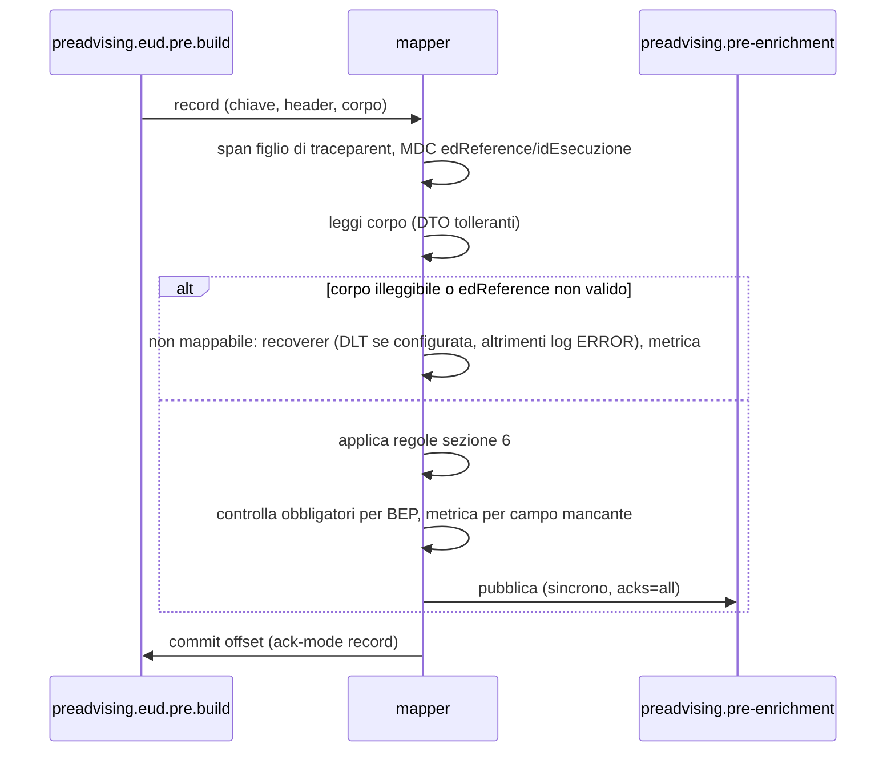

# `ce-dichiarato-eurodis-mapper` — Documento funzionale per lo sviluppo

**Iniziativa**: 136596 — Eurodis autoproduttore · **Versione**: 0.1 (bozza) · **Data**: 2026-11-05
**Autore**: Mary (analyst) · **Destinatario**: Amelia (dev) e team di sviluppo
**Repository**: https://posteitaliane.ghe.com/SVILUPPO/CORRIERE-ESPRESSO_PREADVISING_ce-dichiarato-eurodis-mapper
**Generato da**: [prompt-ce-dichiarato-eurodis-mapper.md](prompt-ce-dichiarato-eurodis-mapper.md)

Etichette usate nel documento:
- **[FATTO]**: scritto nella specifica EURODIS, nel codice o verificato in ambiente; la fonte è indicata.
- **[IPOTESI]**: non scritto da nessuna parte, da confermare.
- **[DECISO]**: decisione presa, con data e riferimento.
- **[DA DECIDERE]**: scelta aperta, con proposta e **default con cui si sviluppa**.

---

## 1. Scopo e responsabilità

Il mapper riceve da `ce-dichiarato-eurodis-in` **una spedizione EURODIS per
messaggio**, così come EURODIS l'ha restituita, la converte nel **tracciato
unico ICD v11** e la pubblica su `preadvising.pre-enrichment`.

**[DECISO 30-10, PA-26]** Il mapping vive **solo** qui. `-in` non trasforma
niente; il ms sync a valle non conosce EURODIS.

**Cosa fa**
- Legge corpo, chiave e header del messaggio di `-in`.
- Applica le regole della sezione 6, campo per campo.
- Pubblica un tracciato con la stessa forma di quello del flusso EUD esistente
  (`esempio-eud-inviofile.json`).
- Rende tracciabile ogni spedizione: esito, campi obbligatori mancanti, metriche, span.

**Cosa non fa**
- Non scarica da EURODIS e non tiene lo storico: lo fa `-in`.
- **Non filtra i duplicati** **[DECISO 04-11]**: si filtra a valle.
- Non chiama F1 né ce-rules finché non si decide dove avviene l'enrichment
  (PA-33): i dati di cliente e contratto arrivano da configurazione (sezione 8).
- Non mappa, in questa fase, dogana, ADR, assicurazione, ritiro e pickup, Punto
  Poste (sezione 6.10).
- Non risponde a EURODIS: non esiste un canale di rifiuto (PA-08).

## 2. Posizione nella catena


**[FATTO]** Il ms sync (`ce-dichiarato-ldv-pdb-sync`) è in test e ha
osservazioni aperte che toccano i nostri dati: paese ISO4 non risolto, nessun
default per peso e dimensioni, nessun troncamento (PA-30, DF-26, DF-27).

## 3. Interfacce

### 3.1 In ingresso: `preadvising.eud.pre.build`

**[DECISO 04-11, PA-31]** Contratto, implementato in `-in` (`SpedizioneProducer`):

- **Chiave**: `edReference` normalizzato, stringa senza decimali.
- **Corpo**: un elemento di `GetShipmentResponse2` **così com'è**, byte per
  byte come EURODIS l'ha mandato. Schema: `eurodis-receive-pan-swagger-v1.json`.
- **Header**:

| Header | Esempio | Uso nel mapper |
|---|---|---|
| `edReference` | `7319003746401` | log e MDC |
| `idEsecuzione` | `6720f1a2b3c4d5e6f7a8b9c0` | → `id_file` |
| `ricevutoIl` | `2026-11-05T09:14:02.123Z` | → `upload_time`, `dataInizioFlusso`, `instantInizioFlusso` |
| `fonte` | `receive-pan/shipments/v1` | log |
| `rifGrezzo` | `eurodis_scarichi/6720f1a2b3c4d5e6f7a8b9c0` | → `link_file_fisico_inviato` |
| `ambiente` | `TEST` | log |
| `schemaVersion` | `1` | se diverso da `1`: log di warning, si prosegue |
| `traceparent` | W3C | lo span del mapper è figlio di quello di `-in` |

**[FATTO, 05-11]** In TEST EURODIS arrivano spedizioni con `consigneeAddress`,
`shipperAddress`, `remunerationAddress` e `bookingInAddress` a `null`, e
`consignorsColloBarcode` vuoto (`esempio-eurodis-spedizione.json`). Lo swagger
dichiara `nullable` tutti gli indirizzi, senza dire quando mancano.

### 3.2 In uscita: `preadvising.pre-enrichment`

- **Chiave**: `rif_spedizione` (= `edReference` normalizzato).
- **Header**: `traceparent` (span del mapper) e `edReference`.
- **Corpo**: tracciato unico ICD v11, una spedizione (`spedizione` è un array
  di un elemento).

**Forma del tracciato** (RF-05). Il tracciato ha la stessa forma di
`esempio-eud-inviofile.json`, il flusso EUD che oggi funziona:
- ogni campo presente in quell'esempio è presente anche da noi;
- un valore assente si scrive `""` se stringa e `0` se numero, mai `null` e
  mai campo omesso;
- in più ci sono i campi delle tabelle della sezione 6;
- le sezioni `ritiro`, `spedizione.pickup` e `collo.articolo` sono assenti.

Oggi il DTO ha 8 campi e `NON_NULL` omette il resto: è la differenza principale
con l'output atteso.

## 4. Flusso di elaborazione



## 5. Regole funzionali generali

| # | Regola |
|---|---|
| RF-01 | Un messaggio in ingresso produce **al più un** messaggio in uscita. |
| RF-02 | `edReference` si legge come numero esatto (`BigDecimal`), mai `double`. `7319003746401.0` vale `7319003746401`. Una parte decimale diversa da zero (`…401.5`) rende il messaggio **non mappabile** (risolve MAP-5: oggi si tronca in silenzio). |
| RF-03 | Il corpo si legge con DTO tolleranti: proprietà sconosciute ignorate, oggetti e liste `null` gestiti senza eccezioni. `collis: null` dà `collo: []`, non NullPointerException (bug della verifica del 04-11). |
| RF-04 | Nessun troncamento **[DECISO 22-10, PA-16]**: ogni valore passa intero, anche oltre la dimensione ICD. |
| RF-05 | Forma del tracciato come nella sezione 3.2. |
| RF-06 | Messaggio non mappabile (corpo non JSON, `edReference` assente o non intero) → recoverer (sezione 7), nessuna pubblicazione. **Ogni altra mancanza non blocca**: si pubblica con `""`/`0`, con un warning e una metrica per campo (RF-07). La validazione di business è a valle (PA-32, da confermare). |
| RF-07 | Obbligatori per BEP, controllati dopo il mapping: `destinatario.cap`, `destinatario.localita`, `data_spedizione`, `collo[].id_ldv`, `collo[].peso`. Se vuoti: warning con il **nome** del campo (mai il valore) e metrica `eurodis_mapper_campo_mancante_total{campo}`. |
| RF-08 | `id_preadvising` = `UUID.randomUUID()` a ogni elaborazione **[DECISO 22-10]**. Una rielaborazione produce un secondo preadvising con lo stesso `rif_spedizione`: la deduplica è a valle (MAP-2). |
| RF-09 | Date e ore si prendono **come arrivano**, senza conversioni di fuso (PA-27: fuso orario non dichiarato). Con o senza `Z` finale, il risultato è lo stesso. |
| RF-10 | Pesi: kg → grammi (×1000), arrotondamento `HALF_UP` all'intero. |
| RF-11 | Header mancanti: i campi derivati restano `""`, warning, si pubblica. |
| RF-12 | Nessun dato personale nei log: solo `edReference`, `idEsecuzione`, esito, nomi dei campi mancanti. |
| RF-13 | Nessun riferimento a PA/DF o a documenti di analisi nei commenti del codice (MAP-7): le regole aperte stanno in questo documento. |

## 6. Regole di mapping

Fonte: foglio "Mapping EURODIS" dell'ICD v11, con i commenti di Diego del 23-10.
**Fase 1** = da fare subito, con i default indicati. Dove la colonna Default
dice `""`/`0` il campo è presente ma vuoto finché il punto non si chiude.

### 6.1 Testata

| Campo ICD | Sorgente | Regola | Rif. |
|---|---|---|---|
| `progressivo` | — | `1` (un messaggio = una spedizione) | MAP-1. Il foglio dice "1..n nel batch": da allineare |
| `versione_tracciato` | — | `1` | |
| `canale` | config `mapper.canale` | default `EUD_INVIOSYSTEM` | **[DECISO 05-11, DF-04, PA-25]**. BEP passa `collo.id_ldv` solo per INVIOSYSTEM; da verificare che `BepChannel.fromCanale` riconosca il valore |
| `id_canale` | — | `""` | [DA DECIDERE PA-15] |
| `id_preadvising` | — | UUID | RF-08 |
| `flag_autoproduttore` | — | `"S"` | |
| `id_file` | header `idEsecuzione` | così com'è | **[DECISO 04-11]** una chiamata = un "file" |
| `upload_time` | header `ricevutoIl` | così com'è (ISO-8601) | |
| `dataInizioFlusso`, `instantInizioFlusso` | header `ricevutoIl` | così com'è | [DA DECIDERE] nessun header porta l'inizio dello scarico: default `ricevutoIl` |
| `link_file_fisico_inviato` | header `rifGrezzo` | così com'è | |
| `errori` | — | assente | a valle |

### 6.2 Cliente

| Campo ICD | Sorgente | Regola | Rif. |
|---|---|---|---|
| `id_cliente`, `codice_login_cliente`, `codice_auc` | config `mapper.cliente.codice` | default `""` | [DA DECIDERE PA-10, PA-33] da F1; finché PA-33 è aperto, costante di configurazione per ambiente |
| `codice_contratto` | config `mapper.cliente.codice-contratto` | default `""` | idem; il ms sync ha un fallback (S7) |
| `ragione_sociale` | `shipperAddress.companyName` | diretto | |
| `no_firma` | `deliveryService.deliveryType` | `S` → `"N"`; `N` → `"S"`; altro o assente → `""` | commento Diego 23-10 |
| altri campi dell'esempio EUD | — | `""` | |

### 6.3 Spedizione

| Campo ICD | Sorgente | Regola | Rif. |
|---|---|---|---|
| `rif_spedizione` | `edReference` | stringa senza decimali (RF-02) | **[DECISO 22-10]** |
| `numero_colli` | `numberOfHandlingUnits` | diretto; `0` se assente. Se diverso dal numero di `collis`: warning, vale `numberOfHandlingUnits` | |
| `id_ldv_partner_master` | `dispatchPartnersDomesticShipmentNumber` | diretto | MAP-6 |
| `id_partner` | config `mapper.id-partner` | default `EURODIS` | [DA DECIDERE PA-15] |
| `codici_servizi` | `deliveryService`, `cashOnDeliveryService` | sezione 6.8 | [DA DECIDERE PA-03] |
| `flag_stampa_ldv` | — | `"N"` (etichetta prodotta da EURODIS) | |
| `flag_attivazione_ritiro` | — | `"N"` | |
| `centro_costo` | config `mapper.centro-costo` | default `""` | [DA DECIDERE DF-11] il ms sync usa la sua config se vuoto |
| `rif_prodotto_cliente` | config `mapper.rif-prodotto-cliente` | default `""` | [DA DECIDERE DF-11] il ms sync usa `APT000901` se vuoto |
| `data_spedizione` | `entranceTimestamp` | `yyyy-MM-dd` (RF-09) | commento Diego 23-10 |
| `ora_spedizione` | `entranceTimestamp` | `HH:mm:ss` | |
| | se `entranceTimestamp` è assente | stessa regola su `clearanceTimestamp` (obbligatorio in EURODIS), con warning | **[DA DECIDERE DF-01]** Diego: `clearanceTimestamp` si ignora; ma `data_spedizione` è obbligatoria per BEP |
| `id_ldv_associata` | `collis[].referencedEuroplateBarcode` | `""` in fase 1 | [DA DECIDERE DF-10] campo di 3 caratteri, barcode di 24, per collo; senza `shipmentTypeIndicator` non si riconosce un reso |
| `codice_tipo_spedizione` | — | `""` | DA DEFINIRE nel foglio |
| `descrizione_contenuto`, `valore` | `customsService` | `""` / `0` in fase 1 | dogana, sezione 6.10 |
| `notifiche_sms`, `notifiche_email` | `consigneePreAdvice` | `""` | [DA DECIDERE DF-09] proposta 29-10: SDA notifica da sola, non si mappa |
| campi CE-RULES (`codice_prodotto`, `servizi_spedizione`, `codice_servizio`…) | — | `""` | ce-rules da `id_ldv`, a valle (PA-03, PA-33) |
| altri campi dell'esempio EUD | — | `""` / `0` | |

### 6.4 Mittente (`spedizione.mittente`) da `shipperAddress`

| Campo ICD | Sorgente | Regola |
|---|---|---|
| `ragione_sociale` | `companyName` | diretto |
| `rif_contatto` | `contactName` | diretto, intero |
| `email` | `contactEMail` | diretto, intero |
| `cellulare` | `contactSMS` | diretto, prefisso compreso |
| `telefono` | `contactTelephone` | diretto |
| `indirizzo` | `street` | diretto |
| `numero_civico` | `streetNumber` | diretto, intero |
| `cap` | `zipcode` | diretto (CAP esteri ammessi) |
| `localita` | `city` | diretto |
| `provincia` | `region` | solo se `countryCode` = `IT` e `region` è una sigla di 2 lettere (maiuscolo); altrimenti `""` (PA-22) |
| `codice_nazione_iso_2` | `countryCode` | diretto |
| `codice_nazione`, `nazione`, `codice_nazione_poste` | — | `""` **[DECISO 23-10, Diego]**: `countryCode` va solo in `codice_nazione_iso_2`. Vedi domanda 3 |
| `note1`, `note2` | `additionalAddressInfo1`, `additionalAddressInfo2` | diretto, intero |

`shipperAddress` assente → tutti i campi `""`.

### 6.5 Destinatario (`spedizione.destinatario`) da `consigneeAddress`

Stesse regole del mittente, sugli stessi campi, più:

| Campo ICD | Regola |
|---|---|
| `prefisso_cellulare` | `""`: `contactSMS` va tutto in `cellulare` (commento Diego 23-10) |
| `cap`, `localita` | obbligatori ICD e BEP: controllati da RF-07 |

`consigneeAddress` assente → tutti i campi `""`, warning e metrica
`campo_mancante{campo=destinatario.cap|destinatario.localita}`, **si pubblica**.
`returnAddress` **non** si usa al posto del destinatario: è l'indirizzo di
rientro. **[DA DECIDERE DF-30]**: vedi domanda 2.

### 6.6 Colli (`spedizione.collo[]`): un elemento per ogni `collis[]`, nello stesso ordine

| Campo ICD | Sorgente | Regola | Rif. |
|---|---|---|---|
| `id_ldv` | `consignorsColloBarcode` | diretto; `""` se assente | **[DECISO 22-10]**. **[FATTO 05-11]** in TEST arriva vuoto: domanda 1 (DF-02) |
| `numero_colli_parz` | posizione | 1..n | |
| `peso` | `weightOfUnit` | ×1000 (RF-10); `0` se assente | |
| `lunghezza` | `length` | diretto, cm; `0` se assente | |
| `altezza` | `height` | diretto | |
| `profondita` | `width` | diretto | |
| `codice_imballo` | `identifierPalletOrCollo` | `P`, `P+` → `"PL"`; `C`, `C+` → `"CL"`; altro → `""` | proposta del foglio |
| `tipo_collo`, `id_ldv_madre`, `id_ldv_figlio`, `id_collo` | — | `""` | [DA DECIDERE PA-11, DF-03] |

### 6.7 Internazionale (`spedizione.internazionale`)

| Campo ICD | Sorgente | Regola | Rif. |
|---|---|---|---|
| `id_ldv_itz` | `collis[].europlateBarcode` | il primo non vuoto e diverso da `"0"` | **[DECISO 22-10]**; con più colli, default di DF-03; `"0"` è il neighbourhood business (DF-18) |
| `peso` | `shipmentWeight` | ×1000 (RF-10) | |
| `vettore` | — | `"EURODIS"` | |
| `descrizione`, `valuta`, `valore_spedizione` | `customsService` | `""` / `0` in fase 1 | sezione 6.10 |
| altri campi dell'esempio EUD | — | `""` / `0` | |

### 6.8 Codici servizi (`spedizione.codici_servizi`)

**[FATTO]** BEP legge i servizi **solo** da `codici_servizi`, non dalle sezioni
`contrassegno`, `consegna` e `assicurata` (DF-07). Senza questo campo il
contrassegno non arriva a PDB.

**[DA DECIDERE PA-03]** Diego (23-10) ha indicato ce-rules da `id_ldv` per
prodotto e servizi e ha lasciato aperti i codici servizi. La proposta del 29-10
li valorizza nel mapper. **Default di fase 1**: valorizzati secondo la tabella,
disattivabili con `mapper.codici-servizi.abilitati=false` (domanda 4).

Stringa di codici separati da `|`: prima il servizio di consegna, poi il
contrassegno. Vuota (`""`) se non c'è nessun servizio.

| Condizione | Codice |
|---|---|
| `deliveryService.deliveryService` = `6` (sabato) | `APT000910` |
| = `E` (sera) | `APT000911` |
| = `F` (entro le 10) | `APT000906` |
| = `M` (entro le 12) | `APT000907` |
| = `B` (su prenotazione) oppure `W` (finestra) | `APT000908` (`W` da confermare, DF-21) |
| = `Z` (PUDO) | nessuno: Punto Poste non mappato (commento Diego 23-10, DF-14, DF-23) |
| = `A`, `D`, `7`, `T`, `N` o altro | nessuno (DF-21, DF-22) |
| `cashOnDeliveryService` presente | `APT000918` |
| più di un collo | nessuno: `APT000945` lo aggiunge il ms sync |

### 6.9 Contrassegno e consegna

| Campo ICD | Sorgente | Regola | Rif. |
|---|---|---|---|
| `contrassegno.flag` | `cashOnDeliveryService` | `"S"` se presente, altrimenti `"N"` | |
| `contrassegno.importo_contrassegno` | `amount` | diretto, 2 decimali; `0` se assente. Se `currency` ≠ `EUR`: si mappa lo stesso, warning e metrica | [DA DECIDERE DF-24] |
| `contrassegno.tipo_pagamento_contrassegno` | `identifierForCODCollection` | `3` → `"CON"`, `5` → `"ABM"`, altro → `""` con warning | [DA DECIDERE DF-24] riscontro SDA, mai `ACM` |
| `consegna.data_consegna` | `deliveryService.deliveryDateWindowStart` | `yyyy-MM-dd` | commento Diego 23-10; DF-06 |
| `consegna.inizio_ora_consegna` | `deliveryTimeWindowStart` | `HH:mm:ss` → `HH:mm` | |
| `consegna.fine_ora_consegna` | `deliveryTimeWindowEnd` | `HH:mm:ss` → `HH:mm` | |
| `consegna.note` | `consigneeAddress.additionalConsigneeInfo`, `shipperAddress.additionalConsigneeInfo` | concatenati in quest'ordine con separatore `mapper.consegna.separatore-note` (default uno spazio); uno solo presente → quello; nessuno → `""` | commento Diego 23-10; separatore [DA DECIDERE] |
| `consegna.modalita` | `deliveryType` | `""` | [DA DECIDERE PA-17] |
| `consegna.codice_frazionario`, `denominazione_frazionario` | `pudoID` | `""` | Punto Poste non mappato (DF-14, DF-23) |
| `consegna.mancata_consegna` | — | `""` | [DA DECIDERE DF-25] |

### 6.10 Fuori dalla fase 1

| Area | Campi EURODIS | Perché | Rif. |
|---|---|---|---|
| Dogana | `customsService.*` → `descrizione_contenuto`, `valore`, `internazionale.descrizione/valuta/valore_spedizione`, `collo.articolo[]` | perimetro non confermato; valorizzare la sezione internazionale può far trattare la spedizione come internazionale da BEP (DF-20) | PA-13 |
| ADR | `hazardousADRServices[]`, `hazardousCollis[]` | nessun campo ICD | PA-13 |
| Assicurazione | `commercialValueOfGoods` → `assicurata.*` | fuori perimetro (riscontro SDA) | DF-08 |
| Punto Poste | `pudoID`, `deliveryService = Z` | commento Diego: non mappare | DF-14, DF-23 |
| Ritiro e pickup | — | EURODIS consegna in hub SDA | |
| Ignorati per decisione | `shipmentTypeIndicator`, `lineHaulIndicator`, `truckLicensePlate`, `termsOfDeliveryText`, `gatewayAssigned`, `alternativeContactTelephone` | commenti Diego 23-10 | DF-15 |

## 7. Gestione errori e recupero

**[FATTO]** Oggi non c'è un error handler esplicito: vale quello di default di
Spring, cioè 9 tentativi senza attesa, poi log e salto del messaggio (MAP-3).

| Scenario | Comportamento | Metrica / log | Recupero |
|---|---|---|---|
| Corpo non JSON | non mappabile, niente tentativi | `eurodis_mapper_spedizioni_total{esito=non_mappabile}`, ERROR senza payload | DLT se configurata; altrimenti ripubblicazione da `-in` (`eurodis.in.ripubblica.ed-references`, env `EURODIS_RIPUBBLICA_ED_REFERENCES`) |
| `edReference` assente o non intero | come sopra | idem | idem |
| Spedizione incompleta (destinatario, data, LDV, peso) | **si pubblica** (RF-06) | `campo_mancante{campo}`, WARN | a valle |
| Kafka in uscita non disponibile, timeout | eccezione → `DefaultErrorHandler` con backoff (default 3 tentativi, 2 s), poi recoverer | `esito=errore_tecnico`, ERROR | offset non committato durante i tentativi; dopo, DLT o ripubblicazione da `-in` |
| Errore inatteso nel mapping | come Kafka giù | idem | idem |

**[DA DECIDERE PA-32]** Coda di scarto (DLT). Default: topic in
`mapper.dlt.topic`; vuoto = disabilitata: log ERROR, metrica, offset avanti.
Proposta: `preadvising.eud.pre.build.DLT`, da far creare se si decide.

## 8. Configurazione

| Parametro | Env | Default | Note |
|---|---|---|---|
| `kafka.consumer.topic.input` | `KAFKA_TOPIC_INPUT` | `preadvising.eud.pre.build` | esistente |
| `kafka.producer.topic.output` | `KAFKA_TOPIC_OUTPUT` | `preadvising.pre-enrichment` | esistente |
| `mapper.canale` | `MAPPER_CANALE` | `EUD_INVIOSYSTEM` | deciso 05-11 |
| `mapper.id-partner` | `MAPPER_ID_PARTNER` | `EURODIS` | PA-15 |
| `mapper.cliente.codice` | `MAPPER_CLIENTE_CODICE` | `""` | → `id_cliente`, `codice_login_cliente`, `codice_auc` |
| `mapper.cliente.codice-contratto` | `MAPPER_CLIENTE_CONTRATTO` | `""` | |
| `mapper.centro-costo` | `MAPPER_CENTRO_COSTO` | `""` | |
| `mapper.rif-prodotto-cliente` | `MAPPER_RIF_PRODOTTO_CLIENTE` | `""` | |
| `mapper.codici-servizi.abilitati` | `MAPPER_CODICI_SERVIZI` | `true` | PA-03 |
| `mapper.consegna.separatore-note` | — | `" "` | |
| `mapper.dlt.topic` | `MAPPER_DLT_TOPIC` | `""` | PA-32 |
| `mapper.errori.tentativi`, `mapper.errori.attesa-ms` | — | `3`, `2000` | backoff dell'error handler |

Producer: `acks=all`, `enable.idempotence=true`, invio sincrono. Consumer:
`ack-mode: record`, `enable-auto-commit: false`. Sono già così.
`management.endpoint.health.show-details`: `never`, come in `-in`.

## 9. Osservabilità

Modello: `ce-dichiarato-adapter` e `ce-dichiarato-eurodis-in` (`TraceUtil`,
`MetricheEurodisIn`).

| Metrica | Tag | Significato |
|---|---|---|
| `kafka_message_consumed_total`, `…_ok`, `…_ko`, `…_errore_tecnico` | — | esistenti, si tengono |
| `eurodis_mapper_spedizioni_total` | `esito` = `pubblicata`, `non_mappabile`, `errore_tecnico` | esito per messaggio |
| `eurodis_mapper_campo_mancante_total` | `campo` | RF-07 |
| `eurodis_mapper_avvisi_total` | `motivo` = `colli_incoerenti`, `fallback_data`, `valuta_non_eur`, `tipo_cod_sconosciuto`, `header_mancante` | regole con warning |
| `eurodis_mapper_durata_seconds` | — | timer dall'ingresso alla pubblicazione |

Span: `eurodis.mapper.elabora`, figlio del `traceparent` di `-in`, con
attributi `edReference`, `idEsecuzione`, `esito`; `traceparent` propagato in
uscita. MDC: `ed_reference`, `id_esecuzione`, `partition`, `offset`.

Alert Datadog: rimandati come per `-in` (AS-19). Proposta da tenere pronta:
`non_mappabile` > 0, `errore_tecnico` > 0 per 10 minuti,
`campo_mancante{campo=destinatario.cap}` in crescita.

## 10. Requisiti non funzionali

| # | Requisito |
|---|---|
| RNF-01 | At-least-once: offset committato solo dopo la pubblicazione confermata. |
| RNF-02 | Nessun dato personale nei log, nelle metriche e negli attributi degli span. |
| RNF-03 | Numeri EURODIS letti come `BigDecimal` o interi, mai `double`. |
| RNF-04 | Ogni regola della sezione 6 ha almeno un test unitario; test con dati inventati, mai di produzione. |
| RNF-05 | Il mapping è una funzione pura (spedizione + header + configurazione → tracciato), testabile senza Kafka. |

## 11. Criteri di accettazione

**AC-01 — esempio TEST del 05-11.** Given il corpo
`esempio-eurodis-spedizione.json` con header `idEsecuzione=E1`,
`ricevutoIl=2026-11-05T09:14:02.123Z`, `rifGrezzo=eurodis_scarichi/E1` e
configurazione di default. When il mapper lo elabora. Then pubblica, con
chiave `7319003746401`, un tracciato con la forma della sezione 3.2 e questi
valori (gli altri campi `""`/`0`):

```json
{
  "progressivo": 1,
  "versione_tracciato": 1,
  "canale": "EUD_INVIOSYSTEM",
  "id_canale": "",
  "id_preadvising": "<uuid>",
  "flag_autoproduttore": "S",
  "id_file": "E1",
  "upload_time": "2026-11-05T09:14:02.123Z",
  "dataInizioFlusso": "2026-11-05T09:14:02.123Z",
  "instantInizioFlusso": "2026-11-05T09:14:02.123Z",
  "link_file_fisico_inviato": "eurodis_scarichi/E1",
  "cliente": { "ragione_sociale": "", "no_firma": "N", "codice_contratto": "" },
  "spedizione": [{
    "rif_spedizione": "7319003746401",
    "numero_colli": 1,
    "id_ldv_partner_master": "30151111",
    "id_partner": "EURODIS",
    "codici_servizi": "APT000918",
    "flag_stampa_ldv": "N",
    "flag_attivazione_ritiro": "N",
    "data_spedizione": "2024-03-29",
    "ora_spedizione": "06:53:55",
    "mittente": { "ragione_sociale": "", "codice_nazione_iso_2": "" },
    "destinatario": { "cap": "", "localita": "", "codice_nazione_iso_2": "" },
    "internazionale": { "id_ldv_itz": "123459000003770904301090", "peso": 15000, "vettore": "EURODIS" },
    "contrassegno": { "flag": "S", "importo_contrassegno": 1111.50, "tipo_pagamento_contrassegno": "CON" },
    "consegna": { "data_consegna": "2024-04-01", "inizio_ora_consegna": "08:00", "fine_ora_consegna": "18:00", "note": "" },
    "collo": [{
      "id_ldv": "", "numero_colli_parz": 1, "peso": 15000,
      "lunghezza": 33, "altezza": 55, "profondita": 44, "codice_imballo": "CL"
    }]
  }]
}
```

E la metrica `campo_mancante` cresce per `destinatario.cap`,
`destinatario.localita` e `collo[].id_ldv`.

| # | Given | When | Then |
|---|---|---|---|
| AC-02 | `collis: null` | elaborazione | pubblica con `collo: []`, nessuna eccezione, `campo_mancante` per `collo[].id_ldv` e `collo[].peso` |
| AC-03 | `consigneeAddress` completo con `streetNumber` di 40 caratteri | elaborazione | destinatario valorizzato, civico intero (RF-04), `codice_nazione` vuoto |
| AC-04 | `entranceTimestamp` assente, `clearanceTimestamp` = `2024-03-28T10:00:00Z` | elaborazione | `data_spedizione` `2024-03-28`, `ora_spedizione` `10:00:00`, avviso `fallback_data` |
| AC-05 | `deliveryType` `N` / `S` / `D` | elaborazione | `no_firma` `"S"` / `"N"` / `""` |
| AC-06 | `deliveryService` `6` + contrassegno | elaborazione | `codici_servizi` = `APT000910\|APT000918` |
| AC-07 | `deliveryService` `Z`, `A`, `D`, `7`, `T` senza contrassegno | elaborazione | `codici_servizi` = `""` |
| AC-08 | `mapper.codici-servizi.abilitati=false` | elaborazione | `codici_servizi` = `""` sempre |
| AC-09 | 3 colli, il primo con `europlateBarcode` `"0"` | elaborazione | 3 elementi `collo`, `numero_colli_parz` 1..3, `id_ldv_itz` dal secondo collo |
| AC-10 | `edReference` `7319003746401.0` / `7319003746401.5` / assente | elaborazione | `"7319003746401"` / non mappabile / non mappabile, nessuna pubblicazione |
| AC-11 | corpo non JSON | elaborazione | non mappabile, offset avanti, DLT se configurata |
| AC-12 | output Kafka non disponibile | elaborazione | 3 tentativi con attesa, offset non committato durante i tentativi, poi recoverer |
| AC-13 | header assenti | elaborazione | `id_file`, `upload_time`, `link_file_fisico_inviato` = `""`, avviso `header_mancante`, pubblicato |
| AC-14 | qualunque spedizione | elaborazione | ogni chiave di `esempio-eud-inviofile.json` è presente nell'output; nessun `null` |
| AC-15 | qualunque spedizione | log | nessun nome, indirizzo, telefono o email |

## 12. Punti aperti e default provvisori

| Punto | Default per partire | Quando arriva la risposta | Rif. |
|---|---|---|---|
| LDV del collo vuota in TEST | resta `consignorsColloBarcode` | si cambia la sorgente di `collo.id_ldv` | DF-02, DF-29 |
| Destinatario assente | si pubblica con campi vuoti | eventuale scarto o altra sorgente | DF-30 |
| Codice nazione | solo `codice_nazione_iso_2` | eventuale copia in `codice_nazione` o ISO4 | DF-12, DF-27 |
| Codici servizi | tabella 6.8, disattivabile | si toglie o si completa la tabella | PA-03, DF-05, DF-21 |
| Cliente, contratto, centro di costo, prodotto | configurazione, default vuoti | valori da F1 o costanti di contratto | PA-10, PA-33, DF-11 |
| Data spedizione senza `entranceTimestamp` | `clearanceTimestamp` | si toglie il fallback o si scarta | DF-01 |
| Contrassegno: valuta e tipo | si mappa tutto, warning | eventuale scarto | DF-24 |
| Messaggi non mappabili | DLT disattivata, log ERROR | si configura il topic | PA-32 |
| Duplicati e `id_preadvising` | UUID casuale, deduplica a valle | eventuale id deterministico | MAP-2 |
| Multicollo madre/figlio, `id_collo` | vuoti | regola LDV | PA-11, DF-03 |
| Dogana, ADR | non mappati | fase 2 | PA-13 |
| `progressivo` | `1` | allineare il foglio | MAP-1 |

## 13. Riferimenti

- Mapping: `ICD_PREADVISING_LDV_EVENT_SOURCE_v11.xlsx` (fogli "Mapping EURODIS", "Mapping inverso EURODIS").
- `verifica-mapper-2026-11-04.md`, `rapporto-amelia-2026-11-02.md`.
- [ce-dichiarato-eurodis-in.md](ce-dichiarato-eurodis-in.md), sezione 3.2.
- `accessori-eurodis-pdb-proposta.md`, `analisi.md`, `punti-aperti-analisi-2026-10-23.md`.
- `esempio-eud-inviofile.json`, `esempio-eurodis-spedizione.json`, `eurodis-receive-pan-swagger-v1.json`.

## Domande per Diego

1. **LDV del collo.** Nella spedizione TEST `consignorsColloBarcode` è vuoto,
   quindi `collo.id_ldv` esce vuoto; `europlateBarcode` invece ha 24 cifre. Si
   resta sulla decisione del 22-10, oppure `europlateBarcode` diventa anche la
   LDV del collo? (DF-02, DF-29)
2. **Destinatario assente.** In TEST `consigneeAddress` è `null`, e cap e
   località sono obbligatori per BEP. Pubblichiamo comunque, come da default,
   o scartiamo? `returnAddress` va lasciato fuori? (DF-30)
3. **Codice nazione.** Con la tua regola (solo `codice_nazione_iso_2`) il ms
   sync legge `codice_nazione` vuoto. Copiamo l'ISO2 anche in `codice_nazione`,
   come fa l'esempio EUD? (DF-12, DF-27)
4. **Codici servizi.** Li valorizziamo nel mapper con la tabella 6.8 (default
   attivo), o aspettiamo ce-rules? Senza, il contrassegno non arriva a PDB. (PA-03)
5. **Cliente e contratto.** Va bene passarli da configurazione per ambiente
   finché non si decide l'enrichment F1? Se sì, servono i valori. (PA-33)
6. **Data spedizione.** Se manca `entranceTimestamp` va bene `clearanceTimestamp`? (DF-01)
7. **Scarti.** Creiamo la DLT `preadvising.eud.pre.build.DLT`? (PA-32)
