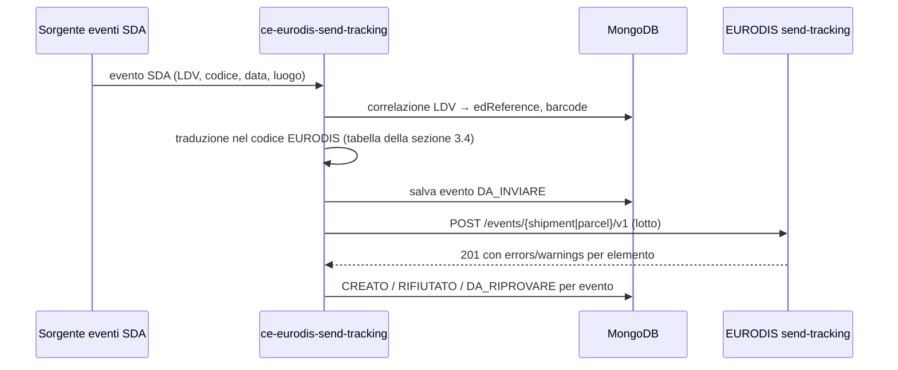
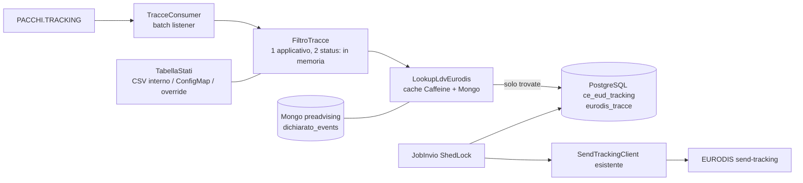
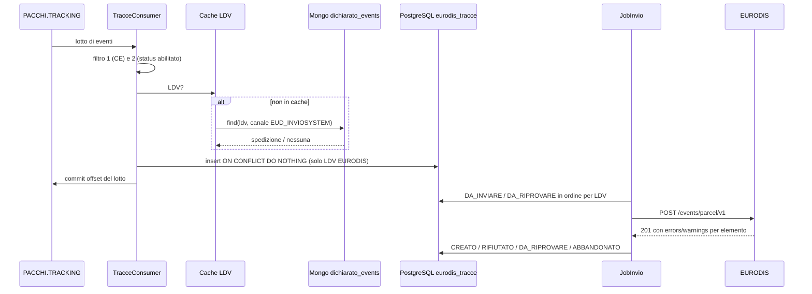

# `ce-eurodis-send-tracking` — Documento funzionale per lo sviluppo

**Iniziativa**: 136596 — Eurodis autoproduttore · **Versione**: 0.3 (bozza) · **Data**: 2026-11-12
**Autrice**: Mary (analyst) · **Destinataria**: Amelia (dev) e team di sviluppo
**Repository**: https://posteitaliane.ghe.com/SVILUPPO/CORRIERE-ESPRESSO_PREADVISING_ce-eurodis-send-tracking (branch `develop`, allineato anche `feature/eurodis-base-implementation`)
**Implementazione** (10-11): client EURODIS `4cba024`, traduzione degli stati IN-BOUND `591767d`; 143 test verdi. Formato della traccia SDA in ingresso (`TracciaSda`) proposto da Amelia in attesa della sorgente (PA-35); `1100` senza `acceptorName` scartato in locale (AC-10).
**Generato da**: [prompt-ce-eurodis-send-tracking.md](prompt-ce-eurodis-send-tracking.md)
**Fonti**: [eurodis-send-tracking-swagger-v1.json](../eurodis-send-tracking-swagger-v1.json) (scaricato il 05-11); [A032 API Data interchange.pdf](../documenti/eurodis/A032%20API%20Data%20interchange.pdf) (EURODIS, annex A03.2, 12-03-2026, cap. 5.3); [Elenco codici status.xlsx](../documenti/eurodis/Elenco%20codici%20status.xlsx) e la versione markdown [elenco-codici-status-inbound.md](../documenti/eurodis/elenco-codici-status-inbound.md); [analisi-pacchi-tracking-prod-2026-11-12.md](../analisi-pacchi-tracking-prod-2026-11-12.md) (Fenaroli/Mary)

Etichette usate nel documento:
- **[FATTO]**: scritto nello swagger EURODIS; la fonte è indicata.
- **[IPOTESI]**: non scritto nello swagger, da confermare.
- **[DECISO]**: decisione presa, con data e riferimento.
- **[DA DECIDERE]**: scelta aperta, con proposta e default provvisorio.

> **Stato 05-11**: client implementato da Amelia (`4cba024` su `feature/eurodis-base-implementation`, 34 test verdi), conforme a RF-01…RF-12 e AC-01…AC-13.
>
> **Cosa si sviluppa adesso** (Diego, 05-11): solo il **client verso EURODIS**, cioè le sezioni 3.1, 5 (RF-01…RF-12), 7.1, 8, 9 e 11.1.
> Sorgente degli eventi SDA, persistenza e job (sezioni 3.2, 3.3, 4 e 6) sono **DA DECIDERE**. Finché non si decidono non si scrivono consumer né scheduler.
>
> **10-11**: la **traduzione degli stati SDA nei codici EURODIS è decisa** (Diego): file `Elenco codici status.xlsx`, foglio "Decodifica Eurodis IN-BOUND" (sezione 3.4). Si può implementare subito come tabella, indipendente dalla sorgente.
>
> **12-11, versione 0.3 (Mary)**: **la sorgente è decisa**: `PACCHI.TRACKING` (sezione 3.2), con tre
> filtri. Il terzo filtro (l'evento riguarda una spedizione EURODIS) si fa **oggi** cercando l'LDV nel
> MongoDB del preadvising (`dichiarato_events`) con canale `EUD_INVIOSYSTEM`, **domani** con la regola
> di sintassi delle LDV EURODIS (DF-29). La tabella degli status da inviare è sovrascrivibile da
> ConfigMap (TR-01). Esempi di eventi in ingresso e di eventi EURODIS attesi: sezione 3.6. Nuove regole
> RF-13…RF-26, casi di scarto (7.3), criteri AC-17…AC-30, punti aperti V-01…V-06 (sezione 12).
> Architettura (consumer, cache, storico, job, DDL, Helm): sezione 14 e [ddl-ce-eurodis-send-tracking.md](ddl-ce-eurodis-send-tracking.md) (Winston, 12-11).

---

## 1. Scopo e responsabilità

`ce-eurodis-send-tracking` restituisce a EURODIS le tracce SDA delle spedizioni che EURODIS ha
affidato a SDA (entrate da `receive-pan`), chiamando l'API EURODIS `send-tracking`.

In pratica:

1. riceve gli eventi di tracciatura SDA delle spedizioni EURODIS (sorgente DA DECIDERE, 3.2);
2. li traduce in eventi EURODIS: codice evento, riferimento della spedizione o del collo, data e luogo;
3. li invia a EURODIS, singolarmente o a lotti;
4. registra l'esito di ogni evento (creato, rifiutato, da riprovare) e lo rende recuperabile.

**Non fa**:

| Fuori perimetro | Chi lo fa |
|---|---|
| Scarico delle spedizioni da EURODIS | `ce-dichiarato-eurodis-in` |
| Mapping verso l'ICD e preadvising | `ce-dichiarato-eurodis-mapper` |
| Prove di consegna (immagini, firme) | API EURODIS `send-pod`, non in perimetro oggi |
| Eventi sugli ordini di ritiro (`/event(s)/pickup-order/v1`) | nessuno: EURODIS non ci affida ritiri |
| Eventi sulle transit unit (`/event(s)/transit/v1`) | nessuno per ora (IPOTESI: SDA non riceve transit unit EURODIS, ST-05) |
| Leggere le tracce che EURODIS espone (`receive-tracking`) | nessuno: è l'API del verso opposto |

## 2. Posizione nella catena

```
EURODIS receive-pan → ce-dichiarato-eurodis-in → ce-dichiarato-eurodis-mapper → preadvising.pre-enrichment → … → PDB
                                                                                                                  │
                                                                                         lavorazione SDA (scan, esiti)
                                                                                                                  │
EURODIS send-tracking ← ce-eurodis-send-tracking ← eventi di tracciatura SDA (sorgente DA DECIDERE, 3.2) ←───────┘
```

Il legame tra i due versi è l'**identità della spedizione**:
- EURODIS la riconosce per `edReference` (spedizione) o per barcode (collo);
- SDA la lavora per LDV (`collo.id_ldv` ← `consignorsColloBarcode`, `internazionale.id_ldv_itz` ← `europlateBarcode`).

Per risalire da una LDV SDA a `edReference` e barcode serve una correlazione (3.3, ST-03).

## 3. Interfacce

### 3.1 In uscita: API EURODIS `send-tracking`

**Ambienti** [FATTO, `servers`]:
- TEST: `https://testapi.eurodis.com/send-tracking`.
- PROD: per analogia con `receive-pan` sarà `https://api.eurodis.com/send-tracking` [IPOTESI].

**Autenticazione** [FATTO, `info.description`]: API key del partner nell'header `X-API-Key`.
- Come in `receive-pan`, non è dichiarata nei `securitySchemes`: un client generato non la aggiunge da solo.
- [IPOTESI] È la stessa chiave di `receive-pan`, perché la chiave identifica il partner. Va confermato (ST-08); default: stesso secret, chiave configurabile a parte.

**Endpoint** [FATTO, `paths`]. Tutti POST, con corpo JSON:

| Endpoint | Cosa crea | Si usa |
|---|---|---|
| `POST /event/shipment/v1` | un evento di spedizione | **sì** |
| `POST /events/shipment/v1` | più eventi di spedizione (lotto) | **sì** |
| `POST /event/parcel/v1` | un evento di collo | **sì** |
| `POST /events/parcel/v1` | più eventi di collo (lotto) | **sì** |
| `POST /event(s)/transit/v1` | eventi su transit unit | no (sezione 1) |
| `POST /event(s)/pickup-order/v1` | eventi su ordini di ritiro | no (sezione 1) |

Quale livello usare (spedizione, collo o entrambi) dipende dai codici evento (ST-01). Il client li offre tutti e quattro.

**Richiesta: evento di spedizione** (`AddShipmentEventRequest`) [FATTO]:

| Campo | Tipo e vincoli | Obbligatorio | Note |
|---|---|---|---|
| `eventCode` | string, **esattamente 3** caratteri | sì | catalogo non nello swagger (ST-01) |
| `edReference` | int64 | no (nullable) | numero di spedizione EURODIS. Di fatto serve per individuarla |
| `acceptorName` | string ≤ 50 | per i codici **100 e 101** | nome di chi ritira: **dato personale** |
| `numberOfParcels` | int 0..999 | **sì** | |
| `numberOfPallets` | int 0..999 | **sì** | |
| `alternateShipmentReference` | string ≤ 50 | no | oltre 50 viene troncato con un warning, senza errore (esempio `02050E`) |
| `eventTimestamp` | string, **10..26** caratteri | sì | ISO 8601, `yyyy-MM-dd'T'HH:mm:ss.SSSZ` (vedi RF-05) |
| `freeTextInformation` | string ≤ 50 | no | |
| `locationCode` | string 1..10 | sì | esempio `CN-CC`; semantica non descritta (ST-04) |
| `countryCode` | string 1..2 | sì | ISO 3166 alpha-2 del luogo dell'evento |
| `bilateralInformation`, `bilateralInformation2` | string ≤ 50 | no | informazioni concordate tra i partner |

**Richiesta: evento di collo** (`AddParcelEventRequest`) [FATTO]. Ha gli stessi campi, con queste differenze:
- `eventCode` ha **esattamente 4** caratteri.
- `acceptorName` è obbligatorio per il codice **1100**.
- `numberOfParcels` e `numberOfPallets` sono facoltativi.
- C'è un riferimento del collo. Almeno uno tra questi è obbligatorio, salvo il setup "neighbourhood business":

| Campo | Vincolo | Quando |
|---|---|---|
| `edReference` | int64 | vuoto solo per scan sul barcode della transit unit |
| `transitUnitBarcode` | ≤ 24 | se il collo è consolidato in una transit unit EURODIS |
| `europlateBarcode` | ≤ 24 | obbligatorio se `deliveryPartnerBarcode` e `dispatchPartnerBarcode` sono entrambi vuoti |
| `deliveryPartnerBarcode` | ≤ 50 | barcode del partner di consegna dal Central Label Service (CLS) |
| `dispatchPartnerBarcode` | ≤ 50 | barcode del partner mittente dal CLS |
| `alternativeBarcode` | ≤ 50 | obbligatorio nel setup neighbourhood business (SOP 02-11) |

Proposta per la correlazione: `europlateBarcode` del collo ricevuto da `receive-pan`, più `edReference`.
- Lo stesso `europlateBarcode` è oggi la base di `internazionale.id_ldv_itz` nel mapper.
- Non sappiamo se SDA è "delivery partner" nel CLS né quale barcode EURODIS si aspetta da noi (ST-03).

**Risposte** [FATTO]:

| Codice | Endpoint singolo | Endpoint a lotti |
|---|---|---|
| `201` | evento creato. Corpo `Add…EventResponse`: echo di `edReference`, barcode, `eventCode`, `warnings[]` | richiesta accolta. Corpo: un `Add…EventsResponse` per evento, con `errors[]` e `warnings[]`. **Se `errors` non è vuoto, quell'evento NON è stato creato** |
| `400` | validazione fallita: `ValidationFailureResponse { errors: [{code, message}] }`, per esempio `02060 Invalid event code` | non documentato: gli errori arrivano per elemento dentro il `201` |
| `401` | API key mancante o errata | idem |
| `424` | partner non determinabile | idem |
| `500` | errore inatteso | idem |

Note sullo swagger:
- Il corpo dei lotti è dichiarato `*/*` invece di `application/json`. Si invia `application/json` [IPOTESI: accettato].
- Non c'è `451`, che invece esiste in `receive-pan`.
- Gli esempi con `eventCode` di 5 caratteri (parcel) o 4 (shipment) sono esempi di errore: la risposta d'esempio li rifiuta con `02060`.
- Per `401` [IPOTESI], come in `receive-pan`, il corpo è testo semplice (`Invalid API Key`), non JSON.
- Non è dichiarato un massimo di elementi per lotto (ST-06).
- Non è dichiarato che la risposta a lotti mantenga l'ordine della richiesta [IPOTESI: stesso ordine e stesso numero di elementi, ST-06].

**Idempotenza** [FATTO, per assenza]: non c'è chiave di idempotenza né un endpoint per leggere gli eventi già creati. Una POST ripetuta dopo una risposta persa **può creare un evento doppio**. Se EURODIS scarti i doppioni (stesso `edReference`/barcode, `eventCode`, `eventTimestamp`) è una domanda (ST-07).

### 3.2 In ingresso: eventi di tracciatura SDA da `PACCHI.TRACKING` [DECISO 12-11]

**[DECISO 12-11, Diego]** La sorgente è il topic Kafka **`PACCHI.TRACKING`** (opzione A della 3.5,
chiude PA-35). In produzione porta gli status SDA del foglio IN-BOUND con `header.applicativo = CE`
(9,85 milioni di eventi `CE` in 24 ore, 65 dei 76 status del foglio: analisi di Fenaroli del 12-11).

**Forma dell'evento** [FATTO, analisi del 12-11 e campioni svil del 10-11; nessun dato personale]:

```json
{
  "header":  { "applicativo": "CE", "timestamp": "2026-11-12 10:15:02.123" },
  "payload": { "canale": "PDT", "status": "GGG", "ldv": "<LDV SDA>", "dataTrack": "2026-11-12 10:14:40",
               "faseLavorazione": "...", "arealavorazione": "...", "tipologiaUfficioEvento": "...",
               "idFrazionarioEvento": "...", "idFrazionarioMittente": "...", "idFrazionarioDestinazione": "...",
               "mazzetto": "...", "tipologiaMazzetto": "...", "numTentativiDiConsegna": "1" }
}
```

| Campo | Uso | Note |
|---|---|---|
| `header.applicativo` | filtro 1 | solo `CE` (Corriere Espresso SDA, [IPOTESI forte] da confermare con SDA) |
| `header.timestamp` | solo log | non fa fede per EURODIS |
| `payload.status` | filtro 2 e traduzione (3.4) | 3 caratteri |
| `payload.ldv` | filtro 3 e `deliveryPartnerBarcode` dell'evento EURODIS | è la LDV PDB Express che EURODIS ci manda in `deliveryPartnerBarcode` (mapper 0.4) |
| `payload.dataTrack` | `eventTimestamp` | `yyyy-MM-dd HH:mm:ss`, ora locale italiana [IPOTESI, V-04] |
| `payload.idFrazionarioEvento` | `locationCode` (RF-21) | [DA DECIDERE, ST-04] |
| `payload.canale` | **non si usa** | per `CE` è `HUB`, `PDT`, `DOL`, `MAN` o assente: il filtro non deve dipendere dal canale |
| altri campi | non si usano | |

- **Chiave Kafka**: in svil i messaggi non hanno chiave; in produzione non è stata letta (V-03).
- **Volumi**: ~275 eventi/s su tutto il topic in produzione, ~114/s `CE`. Dopo i filtri 1 e 2 restano
  ~5,8 milioni di eventi al giorno (~67/s).
- **Svil**: `PACCHI.TRACKING` ha solo traffico della rete pacchi Poste (`TT`), nessun evento `CE`:
  in svil gli eventi si costruiscono (sezione 3.6, test integrati). Collaudo: V-05.

**Filtri, nell'ordine dal più leggero** (RF-13…RF-16):

1. `header.applicativo` deve essere `CE` (scarta ~58% del traffico);
2. `payload.status` deve essere fra gli status abilitati della tabella 3.4 (TR-01, TR-03): scarta
   ~40% degli eventi `CE` (per esempio `THE`, `SCP`);
3. `payload.ldv` deve appartenere a una spedizione EURODIS autoproduttore:
   - **oggi [DECISO 12-11, Diego]**: l'LDV è presente nel MongoDB del preadvising, collezione
     `dichiarato_events`, in `spedizione.collo.id_ldv`, e il documento ha `canale = EUD_INVIOSYSTEM`
     (sezione 3.3);
   - **domani [DA DECIDERE, DF-29]**: l'LDV si riconosce dalla sua sintassi (regola di validità delle
     LDV generate da EURODIS, da SDA/Marzilli), senza lookup.

Solo gli eventi che superano i tre filtri si traducono, si salvano nello storico e si inviano.

### 3.3 Correlazione con la spedizione EURODIS e storico [DECISO 12-11]

**Dove si cerca l'LDV (filtro 3) [DECISO 12-11, Diego]**: nel MongoDB del preadvising.

- **Collezione**: `dichiarato_events` [FATTO, codice]. La scrive `ce-dichiarato-validatore`
  (`FlussoHandler`: storicizza il tracciato unico con `stato`); la legge già `ce-dichiarato-adapter`
  per gli esiti di fase 2 (`PreadvisingEventsRepository.findFirstByColloIdLdv`, query
  `{'spedizione.collo.id_ldv': <ldv>}`).
- **Connessione**: stessa stringa dell'adapter e del validatore, variabile `MONGO_STRING_CONNECTION`
  dal secret `ce-dichiarato-validatore-secret`, chiave `mongo-string-connection`. Solo lettura.
- **Documento** (un tracciato unico per `_id` = `id_preadvising`): campi usati

| Campo Mongo | Uso nell'evento EURODIS |
|---|---|
| `canale` | deve essere `EUD_INVIOSYSTEM` |
| `spedizione[].collo[].id_ldv` | deve contenere `payload.ldv` (è il `deliveryPartnerBarcode` ricevuto da EURODIS) |
| `spedizione[].rif_spedizione` | `edReference` (il mapper vi scrive `edReference` normalizzato) |
| `spedizione[].internazionale.id_ldv_itz` | `europlateBarcode`, se valorizzato (facoltativo: c'è già `deliveryPartnerBarcode`) |
| `spedizione[].numero_colli` | `numberOfParcels` (facoltativo) |
| `id_file`, `_id` | solo storico e log |

- Se per la stessa LDV ci sono più documenti (riconsegne della stessa spedizione), si usa il più
  recente (`dataUltimaModifica`).
- **Indice**: nel codice dei servizi non è dichiarato un indice su `spedizione.collo.id_ldv`
  [FATTO]. Senza indice ogni ricerca scorre la collezione: con ~67 eventi/s non è sostenibile.
  Serve un indice `{ "spedizione.collo.id_ldv": 1, "canale": 1 }` (da creare dal DBA/owner della
  collezione, V-06) e una cache in memoria degli esiti della ricerca (RF-16).

**Alternativa scartata per ora**: tabella `eurodis_ldv` di send-tracking alimentata consumando
`preadvising.eud.pre.build` (proposta della 3.5). Resta valida se il lookup su Mongo non fosse
sostenibile o accessibile.

**Storico degli invii**: tabella PostgreSQL `eurodis_tracce`, una riga per evento SDA che supera i
filtri (dettaglio tecnico e DDL nella sezione 14). Contiene:
- la traccia SDA (LDV, status, `dataTrack`) e il JSON ricevuto (con eventuali dati personali);
- il codice EURODIS, `edReference`, i barcode;
- lo stato di invio (sezione 6), i tentativi, gli errori e i warning EURODIS, l'istante di invio.

Chiave naturale **unica** `(ldv, status_sda, data_traccia)`: una traccia riconsegnata da Kafka non
crea una seconda riga né un secondo invio (RF-18).

### 3.4 Traduzione degli stati SDA nei codici EURODIS [DECISO 10-11]

**[DECISO 10-11, Diego]** Il mapping è nel file
[Elenco codici status.xlsx](../documenti/eurodis/Elenco%20codici%20status.xlsx), foglio **"Decodifica
Eurodis IN-BOUND"** (righe 3-78). Gli altri fogli ("Decodifica Eurodis OUT-BOUND",
"Status Fedex") non sono nel perimetro.

**[FATTO]** Dal foglio:
- **76 status SDA**, ciascuno compare una volta sola, tradotti in **24 codici EURODIS**:
  più status SDA vanno sullo stesso codice (per esempio `000`, `CP0`, `CNP`, `083`, `085` →
  `1100`). La traduzione è quindi a senso unico, da SDA a EURODIS.
- Tutti i codici EURODIS hanno **4 cifre**: sono codici di **collo**. Gli eventi si inviano con
  `POST /events/parcel/v1` (o `/parcels/v1` a lotti), non con gli eventi di spedizione a 3 cifre.
  Questo risolve il livello degli eventi (ST-01, ex domanda 4).
- Il codice `1100` (consegnata) richiede `acceptorName`, il nome di chi ha ritirato (RF della
  sezione 3.1): la sorgente SDA deve fornirlo. È un **dato personale**: si invia ma non si logga
  (RF-12).
- Le descrizioni EURODIS hanno piccole differenze di testo per lo stesso codice (`1200`, `1306`):
  conta il codice.

Regole:

| # | Regola |
|---|---|
| TR-01 | La traduzione è una tabella `statusSDA → codiceEURODIS` caricata da configurazione, non scritta nel codice. **[DECISO 12-11, Diego] Si sovrascrive da ConfigMap**: (a) la base è il file indicato da `eurodis.tracking.stati.file` (CSV con le stesse colonne della risorsa, montato da ConfigMap) o, se non configurato, la risorsa interna `classpath:eurodis/stati-inbound.csv` generata dal foglio; (b) `eurodis.tracking.stati.override` (mappa `status=codice`, per esempio da env `EURODIS_TRACKING_STATI_OVERRIDE=GIA=1785,THE=1767`) aggiunge o sostituisce righe; (c) `eurodis.tracking.stati.abilitati` (elenco di status SDA) limita gli status da inviare; vuoto = tutti quelli della tabella. Una configurazione non valida (codice non di 4 cifre, status non di 3 caratteri) fa fallire l'avvio con un messaggio chiaro. All'avvio si registrano in log il numero di status attivi e l'origine della tabella. |
| TR-02 | Il confronto sullo status SDA è esatto sul codice (3 caratteri, maiuscolo), senza spazi. |
| TR-03 | Status SDA non presente nella tabella o non abilitato: **non si invia** nulla a EURODIS e non si salva nello storico. Con ~4 milioni di eventi `CE` al giorno fuori dal foglio (soprattutto `THE`) **non si logga ogni evento**: solo la metrica `eurodis_tracking_stato_non_mappato_total{status}` (gli status sono codici, non dati personali). [DA CONFERMARE con SDA che l'esclusione di `THE` e degli altri sia voluta.] |
| TR-04 | Lo stesso codice EURODIS può arrivare più volte per lo stesso collo da status SDA diversi (per esempio due giacenze): si inviano tutti, la deduplica non spetta a noi (ST-07). |

Tabella del foglio (stessa sequenza del file):

| Status SDA | Descrizione SDA | Codice EURODIS | Descrizione EURODIS |
|---|---|---|---|
| `000` | OK | `1100` | The item was delivered completely and accepted by the consignee |
| `CP0` | CONSEGNATA AL PUNTOPOSTE | `1100` | The item was delivered completely and accepted by the consignee |
| `CNP` | CONSEGNATA DA UFI AL CLIENTE | `1100` | The item was delivered completely and accepted by the consignee |
| `083` | CONSEGNATA A KIPOINT | `1100` | The item was delivered completely and accepted by the consignee |
| `085` | CONSEGNATA UFFICIO POSTALE | `1100` | The item was delivered completely and accepted by the consignee |
| `009` | Danneggiata | `1105` | Damaged |
| `018` | Manomessa | `1105` | Damaged |
| `FTO` | Furto | `1106` | Item Lost |
| `FTV` | Furto Vettore | `1106` | Item Lost |
| `SMA` | Smarrimento | `1106` | Item Lost |
| `SMV` | Smarrimento Vettore | `1106` | Item Lost |
| `021` | Chiusura Settimanale | `1200` | Special Delivery times - booking in - appointments |
| `029` | Consegne Particolari | `1200` | Special delivery times - booking in - appointments |
| `APC` | Appuntamento concordato | `1200` | Special delivery times - booking in - appointments |
| `APP` | Appuntamento da concordare | `1200` | Special delivery times - booking in - appointments |
| `CON` | Consegna Concordata | `1200` | Special delivery times - booking in - appointments |
| `EDO` | Entrata in dogana | `1201` | The item was taken out of the transportation flow, custom clearance process started |
| `AGT` | Arrivo al Gateway. In attesa di lavorazione | `1203` | Customs clearance documents missing or wrong |
| `007` | Rifiutata | `1300` | Delivery of the item was refused by the consignee without any reason |
| `008` | Destinatario Assente | `1304` | First delivery attempt, notification card was left |
| `010` | Festa Patronale | `1305` | Consignee was closed - holiday |
| `042` | Ferie fino al | `1305` | Consignee was closed - holiday |
| `013` | INCOMPLETA PER MANCANZA/DANNEGGIAMENTO | `1306` | Delivery problem |
| `023` | Fuori Standard | `1306` | Delivery problems caused by customer (i.e. local bank holidays) |
| `024` | Ispezione Postale | `1306` | Delivery problems caused by customer (i.e. local bank holidays) |
| `041` | Zona non servita | `1306` | Delivery problems caused by customer (i.e. local bank holidays) |
| `003` | Indirizzo Errato/Incompleto | `1307` | The address of the consignee is incorrect or incomplete |
| `017` | FDP Concordato | `1308` | The consignee will pick up the item at the delivery depot himself |
| `FDB` | Fermo Deposito Punto Blu | `1308` | The consignee will pick up the item at the delivery depot himself |
| `FDP` | Fermo Deposito Concordato | `1308` | The consignee will pick up the item at the delivery depot himself |
| `SFP` | Servizio Fermo Deposito | `1308` | The consignee will pick up the item at the delivery depot himself |
| `ARP` | ARRIVATA UFI | `1308` | The consignee will pick up the item at the delivery depot himself |
| `AFK` | LA SPEDIZIONE E' IN FERMO DEPOSITO PRESSO KIPOINT | `1308` | The consignee will pick up the item at the delivery depot himself |
| `006` | Mancanza B.A.M. | `1309` | The delivery documents are missing or wrong |
| `027` | Mancato Pagamento | `1310` | The payment information:terms of delivery, COD amounts are wrong or incomplete |
| `093` | Mancato importo contrassegno | `1310` | The payment information:terms of delivery, COD amounts are wrong or incomplete |
| `095` | Importo contrassegno non leggibile | `1310` | The payment information:terms of delivery, COD amounts are wrong or incomplete |
| `096` | Importo contrassegno discordante | `1310` | The payment information:terms of delivery, COD amounts are wrong or incomplete |
| `098` | Mittente contrassegno non leggibile | `1310` | The payment information:terms of delivery, COD amounts are wrong or incomplete |
| `001` | Mancanza di tempo | `1402` | Delivery problems caused by the haulier (i.e vehicle breakdown) |
| `012` | Smistamento Errato | `1406` | No delivery - the item was misrouted or missorted |
| `DID` | Disguido colpa SDA | `1406` | No delivery - the item was misrouted or missorted |
| `DIL` | Disguido | `1406` | No delivery - the item was misrouted or missorted |
| `DIS` | Disguido | `1406` | No delivery - the item was misrouted or missorted |
| `015` | Sciopero | `1408` | Force Majeure |
| `053` | Causa forza maggiore hub | `1408` | Force Majeure |
| `084` | Causa forza maggiore | `1408` | Force Majeure |
| `CAL` | Calamità Naturale | `1408` | Force Majeure |
| `RAL` | Rallentamenti sindacali | `1408` | Force Majeure |
| `SIN` | Agitazione Sindacale | `1408` | Force Majeure |
| `DNR` | Destinatario chiuso causa ordinanza Covid-19 | `1408` | Force Majeure |
| `ZNR` | Zona non raggiungibile per ordinanza Covid-19 | `1408` | Force Majeure |
| `090` | Spedizione abbandonata | `1416` | Disposal of goods |
| `SML` | Smaltita | `1416` | Disposal of goods |
| `RRR` | Ritorno al mittente | `1600` | Return Item |
| `STA` | L/V Stampata | `1740` | Inbound Gateway Scan |
| `PPP` | Partita | `1750` | Delivery Partner Scan |
| `ARR` | Arrivata in filiale | `1766` | Delivery depot arrival |
| `GGG` | In consegna al mattino | `1767` | Out for delivery |
| `POM` | In consegna al pomeriggio | `1767` | Out for delivery |
| `019` | Ritardo Linea | `1785` | On Hold |
| `022` | Non uscita | `1785` | On Hold |
| `035` | Giacenza Problemi linee | `1785` | On Hold |
| `036` | Giacenza Problemi hub | `1785` | On Hold |
| `037` | Giacenza Problemi impianto | `1785` | On Hold |
| `038` | Ritardo linee (partenza) | `1785` | On Hold |
| `044` | Giacenza esubero spedizioni | `1785` | On Hold |
| `ANG` | Arrivata non messa a giro | `1785` | On Hold |
| `ATC` | Attesa partenza colpa Cliente | `1785` | On Hold |
| `ATP` | Attesa In Partenza | `1785` | On Hold |
| `GIA` | Giacenza | `1785` | On Hold |
| `ING` | Entrata in giacenza | `1785` | On Hold |
| `NGG` | Consegna al mattino annullata | `1785` | On Hold |
| `NPO` | Consegna al pomeriggio annullata | `1785` | On Hold |
| `RUS` | Status Precedente | `1785` | On Hold |
| `UDO` | Uscita: Mag. Temp. Custodia | `1785` | On Hold |

### 3.5 Proposta per la sorgente delle tracce (PA-35) [STORICO: superata dalla decisione del 12-11, vedi 3.2 e 3.3]

Winston, 10-11. Proposta ricavata dai **topic Kafka di svil** (non dal codice degli altri progetti), letti in sola lettura: metadati, offset e un campione di messaggi con `assign` e senza gruppo, quindi senza commit di offset. I campioni contengono dati personali e restano fuori dal repo; qui ci sono solo nomi dei campi e forme.

> **12-11, aggiornamento (Mary)**: in **produzione** `PACCHI.TRACKING` porta gli status SDA del
> foglio IN-BOUND con `header.applicativo = CE`: 9,85 milioni di eventi in 24 ore e 65 dei 76 status.
> L'esclusione qui sotto vale solo per svil. Il topic diventa il primo candidato per l'opzione A, con
> filtro `applicativo = CE` → status nel foglio (TR-03) → LDV in `eurodis_ldv`. Dati, copertura per
> status e verifiche ancora aperte (V-01..V-05) in
> [analisi-pacchi-tracking-prod-2026-11-12.md](../analisi-pacchi-tracking-prod-2026-11-12.md).

**Cosa c'è oggi su Kafka svil** [FATTO, 10-11]

- **`preadvising.eud.send-tracking`**, il topic messo come input in `application.yaml`, **non esiste**: nessuno lo alimenta.
- I topic di tracking che hanno traffico **non sono del Corriere Espresso SDA**. Nessuno dei codici osservati coincide con i 76 status SDA del foglio IN-BOUND (3.4). Le LDV hanno le forme della rete pacchi Poste (`A9AAAA9999999`, `9AA9AA9999999`).

| Topic | Messaggi presenti / storici | Forma | Perché si esclude |
|---|---|---|---|
| `PACCHI.TRACKING` | 265 / 257.561 | JSON `{header{applicativo, timestamp}, payload{ldv, status, dataTrack, idFrazionarioEvento, canale, …}}`. Senza chiave Kafka. Producer `tt2-micro-dbpacchi-event` e `tt2-milkman-async-event` | Status Poste (`MVS`, `NCP`, `SCP`), nessuno nel foglio |
| `PACCHI.TRACKING.ITZ` | 37 / 7.763 | JSON con chiave = LDV internazionale. `payload{ldv, ldvInternazionale, status, dataTrack, …}` più anagrafiche di mittente e destinatario | Pacchi internazionali Poste |
| `DESCRITTA.TT.ALL.TRACCE` | 134 / 30.068 | XML da JMS (`MSG/HDR`, sezioni `M1`, `D1`, `MV`, `B2`…, con `OBJ/OBJID`, `OP`, `SUBC`, `TDT`) | Codici `OP`/`SUBC` della rete Poste (`HS4`, `PBS`…), nessuno nel foglio |

- Ci sono invece topic di **esiti SDA** e un topic **CE di tracking**, che in svil oggi sono **vuoti**. Hanno avuto traffico (offset > 0), ma la retention l'ha cancellato: su `CE-TRACKING-EVENTTUP` la retention è di 7 giorni. Il loro formato quindi non si è potuto leggere:

| Topic | Storico (offset) | Nota |
|---|---|---|
| `CE-TRACKING-EVENTTUP` | 40, 3 partizioni, retention 7 giorni | L'unico con prefisso Corriere Espresso e "TRACKING" nel nome |
| `PSDA-23-10.TRACKING.EVENTTT.ESITOUNICO` / `.ESITOCONSEGNA` | 16 / 15 | Esiti SDA dai palmari verso il T&T SDA (`EVENTTT`) |
| `PSDA-20-09.TRACKING.EVENTTT.ESITOLVSTATUS` | 3 | Esito di stato della LDV |
| `PSDA-22-02.EVENTMLP.EXTERNAL.ESITI` | 7.266 | "Esiti verso l'esterno": candidato se esiste già una distribuzione degli esiti ai partner |

- **Nome di chi ritira** (`acceptorName` per `1100`): non verificabile su nessun topic SDA. Su `PACCHI.TRACKING`, che non è SDA, i campi anagrafici sono nulli nei campioni.

**Opzione A, consigliata: consumer diretto del topic degli esiti SDA**

- Si legge il topic che porta gli status SDA a 3 caratteri del foglio IN-BOUND. In ordine di probabilità i candidati sono `CE-TRACKING-EVENTTUP`, `PSDA-23-10.TRACKING.EVENTTT.ESITOUNICO`/`ESITOCONSEGNA` e `PSDA-22-02.EVENTMLP.EXTERNAL.ESITI`.
- Consumer con group id dedicato `ce-eurodis-send-tracking`. Scarta subito le LDV che non sono EURODIS (quasi tutto il traffico) con la tabella `eurodis_ldv` descritta sotto, traduce le altre (3.4), le salva nello storico e le invia a lotti.
- **Pro**: nessun produttore nuovo da far nascere; latenza minima.
- **Contro**: dipende da un formato T&T SDA che non possediamo, e c'è traffico alto da filtrare.
- **Serve da SDA**, il proprietario del T&T: quale topic porta gli status del foglio per il Corriere Espresso (svil e prod), formato, chiave, se c'è il nome di chi ritira, e un campione anche anonimizzato. In alternativa si genera in svil una traccia su una LDV di test e la si cattura.

**Opzione B: topic dedicato `preadvising.eud.send-tracking`**

- Un produttore, lato SDA o un piccolo servizio della catena, pubblica **solo** le tracce delle LDV EURODIS nel formato `TracciaSda` già proposto da Amelia.
- **Pro**: il contratto è nostro, i volumi sono minimi, e il formato T&T non ci riguarda.
- **Contro**: serve un produttore che oggi non esiste e qualcuno che lo possieda. Il filtro sulle LDV EURODIS si sposta da lui.

**Default consigliato**: A, se SDA indica il topic. B se il topic SDA non è leggibile da noi (permessi, formato non pubblico) o se SDA preferisce esporre un contratto dedicato.

**Riconoscere le LDV EURODIS** (vale per A e per B se il filtro lo fa send-tracking)

- Tabella `eurodis_ldv` popolata consumando `preadvising.eud.pre.build`. È la spedizione EURODIS così com'è: ha per ogni collo la coppia `deliveryPartnerBarcode` (la LDV SDA PDB Express) ed `europlateBarcode`, cioè quello che serve all'evento EURODIS di collo.
- Una riga per collo: `ldv` (chiave, = `deliveryPartnerBarcode`), `ed_reference`, `europlate_barcode`, `id_file`, `ricevuto_il`.
- `preadvising.pre-enrichment` non basta: ha `id_ldv_itz` solo a livello di spedizione.
- Leggere `eurodis_spedizioni` di `-in` è scartato: accoppia i due servizi su un database e il JSON non è indicizzato.
- Una traccia per una LDV non ancora in tabella si considera non EURODIS. La traccia arriva dopo il preadvising, quindi la finestra di corsa è trascurabile; se in prova risultasse reale, si aggiunge una tabella di attesa con scadenza.

**Storico degli invii**: PostgreSQL, sul modello di `-in` (JDBC, script DDL in `sql/ddl/`, ShedLock su JDBC). Tabella `eurodis_tracce`, una riga per evento.

| Campi | Contenuto |
|---|---|
| `id` | uuid |
| `ldv`, `ed_reference`, `europlate_barcode` | identificativi del collo |
| `status_sda`, `data_traccia` | traccia SDA di origine |
| `codice_eurodis` | codice di 4 cifre (3.4) |
| `stato` | `DA_INVIARE`, `INVIATO`, `RIFIUTATO`, `SCARTATO`, `ERRORE_INVIO` |
| `tentativi`, `ultimo_errore`, `inviato_il` | esito dell'invio |
| `traccia_json` | testo della traccia SDA, contiene dati personali |

Vincolo `UNIQUE (ldv, status_sda, data_traccia)`.

**Idempotenza e doppioni (ST-07)**

- **In ingresso**: la chiave naturale `UNIQUE` scarta le tracce riconsegnate da Kafka (at-least-once). Il consumer fa insert e commit dell'offset; l'invio è disaccoppiato dal job.
- **In uscita**: un evento `INVIATO` non si reinvia mai. Si ritentano solo gli esiti `ERRORE_TEMPORANEO`, compresi quelli incerti (7.2): accettiamo il rischio di un doppione finché EURODIS non risponde su ST-07.

**Retry**

- Job con ShedLock ogni 2 minuti (configurabile) sui `DA_INVIARE` e sugli errori temporanei, con attesa crescente fra i tentativi.
- Dopo N tentativi l'evento passa a `ERRORE_INVIO`, con metrica e alert. `RIFIUTATO` (4xx di EURODIS) non si ritenta.
- Per lo stesso collo gli eventi si inviano in ordine di `data_traccia`.

### 3.6 Esempi: eventi in ingresso e eventi EURODIS attesi [dati inventati]

LDV e numeri sono inventati. Per tutti gli esempi la LDV `990000000000101` è in `dichiarato_events`
con `canale = EUD_INVIOSYSTEM`, `rif_spedizione = 9900000000001`, `id_ldv_itz =
123459000003770904301099`, salvo dove indicato. `dataTrack` è ora italiana; l'evento EURODIS è in UTC
(RF-05, V-04). `locationCode` = `idFrazionarioEvento` (RF-21), `countryCode` = `IT`.

**E1 — consegnata, `000` → `1100`** (servono `acceptorName`, V-02)

```json
{ "header": { "applicativo": "CE", "timestamp": "2026-11-12 15:31:10.004" },
  "payload": { "canale": "PDT", "status": "000", "ldv": "990000000000101",
               "dataTrack": "2026-11-12 15:30:55", "idFrazionarioEvento": "77001", "numTentativiDiConsegna": "1" } }
```
Evento EURODIS (`POST /events/parcel/v1`, un elemento del lotto):
```json
{ "eventCode": "1100", "edReference": 9900000000001, "deliveryPartnerBarcode": "990000000000101",
  "europlateBarcode": "123459000003770904301099", "eventTimestamp": "2026-11-12T14:30:55.000Z",
  "locationCode": "77001", "countryCode": "IT", "acceptorName": "<nome di chi ritira>" }
```
Se la sorgente non fornisce il nome e `eurodis.tracking.acceptor-name-default` è vuoto: riga nello
storico `SCARTATO` con motivo `acceptor_name_mancante`, nessuna chiamata (RF-06, AC-10, RF-22).

**E2 — in consegna al mattino, `GGG` → `1767`**
```json
{ "header": { "applicativo": "CE", "timestamp": "2026-11-12 07:02:31.550" },
  "payload": { "canale": "DOL", "status": "GGG", "ldv": "990000000000101",
               "dataTrack": "2026-11-12 07:02:10", "idFrazionarioEvento": "77001" } }
```
```json
{ "eventCode": "1767", "edReference": 9900000000001, "deliveryPartnerBarcode": "990000000000101",
  "europlateBarcode": "123459000003770904301099", "eventTimestamp": "2026-11-12T06:02:10.000Z",
  "locationCode": "77001", "countryCode": "IT" }
```

**E3 — giacenza, `GIA` → `1785`**: come E2 con `"status": "GIA"` → `"eventCode": "1785"`.

**E4 — arrivata in filiale, `ARR` → `1766`**: come E2 con `"status": "ARR"`, `"canale": "HUB"` →
`"eventCode": "1766"` (il canale non conta).

**E5 — status non mappato, `THE`**: `applicativo CE`, LDV EURODIS, `"status": "THE"` → nessuna
ricerca su Mongo, nessuna riga nello storico, nessun invio; metrica
`eurodis_tracking_stato_non_mappato_total{status="THE"}` +1 (TR-03).

**E6 — applicativo diverso da `CE`**: `"applicativo": "TT"`, `"status": "000"` → scartato al filtro 1,
nessuna altra elaborazione; metrica `eurodis_tracking_scartati_total{filtro="applicativo"}` +1.

**E7 — LDV non EURODIS**: `applicativo CE`, `"status": "GGG"`, `"ldv": "990000000000999"` non presente
in `dichiarato_events` (o presente con canale diverso da `EUD_INVIOSYSTEM`) → scartato al filtro 3,
nessuna riga nello storico; metrica `eurodis_tracking_scartati_total{filtro="ldv"}` +1; l'esito della
ricerca resta in cache (RF-16).

**E8 — stessa traccia riconsegnata da Kafka**: E2 ricevuto due volte → una sola riga nello storico e
un solo invio (RF-18).

**E9 — status sovrascritto da ConfigMap**: con `EURODIS_TRACKING_STATI_OVERRIDE=THE=1767`, E5 diventa
un evento `1767`; con `EURODIS_TRACKING_STATI_ABILITATI=000,GGG`, E3 (`GIA`) non si invia (TR-01).

## 4. Flusso di elaborazione (proposta del 05-11, superata: il flusso deciso è nelle sezioni 3.2, 3.3 e 14)



## 5. Regole funzionali del client

| # | Regola |
|---|---|
| RF-01 | Ogni chiamata porta l'header `X-API-Key` con la chiave letta dalla configurazione (secret). La chiave non compare mai nei log |
| RF-02 | Il client espone quattro operazioni: evento di spedizione singolo e a lotto, evento di collo singolo e a lotto |
| RF-03 | Il client non solleva eccezioni sugli stati HTTP: restituisce un esito per evento. Gli errori di rete (timeout, connessione rifiutata) diventano anch'essi un esito, `ERRORE_TEMPORANEO`, non un'eccezione verso il chiamante |
| RF-04 | Classificazione degli esiti: `201` senza `errors` → **CREATO** (con eventuali warning); `400` o `errors` non vuoto nel lotto → **RIFIUTATO** (definitivo, non si riprova); `401`/`424` → **ERRORE_CONFIGURAZIONE** (chiave o partner: si riprova solo dopo l'intervento); `500`, `5xx` non documentati, timeout, I/O → **ERRORE_TEMPORANEO** (si può riprovare); altri codici → **ERRORE_TEMPORANEO** con log del codice |
| RF-05 | `eventTimestamp` si invia in UTC nel formato `yyyy-MM-dd'T'HH:mm:ss.SSS'Z'` (24 caratteri). Il pattern con offset numerico (`+0100`) è lungo 28 caratteri e supera il massimo di 26. Il fuso atteso da EURODIS è una domanda (ST-09) |
| RF-06 | Prima dell'invio il client verifica i vincoli dello swagger che EURODIS rifiuterebbe comunque: lunghezza di `eventCode` (3 spedizione, 4 collo), obbligatori, `countryCode` ≤ 2, `locationCode` 1..10, `numberOfParcels`/`numberOfPallets` 0..999, almeno un riferimento del collo, `acceptorName` per 100/101 (spedizione) e 1100 (collo). Un evento non valido diventa **RIFIUTATO** con motivo locale, senza chiamata |
| RF-07 | I campi testuali oltre la lunghezza massima **non si troncano** (regola di progetto PA-16): l'evento è rifiutato localmente (RF-06). Fa eccezione `alternateShipmentReference`, che EURODIS tronca da sé con un warning |
| RF-08 | Lotti: un lotto oltre `lotto-max` elementi si divide in più chiamate. Gli esiti si restituiscono nell'ordine della richiesta. Se una risposta ha un numero di elementi diverso dalla richiesta, tutti gli eventi di quella chiamata diventano **ERRORE_TEMPORANEO** con motivo "risposta non correlabile" |
| RF-09 | Correlazione nel lotto: l'esito i-esimo corrisponde all'evento i-esimo. Se `edReference` o `eventCode` dell'esito non coincidono con l'evento, l'esito si accetta lo stesso ma si registra un warning (metrica e log senza dati personali) |
| RF-10 | Nessun retry automatico nel client HTTP. La politica di retry sta nel chiamante, che decide sugli `ERRORE_TEMPORANEO` (sezione 7.2). Così il client resta prevedibile e una POST non si ripete di nascosto (rischio di doppioni, 3.1) |
| RF-11 | I warning EURODIS (per esempio `02050E`) non bloccano: si registra il codice nei log e nelle metriche |
| RF-12 | Log senza dati personali: si registrano `edReference`, `eventCode`, codici di errore e warning, esito, durata. Mai `acceptorName`, `freeTextInformation`, `bilateralInformation*` né i barcode completi |

**Regole del flusso da `PACCHI.TRACKING`** [12-11]:

| # | Regola |
|---|---|
| RF-13 | Il servizio consuma `PACCHI.TRACKING` con un consumer group proprio (`ce-eurodis-send-tracking`), solo lettura. Non scrive su quel topic |
| RF-14 | Filtro 1: si scartano subito gli eventi con `header.applicativo` diverso da `CE` (configurabile: `eurodis.tracking.filtro.applicativi`, default `CE`) |
| RF-15 | Filtro 2: si scartano gli eventi con `payload.status` non presente o non abilitato nella tabella (TR-01, TR-03). Filtri 1 e 2 sono in memoria, senza accessi esterni |
| RF-16 | Filtro 3 (oggi): l'evento passa se `payload.ldv` è in `dichiarato_events.spedizione.collo.id_ldv` di un documento con `canale = EUD_INVIOSYSTEM`. L'esito della ricerca (trovata con i dati della spedizione, oppure non trovata) va in **cache in memoria** per LDV, con TTL configurabile (default 30 minuti per "trovata", 10 minuti per "non trovata"); un errore di Mongo non va in cache |
| RF-17 | Se Mongo non risponde, l'evento non si scarta: il consumer si ferma su quell'evento e riprova (backoff), così nessuna traccia EURODIS si perde. Metrica e log di errore |
| RF-18 | Ogni evento che supera i filtri si salva in `eurodis_tracce` con stato `DA_INVIARE`, in modo idempotente sulla chiave `(ldv, status_sda, data_traccia)`: un doppione non crea righe né invii. L'offset Kafka si conferma dopo il salvataggio |
| RF-19 | L'invio è disaccoppiato: un job (un solo pod alla volta) prende i `DA_INVIARE` e i `DA_RIPROVARE`, li invia a lotti con `POST /events/parcel/v1` (client RF-01…RF-12) e registra l'esito per evento |
| RF-20 | Per lo stesso collo gli eventi si inviano in ordine di `data_traccia` (gli eventi possono arrivare fuori ordine: V-03) |
| RF-21 | Valori dell'evento EURODIS: `eventCode` dalla tabella; `edReference` = `rif_spedizione`; `deliveryPartnerBarcode` = `payload.ldv`; `europlateBarcode` = `id_ldv_itz` se valorizzato e diverso da `0`; `eventTimestamp` = `dataTrack` (ora italiana) convertita in UTC (RF-05); `locationCode` = `idFrazionarioEvento` se lungo 1..10, altrimenti `eurodis.tracking.location-code-default` (ST-04); `countryCode` = `eurodis.tracking.country-code` (default `IT`); `numberOfParcels` = `numero_colli` se valorizzato |
| RF-22 | `acceptorName` per `1100`: dal campo della sorgente indicato da V-02 se esiste; altrimenti da `eurodis.tracking.acceptor-name-default` se configurato; altrimenti l'evento va `SCARTATO` con motivo `acceptor_name_mancante` (nessuna chiamata). Il nome non va mai nei log |
| RF-23 | Retry solo sugli esiti `ERRORE_TEMPORANEO` (compresi gli esiti incerti, 7.2), con attesa crescente e massimo configurabile; poi `ABBANDONATO` con metrica. `RIFIUTATO` non si ritenta. `ERRORE_CONFIGURAZIONE` sospende gli invii senza consumare tentativi |
| RF-24 | Abilitazioni separate per ambiente: `eurodis.tracking.consumer.abilitato` (lettura di `PACCHI.TRACKING`) e `eurodis.tracking.invio.abilitato` (chiamate a EURODIS), per poter raccogliere lo storico senza inviare |
| RF-25 | Nessun dato personale nei log, nelle metriche e negli span: solo status, codici, esiti, id tecnici. L'LDV nei log si maschera (ultime 4 cifre) |
| RF-26 | Ogni scarto ha una metrica per motivo (`applicativo`, `status`, `ldv`, `acceptor_name_mancante`, `evento_non_valido`); nessun log per evento sui filtri 1-3 (volumi) |

## 6. Stati di un evento (proposta, per lo storico 3.3)

`DA_INVIARE` → `CREATO` | `RIFIUTATO` | `DA_RIPROVARE` → (tentativi) → `CREATO` | `RIFIUTATO` | `ABBANDONATO` (oltre il massimo dei tentativi, con alert).

`ERRORE_CONFIGURAZIONE` non consuma tentativi: blocca gli invii e manda un alert finché la chiave non torna valida.

## 7. Errori e recupero

### 7.1 Nel client

| Scenario | Esito | Note |
|---|---|---|
| `400` con `errors` | RIFIUTATO, con codici EURODIS | non si riprova; il codice va nei log e nella metrica |
| Lotto `201` con alcuni `errors` | quegli eventi RIFIUTATO, gli altri CREATO | successo parziale |
| `401` (corpo testo, non JSON) | ERRORE_CONFIGURAZIONE | il corpo non si interpreta come JSON |
| `424` | ERRORE_CONFIGURAZIONE | |
| `500` | ERRORE_TEMPORANEO | |
| Timeout di connessione / connessione rifiutata | ERRORE_TEMPORANEO | la richiesta non è partita: riprovare è sicuro |
| Timeout di lettura / connessione caduta dopo l'invio | ERRORE_TEMPORANEO, motivo "esito incerto" | l'evento potrebbe essere stato creato: riprovare può creare un doppione (ST-07) |
| Corpo `201` non leggibile | ERRORE_TEMPORANEO, motivo "esito incerto" | come sopra |

### 7.2 Politica di retry [DA DECIDERE]

Proposta: si riprova sugli ERRORE_TEMPORANEO con backoff (1, 5, 15 minuti, poi ogni ora), fino a 24 ore, poi ABBANDONATO con alert. Anche gli "esiti incerti" si riprovano, per due motivi:
- un evento di tracking doppio è meno grave di un evento perso;
- EURODIS potrebbe scartare i doppioni (ST-07).

Se EURODIS risponde che i doppioni sono un problema, gli esiti incerti vanno a verifica manuale invece che al retry automatico.

### 7.3 Casi di scarto e di errore del flusso [12-11]

| Caso | Esito | Storico | Metrica |
|---|---|---|---|
| `applicativo` ≠ `CE` | scartato | no | `scartati_total{filtro=applicativo}` |
| status non in tabella o non abilitato | scartato | no | `stato_non_mappato_total{status}` |
| LDV non in `dichiarato_events` o canale ≠ `EUD_INVIOSYSTEM` | scartato | no | `scartati_total{filtro=ldv}` |
| JSON non leggibile o campi obbligatori assenti (`status`, `ldv`, `dataTrack`) | scartato | no | `scartati_total{filtro=evento_non_valido}` |
| `1100` senza `acceptorName` | `SCARTATO` | sì | `scartati_total{filtro=acceptor_name_mancante}` |
| Mongo non disponibile | consumer fermo e ritenta (RF-17) | — | `mongo_errori_total` |
| PostgreSQL non disponibile | consumer fermo e ritenta | — | errore del consumer |
| EURODIS `400` / errore per elemento | `RIFIUTATO` | sì | `errori_eurodis_total{codice}` |
| EURODIS `401`/`424` | invii sospesi (`ERRORE_CONFIGURAZIONE`) | sì | `eventi_total{esito}` + alert |
| EURODIS `5xx`, timeout | `DA_RIPROVARE`, poi `ABBANDONATO` | sì | `eventi_total{esito}` |

## 8. Configurazione (client)

| Proprietà (`eurodis.tracking.*`) | Variabile | Default | Note |
|---|---|---|---|
| `base-url` | `EURODIS_TRACKING_BASE_URL` | `https://testapi.eurodis.com/send-tracking` | per ambiente |
| `api-key` | `EURODIS_API_KEY` | vuoto | dal secret `ce-eurodis-send-tracking-secret`, chiave `api-key` |
| `timeout.connect` | `EURODIS_TIMEOUT_CONNECT` | `10s` | |
| `timeout.read` | `EURODIS_TIMEOUT_READ` | `30s` | |
| `lotto-max` | `EURODIS_TRACKING_LOTTO_MAX` | `100` | massimo EURODIS non dichiarato (ST-06) |
| `stati.risorsa` | — | `classpath:eurodis/stati-inbound.csv` | tabella della sezione 3.4 (TR-01), usata se `stati.file` non è configurato |
| `stati.file` | `EURODIS_TRACKING_STATI_FILE` | vuoto | percorso del CSV montato da ConfigMap (TR-01) |
| `stati.override` | `EURODIS_TRACKING_STATI_OVERRIDE` | vuoto | `status=codice` separati da virgola (TR-01) |
| `stati.abilitati` | `EURODIS_TRACKING_STATI_ABILITATI` | vuoto (= tutti) | status SDA da inviare (TR-01) |
| `filtro.applicativi` | `EURODIS_TRACKING_APPLICATIVI` | `CE` | RF-14 |
| `location-code-default` | `EURODIS_TRACKING_LOCATION_CODE` | `SDA` | RF-21, ST-04 |
| `country-code` | `EURODIS_TRACKING_COUNTRY_CODE` | `IT` | RF-21 |
| `acceptor-name-default` | `EURODIS_TRACKING_ACCEPTOR_NAME_DEFAULT` | vuoto | RF-22 |
| `consumer.abilitato`, `invio.abilitato` | `EURODIS_TRACKING_CONSUMER_ABILITATO`, `EURODIS_TRACKING_INVIO_ABILITATO` | `false`, `false` | RF-24 |
| `cache-ldv.ttl-trovata`, `cache-ldv.ttl-non-trovata` | — | `30m`, `10m` | RF-16 |

Topic, consumer group, Mongo, PostgreSQL, job e Helm: sezione 14 (Winston).

## 9. Osservabilità

Metriche (Micrometer/Prometheus, tag comune `service=ce-eurodis-send-tracking`), sul modello di `-in`:

| Metrica | Tipo | Tag |
|---|---|---|
| `eurodis_tracking_chiamata_total` | counter | `endpoint` (shipment, shipments, parcel, parcels), `esito` (codice HTTP o `io`) |
| `eurodis_tracking_chiamata_durata` | timer | `endpoint` |
| `eurodis_tracking_eventi_total` | counter | `livello` (spedizione, collo), `esito` (CREATO, RIFIUTATO, ERRORE_CONFIGURAZIONE, ERRORE_TEMPORANEO) |
| `eurodis_tracking_errori_eurodis_total` | counter | `codice` (codice errore EURODIS, `locale` per RF-06) |
| `eurodis_tracking_warning_total` | counter | `codice` |
| `eurodis_tracking_stato_non_mappato_total` | counter | `status` (status SDA) — TR-03 |
| `eurodis_tracking_lotto_non_correlabile_total` | counter | — |
| `eurodis_tracking_esito_non_coincidente_total` | counter | — (RF-09) |

Span OpenTelemetry: uno per chiamata HTTP, kind CLIENT, nome `eurodis.send-tracking <endpoint>`. Attributi: `http.status_code`, `eurodis.eventi`, `eurodis.creati`, `eurodis.rifiutati`. Il tracing non deve mai far fallire l'invio (principio di `TraceUtil`).

Alert (più avanti, come AS-19 di `-in`):
- qualsiasi `401`/`424`;
- tasso di ERRORE_TEMPORANEO oltre soglia;
- eventi ABBANDONATO.

## 10. Requisiti non funzionali

| # | Requisito |
|---|---|
| RNF-01 | Chiave API solo da secret, mai in `application*.yaml` né nei log |
| RNF-02 | Nessun dato personale nei log (RF-12) |
| RNF-03 | Nessun retry automatico nascosto nel client HTTP (RF-10) |
| RNF-04 | DTO tolleranti: le proprietà sconosciute nelle risposte si ignorano; `edReference` è `Long`, mai `double` |
| RNF-05 | Timeout espliciti su connessione e lettura |
| RNF-06 | Stack della catena: Java 17, Spring Boot 3.5.14, Dockerfile allineato a `ce-dichiarato-adapter` |

## 11. Criteri di accettazione

### 11.1 Client (si sviluppa ora; test con server HTTP finto e dati inventati)

| # | Given / When / Then |
|---|---|
| AC-01 | Dato un evento di spedizione valido, quando lo invio, allora parte `POST /event/shipment/v1` con `X-API-Key` e il JSON atteso; con `201` l'esito è CREATO |
| AC-02 | Dato un `201` con `warnings`, l'esito è CREATO e i codici dei warning sono riportati |
| AC-03 | Dato un `400` con `errors [02060]`, l'esito è RIFIUTATO con il codice `02060` |
| AC-04 | Dato un lotto di due eventi e un `201` con `errors` solo sul primo, il primo è RIFIUTATO e il secondo CREATO |
| AC-05 | Dato un `401` con corpo testo `Invalid API Key`, l'esito è ERRORE_CONFIGURAZIONE senza errori di parsing |
| AC-06 | Dato un `500`, l'esito è ERRORE_TEMPORANEO e la richiesta parte **una sola volta** |
| AC-07 | Dato un timeout di lettura, l'esito è ERRORE_TEMPORANEO con motivo "esito incerto", senza eccezione verso il chiamante |
| AC-08 | Dato un lotto più grande di `lotto-max`, partono più chiamate e gli esiti tornano nell'ordine della richiesta |
| AC-09 | Dato un `201` a lotto con un numero di elementi diverso dalla richiesta, tutti gli eventi della chiamata sono ERRORE_TEMPORANEO "risposta non correlabile" |
| AC-10 | Dato un evento con `eventCode` di lunghezza errata, o con codice 100 senza `acceptorName`, o di collo senza riferimenti, l'esito è RIFIUTATO locale senza chiamata HTTP |
| AC-11 | `eventTimestamp` è serializzato come `2026-11-05T13:45:00.000Z` |
| AC-12 | Nei log del client non compaiono `acceptorName` né la chiave API |
| AC-13 | Le metriche della sezione 9 si incrementano con i tag attesi |
| AC-14 | Dato lo status SDA `CP0`, la traduzione dà `1100`; dato `GGG` dà `1767`; dato `RRR` dà `1600` |
| AC-15 | Data la risorsa caricata, contiene 76 status SDA e 24 codici EURODIS distinti, tutti di 4 cifre (controllo di coerenza con il foglio) |
| AC-16 | Dato uno status SDA non in tabella (es. `XYZ`), non parte nessuna chiamata, c'è un warning e `eurodis_tracking_stato_non_mappato_total{status="XYZ"}` cresce |

### 11.2 Flusso da `PACCHI.TRACKING` (dati inventati, esempi della sezione 3.6)

| # | Given / When / Then |
|---|---|
| AC-17 | Dato E2 con LDV EURODIS in Mongo, quando arriva, allora si salva una riga `DA_INVIARE` con codice `1767`, `edReference` 9900000000001, `eventTimestamp` `2026-11-12T06:02:10.000Z`, e il job invia l'evento di collo atteso |
| AC-18 | Dato E1 (`000`) senza nome di chi ritira e default vuoto, la riga è `SCARTATO` con motivo `acceptor_name_mancante` e non parte nessuna chiamata |
| AC-19 | Dato E1 con `acceptor-name-default` configurato, parte l'evento `1100` con quel valore e il valore non compare nei log |
| AC-20 | Dato E5 (`THE`), non si interroga Mongo, non si salva niente, cresce `stato_non_mappato_total{status="THE"}` |
| AC-21 | Dato E6 (`TT`), lo scarto avviene al filtro 1 senza altre elaborazioni |
| AC-22 | Dato E7 (LDV non EURODIS), scarto al filtro 3; un secondo evento sulla stessa LDV entro il TTL non interroga Mongo (cache) |
| AC-23 | Dato un documento Mongo con la LDV ma canale `PDB_INVIOSYSTEM`, l'evento è scartato al filtro 3 |
| AC-24 | Dato E2 ricevuto due volte, una sola riga e un solo invio |
| AC-25 | Dato Mongo non disponibile, l'evento non si perde: dopo il ripristino si salva e si invia |
| AC-26 | Dato `EURODIS_TRACKING_STATI_OVERRIDE=THE=1767`, E5 genera un evento `1767`; dato `EURODIS_TRACKING_STATI_ABILITATI=000,GGG`, E3 non si invia |
| AC-27 | Dato un file di stati montato con un codice di 3 cifre, il servizio non parte e il log indica riga e valore errati |
| AC-28 | Dati due eventi dello stesso collo arrivati in ordine inverso di `dataTrack`, il job li invia in ordine di `dataTrack` |
| AC-29 | Con `invio.abilitato=false` le righe restano `DA_INVIARE` e non parte nessuna chiamata; con `consumer.abilitato=false` il topic non si legge |
| AC-30 | Nei log non compaiono nomi, indirizzi né LDV complete; le metriche di scarto si incrementano con i tag attesi |

## 12. Punti aperti e default provvisori

| # | Punto | Default per partire | Impatto quando arriva la risposta | Rif. |
|---|---|---|---|---|
| ST-01 | Catalogo dei codici evento EURODIS e traduzione degli eventi SDA | **CHIUSO 10-11**: tabella del foglio "Decodifica Eurodis IN-BOUND" (sezione 3.4), codici di collo a 4 cifre | — | PA-34 |
| ST-02 | Sorgente degli eventi SDA delle LDV EURODIS | **CHIUSO 12-11**: `PACCHI.TRACKING`, tre filtri (3.2) | — | PA-35 |
| ST-03 | Correlazione LDV SDA → `edReference` e barcode del collo (gli eventi sono di collo, sezione 3.4); quale barcode EURODIS si aspetta da SDA. Dal 10-11 la LDV SDA del collo è `deliveryPartnerBarcode` (mapper 0.4) | proposta `edReference` + `europlateBarcode` + `deliveryPartnerBarcode` | indice di correlazione nel mapper o in `-in` | PA-35, PA-11 |
| ST-04 | Significato di `locationCode` (es. `CN-CC`) e di `countryCode` per gli eventi SDA | campi passati dal chiamante | regola di derivazione (deposito SDA? codice EURODIS?) | PA-36 (nuovo) |
| ST-05 | SDA riceve transit unit EURODIS? Servono gli eventi transit? | no | eventuali endpoint transit | PA-36 |
| ST-06 | Massimo di eventi per lotto; ordine e numero degli elementi nella risposta | 100; stesso ordine | `lotto-max`; correlazione diversa se l'ordine non è garantito | PA-36 |
| ST-07 | EURODIS scarta i doppioni? Una POST ripetuta crea due eventi? | retry anche sugli esiti incerti | se i doppioni sono un problema, esiti incerti a verifica manuale | PA-36 |
| ST-08 | Chiave API di send-tracking: la stessa di receive-pan? | stesso secret | secret separato | PA-12 |
| ST-09 | Fuso orario atteso in `eventTimestamp` | UTC con `Z` | formato locale se richiesto | PA-27 |
| ST-10 | Errori verso EURODIS (spedizioni scartate dal mapper): passano da un evento di eccezione? | fuori dal client | eventuale codice evento di scarto | PA-08 |
| ST-11 | Status SDA non presente nella tabella (TR-03) | non si invia, warning e metrica | eventuale codice EURODIS di default | — |
| ST-12 | `acceptorName` per `1100`: la sorgente SDA ha il nome di chi ritira? | `SCARTATO` se manca, salvo `acceptor-name-default` (RF-22) | campo della sorgente (V-02) o valore convenzionale concordato con EURODIS | PA-35, V-02 |
| V-01 | Le LDV EURODIS (`deliveryPartnerBarcode`) arrivano su `PACCHI.TRACKING` con `applicativo = CE`? Con quali status? | si assume di sì | se no, cambia la sorgente o il filtro 1 | analisi 12-11 |
| V-02 | Campo con il nome di chi ritira per `000` | nessuno (RF-22) | si legge quel campo per `acceptorName` | ST-12 |
| V-03 | Chiave Kafka di `PACCHI.TRACKING` in produzione e ordine degli eventi | ordine garantito dal job per `data_traccia` (RF-20) | nessuno se la chiave è l'LDV | analisi 12-11 |
| V-04 | Formato e fuso di `dataTrack` | `yyyy-MM-dd HH:mm:ss` ora italiana | conversione diversa | ST-09 |
| V-05 | `PACCHI.TRACKING` in collaudo ha traffico `CE`? | test con eventi costruiti | prova end-to-end in collaudo | analisi 12-11 |
| V-06 | Indice `{spedizione.collo.id_ldv: 1, canale: 1}` su `dichiarato_events` e accesso in lettura da send-tracking | da creare (owner della collezione/DBA) | senza indice il filtro 3 non regge i volumi | 3.3 |
| DF-29 | Riconoscere l'LDV EURODIS dalla sintassi, senza lookup (domani) | lookup su Mongo (oggi) | il filtro 3 diventa in memoria, si toglie la dipendenza da Mongo | 3.2 |

## 13. Riferimenti

- Swagger: [eurodis-send-tracking-swagger-v1.json](../eurodis-send-tracking-swagger-v1.json); originale https://testapi.eurodis.com/send-tracking/swagger/Release%20v1/swagger.json
- Traduzione degli stati: [Elenco codici status.xlsx](../documenti/eurodis/Elenco%20codici%20status.xlsx), foglio "Decodifica Eurodis IN-BOUND"; versione markdown [elenco-codici-status-inbound.md](../documenti/eurodis/elenco-codici-status-inbound.md)
- Specifica EURODIS dello scambio dati: [A032 API Data interchange.pdf](../documenti/eurodis/A032%20API%20Data%20interchange.pdf), cap. 5.3 (Tracking Exchange)
- Sorgente: [analisi-pacchi-tracking-prod-2026-11-12.md](../analisi-pacchi-tracking-prod-2026-11-12.md); MongoDB `dichiarato_events` (validatore, adapter)
- [ce-dichiarato-eurodis-in.md](ce-dichiarato-eurodis-in.md): convenzioni, collezione `eurodis_spedizioni`
- [analisi.md](../analisi.md): PA-07, PA-08, PA-11, PA-12, PA-27, PA-34…PA-36
- Repository: CORRIERE-ESPRESSO_PREADVISING_ce-eurodis-send-tracking
- Modello di metriche e tracing: `ce-dichiarato-adapter`, `ce-dichiarato-eurodis-in` (`TraceUtil`, `MetricheEurodisIn`)

## Domande per Diego

1. ~~Sorgente degli eventi SDA~~: chiuso il 12-11, `PACCHI.TRACKING` con tre filtri (3.2).
2. ~~Catalogo dei codici evento~~: chiuso il 10-11 con il foglio "Decodifica Eurodis IN-BOUND" (sezione 3.4).
3. **Retry sugli esiti incerti** (7.2): va bene la proposta "meglio un doppione che un evento perso" finché EURODIS non risponde su ST-07?
4. ~~Livello degli eventi~~: collo, perché i codici del foglio sono tutti di 4 cifre.
5. **Status SDA non mappati** (TR-03): va bene non inviarli, con warning e metrica?
6. **`acceptorName`** per `1100` (ST-12): la sorgente SDA delle tracce ha il nome di chi ritira?


## 14. Architettura (Winston, 12-11)

Ricavata dalla parte funzionale 0.3 (sezioni 3.2-3.6, RF-13…RF-26). DDL e ambiente in
[ddl-ce-eurodis-send-tracking.md](ddl-ce-eurodis-send-tracking.md).

### 14.1 Componenti



| Componente | Responsabilità | Note |
|---|---|---|
| `TracceConsumer` | Consuma `PACCHI.TRACKING` con listener **a lotti** (`max.poll.records` 500), group `ce-eurodis-send-tracking-group`, `ack-mode` manuale per lotto | Legge il JSON con un parser tollerante (solo i campi della 3.2). Commit dell'offset dopo il salvataggio del lotto (RF-18). `auto-offset-reset: latest` al primo avvio: lo storico del topic non si rielabora |
| `FiltroTracce` | Filtri 1 e 2 su stringhe, nessun accesso esterno | ~114 eventi/s `CE` in produzione: costo trascurabile |
| `TabellaStati` | Carica la tabella: file `eurodis.tracking.stati.file` (ConfigMap montata) o risorsa interna, poi `override`, poi `abilitati` (TR-01); valida all'avvio | Estende `DecodificaStati`/`TraduttoreStati` esistenti. Ricarica solo al riavvio (un cambio di ConfigMap richiede il restart del pod) |
| `LookupLdvEurodis` | Filtro 3: cache Caffeine per LDV (TTL 30 min trovata, 10 min non trovata, dimensione massima configurabile, default 500.000), poi query Mongo in sola lettura | Query `{ "spedizione.collo.id_ldv": ldv, "canale": "EUD_INVIOSYSTEM" }`, proiezione su `_id`, `id_file`, `spedizione.rif_spedizione`, `spedizione.numero_colli`, `spedizione.internazionale.id_ldv_itz`, `dataUltimaModifica`; ordinamento per `dataUltimaModifica` decrescente, `limit 1`. Read preference `secondaryPreferred`. Errore Mongo → eccezione: il lotto non si conferma e si riprova (RF-17) |
| `TracceRepository` | `INSERT ... ON CONFLICT (ldv, status_sda, data_traccia) DO NOTHING`; query del job | JDBC; batch insert |
| `JobInvio` | Ogni minuto (`eurodis.tracking.invio.cron`), un pod (ShedLock JDBC, `POSTGRES_SQL`): prende fino a `lotto-max` righe `DA_INVIARE`/`DA_RIPROVARE` con `prossimo_tentativo_il` scaduto, in ordine `ldv, data_traccia`; per ogni LDV salta le righe successive alla prima ancora in errore (ordine per collo, RF-20); costruisce gli eventi (RF-21, RF-22) e chiama `SendTrackingClient` a lotti | Esiti come RF-04; `DA_RIPROVARE` con backoff 1, 5, 15, 60 minuti fino a 24 ore, poi `ABBANDONATO`; `ERRORE_CONFIGURAZIONE` sospende il job per `eurodis.tracking.invio.pausa-configurazione` (default 15 min) |
| `JobPulizia` | Conservazione (DDL, sezione 4) | DA DECIDERE la durata |

### 14.2 Flusso



### 14.3 Volumi e prestazioni

- Produzione: ~275 eventi/s sul topic, ~114/s `CE`; dopo i filtri 1-2 ~67/s arrivano al filtro 3.
- Il filtro 3 regge solo con la **cache** e l'**indice** su `dichiarato_events` (V-06): senza indice
  ogni ricerca scorre la collezione. Le LDV non EURODIS sono la quasi totalità: la cache "non
  trovata" evita di rifare la ricerca per le tracce successive dello stesso collo (5-8 per collo).
- Partizioni: il topic ne ha 15; `concurrency` del listener configurabile (default 3), repliche 1-3.
- Metriche per dimensionare: lag del consumer, `cache_total{esito}`, durata della ricerca Mongo.

### 14.4 Ordine e doppioni

- La chiave Kafka in produzione non è nota (V-03): gli eventi di un collo possono arrivare fuori
  ordine. Il consumer salva tutto, l'ordine lo garantisce il job (RF-20).
- Doppioni in ingresso: vincolo unico. In uscita: una riga `CREATO` non si reinvia; gli esiti
  incerti si ritentano (ST-07, rischio di doppione accettato).

### 14.5 Configurazione Helm

| Variabile | Default `.helm` | svil | coll | prod (template) |
|---|---|---|---|---|
| `KAFKA_TOPIC_INPUT` | `PACCHI.TRACKING` | `PACCHI.TRACKING` (in svil non c'è traffico `CE`: per i test si può puntare a un topic di prova, vedi 14.7) | `PACCHI.TRACKING` | `_#KAFKA_TOPIC_TRACKING` |
| `KAFKA_CONSUMER_GROUP` | `ce-eurodis-send-tracking-group` | | | |
| `EURODIS_TRACKING_CONSUMER_ABILITATO` | `'false'` | `'true'` | `'false'` | `_#…` |
| `EURODIS_TRACKING_INVIO_ABILITATO` | `'false'` | `'true'` (EURODIS TEST) | `'false'` | `_#…` |
| `EURODIS_TRACKING_STATI_FILE` | vuoto | | | percorso del file montato se si usa la ConfigMap |
| `EURODIS_TRACKING_STATI_OVERRIDE`, `EURODIS_TRACKING_STATI_ABILITATI` | vuoti | | | |
| `DATASOURCE_*`, `MONGO_STRING_CONNECTION` | da secret | DDL, sezione 5 | | |

ConfigMap degli stati (facoltativa): chiave `stati-inbound.csv` montata in
`/config/eurodis/stati-inbound.csv` e `EURODIS_TRACKING_STATI_FILE` valorizzata; senza ConfigMap vale
la risorsa interna.

### 14.6 Osservabilità

Metriche in aggiunta a quelle del client (sezione 9), prefisso `eurodis_tracking_`:

| Metrica | Tipo | Tag |
|---|---|---|
| `tracce_lette_total` | counter | — |
| `scartati_total` | counter | `filtro` (`applicativo`, `status`, `ldv`, `evento_non_valido`, `acceptor_name_mancante`) |
| `cache_ldv_total` | counter | `esito` (`hit_trovata`, `hit_non_trovata`, `miss`) |
| `mongo_ricerca_durata` | timer | — |
| `mongo_errori_total` | counter | — |
| `tracce_salvate_total`, `tracce_duplicate_total` | counter | — |
| `tracce_da_inviare` | gauge | — (righe `DA_INVIARE` + `DA_RIPROVARE`) |
| `invio_job_durata` | timer | — |
| `tracce_abbandonate_total` | counter | — |

Span: uno per lotto consumato (`eurodis.tracking.lotto`, attributi `eventi`, `scartati`, `salvati`),
uno per ricerca Mongo non in cache (`eurodis.tracking.lookup_ldv`), uno per esecuzione del job
(`eurodis.tracking.invio`) con figli gli span del client. Niente span per evento (volumi). Alert:
[alert-datadog-eurodis.md](alert-datadog-eurodis.md), gruppo send-tracking.

### 14.7 Test

- Unitari con gli esempi E1-E9 (sezione 3.6), Mongo simulato, H2 per il repository (limiti: `ON
  CONFLICT`, indici parziali, `CHECK` con regex non coperti).
- In svil `PACCHI.TRACKING` non ha eventi `CE`: per la prova integrata si iniettano gli eventi E1-E9
  su un topic di prova dedicato (per esempio `preadvising.eud.tracking.test`, da far creare) puntando
  `KAFKA_TOPIC_INPUT` su di esso, senza scrivere sul topic condiviso della rete pacchi.

### 14.8 Rischi e prerequisiti

| # | Rischio / prerequisito | Mitigazione |
|---|---|---|
| R-1 | Nessun indice su `dichiarato_events.spedizione.collo.id_ldv` | script 5 della DDL (V-06), prima della produzione |
| R-2 | ACL di lettura su `PACCHI.TRACKING` in produzione (topic di un altro team) | richiesta all'owner del topic |
| R-3 | Secret Mongo condiviso con validatore e adapter (`ce-dichiarato-validatore-secret`) | stesso schema già usato dall'adapter; solo lettura |
| R-4 | `acceptorName` assente (V-02): le consegne `1100` non partono | `acceptor-name-default` concordato con EURODIS, o campo della sorgente |
| R-5 | Dipendenza da Mongo per il filtro 3 | domani regola sintattica delle LDV (DF-29, PA-38) |

## Confronto fra le fonti EURODIS (12-11)

- **PDF A03.2, cap. 5.3.1** [FATTO]: rimanda per i campi alla documentazione online dello swagger
  (`send-tracking/documentation`), prevede invio singolo ("Event") e a lotti ("Events") e tre livelli
  di evento: spedizione, collo, ritiro (pickup). Non elenca codici evento né codici di errore del
  tracking (la tabella degli errori del PDF è solo per i PAN). **Nessuna differenza con lo swagger.**
- **PDF A03.2, cap. 5.4.3**: il POD si rende disponibile solo con gli scan event `100`, `101`, `104`,
  `416`, `1100`, `1104`, `1416`. Dei nostri codici di collo ci riguardano `1100` (consegnata) e
  `1416` (smaltita, nel foglio IN-BOUND); `1104` non è nel foglio. Informazione utile se un domani
  si invieranno POD (fuori perimetro).
- **Swagger vs client** [FATTO, client `4cba024`]: il client usa gli endpoint di collo
  `/event/parcel/v1` e `/events/parcel/v1`, `eventCode` di 4 caratteri, `acceptorName` obbligatorio
  per `1100`, `eventTimestamp` UTC con `Z` (RF-05): coerente con lo swagger. Nessuna differenza nota.
