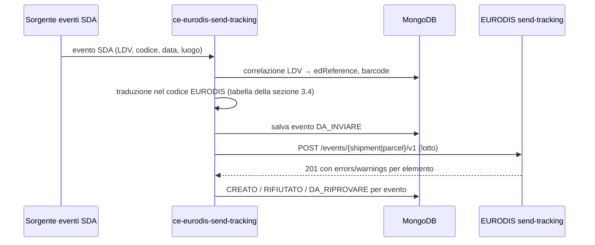

# `ce-eurodis-send-tracking` — Documento funzionale per lo sviluppo

**Iniziativa**: 136596 — Eurodis autoproduttore · **Versione**: 0.2 (bozza) · **Data**: 2026-11-10
**Autrice**: Mary (analyst) · **Destinataria**: Amelia (dev) e team di sviluppo
**Repository**: https://posteitaliane.ghe.com/SVILUPPO/CORRIERE-ESPRESSO_PREADVISING_ce-eurodis-send-tracking (branch `feature/eurodis-base-implementation`)
**Generato da**: [prompt-ce-eurodis-send-tracking.md](prompt-ce-eurodis-send-tracking.md)
**Fonte principale**: [eurodis-send-tracking-swagger-v1.json](../eurodis-send-tracking-swagger-v1.json) (scaricato il 05-11)

Etichette usate nel documento:
- **[FATTO]**: scritto nello swagger EURODIS; la fonte è indicata.
- **[IPOTESI]**: non scritto nello swagger, da confermare.
- **[DECISO]**: decisione presa, con data e riferimento.
- **[DA DECIDERE]**: scelta aperta, con proposta e default provvisorio.

> **Stato 05-11**: client implementato da Amelia (`4cba024` su `feature/eurodis-base-implementation`, 34 test verdi), conforme a RF-01…RF-12 e AC-01…AC-13.
>
> **Cosa si sviluppa adesso** (Diego, 05-11): solo il **client verso EURODIS**, cioè le sezioni 3.1, 5 (RF-01…RF-12), 7.1, 8, 9 e 11.1.
> Sorgente degli eventi SDA, persistenza e job (sezioni 3.2, 3.3, 4 e 6) sono **DA DECIDERE**. Finché non si decidono non si scrivono consumer né scheduler.
>
> **10-11**: la **traduzione degli stati SDA nei codici EURODIS è decisa** (Diego): file `Elenco codici status.xlsx`, foglio "Decodifica Eurodis IN-BOUND" (sezione 3.4). Si può implementare subito come tabella, indipendente dalla sorgente.

---

## 1. Scopo e responsabilità

`ce-eurodis-send-tracking` restituisce a EURODIS le tracce SDA delle spedizioni che EURODIS ha
affidato a SDA (entrate da `receive-pan`), chiamando l'API EURODIS `send-tracking`.

In pratica:

1. riceve gli eventi di tracciatura SDA delle spedizioni EURODIS (sorgente DA DECIDERE, 3.2);
2. li traduce in eventi EURODIS: codice evento, riferimento della spedizione o del collo, data e luogo;
3. li invia a EURODIS, singolarmente o a lotti;
4. registra l'esito di ogni evento (creato, rifiutato, da riprovare) e lo rende recuperabile.

**Non fa**:

| Fuori perimetro | Chi lo fa |
|---|---|
| Scarico delle spedizioni da EURODIS | `ce-dichiarato-eurodis-in` |
| Mapping verso l'ICD e preadvising | `ce-dichiarato-eurodis-mapper` |
| Prove di consegna (immagini, firme) | API EURODIS `send-pod`, non in perimetro oggi |
| Eventi sugli ordini di ritiro (`/event(s)/pickup-order/v1`) | nessuno: EURODIS non ci affida ritiri |
| Eventi sulle transit unit (`/event(s)/transit/v1`) | nessuno per ora (IPOTESI: SDA non riceve transit unit EURODIS, ST-05) |
| Leggere le tracce che EURODIS espone (`receive-tracking`) | nessuno: è l'API del verso opposto |

## 2. Posizione nella catena

```
EURODIS receive-pan → ce-dichiarato-eurodis-in → ce-dichiarato-eurodis-mapper → preadvising.pre-enrichment → … → PDB
                                                                                                                  │
                                                                                         lavorazione SDA (scan, esiti)
                                                                                                                  │
EURODIS send-tracking ← ce-eurodis-send-tracking ← eventi di tracciatura SDA (sorgente DA DECIDERE, 3.2) ←───────┘
```

Il legame tra i due versi è l'**identità della spedizione**:
- EURODIS la riconosce per `edReference` (spedizione) o per barcode (collo);
- SDA la lavora per LDV (`collo.id_ldv` ← `consignorsColloBarcode`, `internazionale.id_ldv_itz` ← `europlateBarcode`).

Per risalire da una LDV SDA a `edReference` e barcode serve una correlazione (3.3, ST-03).

## 3. Interfacce

### 3.1 In uscita: API EURODIS `send-tracking`

**Ambienti** [FATTO, `servers`]:
- TEST: `https://testapi.eurodis.com/send-tracking`.
- PROD: per analogia con `receive-pan` sarà `https://api.eurodis.com/send-tracking` [IPOTESI].

**Autenticazione** [FATTO, `info.description`]: API key del partner nell'header `X-API-Key`.
- Come in `receive-pan`, non è dichiarata nei `securitySchemes`: un client generato non la aggiunge da solo.
- [IPOTESI] È la stessa chiave di `receive-pan`, perché la chiave identifica il partner. Va confermato (ST-08); default: stesso secret, chiave configurabile a parte.

**Endpoint** [FATTO, `paths`]. Tutti POST, con corpo JSON:

| Endpoint | Cosa crea | Si usa |
|---|---|---|
| `POST /event/shipment/v1` | un evento di spedizione | **sì** |
| `POST /events/shipment/v1` | più eventi di spedizione (lotto) | **sì** |
| `POST /event/parcel/v1` | un evento di collo | **sì** |
| `POST /events/parcel/v1` | più eventi di collo (lotto) | **sì** |
| `POST /event(s)/transit/v1` | eventi su transit unit | no (sezione 1) |
| `POST /event(s)/pickup-order/v1` | eventi su ordini di ritiro | no (sezione 1) |

Quale livello usare (spedizione, collo o entrambi) dipende dai codici evento (ST-01). Il client li offre tutti e quattro.

**Richiesta: evento di spedizione** (`AddShipmentEventRequest`) [FATTO]:

| Campo | Tipo e vincoli | Obbligatorio | Note |
|---|---|---|---|
| `eventCode` | string, **esattamente 3** caratteri | sì | catalogo non nello swagger (ST-01) |
| `edReference` | int64 | no (nullable) | numero di spedizione EURODIS. Di fatto serve per individuarla |
| `acceptorName` | string ≤ 50 | per i codici **100 e 101** | nome di chi ritira: **dato personale** |
| `numberOfParcels` | int 0..999 | **sì** | |
| `numberOfPallets` | int 0..999 | **sì** | |
| `alternateShipmentReference` | string ≤ 50 | no | oltre 50 viene troncato con un warning, senza errore (esempio `02050E`) |
| `eventTimestamp` | string, **10..26** caratteri | sì | ISO 8601, `yyyy-MM-dd'T'HH:mm:ss.SSSZ` (vedi RF-05) |
| `freeTextInformation` | string ≤ 50 | no | |
| `locationCode` | string 1..10 | sì | esempio `CN-CC`; semantica non descritta (ST-04) |
| `countryCode` | string 1..2 | sì | ISO 3166 alpha-2 del luogo dell'evento |
| `bilateralInformation`, `bilateralInformation2` | string ≤ 50 | no | informazioni concordate tra i partner |

**Richiesta: evento di collo** (`AddParcelEventRequest`) [FATTO]. Ha gli stessi campi, con queste differenze:
- `eventCode` ha **esattamente 4** caratteri.
- `acceptorName` è obbligatorio per il codice **1100**.
- `numberOfParcels` e `numberOfPallets` sono facoltativi.
- C'è un riferimento del collo. Almeno uno tra questi è obbligatorio, salvo il setup "neighbourhood business":

| Campo | Vincolo | Quando |
|---|---|---|
| `edReference` | int64 | vuoto solo per scan sul barcode della transit unit |
| `transitUnitBarcode` | ≤ 24 | se il collo è consolidato in una transit unit EURODIS |
| `europlateBarcode` | ≤ 24 | obbligatorio se `deliveryPartnerBarcode` e `dispatchPartnerBarcode` sono entrambi vuoti |
| `deliveryPartnerBarcode` | ≤ 50 | barcode del partner di consegna dal Central Label Service (CLS) |
| `dispatchPartnerBarcode` | ≤ 50 | barcode del partner mittente dal CLS |
| `alternativeBarcode` | ≤ 50 | obbligatorio nel setup neighbourhood business (SOP 02-11) |

Proposta per la correlazione: `europlateBarcode` del collo ricevuto da `receive-pan`, più `edReference`.
- Lo stesso `europlateBarcode` è oggi la base di `internazionale.id_ldv_itz` nel mapper.
- Non sappiamo se SDA è "delivery partner" nel CLS né quale barcode EURODIS si aspetta da noi (ST-03).

**Risposte** [FATTO]:

| Codice | Endpoint singolo | Endpoint a lotti |
|---|---|---|
| `201` | evento creato. Corpo `Add…EventResponse`: echo di `edReference`, barcode, `eventCode`, `warnings[]` | richiesta accolta. Corpo: un `Add…EventsResponse` per evento, con `errors[]` e `warnings[]`. **Se `errors` non è vuoto, quell'evento NON è stato creato** |
| `400` | validazione fallita: `ValidationFailureResponse { errors: [{code, message}] }`, per esempio `02060 Invalid event code` | non documentato: gli errori arrivano per elemento dentro il `201` |
| `401` | API key mancante o errata | idem |
| `424` | partner non determinabile | idem |
| `500` | errore inatteso | idem |

Note sullo swagger:
- Il corpo dei lotti è dichiarato `*/*` invece di `application/json`. Si invia `application/json` [IPOTESI: accettato].
- Non c'è `451`, che invece esiste in `receive-pan`.
- Gli esempi con `eventCode` di 5 caratteri (parcel) o 4 (shipment) sono esempi di errore: la risposta d'esempio li rifiuta con `02060`.
- Per `401` [IPOTESI], come in `receive-pan`, il corpo è testo semplice (`Invalid API Key`), non JSON.
- Non è dichiarato un massimo di elementi per lotto (ST-06).
- Non è dichiarato che la risposta a lotti mantenga l'ordine della richiesta [IPOTESI: stesso ordine e stesso numero di elementi, ST-06].

**Idempotenza** [FATTO, per assenza]: non c'è chiave di idempotenza né un endpoint per leggere gli eventi già creati. Una POST ripetuta dopo una risposta persa **può creare un evento doppio**. Se EURODIS scarti i doppioni (stesso `edReference`/barcode, `eventCode`, `eventTimestamp`) è una domanda (ST-07).

### 3.2 In ingresso: eventi di tracciatura SDA [DA DECIDERE]

Non sappiamo ancora da dove arrivano le tracce SDA delle LDV EURODIS né in che formato (PA-07, ST-02). Candidati da verificare:
- un topic dedicato, per esempio `preadvising.eud.send-tracking` (il nome già messo da azzurrazezza in `application.yaml`), alimentato da chi possiede il tracking SDA;
- un topic o archivio del tracking SDA esistente (track & trace), filtrato sulle LDV EURODIS.

**Default per lo sviluppo**: nessun consumer. Il client ha un'interfaccia Java chiara, così che il consumer, quando la sorgente è decisa, la chiami senza toccare il client.

### 3.3 Persistenza e correlazione [DA DECIDERE]

Proposta, da confermare quando si decide la sorgente:
- **Correlazione LDV → spedizione EURODIS** (ST-03). Per tradurre un evento SDA (per LDV) in un evento EURODIS servono `edReference` e il barcode del collo. Si possono ricavare:
  - dal JSON della spedizione salvato da `-in` in `eurodis_spedizioni` (oggi senza indice sui barcode);
  - oppure da un indice LDV → (`edReference`, `europlateBarcode`) che il mapper scrive quando pubblica.
  - Decide l'Architect.
- **Storico degli invii**: collezione `eurodis_tracce` con un documento per evento. Contiene:
  - evento SDA di origine ed evento EURODIS inviato;
  - stato (sezione 6), tentativi, codici di errore e warning EURODIS;
  - istante di invio.
  - Serve per audit, ripresa e per non reinviare un evento già creato.

### 3.4 Traduzione degli stati SDA nei codici EURODIS [DECISO 10-11]

**[DECISO 10-11, Diego]** Il mapping è nel file
[Elenco codici status.xlsx](../Elenco%20codici%20status.xlsx), foglio **"Decodifica
Eurodis IN-BOUND"** (righe 3-78). Gli altri fogli ("Decodifica Eurodis OUT-BOUND",
"Status Fedex") non sono nel perimetro.

**[FATTO]** Dal foglio:
- **76 status SDA**, ciascuno compare una volta sola, tradotti in **24 codici EURODIS**:
  più status SDA vanno sullo stesso codice (per esempio `000`, `CP0`, `CNP`, `083`, `085` →
  `1100`). La traduzione è quindi a senso unico, da SDA a EURODIS.
- Tutti i codici EURODIS hanno **4 cifre**: sono codici di **collo**. Gli eventi si inviano con
  `POST /events/parcel/v1` (o `/parcels/v1` a lotti), non con gli eventi di spedizione a 3 cifre.
  Questo risolve il livello degli eventi (ST-01, ex domanda 4).
- Il codice `1100` (consegnata) richiede `acceptorName`, il nome di chi ha ritirato (RF della
  sezione 3.1): la sorgente SDA deve fornirlo. È un **dato personale**: si invia ma non si logga
  (RF-12).
- Le descrizioni EURODIS hanno piccole differenze di testo per lo stesso codice (`1200`, `1306`):
  conta il codice.

Regole:

| # | Regola |
|---|---|
| TR-01 | La traduzione è una tabella `statusSDA → codiceEURODIS` caricata da configurazione (file di risorse versionato nel repository, generato dal foglio), non scritta nel codice: se il foglio cambia si aggiorna la risorsa. |
| TR-02 | Il confronto sullo status SDA è esatto sul codice (3 caratteri, maiuscolo), senza spazi. |
| TR-03 | **[DA DECIDERE]** Status SDA non presente nella tabella. Default: **non si invia** nulla a EURODIS; log di warning con status e LDV (mai dati personali) e metrica `eurodis_tracking_stato_non_mappato_total{status}`. |
| TR-04 | Lo stesso codice EURODIS può arrivare più volte per lo stesso collo da status SDA diversi (per esempio due giacenze): si inviano tutti, la deduplica non spetta a noi (ST-07). |

Tabella del foglio (stessa sequenza del file):

| Status SDA | Descrizione SDA | Codice EURODIS | Descrizione EURODIS |
|---|---|---|---|
| `000` | OK | `1100` | The item was delivered completely and accepted by the consignee |
| `CP0` | CONSEGNATA AL PUNTOPOSTE | `1100` | The item was delivered completely and accepted by the consignee |
| `CNP` | CONSEGNATA DA UFI AL CLIENTE | `1100` | The item was delivered completely and accepted by the consignee |
| `083` | CONSEGNATA A KIPOINT | `1100` | The item was delivered completely and accepted by the consignee |
| `085` | CONSEGNATA UFFICIO POSTALE | `1100` | The item was delivered completely and accepted by the consignee |
| `009` | Danneggiata | `1105` | Damaged |
| `018` | Manomessa | `1105` | Damaged |
| `FTO` | Furto | `1106` | Item Lost |
| `FTV` | Furto Vettore | `1106` | Item Lost |
| `SMA` | Smarrimento | `1106` | Item Lost |
| `SMV` | Smarrimento Vettore | `1106` | Item Lost |
| `021` | Chiusura Settimanale | `1200` | Special Delivery times - booking in - appointments |
| `029` | Consegne Particolari | `1200` | Special delivery times - booking in - appointments |
| `APC` | Appuntamento concordato | `1200` | Special delivery times - booking in - appointments |
| `APP` | Appuntamento da concordare | `1200` | Special delivery times - booking in - appointments |
| `CON` | Consegna Concordata | `1200` | Special delivery times - booking in - appointments |
| `EDO` | Entrata in dogana | `1201` | The item was taken out of the transportation flow, custom clearance process started |
| `AGT` | Arrivo al Gateway. In attesa di lavorazione | `1203` | Customs clearance documents missing or wrong |
| `007` | Rifiutata | `1300` | Delivery of the item was refused by the consignee without any reason |
| `008` | Destinatario Assente | `1304` | First delivery attempt, notification card was left |
| `010` | Festa Patronale | `1305` | Consignee was closed - holiday |
| `042` | Ferie fino al | `1305` | Consignee was closed - holiday |
| `013` | INCOMPLETA PER MANCANZA/DANNEGGIAMENTO | `1306` | Delivery problem |
| `023` | Fuori Standard | `1306` | Delivery problems caused by customer (i.e. local bank holidays) |
| `024` | Ispezione Postale | `1306` | Delivery problems caused by customer (i.e. local bank holidays) |
| `041` | Zona non servita | `1306` | Delivery problems caused by customer (i.e. local bank holidays) |
| `003` | Indirizzo Errato/Incompleto | `1307` | The address of the consignee is incorrect or incomplete |
| `017` | FDP Concordato | `1308` | The consignee will pick up the item at the delivery depot himself |
| `FDB` | Fermo Deposito Punto Blu | `1308` | The consignee will pick up the item at the delivery depot himself |
| `FDP` | Fermo Deposito Concordato | `1308` | The consignee will pick up the item at the delivery depot himself |
| `SFP` | Servizio Fermo Deposito | `1308` | The consignee will pick up the item at the delivery depot himself |
| `ARP` | ARRIVATA UFI | `1308` | The consignee will pick up the item at the delivery depot himself |
| `AFK` | LA SPEDIZIONE E' IN FERMO DEPOSITO PRESSO KIPOINT | `1308` | The consignee will pick up the item at the delivery depot himself |
| `006` | Mancanza B.A.M. | `1309` | The delivery documents are missing or wrong |
| `027` | Mancato Pagamento | `1310` | The payment information:terms of delivery, COD amounts are wrong or incomplete |
| `093` | Mancato importo contrassegno | `1310` | The payment information:terms of delivery, COD amounts are wrong or incomplete |
| `095` | Importo contrassegno non leggibile | `1310` | The payment information:terms of delivery, COD amounts are wrong or incomplete |
| `096` | Importo contrassegno discordante | `1310` | The payment information:terms of delivery, COD amounts are wrong or incomplete |
| `098` | Mittente contrassegno non leggibile | `1310` | The payment information:terms of delivery, COD amounts are wrong or incomplete |
| `001` | Mancanza di tempo | `1402` | Delivery problems caused by the haulier (i.e vehicle breakdown) |
| `012` | Smistamento Errato | `1406` | No delivery - the item was misrouted or missorted |
| `DID` | Disguido colpa SDA | `1406` | No delivery - the item was misrouted or missorted |
| `DIL` | Disguido | `1406` | No delivery - the item was misrouted or missorted |
| `DIS` | Disguido | `1406` | No delivery - the item was misrouted or missorted |
| `015` | Sciopero | `1408` | Force Majeure |
| `053` | Causa forza maggiore hub | `1408` | Force Majeure |
| `084` | Causa forza maggiore | `1408` | Force Majeure |
| `CAL` | Calamità Naturale | `1408` | Force Majeure |
| `RAL` | Rallentamenti sindacali | `1408` | Force Majeure |
| `SIN` | Agitazione Sindacale | `1408` | Force Majeure |
| `DNR` | Destinatario chiuso causa ordinanza Covid-19 | `1408` | Force Majeure |
| `ZNR` | Zona non raggiungibile per ordinanza Covid-19 | `1408` | Force Majeure |
| `090` | Spedizione abbandonata | `1416` | Disposal of goods |
| `SML` | Smaltita | `1416` | Disposal of goods |
| `RRR` | Ritorno al mittente | `1600` | Return Item |
| `STA` | L/V Stampata | `1740` | Inbound Gateway Scan |
| `PPP` | Partita | `1750` | Delivery Partner Scan |
| `ARR` | Arrivata in filiale | `1766` | Delivery depot arrival |
| `GGG` | In consegna al mattino | `1767` | Out for delivery |
| `POM` | In consegna al pomeriggio | `1767` | Out for delivery |
| `019` | Ritardo Linea | `1785` | On Hold |
| `022` | Non uscita | `1785` | On Hold |
| `035` | Giacenza Problemi linee | `1785` | On Hold |
| `036` | Giacenza Problemi hub | `1785` | On Hold |
| `037` | Giacenza Problemi impianto | `1785` | On Hold |
| `038` | Ritardo linee (partenza) | `1785` | On Hold |
| `044` | Giacenza esubero spedizioni | `1785` | On Hold |
| `ANG` | Arrivata non messa a giro | `1785` | On Hold |
| `ATC` | Attesa partenza colpa Cliente | `1785` | On Hold |
| `ATP` | Attesa In Partenza | `1785` | On Hold |
| `GIA` | Giacenza | `1785` | On Hold |
| `ING` | Entrata in giacenza | `1785` | On Hold |
| `NGG` | Consegna al mattino annullata | `1785` | On Hold |
| `NPO` | Consegna al pomeriggio annullata | `1785` | On Hold |
| `RUS` | Status Precedente | `1785` | On Hold |
| `UDO` | Uscita: Mag. Temp. Custodia | `1785` | On Hold |

## 4. Flusso di elaborazione (proposta, quando la sorgente è decisa)



## 5. Regole funzionali del client

| # | Regola |
|---|---|
| RF-01 | Ogni chiamata porta l'header `X-API-Key` con la chiave letta dalla configurazione (secret). La chiave non compare mai nei log |
| RF-02 | Il client espone quattro operazioni: evento di spedizione singolo e a lotto, evento di collo singolo e a lotto |
| RF-03 | Il client non solleva eccezioni sugli stati HTTP: restituisce un esito per evento. Gli errori di rete (timeout, connessione rifiutata) diventano anch'essi un esito, `ERRORE_TEMPORANEO`, non un'eccezione verso il chiamante |
| RF-04 | Classificazione degli esiti: `201` senza `errors` → **CREATO** (con eventuali warning); `400` o `errors` non vuoto nel lotto → **RIFIUTATO** (definitivo, non si riprova); `401`/`424` → **ERRORE_CONFIGURAZIONE** (chiave o partner: si riprova solo dopo l'intervento); `500`, `5xx` non documentati, timeout, I/O → **ERRORE_TEMPORANEO** (si può riprovare); altri codici → **ERRORE_TEMPORANEO** con log del codice |
| RF-05 | `eventTimestamp` si invia in UTC nel formato `yyyy-MM-dd'T'HH:mm:ss.SSS'Z'` (24 caratteri). Il pattern con offset numerico (`+0100`) è lungo 28 caratteri e supera il massimo di 26. Il fuso atteso da EURODIS è una domanda (ST-09) |
| RF-06 | Prima dell'invio il client verifica i vincoli dello swagger che EURODIS rifiuterebbe comunque: lunghezza di `eventCode` (3 spedizione, 4 collo), obbligatori, `countryCode` ≤ 2, `locationCode` 1..10, `numberOfParcels`/`numberOfPallets` 0..999, almeno un riferimento del collo, `acceptorName` per 100/101 (spedizione) e 1100 (collo). Un evento non valido diventa **RIFIUTATO** con motivo locale, senza chiamata |
| RF-07 | I campi testuali oltre la lunghezza massima **non si troncano** (regola di progetto PA-16): l'evento è rifiutato localmente (RF-06). Fa eccezione `alternateShipmentReference`, che EURODIS tronca da sé con un warning |
| RF-08 | Lotti: un lotto oltre `lotto-max` elementi si divide in più chiamate. Gli esiti si restituiscono nell'ordine della richiesta. Se una risposta ha un numero di elementi diverso dalla richiesta, tutti gli eventi di quella chiamata diventano **ERRORE_TEMPORANEO** con motivo "risposta non correlabile" |
| RF-09 | Correlazione nel lotto: l'esito i-esimo corrisponde all'evento i-esimo. Se `edReference` o `eventCode` dell'esito non coincidono con l'evento, l'esito si accetta lo stesso ma si registra un warning (metrica e log senza dati personali) |
| RF-10 | Nessun retry automatico nel client HTTP. La politica di retry sta nel chiamante, che decide sugli `ERRORE_TEMPORANEO` (sezione 7.2). Così il client resta prevedibile e una POST non si ripete di nascosto (rischio di doppioni, 3.1) |
| RF-11 | I warning EURODIS (per esempio `02050E`) non bloccano: si registra il codice nei log e nelle metriche |
| RF-12 | Log senza dati personali: si registrano `edReference`, `eventCode`, codici di errore e warning, esito, durata. Mai `acceptorName`, `freeTextInformation`, `bilateralInformation*` né i barcode completi |

## 6. Stati di un evento (proposta, per lo storico 3.3)

`DA_INVIARE` → `CREATO` | `RIFIUTATO` | `DA_RIPROVARE` → (tentativi) → `CREATO` | `RIFIUTATO` | `ABBANDONATO` (oltre il massimo dei tentativi, con alert).

`ERRORE_CONFIGURAZIONE` non consuma tentativi: blocca gli invii e manda un alert finché la chiave non torna valida.

## 7. Errori e recupero

### 7.1 Nel client

| Scenario | Esito | Note |
|---|---|---|
| `400` con `errors` | RIFIUTATO, con codici EURODIS | non si riprova; il codice va nei log e nella metrica |
| Lotto `201` con alcuni `errors` | quegli eventi RIFIUTATO, gli altri CREATO | successo parziale |
| `401` (corpo testo, non JSON) | ERRORE_CONFIGURAZIONE | il corpo non si interpreta come JSON |
| `424` | ERRORE_CONFIGURAZIONE | |
| `500` | ERRORE_TEMPORANEO | |
| Timeout di connessione / connessione rifiutata | ERRORE_TEMPORANEO | la richiesta non è partita: riprovare è sicuro |
| Timeout di lettura / connessione caduta dopo l'invio | ERRORE_TEMPORANEO, motivo "esito incerto" | l'evento potrebbe essere stato creato: riprovare può creare un doppione (ST-07) |
| Corpo `201` non leggibile | ERRORE_TEMPORANEO, motivo "esito incerto" | come sopra |

### 7.2 Politica di retry [DA DECIDERE]

Proposta: si riprova sugli ERRORE_TEMPORANEO con backoff (1, 5, 15 minuti, poi ogni ora), fino a 24 ore, poi ABBANDONATO con alert. Anche gli "esiti incerti" si riprovano, per due motivi:
- un evento di tracking doppio è meno grave di un evento perso;
- EURODIS potrebbe scartare i doppioni (ST-07).

Se EURODIS risponde che i doppioni sono un problema, gli esiti incerti vanno a verifica manuale invece che al retry automatico.

## 8. Configurazione (client)

| Proprietà (`eurodis.tracking.*`) | Variabile | Default | Note |
|---|---|---|---|
| `base-url` | `EURODIS_TRACKING_BASE_URL` | `https://testapi.eurodis.com/send-tracking` | per ambiente |
| `api-key` | `EURODIS_API_KEY` | vuoto | dal secret `ce-eurodis-send-tracking-secret`, chiave `api-key` |
| `timeout.connect` | `EURODIS_TIMEOUT_CONNECT` | `10s` | |
| `timeout.read` | `EURODIS_TIMEOUT_READ` | `30s` | |
| `lotto-max` | `EURODIS_TRACKING_LOTTO_MAX` | `100` | massimo EURODIS non dichiarato (ST-06) |
| `stati.risorsa` | — | `classpath:eurodis/stati-inbound.csv` | tabella della sezione 3.4 (TR-01) |

## 9. Osservabilità

Metriche (Micrometer/Prometheus, tag comune `service=ce-eurodis-send-tracking`), sul modello di `-in`:

| Metrica | Tipo | Tag |
|---|---|---|
| `eurodis_tracking_chiamata_total` | counter | `endpoint` (shipment, shipments, parcel, parcels), `esito` (codice HTTP o `io`) |
| `eurodis_tracking_chiamata_durata` | timer | `endpoint` |
| `eurodis_tracking_eventi_total` | counter | `livello` (spedizione, collo), `esito` (CREATO, RIFIUTATO, ERRORE_CONFIGURAZIONE, ERRORE_TEMPORANEO) |
| `eurodis_tracking_errori_eurodis_total` | counter | `codice` (codice errore EURODIS, `locale` per RF-06) |
| `eurodis_tracking_warning_total` | counter | `codice` |
| `eurodis_tracking_stato_non_mappato_total` | counter | `status` (status SDA) — TR-03 |
| `eurodis_tracking_lotto_non_correlabile_total` | counter | — |
| `eurodis_tracking_esito_non_coincidente_total` | counter | — (RF-09) |

Span OpenTelemetry: uno per chiamata HTTP, kind CLIENT, nome `eurodis.send-tracking <endpoint>`. Attributi: `http.status_code`, `eurodis.eventi`, `eurodis.creati`, `eurodis.rifiutati`. Il tracing non deve mai far fallire l'invio (principio di `TraceUtil`).

Alert (più avanti, come AS-19 di `-in`):
- qualsiasi `401`/`424`;
- tasso di ERRORE_TEMPORANEO oltre soglia;
- eventi ABBANDONATO.

## 10. Requisiti non funzionali

| # | Requisito |
|---|---|
| RNF-01 | Chiave API solo da secret, mai in `application*.yaml` né nei log |
| RNF-02 | Nessun dato personale nei log (RF-12) |
| RNF-03 | Nessun retry automatico nascosto nel client HTTP (RF-10) |
| RNF-04 | DTO tolleranti: le proprietà sconosciute nelle risposte si ignorano; `edReference` è `Long`, mai `double` |
| RNF-05 | Timeout espliciti su connessione e lettura |
| RNF-06 | Stack della catena: Java 17, Spring Boot 3.5.14, Dockerfile allineato a `ce-dichiarato-adapter` |

## 11. Criteri di accettazione

### 11.1 Client (si sviluppa ora; test con server HTTP finto e dati inventati)

| # | Given / When / Then |
|---|---|
| AC-01 | Dato un evento di spedizione valido, quando lo invio, allora parte `POST /event/shipment/v1` con `X-API-Key` e il JSON atteso; con `201` l'esito è CREATO |
| AC-02 | Dato un `201` con `warnings`, l'esito è CREATO e i codici dei warning sono riportati |
| AC-03 | Dato un `400` con `errors [02060]`, l'esito è RIFIUTATO con il codice `02060` |
| AC-04 | Dato un lotto di due eventi e un `201` con `errors` solo sul primo, il primo è RIFIUTATO e il secondo CREATO |
| AC-05 | Dato un `401` con corpo testo `Invalid API Key`, l'esito è ERRORE_CONFIGURAZIONE senza errori di parsing |
| AC-06 | Dato un `500`, l'esito è ERRORE_TEMPORANEO e la richiesta parte **una sola volta** |
| AC-07 | Dato un timeout di lettura, l'esito è ERRORE_TEMPORANEO con motivo "esito incerto", senza eccezione verso il chiamante |
| AC-08 | Dato un lotto più grande di `lotto-max`, partono più chiamate e gli esiti tornano nell'ordine della richiesta |
| AC-09 | Dato un `201` a lotto con un numero di elementi diverso dalla richiesta, tutti gli eventi della chiamata sono ERRORE_TEMPORANEO "risposta non correlabile" |
| AC-10 | Dato un evento con `eventCode` di lunghezza errata, o con codice 100 senza `acceptorName`, o di collo senza riferimenti, l'esito è RIFIUTATO locale senza chiamata HTTP |
| AC-11 | `eventTimestamp` è serializzato come `2026-11-05T13:45:00.000Z` |
| AC-12 | Nei log del client non compaiono `acceptorName` né la chiave API |
| AC-13 | Le metriche della sezione 9 si incrementano con i tag attesi |
| AC-14 | Dato lo status SDA `CP0`, la traduzione dà `1100`; dato `GGG` dà `1767`; dato `RRR` dà `1600` |
| AC-15 | Data la risorsa caricata, contiene 76 status SDA e 24 codici EURODIS distinti, tutti di 4 cifre (controllo di coerenza con il foglio) |
| AC-16 | Dato uno status SDA non in tabella (es. `XYZ`), non parte nessuna chiamata, c'è un warning e `eurodis_tracking_stato_non_mappato_total{status="XYZ"}` cresce |

### 11.2 End-to-end (quando la sorgente è decisa)

Da scrivere: evento SDA → evento EURODIS creato in TEST, rifiuto con codice errato, ripresa dopo un errore temporaneo.

## 12. Punti aperti e default provvisori

| # | Punto | Default per partire | Impatto quando arriva la risposta | Rif. |
|---|---|---|---|---|
| ST-01 | Catalogo dei codici evento EURODIS e traduzione degli eventi SDA | **CHIUSO 10-11**: tabella del foglio "Decodifica Eurodis IN-BOUND" (sezione 3.4), codici di collo a 4 cifre | — | PA-34 |
| ST-02 | Sorgente degli eventi SDA delle LDV EURODIS (topic, archivio T&T, formato) | nessun consumer | si scrivono consumer e storico | PA-35 (nuovo), PA-07 |
| ST-03 | Correlazione LDV SDA → `edReference` e barcode del collo (gli eventi sono di collo, sezione 3.4); quale barcode EURODIS si aspetta da SDA. Dal 10-11 la LDV SDA del collo è `deliveryPartnerBarcode` (mapper 0.4) | proposta `edReference` + `europlateBarcode` + `deliveryPartnerBarcode` | indice di correlazione nel mapper o in `-in` | PA-35, PA-11 |
| ST-04 | Significato di `locationCode` (es. `CN-CC`) e di `countryCode` per gli eventi SDA | campi passati dal chiamante | regola di derivazione (deposito SDA? codice EURODIS?) | PA-36 (nuovo) |
| ST-05 | SDA riceve transit unit EURODIS? Servono gli eventi transit? | no | eventuali endpoint transit | PA-36 |
| ST-06 | Massimo di eventi per lotto; ordine e numero degli elementi nella risposta | 100; stesso ordine | `lotto-max`; correlazione diversa se l'ordine non è garantito | PA-36 |
| ST-07 | EURODIS scarta i doppioni? Una POST ripetuta crea due eventi? | retry anche sugli esiti incerti | se i doppioni sono un problema, esiti incerti a verifica manuale | PA-36 |
| ST-08 | Chiave API di send-tracking: la stessa di receive-pan? | stesso secret | secret separato | PA-12 |
| ST-09 | Fuso orario atteso in `eventTimestamp` | UTC con `Z` | formato locale se richiesto | PA-27 |
| ST-10 | Errori verso EURODIS (spedizioni scartate dal mapper): passano da un evento di eccezione? | fuori dal client | eventuale codice evento di scarto | PA-08 |
| ST-11 | Status SDA non presente nella tabella (TR-03) | non si invia, warning e metrica | eventuale codice EURODIS di default | — |
| ST-12 | `acceptorName` per `1100`: la sorgente SDA ha il nome di chi ritira? | evento rifiutato localmente se manca (AC-10) | se manca sempre, va chiesto a EURODIS se accettano un valore convenzionale | PA-35 |

## 13. Riferimenti

- Swagger: [eurodis-send-tracking-swagger-v1.json](../eurodis-send-tracking-swagger-v1.json); originale https://testapi.eurodis.com/send-tracking/swagger/Release%20v1/swagger.json
- Traduzione degli stati: [Elenco codici status.xlsx](../Elenco%20codici%20status.xlsx), foglio "Decodifica Eurodis IN-BOUND"
- [ce-dichiarato-eurodis-in.md](ce-dichiarato-eurodis-in.md): convenzioni, collezione `eurodis_spedizioni`
- [analisi.md](../analisi.md): PA-07, PA-08, PA-11, PA-12, PA-27, PA-34…PA-36
- Repository: CORRIERE-ESPRESSO_PREADVISING_ce-eurodis-send-tracking
- Modello di metriche e tracing: `ce-dichiarato-adapter`, `ce-dichiarato-eurodis-in` (`TraceUtil`, `MetricheEurodisIn`)

## Domande per Diego

1. **Sorgente degli eventi SDA** (ST-02): sai chi possiede le tracce SDA delle LDV EURODIS e su quale topic o archivio passano? Il placeholder `preadvising.eud.send-tracking` di azzurrazezza è un topic che esiste o un'idea?
2. ~~Catalogo dei codici evento~~: chiuso il 10-11 con il foglio "Decodifica Eurodis IN-BOUND" (sezione 3.4).
3. **Retry sugli esiti incerti** (7.2): va bene la proposta "meglio un doppione che un evento perso" finché EURODIS non risponde su ST-07?
4. ~~Livello degli eventi~~: collo, perché i codici del foglio sono tutti di 4 cifre.
5. **Status SDA non mappati** (TR-03): va bene non inviarli, con warning e metrica?
6. **`acceptorName`** per `1100` (ST-12): la sorgente SDA delle tracce ha il nome di chi ritira?
