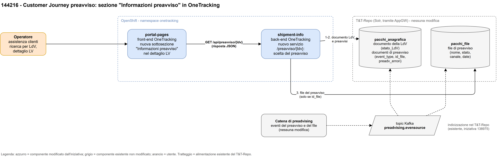
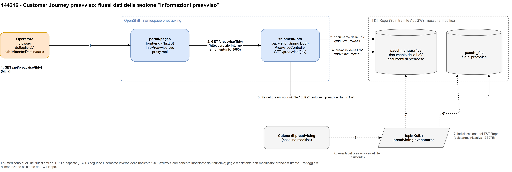

# Architettura Applicativa

L'iniziativa ha lo scopo di rendere consultabili agli operatori dell'assistenza clienti, nel dettaglio di una LdV di OneTracking, i dati di preavviso della spedizione: dati del preavviso, dati del file di preavviso ed errori riscontrati. I dati sono già raccolti nel T&T-Repo dalla catena di preadvising (iniziativa 138975) e vengono letti, senza modificarli, dalle collection Solr `pacchi_anagrafica` e `pacchi_file`. Sono modificati due componenti esistenti di OneTracking, il front-end `portal-pages` e il back-end `shipment-info`; catena di preadvising, T&T-Repo e profilazione non cambiano. Le regole funzionali sono descritte nella Specifica Funzionale dell'iniziativa (allegato SF_144216_Customer_Journey_preavviso, versione 0.1).

## Business Architecture – Consultazione del preavviso in OneTracking

| Processo | Fase | Sistema Applicativo (AP) / Applicazione (PK) | Ruolo dell'Applicativo | Impatto Applicativo (S/N) | Applicativo esistente o nuovo |
|---|---|---|---|---|---|
| Assistenza clienti | Consultazione del dettaglio LV | CE (AP-00988) / OneTracking `portal-pages` (PK-02401) | Front-end di OneTracking: mostra la nuova sottosezione "Informazioni preavviso" nel tab "Mittente/Destinatario" del dettaglio LV e inoltra la richiesta a `shipment-info` tramite il proprio proxy `/api` | S | Esistente |
| Assistenza clienti | Recupero del preavviso | CE (AP-00988) / OneTracking `shipment-info` (PK-02400) | Back-end di OneTracking: espone il nuovo servizio `GET /preavviso/{ldv}`, legge il T&T-Repo, sceglie il preavviso da mostrare e decodifica stati, date ed errori | S | Esistente |
| Assistenza clienti | Lettura dei dati di preavviso | T&T2.0 (AP-00960) / T&T repo (PK-03985), collection `pacchi_anagrafica` e `pacchi_file` tramite AppGW | Fornisce in lettura il documento della LdV, i documenti di preavviso e il documento del file di preavviso | N | Esistente |
| Preadvising | Alimentazione del T&T-Repo | CE (AP-00988) / catena di preadvising (PK-03089) | Pubblica sul topic `preadvising.evensource` gli eventi del preavviso e del file, indicizzati nel T&T-Repo; nessuna modifica | N | Esistente |

Tabella 1: Business Architecture – Consultazione del preavviso in OneTracking

## Information System Architecture

Il dato nasce nella catena di preadvising, che ne pubblica gli eventi sul topic `preadvising.evensource`, ed è indicizzato nel T&T-Repo nelle collection `pacchi_anagrafica` e `pacchi_file` (flussi esistenti). All'apertura del tab "Mittente/Destinatario" il browser dell'operatore richiede il preavviso della LdV a `portal-pages`, che inoltra la richiesta a `shipment-info`; `shipment-info` legge in sequenza dal T&T-Repo, tramite AppGW, il documento della LdV, i documenti di preavviso e, se il preavviso scelto proviene da file, il documento del file, e restituisce la risposta JSON che il front-end mostra nella sottosezione.

| Flusso dati | Descrizione |
|---|---|
| Flusso dati 1 | All'apertura del tab "Mittente/Destinatario" del dettaglio LV, il browser dell'operatore invoca `GET /api/preavviso/{ldv}` su `portal-pages`, in parallelo e indipendentemente dalla chiamata esistente dei dati di mittente e destinatario. |
| Flusso dati 2 | Il proxy di `portal-pages` toglie il prefisso `/api` e inoltra la richiesta a `shipment-info` (`GET /preavviso/{ldv}`) sul servizio interno del namespace `onetracking`; la risposta JSON (preavviso, file, errori) torna al browser per la stessa via. |
| Flusso dati 3 | `shipment-info` legge in `pacchi_anagrafica` il documento della LdV (query `id:"<ldv>"`, un documento, campi `id`, `stato_LdV`, `id_preadvising`), da cui ricava lo stato del preavviso (`stato_LdV`). |
| Flusso dati 4 | `shipment-info` legge in `pacchi_anagrafica` i documenti di preavviso della LdV (query `ldv:"<ldv>"`, ordinati per `event_ts` decrescente, al massimo `onetracking.preavviso.max-preavvisi`, default 50; solo i campi della sottosezione) e sceglie il preavviso da mostrare secondo la regola della SF. |
| Flusso dati 5 | Solo se il preavviso scelto ha un file associato (`id_file`), `shipment-info` legge in `pacchi_file` il documento del file (query `idfile:"<id_file>"`, un documento, campi `nomefile`, `upload_time_stamp`, `idStato`, `status`, `channel`, `_lastupdate_`). |
| Flusso dati 6 | La catena di preadvising pubblica sul topic `preadvising.evensource` gli eventi del preavviso e del file. Flusso esistente, non modificato. |
| Flusso dati 7 | Gli eventi del topic `preadvising.evensource` sono indicizzati nel T&T-Repo nelle collection `pacchi_anagrafica` e `pacchi_file` (iniziativa 138975). Flusso esistente, non modificato. |

Tabella 2: Information System Architecture – Flussi dati

# Architettura Tecnica

## Application Technical Architecture

Le modifiche restano nello stack esistente di OneTracking: `shipment-info` è un microservizio Java 11 / Spring Boot 2.7.18 e `portal-pages` un front-end Nuxt 3.14 / Vue 3, entrambi deployati con chart Helm e pipeline Jenkins ALM nel namespace OpenShift `onetracking`. Le letture del T&T-Repo usano il client Solr già presente in `shipment-info`, con l'endpoint AppGW (`solrappgw.endpoint`) e le credenziali Solr già in uso: non sono necessari nuovi secret, topic, database, route né nuove regole di rete. Volumi e dimensioni non ancora noti sono indicati come stima o `DA DEFINIRE`.

| Pacchetto Applicativo | Software | Versione | Layer Applicativo | Applicativo nuovo o esistente |
|---|---|---|---|---|
| `portal-pages` | Front-end Nuxt 3.14 / Vue 3 (componente `InfoPreavviso.vue`) | 26.01.01-SNAPSHOT sul branch di sviluppo; versione di rilascio DA DEFINIRE | Application | Esistente (nuova sottosezione) |
| `shipment-info` | Microservizio Java 11 / Spring Boot 2.7.18 (`PreavvisoController`, `PreavvisoServiceImpl`) | 25.11.08-SNAPSHOT sul branch di sviluppo; versione di rilascio DA DEFINIRE | Application | Esistente (nuovo servizio `/preavviso/{ldv}`) |
| AppGW del T&T-Repo (`cdp-proxy-api`) | Application Gateway di accesso a Solr | Non applicabile | Integration | Esistente |
| `pacchi_anagrafica` | Collection Solr del T&T-Repo | Non applicabile | Data | Esistente (nuove query in lettura) |
| `pacchi_file` | Collection Solr del T&T-Repo | Non applicabile | Data | Esistente (nuovo consumatore in lettura: `shipment-info`) |
| `preadvising.evensource` | Topic Kafka | Non applicabile | Integration | Esistente (non modificato) |

Tabella 3: Consultazione del preavviso in OneTracking – dettaglio applicativi

<!-- orientamento: orizzontale -->

| Flusso dati | Protocollo | Origine | Destinazione | Tipologia | Frequenza | Frequenza di picco | Dimensione media dei messaggi | Dimensione massima dei messaggi | Flusso nuovo o esist. |
|---|---|---|---|---|---|---|---|---|---|
| Flusso 1 | https | Browser dell'operatore | `portal-pages` | Sincrona | Una chiamata per apertura del tab "Mittente/Destinatario" del dettaglio LV; nessun nuovo tentativo automatico | DA DEFINIRE (aperture del dettaglio LV) | stima: circa 1 KB di risposta (esempio della SF, caso 1) | DA DEFINIRE (cresce con il numero di errori del preavviso) | Nuovo |
| Flusso 2 | http (servizio interno del namespace) | `portal-pages` (proxy `/api`) | `shipment-info` | Sincrona | Come il Flusso 1 | Come il Flusso 1 | stima: circa 1 KB di risposta | DA DEFINIRE (cresce con il numero di errori del preavviso) | Nuovo |
| Flusso 3 | https | `shipment-info` | T&T-Repo (AppGW), collection `pacchi_anagrafica` | Sincrona | Una chiamata per richiesta del Flusso 2 | Come il Flusso 1 | DA DEFINIRE (un documento LdV, restituito intero) | DA DEFINIRE (un documento) | Nuovo (nuova query su collection già consultata) |
| Flusso 4 | https | `shipment-info` | T&T-Repo (AppGW), collection `pacchi_anagrafica` | Sincrona | Una chiamata per richiesta del Flusso 2 | Come il Flusso 1 | DA DEFINIRE (stima: un documento di preavviso per LdV, di più se il preavviso è stato ritrasmesso) | DA DEFINIRE (al massimo 50 documenti di preavviso, proprietà `onetracking.preavviso.max-preavvisi`) | Nuovo |
| Flusso 5 | https | `shipment-info` | T&T-Repo (AppGW), collection `pacchi_file` | Sincrona | Solo se il preavviso scelto proviene da file, una chiamata | Come il Flusso 1 | DA DEFINIRE (un documento di file) | DA DEFINIRE (un documento) | Nuovo |
| Flusso 6 | Kafka | Catena di preadvising | Topic `preadvising.evensource` | Asincrona | Invariata (flusso esistente) | Invariata (flusso esistente) | Invariata (flusso esistente) | Invariata (flusso esistente) | Esistente |
| Flusso 7 | Kafka | Topic `preadvising.evensource` | T&T-Repo (`pacchi_anagrafica`, `pacchi_file`) | Asincrona | Invariata (flusso esistente) | Invariata (flusso esistente) | Invariata (flusso esistente) | Invariata (flusso esistente) | Esistente |

Tabella 4: Consultazione del preavviso in OneTracking – dettaglio flussi

N.B. Prima di qualsiasi lettura `shipment-info` valida la LdV ricevuta (spazi iniziali e finali eliminati, solo lettere e cifre, da 1 a 35 caratteri): se non è valida risponde `400` ("LdV non valida") senza interrogare il T&T-Repo. Le letture dei Flussi 3, 4 e 5 sono eseguite in sequenza con il RestTemplate `solrRestTemplate` già presente in `shipment-info` (timeout di connessione 60 s, timeout di lettura `server.controller.solr-timeout`, 60 s) e con le credenziali Solr del secret esistente `solr`. Se il T&T-Repo non risponde, va in errore o restituisce una risposta non leggibile su una qualsiasi delle letture, il servizio risponde `503` e il front-end mostra "Dati preavviso non disponibili" nella sola sottosezione, senza bloccare il resto del dettaglio; un errore inatteso del servizio risponde `500`, con lo stesso effetto a video. Le query chiedono al T&T-Repo solo i campi usati (parametro `fl`); il servizio restituisce al front-end solo i campi della sottosezione e non registra nei log nominativi, indirizzi, codici fiscali, partite IVA né il contenuto degli errori. Tre nuove proprietà applicative, con valore di default nel codice e nessun valore per ambiente, governano la regola di scelta, il canale e il numero massimo di preavvisi letti: `onetracking.preavviso.stato-preferito` (`COMPLETED`), `onetracking.preavviso.campo-canale` (`channel`) e `onetracking.preavviso.max-preavvisi` (50; se il T&T-Repo ne contiene di più il servizio lo registra nei log come avviso). Il front-end legge il path del servizio dalla variabile `wsActionPreavviso` (default `/api/preavviso`). Il servizio è misurato dalla metrica `shp_info_get_preavviso`, esposta con le metriche esistenti del pod.

<!-- orientamento: verticale -->

# Scheda HW

L'iniziativa non richiede server dedicati, mainframe, HW periferico né risorse cloud IaaS, e non richiede nuove risorse OpenShift: `portal-pages` e `shipment-info` sono già deployati nel namespace `onetracking` e il carico aggiunto è di una chiamata al servizio e due o tre letture Solr per apertura del tab "Mittente/Destinatario". Il rilascio avviene con le pipeline Jenkins esistenti (job `shipment-info-build`/`-deploy` e `portal-pages-build`/`-deploy`) dal branch `144216_preavviso_onetracking` dei due repository, senza modifiche a values, secret o route. La collocazione del cluster (on prem o cloud) è DA DEFINIRE: i dimensionamenti sono riportati nella tabella Openshift on prem e vanno spostati nella tabella Openshift cloud se il cluster è in cloud.

## Risorse on Prem

| (AP/PK) | Ambiente | Server Fisico/Virtuale | Layer | Tipologia | Data Center | Cluster | RAM | Storage | CPU | Core | SO | SW |
|---|---|---|---|---|---|---|---|---|---|---|---|---|
| Non applicabile | Non applicabile | Non applicabile | Non applicabile | Non applicabile | Non applicabile | Non applicabile | Non applicabile | Non applicabile | Non applicabile | Non applicabile | Non applicabile | Non applicabile |

Tabella 5: Risorse on Prem (HW dedicato o Private Cloud)

| Componente | Ambiente | MIPS | Tipologia elaborazione | Capacità di storage | Storage Tape |
|---|---|---|---|---|---|
| Non applicabile | Non applicabile | Non applicabile | Non applicabile | Non applicabile | Non applicabile |

Tabella 6: Mainframe

| Tipologia | Marca | Modello | Caratteristica tecnica 1 | Caratteristica tecnica 2 | Caratteristica tecnica 3 | Caratteristica tecnica 4 |
|---|---|---|---|---|---|---|
| Non applicabile | Non applicabile | Non applicabile | Non applicabile | Non applicabile | Non applicabile | Non applicabile |

Tabella 7: HW Periferico

### Openshift

Namespace esistente `onetracking`, condiviso con gli altri componenti di OneTracking. Request, limit e pod di sviluppo e collaudo sono quelli dei chart Helm e dei values di deploy dei due componenti; per la produzione restano i valori in esercizio, che l'iniziativa non modifica.

| (AP/PK) | Ambiente | Nome Cluster | Tipologia cluster | Namespace | Gen | Request Core (millicore) | Request Ram (MB) | Limit Core (core) | Limit Ram (MB) | Pod | BlobStorage (GB) |
|---|---|---|---|---|---|---|---|---|---|---|---|
| AP-00988 / `shipment-info` (PK-02400) | Sviluppo | `gen3gpazne` (`cloudsvil.poste.it`, esistente) | DA DEFINIRE | `onetracking` (esistente) | DA DEFINIRE | 100 | 256 | 0,5 | 512 | 1 | Non applicabile |
| AP-00988 / `shipment-info` (PK-02400) | Collaudo | DA DEFINIRE (esistente) | DA DEFINIRE | `onetracking` (esistente) | DA DEFINIRE | 100 | 256 | 0,5 | 512 | 1 | Non applicabile |
| AP-00988 / `shipment-info` (PK-02400) | Produzione | DA DEFINIRE (esistente) | DA DEFINIRE | `onetracking` (esistente) | DA DEFINIRE | Invariato | Invariato | Invariato | Invariato | Invariato | Non applicabile |
| AP-00988 / `portal-pages` (PK-02401) | Sviluppo | `gen3gpazne` (`cloudsvil.poste.it`, esistente) | DA DEFINIRE | `onetracking` (esistente) | DA DEFINIRE | 100 | 256 | 0,5 | 512 | 1 | Non applicabile |
| AP-00988 / `portal-pages` (PK-02401) | Collaudo | DA DEFINIRE (esistente) | DA DEFINIRE | `onetracking` (esistente) | DA DEFINIRE | 100 | 256 | 0,5 | 512 | 1 | Non applicabile |
| AP-00988 / `portal-pages` (PK-02401) | Produzione | DA DEFINIRE (esistente) | DA DEFINIRE | `onetracking` (esistente) | DA DEFINIRE | Invariato | Invariato | Invariato | Invariato | Invariato | Non applicabile |

Tabella 8: Openshift on Prem

N.B. Il servizio non mantiene stato e non usa volumi: il numero di pod può essere variato senza impatti funzionali. Il pool di connessioni HTTP di `shipment-info` (`MAX_CONNECTIONS`, `MAX_CONNECTIONS_PER_ROUTE`) è condiviso con le altre letture Solr esistenti; con il timeout di lettura di 60 s, un'indisponibilità prolungata del T&T-Repo può trattenere connessioni anche per questa sottosezione, come già avviene per le altre letture Solr.

## Risorse Cloud

| (AP/PK) | Ambiente | Risorsa | Tipologia | Cloud Provider | Region | Resource Group | FQDN Front Door | FQDN Backend | RAM | Storage | CPU | Core | SO | SW |
|---|---|---|---|---|---|---|---|---|---|---|---|---|---|---|
| Non applicabile | Non applicabile | Non applicabile | Non applicabile | Non applicabile | Non applicabile | Non applicabile | Non applicabile | Non applicabile | Non applicabile | Non applicabile | Non applicabile | Non applicabile | Non applicabile | Non applicabile |

Tabella 9: Risorse Cloud IaaS

### Openshift

| (AP/PK) | Ambiente | Nome Cluster | Tipologia cluster | Namespace | Gen | Request Core (millicore) | Request Ram (MB) | Limit Core (core) | Limit Ram (MB) | Pod | BlobStorage (GB) |
|---|---|---|---|---|---|---|---|---|---|---|---|
| DA DEFINIRE: da compilare con i valori della Tabella 8 se il cluster è in cloud | Non applicabile | Non applicabile | Non applicabile | Non applicabile | Non applicabile | Non applicabile | Non applicabile | Non applicabile | Non applicabile | Non applicabile | Non applicabile |

Tabella 10: Openshift Cloud

# Allegati

| Codice Documento | Nome |
|---|---|
| SF_144216_Customer_Journey_preavviso | Specifica Funzionale dell'iniziativa 144216 - Assistenza Clienti — Customer Journey preavviso, versione 0.1 |
| Recupero_risottomissione_preadvising_bozza_v0.8 | Presentazione mock up "Customer Journey preavviso", bozza v0.8, con i requisiti DREQ0062862, DREQ0062864, DREQ0062865, DREQ0062866 |
| ICD_PACCHI_ANAGRAFICA_138975_v1.0 | ICD della collection Solr `pacchi_anagrafica` del T&T-Repo, estesa dall'iniziativa 138975 |
| ICD_PACCHI_FILE_v1 | ICD della collection Solr `pacchi_file` del T&T-Repo |
| fig-1-architettura | Schema drawio della soluzione architetturale (Figura 1, la stessa della SF) |
| fig-2-flussi-dati | Schema drawio dei flussi dati (Figura 2) |
