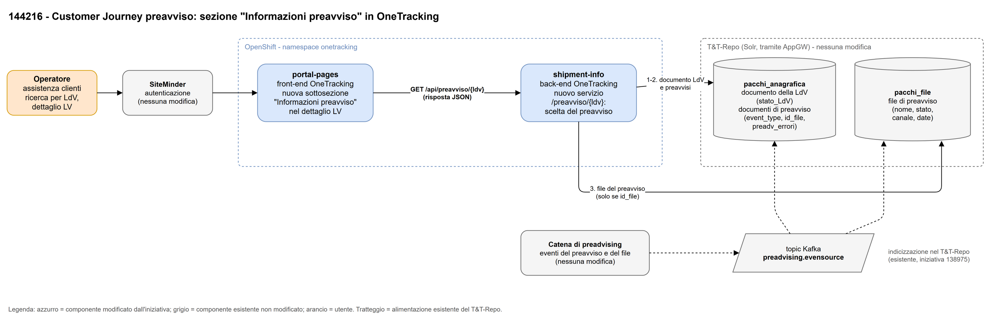

# Introduzione

## Scopo

Il presente documento contiene l'analisi degli impatti funzionali relativi all'Iniziativa "144216 - Assistenza Clienti — Customer Journey preavviso".

## Definizione, Acronimi e Abbreviazioni

| Sigla | Significato esteso |
|---|---|
| API | Application Programming Interface |
| AppGW | Application Gateway di accesso al T&T-Repo |
| CE | Corriere Espresso |
| DREQ | Codice del requisito del cliente |
| HTTP | HyperText Transfer Protocol |
| ICD | Interface Control Document |
| JSON | JavaScript Object Notation |
| LdV / LV | Lettera di Vettura |
| ms | Microservizio |
| OT | OneTracking, portale degli operatori per lo stato delle spedizioni |
| T&T-Repo | Repository Track & Trace (Solr) che contiene l'anagrafica delle LdV, dei preavvisi e dei file di preavviso |

## Riferimenti

| Id. Documento | Tipo di Documento | Titolo Documento | Allegato |
|---|---|---|---|
| 1 | Mock up | Presentazione mock up 144216 "Customer Journey preavviso", bozza v0.8 del 02/09/2026, con i requisiti DREQ0062862, DREQ0062864, DREQ0062865, DREQ0062866 (Recupero_risottomissione_preadvising_bozza_v0.8.pptx) | non disponibile |
| 2 | ICD | ICD della collection Solr `pacchi_anagrafica` del T&T-Repo, v1.0, estesa dall'iniziativa 138975 (ICD_PACCHI_ANAGRAFICA_138975_v1.0.xlsx) | non disponibile |
| 3 | ICD | ICD della collection Solr `pacchi_file` del T&T-Repo, v1 (ICD_PACCHI_FILE_v1.xlsx) | non disponibile |

## Vincoli, Assunzioni, Esclusioni ed Open Point

| Id | Tipo | Descrizione | Riferimento |
|---|---|---|---|
| 1 | Vincolo | La sezione legge i dati di preavviso già presenti nel T&T-Repo (collection `pacchi_anagrafica`, estesa dall'iniziativa 138975, e `pacchi_file`), così come indicizzati dalla catena di preadvising. L'iniziativa non modifica né la catena di preadvising né il T&T-Repo: i dati mostrati sono quelli dell'ultima indicizzazione. | Specifiche Funzionali; responsabile T&T-Repo |
| 2 | Assunzione | Non sono previste nuove funzionalità di profilazione: la sezione è visibile a tutti gli utenti che vedono il tab "Mittente/Destinatario" del dettaglio LV, qualunque sia la tipologia di utente (assistenza, SDA, filiali), sebbene il mock up la indichi per gli operatori dell'assistenza clienti. | DREQ0062862; Poste |
| 3 | Assunzione | Il mock up indica la sezione come raggiungibile ricercando per LdV. La sezione è presente in ogni dettaglio LV, anche quando vi si arriva da altre ricerche o dalla ricerca massiva; in quest'ultimo caso si riferisce alla LdV selezionata. | DREQ0062862; Poste |
| 4 | Assunzione | Il "Numero ordine" è il riferimento della spedizione indicato dal cliente nel preavviso (`code_externalId`, valorizzato da `rif_spedizione` del tracciato). | DREQ0062864; Poste |
| 5 | Esclusione | L'esportazione in PDF ed Excel del tab "Mittente/Destinatario" non include la sezione "Informazioni preavviso" in questa versione (da confermare). | DREQ0062862; Poste |
| 6 | Esclusione | Gli errori a livello di file presenti in `pacchi_file` (`esito`, `codiceErrore`, `descrizioneErrore`, per esempio per un file completamente scartato) non vengono mostrati: il "Dettaglio errori" riporta solo gli errori del preavviso (da confermare). | DREQ0062866; Poste |
| 7 | Open Point | Attribuzione dei requisiti ai blocchi della sezione: il mock up elenca i quattro requisiti insieme. L'attribuzione adottata nel documento (DREQ0062862 sottosezione e recupero, DREQ0062864 dati del preavviso, DREQ0062865 dati del file, DREQ0062866 errori) segue l'ordine della slide di obiettivo. | Specifiche Funzionali; Poste |
| 8 | Open Point | Valori del canale del file: il mock up mostra codici (`INVIOFILE`, `INVIOEASY`, `STAMPA MASSIVA`), mentre l'ICD di `pacchi_file` dichiara descrizioni (`Invio Easy`, `Invio File`, `Invio System`, `Stampa Massiva`, `Web`). Il valore viene mostrato così come presente nel T&T-Repo, senza transcodifica: da confermare. | DREQ0062865; Poste |
| 9 | Open Point | Tab "Mittente/Destinatario" senza dati: quando i dati di mittente e destinatario non sono presenti il tab mostra solo il messaggio "Dati non presenti" e non le sottosezioni. Una LdV con preavviso ma non ancora nei sistemi SDA è un caso utile all'assistenza: si propone di mostrare comunque la sezione "Informazioni preavviso". | DREQ0062862; Poste |
| 10 | Open Point | Canale del preavviso che non proviene da file (mock up, caso 3, es. `WEBSERVICES`): l'ICD di `pacchi_anagrafica` non prevede un campo con il canale del preavviso. Il campo da leggere è DA DEFINIRE; in attesa viene letto il campo `channel` del documento di preavviso e, se assente, viene mostrato "-". | DREQ0062864; responsabile T&T-Repo |
| 11 | Open Point | Stato del preavviso: è ricavato dallo stato della LdV (`stato_LdV`), valorizzato solo quando la LdV è presente nel T&T-Repo. Una LdV con preavviso ma senza `stato_LdV` (per esempio non ancora scansionata) risulta "Senza preavviso". Da confermare questo comportamento e se `stato_LdV` tenga conto anche dei preavvisi in errore (nel mock up, caso 1, un preavviso con errori risulta "In ritardo"). | DREQ0062864; responsabile T&T-Repo, Poste |
| 12 | Open Point | Formato degli errori del preavviso (`preadv_errori`): l'ICD di `pacchi_anagrafica` non ne descrive la struttura e, nella colonna di mappatura, indica `event_type` (probabile refuso). Fonte e formato (campo, codice, descrizione) sono DA DEFINIRE; in attesa gli errori vengono interpretati come elenco di campo, codice e descrizione e, se il formato non è riconosciuto, il testo viene mostrato nella descrizione. | DREQ0062866; responsabile T&T-Repo |
| 13 | Open Point | Data stato del file: `pacchi_file` non ha un campo dedicato. Si usa la data di ultimo aggiornamento del documento (`_lastupdate_`), che cambia anche a ogni reindicizzazione. Si propone di indicizzare in `pacchi_file` la data di stato presente negli eventi del file. | DREQ0062865; responsabile T&T-Repo |
| 14 | Open Point | Dati di test: per la verifica in sviluppo e collaudo servono LdV di test con preavviso nei tre casi del mock up (da file con errori, da file senza errori, non da file) e una LdV senza preavviso, presenti nel T&T-Repo dei rispettivi ambienti. | Specifiche Funzionali; SDA, team ACN |

# Obiettivo dell'iniziativa

Gli operatori dell'assistenza clienti usano OneTracking per conoscere in un'unica vista lo stato di una spedizione. Oggi, nel dettaglio di una LdV, non è visibile se e come il cliente ne abbia trasmesso il preavviso: per rispondere a un cliente che chiede perché una spedizione risulti senza preavviso, o perché un preavviso sia stato scartato, l'operatore deve rivolgersi ad altri sistemi o ad altri team.

Con l'iniziativa i dati di preavviso associati alla singola LdV, già raccolti nel T&T-Repo dalla catena di preadvising, diventano consultabili direttamente nella pagina di dettaglio LV, in una nuova sottosezione "Informazioni preavviso" (documento di riferimento ID 1).

Gli obiettivi sono:

- mostrare nel dettaglio LV i dati del preavviso della LdV: numero ordine, identificativo del collo, numero di colli e stato del preavviso;
- mostrare i dati del file di preavviso, quando il preavviso proviene da file;
- mostrare il dettaglio degli errori riscontrati sul preavviso, quando presenti;
- non alterare il resto del dettaglio LV, anche quando i dati di preavviso non sono disponibili.

# Specifiche Funzionali

La soluzione descritta di seguito tratta i seguenti temi:

- la nuova sottosezione "Informazioni preavviso" nel dettaglio LV e il recupero del preavviso della LdV (DREQ0062862);
- i dati del preavviso (DREQ0062864);
- i dati del file di preavviso (DREQ0062865);
- il dettaglio degli errori (DREQ0062866).

La soluzione è riportata nella figura successiva e nell'allegato 1.



La figura mostra la sequenza: l'operatore, autenticato tramite SiteMinder, apre il dettaglio di una LdV nel front-end di OneTracking (`portal-pages`); il front-end invoca il nuovo servizio di recupero del preavviso esposto dal back-end di OneTracking (`shipment-info`); il servizio legge dal T&T-Repo, tramite AppGW, il documento della LdV e i documenti di preavviso nella collection `pacchi_anagrafica` e, se il preavviso proviene da file, il documento del file nella collection `pacchi_file`. Le due collection sono alimentate, senza modifiche, dagli eventi della catena di preadvising (topic `preadvising.evensource`, iniziativa 138975).

## DREQ0062862 – Dati di preavviso nel dettaglio LV

### Posizione e struttura della sottosezione

Nel tab "Mittente/Destinatario" del dettaglio LV viene inserita la nuova sottosezione "Informazioni preavviso", fra la sottosezione esistente "Informazioni LV" e la sottosezione esistente "Cliente/Mittente/Destinatario". La sottosezione è composta da tre blocchi, ciascuno con un titolo e una tabella a una riga di intestazione, nello stile delle tabelle esistenti del dettaglio; un valore assente viene mostrato con "-".

| Blocco | Contenuto | Quando è visibile |
|---|---|---|
| Informazioni LV | Esistente, non modificato | Come oggi |
| Informazioni preavviso | Dati del preavviso della LdV (DREQ0062864) | Sempre, all'apertura del tab |
| Dati file preavviso | Dati del file da cui proviene il preavviso (DREQ0062865) | Solo se il preavviso ha un file associato |
| Dettaglio errori | Errori riscontrati sul preavviso (DREQ0062866) | Solo se il preavviso ha errori |
| Cliente/Mittente/Destinatario | Esistente, non modificato | Come oggi |

Tabella 1: Struttura del tab "Mittente/Destinatario"

L'etichetta "NUOVA SEZIONE" presente nel mock up è un'annotazione della presentazione e non viene mostrata. La sottosezione è visibile secondo le assunzioni 2 e 3; il comportamento del tab senza dati di mittente e destinatario è oggetto dell'Open Point 9.

### Recupero del preavviso della LdV

Il recupero parte dalla LdV del dettaglio. Il front-end invoca il servizio di recupero all'apertura del tab, in parallelo al caricamento dei dati di mittente e destinatario, e senza attenderne l'esito; durante il caricamento la sottosezione mostra il messaggio "Caricamento dati preavviso in corso...".

| Passo | Descrizione |
|---|---|
| 1 | All'apertura del tab "Mittente/Destinatario", il front-end `portal-pages` invoca il servizio di recupero del preavviso con la LdV del dettaglio. |
| 2 | Il ms `shipment-info` legge in `pacchi_anagrafica` il documento della LdV, da cui ricava lo stato del preavviso (`stato_LdV`). |
| 3 | Il ms legge in `pacchi_anagrafica` i documenti di preavviso della LdV (documenti con il campo `ldv` uguale alla LdV). |
| 4 | Il ms sceglie il preavviso da mostrare secondo la regola di scelta. |
| 5 | Se il preavviso scelto ha un file associato (`id_file`), il ms legge il documento del file in `pacchi_file`. |
| 6 | Il ms decodifica stati, date ed errori e restituisce la risposta al front-end. |
| 7 | Il front-end mostra i blocchi della sottosezione secondo le regole di visibilità della Tabella 1. |

Tabella 2: Passi del recupero

Dal T&T-Repo vengono letti solo i campi necessari alla sezione: nominativi, indirizzi, codici fiscali e partite IVA presenti nelle collection non vengono letti né registrati nei log.

#### Regola di scelta del preavviso

Una LdV può avere più documenti di preavviso, per esempio quando il cliente ha trasmesso di nuovo il preavviso dopo uno scarto. Il preavviso da mostrare viene scelto in base allo stato del documento di preavviso (`event_type`: `PRE_ENRICHMENT`, `COMPLETED` o `ERROR`) e alla data dell'ultimo evento applicato (`event_ts`).

| Preavvisi della LdV | Preavviso mostrato |
|---|---|
| Nessuno | Nessun preavviso: la sottosezione mostra la LdV con stato "Senza preavviso" |
| Uno | Quello, qualunque sia lo stato |
| Più di uno, almeno uno in stato `COMPLETED` | Il preavviso in stato `COMPLETED`; fra più preavvisi `COMPLETED`, il più recente |
| Più di uno, nessuno in stato `COMPLETED` | Il penultimo in ordine di tempo, cioè il secondo dal più recente |

Tabella 3: Regola di scelta del preavviso

I dati di file ed errori mostrati sono sempre quelli del preavviso scelto.

#### Casi di visualizzazione

Il mock up (documento di riferimento ID 1) illustra tre casi; a questi si aggiungono la LdV senza preavviso e l'indisponibilità del T&T-Repo.

| Caso | Situazione | Informazioni preavviso | Dati file preavviso | Dettaglio errori |
|---|---|---|---|---|
| 1 (mock up) | Preavviso da file con errori, file elaborato con scarto | Sì, senza colonna Canale | Sì | Sì |
| 2 (mock up) | Preavviso da file senza errori, file elaborato con successo | Sì, senza colonna Canale | Sì | No |
| 3 (mock up) | Preavviso non da file (es. canale `WEBSERVICES`) | Sì, con colonna Canale | No | No |
| 4 | Nessun preavviso per la LdV | Sì: LdV, "-" negli altri campi, stato "Senza preavviso" | No | No |
| 5 | T&T-Repo non disponibile | Solo il messaggio "Dati preavviso non disponibili" | No | No |

Tabella 4: Casi di visualizzazione

#### Comportamento in caso di errore

| Esito/Stato | Descrizione |
|---|---|
| Preavviso trovato | La sottosezione mostra i blocchi previsti dal caso |
| Nessun preavviso | Esito regolare: la sottosezione mostra la LdV con stato "Senza preavviso" |
| File associato non trovato in `pacchi_file` | Esito regolare: il blocco "Dati file preavviso" non viene mostrato |
| T&T-Repo non raggiungibile o in errore su una delle letture | La sottosezione mostra "Dati preavviso non disponibili"; le sottosezioni "Informazioni LV" e "Cliente/Mittente/Destinatario" vengono mostrate normalmente |
| LdV non valida o errore inatteso del servizio | Come per il T&T-Repo non disponibile |

Tabella 5: Comportamento in caso di errore

La lettura non viene ripetuta automaticamente: riaprendo il tab il recupero viene eseguito di nuovo.

#### Servizio di recupero del preavviso

Il front-end invoca il servizio come `GET /api/preavviso/{ldv}`; il servizio è esposto da `shipment-info` su `GET /preavviso/{ldv}`, con il prefisso `/api` gestito dal front-end come per gli altri servizi di OneTracking. L'unico parametro è la LdV. La risposta ha sempre la stessa forma: i blocchi assenti hanno `file` nullo ed `errori` vuoto. Le descrizioni degli stati sono restituite dal servizio; il formato delle date a video è applicato dal front-end.

Esempio con valori fittizi (caso 1):

```
GET /api/preavviso/TST0000000001
200 OK
{
  "presente": true,
  "preavviso": {
    "ldv": "TST0000000001", "idPreadvising": "a1000000-0000-4000-8000-000000000001",
    "numeroOrdine": "ORD-TEST-0001", "idCollo": "COLLO-TEST-1", "numeroColli": 1,
    "canale": null, "statoPreavviso": "IN_RITARDO", "statoPreavvisoDescrizione": "In ritardo",
    "eventType": "ERROR", "dataEvento": "2026-11-10T08:47:00+01:00",
    "idFile": "f1000000-0000-4000-8000-000000000001"
  },
  "file": {
    "idFile": "f1000000-0000-4000-8000-000000000001", "nomeFile": "PREAVVISO_TEST_001.csv",
    "dataCaricamento": "2026-11-10T08:32:00+01:00", "idStato": "ST_F0007",
    "statoFile": "File elaborato con scarto", "dataStato": "2026-11-10T08:47:00+01:00",
    "canale": "Invio File"
  },
  "errori": [
    { "campo": "CAP destinatario", "codice": "ERR-TEST-01", "descrizione": "CAP non valido" },
    { "campo": "Peso dichiarato", "codice": "ERR-TEST-02", "descrizione": "Peso non ammesso" }
  ]
}
```

| Esito/Stato | Descrizione |
|---|---|
| `200`, `presente` = `true` | Preavviso trovato; `file` valorizzato solo se il preavviso proviene da file; `errori` vuoto se non ci sono errori |
| `200`, `presente` = `false` | Nessun preavviso: `preavviso` contiene solo la LdV e lo stato `SENZA_PREAVVISO`, `file` nullo, `errori` vuoto |
| `400` | LdV non valida: il T&T-Repo non viene interrogato |
| `503` | T&T-Repo non disponibile, con il messaggio "Dati preavviso non disponibili" |

Tabella 6: Esiti del servizio di recupero

I campi `idPreadvising`, `eventType`, `dataEvento` e gli identificativi del file servono alla diagnosi e non vengono mostrati a video.

Ulteriori dettagli: per l'implementazione delle funzionalità sopra descritte vengono modificati due componenti esistenti di OneTracking, nel namespace OpenShift `onetracking`. Il front-end `portal-pages` riceve la nuova sottosezione "Informazioni preavviso" nel tab "Mittente/Destinatario" del dettaglio LV. Il back-end `shipment-info` espone il nuovo servizio `/preavviso/{ldv}` e legge, tramite AppGW e con le credenziali Solr già in uso, le collection `pacchi_anagrafica` e `pacchi_file` del T&T-Repo. Nessun componente legge o scrive topic Kafka.

## DREQ0062864 – Dati preavviso LdV

Il blocco "Informazioni preavviso" è sempre presente all'apertura del tab e contiene una riga con i dati del preavviso scelto.

| Colonna | Contenuto | Fonte nel T&T-Repo (`pacchi_anagrafica`) |
|---|---|---|
| Lettera di vettura | LdV del preavviso; se assente, la LdV del dettaglio | `ldv` del documento di preavviso |
| Numero ordine | Riferimento della spedizione del cliente (assunzione 4) | `code_externalId` |
| Id collo | Identificativo del collo | `code_parcelLabel` |
| Numero colli | Numero dei colli della spedizione | `code_packageNumber` |
| Canale | Canale di acquisizione del preavviso; colonna presente solo se il preavviso non proviene da file | DA DEFINIRE (Open Point 10) |
| Preavviso | Stato del preavviso: "In tempo", "In ritardo", "Senza preavviso" | `stato_LdV` del documento della LdV |

Tabella 7: Blocco "Informazioni preavviso"

Le colonne seguono l'ordine della tabella. Quando il preavviso proviene da file la colonna Canale non viene mostrata, perché il canale è riportato nel blocco "Dati file preavviso" (DREQ0062865).

#### Stato del preavviso

Lo stato del preavviso viene ricavato dallo stato della LdV calcolato dal T&T-Repo (iniziativa 138975), che confronta il preavviso con la prima traccia della spedizione.

| Esito/Stato | Descrizione |
|---|---|
| In tempo | `stato_LdV` = `LDV ON TIME` |
| In ritardo | `stato_LdV` = `LDV IN RITARDO` |
| Senza preavviso | `stato_LdV` = `LDV SENZA PREAVVISO`, assente o con un valore diverso dai precedenti, oppure nessun preavviso trovato per la LdV |

Tabella 8: Stato del preavviso

N.B. Lo stato è quello della LdV e non del singolo preavviso: una LdV con preavviso ma senza `stato_LdV` risulta "Senza preavviso" (Open Point 11).

Ulteriori dettagli: i dati sono composti dal ms `shipment-info` e mostrati dal front-end `portal-pages` (namespace OpenShift `onetracking`), a partire dalla collection `pacchi_anagrafica` del T&T-Repo (documento di riferimento ID 2).

## DREQ0062865 – Dati file preavviso

Il blocco "Dati file preavviso" viene mostrato solo se il preavviso scelto ha un file associato (`id_file`) e il file è presente in `pacchi_file`. La visibilità dipende dalla presenza del file e non dal canale: rientrano quindi anche i canali `Invio System` e `Web` dell'ICD, non citati nel mock up, che elenca `INVIOFILE`, `INVIOEASY` e `STAMPA MASSIVA`.

| Colonna | Contenuto | Fonte nel T&T-Repo (`pacchi_file`) |
|---|---|---|
| Nome file | Nome del file inviato dal cliente | `nomefile` |
| Data caricamento | Data e ora di caricamento del file | `upload_time_stamp` |
| Stato file | Descrizione dello stato del file | `idStato` (in sua assenza `status`) |
| Data stato | Data e ora dell'ultimo aggiornamento dello stato del file | `_lastupdate_` (Open Point 13) |
| Canale | Canale di acquisizione del file, così come presente nel T&T-Repo | `channel` (Open Point 8) |

Tabella 9: Blocco "Dati file preavviso"

Le date sono mostrate nel formato `gg/mm/aaaa hh:mm`, nell'ora italiana, indipendentemente dal fuso del computer dell'operatore.

#### Stati del file

| Esito/Stato | Descrizione |
|---|---|
| `ST_F0001` | File inviato dal cliente |
| `ST_F0002` | File preso in carico |
| `ST_F0005` | File in elaborazione |
| `ST_F0006` | File elaborato con successo |
| `ST_F0007` | File elaborato con scarto |
| `ST_F0008` | File completamente scartato |

Tabella 10: Stati del file

Un codice di stato non presente nella tabella viene mostrato così com'è.

Ulteriori dettagli: i dati sono letti dal ms `shipment-info` nella collection `pacchi_file` del T&T-Repo (documento di riferimento ID 3), con l'identificativo del file del preavviso, e mostrati dal front-end `portal-pages` (namespace OpenShift `onetracking`).

## DREQ0062866 – Dettaglio errori

Il blocco "Dettaglio errori" viene mostrato solo se il preavviso scelto ha errori. Sotto il titolo una riga riporta il numero di errori ("3 errori riscontrati"; con un solo errore "1 errore riscontrato"); segue la tabella, con una riga per errore nell'ordine in cui gli errori sono registrati.

| Colonna | Contenuto |
|---|---|
| Campo in errore | Campo del preavviso a cui si riferisce l'errore |
| Codice errore | Codice dell'errore |
| Descrizione errore | Descrizione dell'errore |

Tabella 11: Blocco "Dettaglio errori"

Gli errori sono letti dal campo `preadv_errori` del documento di preavviso in `pacchi_anagrafica`, il cui formato è DA DEFINIRE (Open Point 12). Vengono mostrati solo gli errori del preavviso; gli errori a livello di file restano esclusi (esclusione 6).

Ulteriori dettagli: gli errori sono interpretati dal ms `shipment-info` e mostrati dal front-end `portal-pages` (namespace OpenShift `onetracking`).

# Elenco Sistemi Impattati

| Sistema | Componente | Tipo intervento | Nuovo/Esistente |
|---|---|---|---|
| OneTracking (OpenShift `onetracking`) | `portal-pages` (front-end) | Nuova sottosezione "Informazioni preavviso" nel tab "Mittente/Destinatario" del dettaglio LV | Esistente |
| OneTracking (OpenShift `onetracking`) | `shipment-info` (back-end) | Nuovo servizio di recupero del preavviso `/preavviso/{ldv}` | Esistente |
| T&T-Repo (Solr) | Collection `pacchi_anagrafica` | Consultazione in lettura, nessuna modifica | Esistente |
| T&T-Repo (Solr) | Collection `pacchi_file` | Consultazione in lettura, nessuna modifica | Esistente |
| Catena di preadvising | Alimentazione del T&T-Repo (topic `preadvising.evensource`) | Nessuna modifica | Esistente |
| SiteMinder / profilazione OneTracking | Funzionalità di profilazione | Nessuna nuova funzionalità (assunzione 2) | Esistente |

# Allegati

| ID Documento | Tipo Documento | Titolo e Contenuto | Allegato |
|---|---|---|---|
| 1 | Architettura | Schema architetturale della soluzione (Figura 1) | fig-1-architettura.drawio |
