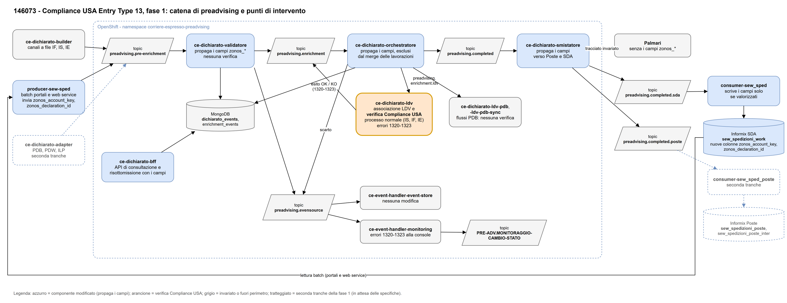
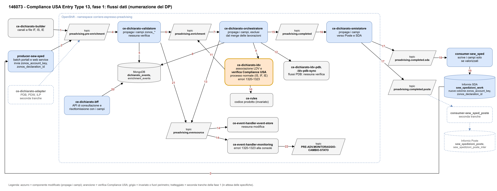

# Architettura Applicativa

L'iniziativa adegua la catena di preadvising del Corriere Espresso alla normativa USA Entry Type 13 per le spedizioni con merce dirette negli USA. Nella fase 1, oggetto di questo documento, il tracciato unico porta tre nuovi campi: `zonos_account_key` (per spedizione, 52 caratteri), `zonos_product_id` (per articolo, da 1 a 255 caratteri) e `zonos_declaration_id` (per spedizione, 13 caratteri, solo predisposto per la fase 2). I campi attraversano la catena esistente senza trasformazioni fino alla tabella SEW `sew_spedizioni_work`; la verifica di presenza e lunghezza sulle spedizioni soggette si esegue in `ce-dichiarato-ldv`, nel processo normale dei flussi SDA, e produce gli scarti `1320`…`1323`. Non sono previsti nuovi microservizi né nuove risorse infrastrutturali. La lavorazione Zonos e l'invio dei campi a BEP appartengono alla fase 2 e non sono descritti qui. Le regole funzionali sono descritte nella Specifica Funzionale dell'iniziativa (allegato SF_146073_Compliance_USA_Entry_Type_13, versione 0.1).

## Business Architecture – Preadvising Compliance USA

| Processo | Fase | Sistema Applicativo (AP) / Applicazione (PK) | Ruolo dell'Applicativo | Impatto Applicativo (S/N) | Applicativo esistente o nuovo |
|---|---|---|---|---|---|
| Preadvising | Acquisizione dei file | CE (AP-00988) / `ce-dichiarato-builder` (PK-03089) | Acquisisce i nuovi campi dai file dei clienti e li pubblica nel tracciato unico su `preadvising.pre-enrichment`. Adeguamento a carico del team applicativo, fuori dal perimetro di questo documento | S | Esistente |
| Preadvising | Acquisizione da portali e web service | SDA (AP DA DEFINIRE) / `sda-ldv-preadv-consumer`, modulo `producer-sew-sped` (PK DA DEFINIRE) | Batch che rilegge i preavvisi di portali e web service (`MYSDA`, `INVIO_WEB`, `SDA_WS`) da `sew_spedizioni_work` e li pubblica nella catena; legge anche `zonos_account_key` e `zonos_declaration_id`, dietro un'abilitazione spenta di default | S | Esistente |
| Preadvising | Inserimento del preavviso da portale | Portali SDA MySDA, Invio Web e web service SDA (AP DA DEFINIRE) | Scrivono il preavviso in `sew_spedizioni_work`; l'Account Key arriva al producer solo se i portali la scrivono. Adeguamento fuori perimetro, DA DEFINIRE | N | Esistente |
| Preadvising | Validazione del tracciato unico | CE (AP-00988) / `ce-dichiarato-validatore` (PK-03089) | Propaga i tre campi su tutti i canali, senza verifiche; li salva su `dichiarato_events` | S | Esistente |
| Preadvising | Orchestrazione | CE (AP-00988) / `ce-dichiarato-orchestratore` (PK-03089) | Conserva i tre campi su MongoDB e attraverso le lavorazioni; li protegge nel merge con le lavorazioni che non li conoscono (`check-ldv`, `ldv-pdb`, `ldv-bep-sync`, `enrichment_bep`); trasforma lo scarto di compliance nell'evento `PREADVISING_PARZIALE_E_BLOCCATO` | S | Esistente |
| Preadvising | Assegnazione LDV e verifica Compliance USA | CE (AP-00988) / `ce-dichiarato-ldv` (PK-03089) | Propaga i tre campi; nel processo normale (`IS`, `IF`, `IE`), dopo l'assegnazione della LDV, riconosce le spedizioni soggette e verifica Account Key e Product ID (errori `1320`…`1323`), con abilitazione spenta di default. Non verifica nel processo semplificato dei portali | S | Esistente |
| Preadvising | Determinazione del prodotto | CE (AP-00988) / ce-rules (PK-03089) | Calcola il codice prodotto della LDV, usato dalla verifica; nessuna modifica | N | Esistente |
| Preadvising | Creazione LDV su PDB/BEP | CE (AP-00988) / `ce-dichiarato-ldv-pdb`, `ce-dichiarato-ldv-pdb-sync` (PK-03089) | Lavorazioni dei flussi PDB: non conoscono i campi, che l'orchestratore conserva. Nessuna verifica di compliance sui flussi PDB fino alle specifiche di Poste | N | Esistente |
| Preadvising | Smistamento | CE (AP-00988) / `ce-dichiarato-smistatore` (PK-03089) | Propaga i campi su `preadvising.completed.sda` e `preadvising.completed.poste`, solo se valorizzati; non li invia ai palmari | S | Esistente |
| Preadvising | Storicizzazione SEW SDA | SDA (AP DA DEFINIRE) / `sda-ldv-preadv-consumer`, modulo `consumer-sew_sped` (PK DA DEFINIRE) | Scrive `zonos_account_key` e `zonos_declaration_id` su `sew_spedizioni_work`, solo quando valorizzati | S | Esistente |
| Preadvising | Base dati SEW SDA | Informix SDA (AP DA DEFINIRE) / tabella `sew_spedizioni_work` | Nuove colonne `zonos_account_key`, `zonos_declaration_id`, `zonos_product_id` (DDL a cura del DBA) | S | Esistente |
| Preadvising | Consultazione del preavviso | CE (AP-00988) / `ce-dichiarato-bff` (PK-03089) | Restituisce i tre campi nelle API di dettaglio e ricerca e li conserva nella risottomissione del preavviso | S | Esistente |
| Preadvising | Storico degli eventi | CE (AP-00988) / `ce-event-handler-event-store` (PK-03089) | Salva gli eventi così come arrivano: nessuna modifica di codice, solo test di non regressione | N | Esistente |
| Preadvising | Monitoraggio | CE (AP-00988) / `ce-event-handler-monitoring` (PK-03089) | Riceve gli errori `1320`…`1323` come gli altri errori di business: nessuna modifica di codice | N | Esistente |
| Preadvising | Acquisizione PDB, PDW, ILP | CE (AP-00988) / `ce-dichiarato-adapter` (PK-03089) | Mapping dei campi dai messaggi PDB, PDW e ILP: rimandato alla seconda tranche della fase 1 | S | Esistente |
| Preadvising | Storicizzazione SEW Poste | `poste-ldv-preadv-consumer`, modulo `consumer-sew_sped_poste` (AP e PK DA DEFINIRE) | Scrittura dei campi su `sew_spedizioni_poste`: rimandata alla seconda tranche della fase 1 | S | Esistente |
| Preadvising | Base dati SEW Poste | Informix Poste (AP DA DEFINIRE) / tabelle `sew_spedizioni_poste`, `sew_spedizioni_poste_inter` | Nuove colonne per Account Key, Declaration ID e Product ID (DDL): seconda tranche della fase 1 | S | Esistente |

Tabella 1: Business Architecture – Preadvising Compliance USA

## Information System Architecture

I campi nascono nei sistemi di acquisizione: il builder per i file dei clienti, fuori perimetro, e il producer `producer-sew-sped` per portali e web service. Entrano nella catena su `preadvising.pre-enrichment` e la percorrono fino a `preadvising.completed`, con il validatore e l'orchestratore che li conservano su MongoDB. `ce-dichiarato-ldv` li verifica nella lavorazione `ldv`, e l'eventuale scarto raggiunge monitoraggio ed event store tramite `preadvising.evensource`. Lo smistatore li inoltra sulle uscite SDA e Poste e `consumer-sew_sped` li storicizza in `sew_spedizioni_work`. I flussi dei componenti della seconda tranche della fase 1 (adapter, `consumer-sew_sped_poste`) non sono riportati.

| Flusso dati | Descrizione |
|---|---|
| Flusso dati 1 | `ce-dichiarato-builder` pubblica il tracciato unico con i tre campi sul topic `preadvising.pre-enrichment` (adeguamento a carico del team applicativo). |
| Flusso dati 2 | `producer-sew-sped` legge da `sew_spedizioni_work` i preavvisi di portali e web service, comprese le colonne `zonos_account_key` e `zonos_declaration_id` (solo con la property `compliance-usa.lettura-zonos.abilitata` attiva), e toglie gli spazi di riempimento a destra. |
| Flusso dati 3 | `producer-sew-sped` pubblica il tracciato unico con i campi valorizzati sul topic d'ingresso della catena (atteso `preadvising.pre-enrichment`, DA DEFINIRE sulle properties d'ambiente). |
| Flusso dati 4 | `ce-dichiarato-validatore` consuma il tracciato da `preadvising.pre-enrichment` e lo valida con le regole esistenti, senza verifiche sui nuovi campi. |
| Flusso dati 5 | `ce-dichiarato-validatore` salva il preavviso, con i tre campi, nella collection MongoDB `dichiarato_events`. |
| Flusso dati 6 | `ce-dichiarato-validatore` pubblica il tracciato validato, con i tre campi, sul topic `preadvising.enrichment`. |
| Flusso dati 7 | `ce-dichiarato-orchestratore` consuma il tracciato da `preadvising.enrichment` (ingresso ed esiti delle lavorazioni). |
| Flusso dati 8 | `ce-dichiarato-orchestratore` salva il preavviso e le lavorazioni, con i tre campi, nelle collection MongoDB `dichiarato_events` ed `enrichment_events`. |
| Flusso dati 9 | `ce-dichiarato-orchestratore` invia il tracciato a `ce-dichiarato-ldv` tramite il topic `preadvising.enrichment.ldv` (lavorazione `ldv`, flussi SDA `IS`, `IF`, `IE` e portali). |
| Flusso dati 10 | `ce-dichiarato-ldv` assegna o genera la LDV e ottiene da ce-rules il codice prodotto (chiamata esistente, invariata). |
| Flusso dati 11 | `ce-dichiarato-ldv`, nel processo normale, verifica le spedizioni soggette e pubblica su `preadvising.enrichment` il tracciato con i tre campi invariati e l'esito: `OK`, oppure `KO` con il primo errore fra `1320`…`1323`. |
| Flusso dati 12 | `ce-dichiarato-orchestratore` invia il tracciato alle lavorazioni dei flussi PDB (`preadvising.enrichment.pdb`, `preadvising.enrichment.bepsync`) e ne fonde gli esiti escludendo i tre campi dal merge (`campi-esclusi`), così che non si perdano. |
| Flusso dati 13 | In caso di scarto, `ce-dichiarato-orchestratore` pubblica sul topic `preadvising.evensource` l'evento `PREADVISING_PARZIALE_E_BLOCCATO` con la mappa degli errori (es. `1320`). |
| Flusso dati 14 | `ce-event-handler-event-store` e `ce-event-handler-monitoring` consumano gli eventi da `preadvising.evensource`, senza modifiche; il monitoraggio mostra gli errori `1320`…`1323` come gli altri errori di business. |
| Flusso dati 15 | `ce-dichiarato-orchestratore` pubblica il tracciato completato, con i tre campi, sul topic `preadvising.completed`. |
| Flusso dati 16 | `ce-dichiarato-smistatore` consuma il tracciato da `preadvising.completed`. |
| Flusso dati 17 | `ce-dichiarato-smistatore` pubblica il tracciato sui topic `preadvising.completed.sda` e `preadvising.completed.poste`, con i campi solo se valorizzati; il tracciato verso i palmari resta invariato. |
| Flusso dati 18 | `consumer-sew_sped` consuma il tracciato da `preadvising.completed.sda` (topic da confermare sulle properties d'ambiente). |
| Flusso dati 19 | `consumer-sew_sped` scrive `zonos_account_key` e `zonos_declaration_id` nella tabella Informix `sew_spedizioni_work`, solo quando valorizzati; senza i campi lo statement resta quello di oggi. |
| Flusso dati 20 | `ce-dichiarato-bff` legge il preavviso, con i tre campi, da `dichiarato_events` per le API di dettaglio e ricerca, e lo risottomette su un topic della catena senza perderli. |
| Flusso dati 21 | `ce-dichiarato-validatore` pubblica gli eventi di stato del preavviso, che contengono il tracciato con i tre campi, sul topic `preadvising.evensource`. |
| Flusso dati 22 | `ce-event-handler-monitoring` pubblica i messaggi per la console di monitoraggio sul topic `PRE-ADV.MONITORAGGIO-CAMBIO-STATO`, con i codici `1320`…`1323` come gli altri errori; il messaggio non riceve i nuovi campi. |

Tabella 2: Information System Architecture – Flussi dati

# Architettura Tecnica

## Application Technical Architecture

Tutti i componenti sono esistenti. I microservizi `ce-` seguono lo stack standard del preadvising: Java 17 e Spring Boot 3, deploy su OpenShift con chart Helm, integrazione via Kafka e persistenza su MongoDB. `sda-ldv-preadv-consumer` è un'applicazione Java 8 con client Kafka e accesso JDBC a Informix, fuori da OpenShift. Le nuove verifiche e letture sono governate da configurazione, spenta di default: `compliance-usa` (variabili `COMPLIANCE_USA_*`) in `ce-dichiarato-ldv`, `compliance-usa.lettura-zonos.abilitata` in `producer-sew-sped`. Volumi e frequenze non cambiano rispetto all'esistente: i messaggi crescono al massimo di 65 caratteri per spedizione e 255 per articolo.

| Pacchetto Applicativo | Software | Versione | Layer Applicativo | Applicativo nuovo o esistente |
|---|---|---|---|---|
| `ce-dichiarato-validatore` | Microservizio Java 17 / Spring Boot 3 | DA DEFINIRE | Application | Esistente (DTO) |
| `ce-dichiarato-orchestratore` | Microservizio Java 17 / Spring Boot 3.5.14 | DA DEFINIRE | Application | Esistente (DTO, merge policy) |
| `ce-dichiarato-ldv` | Microservizio Java 17 / Spring Boot 3 | DA DEFINIRE | Application | Esistente (DTO, verifica Compliance USA) |
| `ce-dichiarato-smistatore` | Microservizio Java 17 / Spring Boot 3.5.14 | DA DEFINIRE | Application | Esistente (DTO) |
| `ce-dichiarato-bff` | Microservizio Java 17 / Spring Boot 3 | DA DEFINIRE | Application | Esistente (DTO) |
| `ce-event-handler-event-store` | Microservizio | DA DEFINIRE | Application | Esistente (nessuna modifica) |
| `ce-event-handler-monitoring` | Microservizio | DA DEFINIRE | Application | Esistente (nessuna modifica) |
| `ce-dichiarato-ldv-pdb`, `ce-dichiarato-ldv-pdb-sync` | Microservizio | DA DEFINIRE | Application | Esistente (nessuna modifica) |
| ce-rules | Microservizio | DA DEFINIRE | Application | Esistente (nessuna modifica) |
| `sda-ldv-preadv-consumer` – `consumer-sew_sped` | Applicazione Java 8, client Kafka 2.2, JDBC Informix | DA DEFINIRE | Application | Esistente (scrittura delle nuove colonne) |
| `sda-ldv-preadv-consumer` – `producer-sew-sped` | Batch Java 8, client Kafka, JDBC Informix | DA DEFINIRE | Application | Esistente (lettura delle nuove colonne) |
| `preadvising.pre-enrichment` | Topic Kafka | Non applicabile | Integration | Esistente |
| `preadvising.enrichment` | Topic Kafka | Non applicabile | Integration | Esistente |
| `preadvising.enrichment.ldv` | Topic Kafka | Non applicabile | Integration | Esistente |
| `preadvising.enrichment.pdb`, `preadvising.enrichment.bepsync` | Topic Kafka | Non applicabile | Integration | Esistente |
| `preadvising.evensource` | Topic Kafka | Non applicabile | Integration | Esistente (nuovi codici di errore) |
| `preadvising.completed` | Topic Kafka | Non applicabile | Integration | Esistente |
| `preadvising.completed.sda`, `preadvising.completed.poste` | Topic Kafka | Non applicabile | Integration | Esistente |
| `PRE-ADV.MONITORAGGIO-CAMBIO-STATO` | Topic Kafka | Non applicabile | Integration | Esistente (nuovi codici di errore) |
| MongoDB preadvising (collection `dichiarato_events`, `enrichment_events`) | MongoDB | Non applicabile | Data | Esistente (nuove chiavi `zonos_*` nei documenti) |
| `sew_spedizioni_work` | Tabella Informix SDA | Non applicabile | Data | Esistente (tre nuove colonne `char` con default `''`) |

Tabella 3: Preadvising Compliance USA – dettaglio applicativi

<!-- orientamento: orizzontale -->

| Flusso dati | Protocollo | Origine | Destinazione | Tipologia | Frequenza | Frequenza di picco | Dimensione media dei messaggi | Dimensione massima dei messaggi | Flusso nuovo o esist. |
|---|---|---|---|---|---|---|---|---|---|
| Flusso 1 | Kafka | `ce-dichiarato-builder` | Topic `preadvising.pre-enrichment` | Asincrona | A evento, un tracciato per spedizione; invariata | DA DEFINIRE (volumi) | stima: 3-4 KB (tracciato unico) | DA DEFINIRE | Esistente (nuovi campi) |
| Flusso 2 | JDBC | `producer-sew-sped` | Informix, tabella `sew_spedizioni_work` | Sincrona | A ogni esecuzione del batch; schedulazione esistente, DA DEFINIRE | DA DEFINIRE | stima: inferiore a 1 KB per riga | DA DEFINIRE | Esistente (nuove colonne) |
| Flusso 3 | Kafka | `producer-sew-sped` | Topic d'ingresso della catena (atteso `preadvising.pre-enrichment`, DA DEFINIRE) | Asincrona | A ogni esecuzione del batch, un messaggio per preavviso | DA DEFINIRE | stima: 3-4 KB | DA DEFINIRE | Esistente (nuovi campi) |
| Flusso 4 | Kafka | Topic `preadvising.pre-enrichment` | `ce-dichiarato-validatore` | Asincrona | A evento; invariata | DA DEFINIRE (volumi) | stima: 3-4 KB | DA DEFINIRE | Esistente (nuovi campi) |
| Flusso 5 | MongoDB | `ce-dichiarato-validatore` | Collection `dichiarato_events` | Sincrona | A evento; invariata | DA DEFINIRE (volumi) | stima: 3-4 KB | DA DEFINIRE | Esistente (nuovi campi) |
| Flusso 6 | Kafka | `ce-dichiarato-validatore` | Topic `preadvising.enrichment` | Asincrona | A evento; invariata | DA DEFINIRE (volumi) | stima: 3-4 KB | DA DEFINIRE | Esistente (nuovi campi) |
| Flusso 7 | Kafka | Topic `preadvising.enrichment` | `ce-dichiarato-orchestratore` | Asincrona | A evento; invariata | DA DEFINIRE (volumi) | stima: 3-4 KB | DA DEFINIRE | Esistente (nuovi campi) |
| Flusso 8 | MongoDB | `ce-dichiarato-orchestratore` | Collection `dichiarato_events`, `enrichment_events` | Sincrona | A evento; invariata | DA DEFINIRE (volumi) | stima: 3-4 KB | DA DEFINIRE | Esistente (nuovi campi) |
| Flusso 9 | Kafka | `ce-dichiarato-orchestratore` | `ce-dichiarato-ldv`, tramite il topic `preadvising.enrichment.ldv` | Asincrona | A evento; invariata | DA DEFINIRE (volumi) | stima: 3-4 KB | DA DEFINIRE | Esistente (nuovi campi) |
| Flusso 10 | https | `ce-dichiarato-ldv` | ce-rules | Sincrona | A evento; invariata (nessuna chiamata aggiuntiva) | DA DEFINIRE (volumi) | stima: inferiore a 1 KB | DA DEFINIRE | Esistente |
| Flusso 11 | Kafka | `ce-dichiarato-ldv` | Topic `preadvising.enrichment` | Asincrona | A evento; invariata | DA DEFINIRE (volumi) | stima: 3-4 KB | DA DEFINIRE | Esistente (nuovi campi e nuovi esiti `KO`) |
| Flusso 12 | Kafka | `ce-dichiarato-orchestratore` | `ce-dichiarato-ldv-pdb`, `ce-dichiarato-ldv-pdb-sync`, tramite i topic `preadvising.enrichment.pdb` e `preadvising.enrichment.bepsync` | Asincrona | A evento; invariata | DA DEFINIRE (volumi) | stima: 3-4 KB | DA DEFINIRE | Esistente |
| Flusso 13 | Kafka | `ce-dichiarato-orchestratore` | Topic `preadvising.evensource` | Asincrona | A evento, uno per scarto; invariata | DA DEFINIRE (volumi) | stima: circa 1 KB | stima: circa 1 KB | Esistente (nuovi codici di errore) |
| Flusso 14 | Kafka | Topic `preadvising.evensource` | `ce-event-handler-event-store`, `ce-event-handler-monitoring` | Asincrona | A evento; invariata | DA DEFINIRE (volumi) | stima: circa 1 KB | DA DEFINIRE | Esistente |
| Flusso 15 | Kafka | `ce-dichiarato-orchestratore` | Topic `preadvising.completed` | Asincrona | A evento; invariata | DA DEFINIRE (volumi) | stima: 3-4 KB | DA DEFINIRE | Esistente (nuovi campi) |
| Flusso 16 | Kafka | Topic `preadvising.completed` | `ce-dichiarato-smistatore` | Asincrona | A evento; invariata | DA DEFINIRE (volumi) | stima: 3-4 KB | DA DEFINIRE | Esistente (nuovi campi) |
| Flusso 17 | Kafka | `ce-dichiarato-smistatore` | Topic `preadvising.completed.sda`, `preadvising.completed.poste` | Asincrona | A evento; invariata | DA DEFINIRE (volumi) | stima: 3-4 KB | DA DEFINIRE | Esistente (nuovi campi) |
| Flusso 18 | Kafka | Topic `preadvising.completed.sda` | `consumer-sew_sped` | Asincrona | A evento; invariata | DA DEFINIRE (volumi) | stima: 3-4 KB | DA DEFINIRE | Esistente (nuovi campi) |
| Flusso 19 | JDBC | `consumer-sew_sped` | Informix, tabella `sew_spedizioni_work` | Sincrona | A evento, una scrittura per spedizione; invariata | DA DEFINIRE (volumi) | stima: inferiore a 1 KB per riga (65 caratteri in più) | DA DEFINIRE | Esistente (nuove colonne) |
| Flusso 20 | MongoDB | `ce-dichiarato-bff` | Collection `dichiarato_events` | Sincrona | Su richiesta dell'operatore; invariata | DA DEFINIRE | stima: 3-4 KB | DA DEFINIRE | Esistente (nuovi campi) |
| Flusso 21 | Kafka | `ce-dichiarato-validatore` | Topic `preadvising.evensource` | Asincrona | A evento; invariata | DA DEFINIRE (volumi) | stima: 3-4 KB | DA DEFINIRE | Esistente (nuovi campi) |
| Flusso 22 | Kafka | `ce-event-handler-monitoring` | Topic `PRE-ADV.MONITORAGGIO-CAMBIO-STATO` | Asincrona | A evento; invariata | DA DEFINIRE (volumi) | stima: inferiore a 1 KB | DA DEFINIRE | Esistente (nuovi codici di errore) |

Tabella 4: Preadvising Compliance USA – dettaglio flussi

# Scheda HW

L'iniziativa non richiede nuove risorse: nessun nuovo microservizio, server, mainframe, HW periferico o risorsa cloud IaaS. I microservizi modificati restano nel namespace esistente `corriere-espresso-preadvising` con il dimensionamento attuale, riportato per riferimento dai chart Helm. L'unico impatto sul dato è la DDL Informix su `sew_spedizioni_work`, a cura del DBA, da eseguire prima che il builder invii i campi (allegato ddl-sew-146073). La collocazione del cluster (on prem o cloud) è DA DEFINIRE: i dimensionamenti sono riportati nella tabella Openshift on prem.

## Risorse on Prem

| (AP/PK) | Ambiente | Server Fisico/Virtuale | Layer | Tipologia | Data Center | Cluster | RAM | Storage | CPU | Core | SO | SW |
|---|---|---|---|---|---|---|---|---|---|---|---|---|
| Informix SDA (AP DA DEFINIRE) / `sew_spedizioni_work` | Sviluppo, Collaudo, Produzione | Esistente (istanza DA DEFINIRE) | Data | Database Informix | DA DEFINIRE | DA DEFINIRE | Nessuna variazione | Incremento stimato: 320 byte per riga (`char(52)`, `char(13)`, `char(255)`); volume DA DEFINIRE | Nessuna variazione | Nessuna variazione | DA DEFINIRE | Informix (esistente) |
| SDA (AP DA DEFINIRE) / `sda-ldv-preadv-consumer` | Sviluppo, Collaudo, Produzione | Esistente (server DA DEFINIRE) | Application | Applicazione Java 8 | DA DEFINIRE | DA DEFINIRE | Nessuna variazione | Nessuna variazione | Nessuna variazione | Nessuna variazione | DA DEFINIRE | Java 8 (esistente) |

Tabella 5: Risorse on Prem (HW dedicato o Private Cloud)

| Componente | Ambiente | MIPS | Tipologia elaborazione | Capacità di storage | Storage Tape |
|---|---|---|---|---|---|
| Non applicabile | Non applicabile | Non applicabile | Non applicabile | Non applicabile | Non applicabile |

Tabella 6: Mainframe

| Tipologia | Marca | Modello | Caratteristica tecnica 1 | Caratteristica tecnica 2 | Caratteristica tecnica 3 | Caratteristica tecnica 4 |
|---|---|---|---|---|---|---|
| Non applicabile | Non applicabile | Non applicabile | Non applicabile | Non applicabile | Non applicabile | Non applicabile |

Tabella 7: HW Periferico

### Openshift

Namespace esistente `corriere-espresso-preadvising`. Nessuna variazione di request, limit e pod rispetto all'esistente. I valori di Sviluppo e Collaudo sono quelli dei values Helm (`deploy-svil`, `deploy-coll`) su `develop`; quelli di Produzione sono gli esempi commentati nei `values_TEMPLATE`, da confermare con l'infrastruttura.

| (AP/PK) | Ambiente | Nome Cluster | Tipologia cluster | Namespace | Gen | Request Core (millicore) | Request Ram (MB) | Limit Core (core) | Limit Ram (MB) | Pod | BlobStorage (GB) |
|---|---|---|---|---|---|---|---|---|---|---|---|
| AP-00988 / `ce-dichiarato-validatore` (PK-03089) | Sviluppo | DA DEFINIRE (esistente) | DA DEFINIRE | `corriere-espresso-preadvising` (esistente) | DA DEFINIRE | 100 | 256 | 0,5 | 1024 | 1 | Non applicabile |
| AP-00988 / `ce-dichiarato-validatore` (PK-03089) | Collaudo | DA DEFINIRE (esistente) | DA DEFINIRE | `corriere-espresso-preadvising` (esistente) | DA DEFINIRE | 100 | 256 | 0,5 | 1024 | 1 | Non applicabile |
| AP-00988 / `ce-dichiarato-validatore` (PK-03089) | Produzione | DA DEFINIRE (esistente) | DA DEFINIRE | `corriere-espresso-preadvising` (esistente) | DA DEFINIRE | 200 (da confermare) | 256 (da confermare) | 1 (da confermare) | 2048 (da confermare) | 12 (da confermare) | Non applicabile |
| AP-00988 / `ce-dichiarato-orchestratore` (PK-03089) | Sviluppo | DA DEFINIRE (esistente) | DA DEFINIRE | `corriere-espresso-preadvising` (esistente) | DA DEFINIRE | 500 | 256 | 2 | 1024 | 1 | Non applicabile |
| AP-00988 / `ce-dichiarato-orchestratore` (PK-03089) | Collaudo | DA DEFINIRE (esistente) | DA DEFINIRE | `corriere-espresso-preadvising` (esistente) | DA DEFINIRE | 500 | 256 | 2 | 1024 | 1 | Non applicabile |
| AP-00988 / `ce-dichiarato-orchestratore` (PK-03089) | Produzione | DA DEFINIRE (esistente) | DA DEFINIRE | `corriere-espresso-preadvising` (esistente) | DA DEFINIRE | 200 (da confermare) | 256 (da confermare) | 1 (da confermare) | 2048 (da confermare) | 12 (da confermare) | Non applicabile |
| AP-00988 / `ce-dichiarato-ldv` (PK-03089) | Sviluppo | DA DEFINIRE (esistente) | DA DEFINIRE | `corriere-espresso-preadvising` (esistente) | DA DEFINIRE | DA DEFINIRE (default del chart) | DA DEFINIRE (default del chart) | DA DEFINIRE (default del chart) | DA DEFINIRE (default del chart) | DA DEFINIRE (default del chart) | Non applicabile |
| AP-00988 / `ce-dichiarato-ldv` (PK-03089) | Collaudo | DA DEFINIRE (esistente) | DA DEFINIRE | `corriere-espresso-preadvising` (esistente) | DA DEFINIRE | 100 | 256 | 0,5 | 1024 | 1 | Non applicabile |
| AP-00988 / `ce-dichiarato-ldv` (PK-03089) | Produzione | DA DEFINIRE (esistente) | DA DEFINIRE | `corriere-espresso-preadvising` (esistente) | DA DEFINIRE | 200 (da confermare) | 256 (da confermare) | 1 (da confermare) | 2048 (da confermare) | 12 (da confermare) | Non applicabile |
| AP-00988 / `ce-dichiarato-smistatore` (PK-03089) | Sviluppo | DA DEFINIRE (esistente) | DA DEFINIRE | `corriere-espresso-preadvising` (esistente) | DA DEFINIRE | 100 | 256 | 0,5 | 1024 | 1 | Non applicabile |
| AP-00988 / `ce-dichiarato-smistatore` (PK-03089) | Collaudo | DA DEFINIRE (esistente) | DA DEFINIRE | `corriere-espresso-preadvising` (esistente) | DA DEFINIRE | 100 | 256 | 0,5 | 1024 | 1 | Non applicabile |
| AP-00988 / `ce-dichiarato-smistatore` (PK-03089) | Produzione | DA DEFINIRE (esistente) | DA DEFINIRE | `corriere-espresso-preadvising` (esistente) | DA DEFINIRE | 200 (da confermare) | 256 (da confermare) | 0,5 (da confermare) | 1024 (da confermare) | 12 (da confermare) | Non applicabile |
| AP-00988 / `ce-dichiarato-bff` (PK-03089) | Sviluppo | DA DEFINIRE (esistente) | DA DEFINIRE | `corriere-espresso-preadvising` (esistente) | DA DEFINIRE | 100 | 256 | 0,5 | 1024 | 1 | Non applicabile |
| AP-00988 / `ce-dichiarato-bff` (PK-03089) | Collaudo | DA DEFINIRE (esistente) | DA DEFINIRE | `corriere-espresso-preadvising` (esistente) | DA DEFINIRE | 100 | 256 | 0,5 | 1024 | 1 | Non applicabile |
| AP-00988 / `ce-dichiarato-bff` (PK-03089) | Produzione | DA DEFINIRE (esistente) | DA DEFINIRE | `corriere-espresso-preadvising` (esistente) | DA DEFINIRE | 200 (da confermare) | 256 (da confermare) | 0,5 (da confermare) | 1024 (da confermare) | 2 (da confermare) | Non applicabile |

Tabella 8: Openshift on Prem

N.B. La verifica Compliance USA di `ce-dichiarato-ldv` è un controllo in memoria, lineare sul numero di articoli e senza chiamate esterne: non richiede risorse aggiuntive. La configurazione `compliance-usa` è spenta di default e non è presente nei `values_TEMPLATE` di certificazione e produzione: va aggiunta quando si decide di attivare la verifica.

## Risorse Cloud

| (AP/PK) | Ambiente | Risorsa | Tipologia | Cloud Provider | Region | Resource Group | FQDN Front Door | FQDN Backend | RAM | Storage | CPU | Core | SO | SW |
|---|---|---|---|---|---|---|---|---|---|---|---|---|---|---|
| Non applicabile | Non applicabile | Non applicabile | Non applicabile | Non applicabile | Non applicabile | Non applicabile | Non applicabile | Non applicabile | Non applicabile | Non applicabile | Non applicabile | Non applicabile | Non applicabile | Non applicabile |

Tabella 9: Risorse Cloud IaaS

### Openshift

| (AP/PK) | Ambiente | Nome Cluster | Tipologia cluster | Namespace | Gen | Request Core (millicore) | Request Ram (MB) | Limit Core (core) | Limit Ram (MB) | Pod | BlobStorage (GB) |
|---|---|---|---|---|---|---|---|---|---|---|---|
| DA DEFINIRE: da compilare con i valori della Tabella 8 se il cluster è in cloud | Non applicabile | Non applicabile | Non applicabile | Non applicabile | Non applicabile | Non applicabile | Non applicabile | Non applicabile | Non applicabile | Non applicabile | Non applicabile |

Tabella 10: Openshift Cloud

<!-- orientamento: verticale -->

# Allegati

| Codice Documento | Nome |
|---|---|
| SF_146073_Compliance_USA_Entry_Type_13 | Specifica Funzionale dell'iniziativa 146073 - Compliance USA Entry Type 13 — nuovi campi e controlli sul preadvising, versione 0.1 |
| HLD_146073_dati_preadvising_fase_1 | HLD v.1 del 09/11/2026 "Dazi dati preadvising", fase 1 |
| 20261116_descrizione_compliance_usa_entry_type_13 | Descrizione generale dell'iniziativa Compliance USA Entry Type 13 |
| ddl-sew-146073 | Script DDL Informix delle colonne `zonos_*` su `sew_spedizioni_work`, con verifica e rollback |
| ICD_PREADVISING_LDV_EVENT_SOURCE | ICD del tracciato unico preadvising, da aggiornare con i campi `zonos_*` (versione DA DEFINIRE) |
| fig-1-architettura | Schema drawio della soluzione: Figura 1 e Figura 2 |
