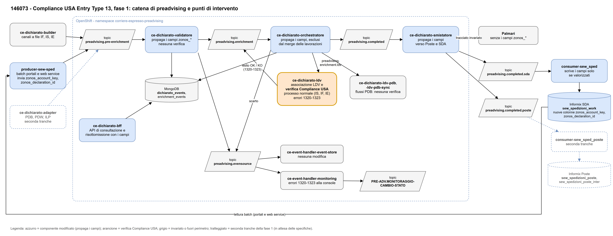

# Introduzione

## Scopo

Il presente documento contiene l'analisi degli impatti funzionali relativi all'Iniziativa "146073 - Compliance USA Entry Type 13 — nuovi campi e controlli sul preadvising". Il documento copre la fase 1 dell'iniziativa (dati di accettazione); la fase 2 (lavorazione Zonos) sarà oggetto di una revisione successiva.

## Definizione, Acronimi e Abbreviazioni

| Sigla | Significato esteso |
|---|---|
| BEP | Back End Pacchi |
| CE | Corriere Espresso |
| DBA | Database Administrator |
| DDL | Data Definition Language, istruzioni di modifica della struttura delle tabelle |
| DTO | Data Transfer Object, struttura del messaggio scambiato fra i microservizi |
| HLD | High Level Design |
| ICD | Interface Control Document |
| LDV | Lettera di Vettura |
| ms | Microservizio |
| PDB | Poste Delivery Business (canali `PDB_*`, `EUD_*`, PDW, ILP) |
| SEW | Tabelle Informix dei preavvisi SDA e Poste (`sew_spedizioni_work`, `sew_spedizioni_poste`) |
| USA | Stati Uniti d'America |

## Riferimenti

| Id. Documento | Tipo di Documento | Titolo Documento | Allegato |
|---|---|---|---|
| 1 | HLD | HLD 146073 "Dazi dati preadvising", fase 1, v.1 del 09/11/2026 (HLD_146073_dati_preadvising_fase_1.xlsx) | non disponibile |
| 2 | HLD | HLD 146073 "Dazi dati preadvising", fase 2, v.1 del 09/11/2026 (HLD_146073_dati_preadvising_fase_2.xlsx) | non disponibile |
| 3 | Descrizione | Descrizione delle attività sui servizi Preadvising per la Compliance USA Entry Type 13, ricevuta il 16/11/2026 | non disponibile |
| 4 | ICD | ICD del tracciato unico di preadvising (ICD_PREADVISING_V5) | non disponibile |
| 5 | ICD | ICD degli eventi di stato del preadvising (`preadvising.evensource`) | non disponibile |

## Vincoli, Assunzioni, Esclusioni ed Open Point

| Id | Tipo | Descrizione | Riferimento |
|---|---|---|---|
| 1 | Vincolo | I nuovi campi entrano nella catena di preadvising solo se pubblicati dai sistemi di acquisizione: `ce-dichiarato-builder` (fuori perimetro, team applicativo) per i canali a file e i canali portali e web service attraverso le tabelle SEW. Finché il builder non pubblica i campi la verifica resta disattivata. | Acquisizione; team ce-dichiarato-builder |
| 2 | Vincolo | Le modifiche alle tabelle SEW (DDL) devono essere eseguite prima che i sistemi di acquisizione inviino i campi valorizzati. Il software dei consumer può essere rilasciato anche prima, perché le colonne nuove vengono scritte solo quando i campi arrivano valorizzati. | Storicizzazione nelle SEW; SDA (DBA) |
| 3 | Vincolo | Nella verifica viene riportato un solo errore per preavviso, come per gli altri controlli eseguiti in fase di associazione della LDV: il primo nell'ordine 1320, 1321, 1322, 1323. Un preavviso con più anomalie le evidenzia una alla volta, a ogni nuovo invio. | Verifica Compliance USA; Poste |
| 4 | Vincolo | Per i preavvisi dei canali che generano la LDV (InvioFile, InvioEasy) la verifica avviene dopo la generazione della LDV, perché solo allora è noto il prodotto: in caso di scarto la LDV risulta già assegnata, come avviene oggi per gli altri controlli successivi alla generazione. | Verifica Compliance USA; Poste |
| 5 | Assunzione | I tre campi `zonos_account_key`, `zonos_product_id` e `zonos_declaration_id` sono i "3 nuovi campi" del documento di riferimento ID 1; `zonos_declaration_id` viene predisposto in fase 1 (sempre assente) e valorizzato in fase 2. | Dati dell'iniziativa; Poste |
| 6 | Assunzione | Un campo assente e un campo nullo sono equivalenti in tutta la catena. I valori non vengono mai trasformati (nessun troncamento, conversione o rimozione di spazi), salvo la rimozione degli spazi di riempimento delle colonne Informix in rilettura. | Dati dell'iniziativa; Poste |
| 7 | Assunzione | Una spedizione soggetta senza articoli non produce errori sul Product ID, non essendovi un articolo da indicare. | Verifica Compliance USA; Poste |
| 8 | Esclusione | Fase 2 dell'iniziativa: integrazione con il microservizio comune Zonos, valorizzazione del Declaration ID, dazi e fee, invio dei campi a BEP. | Obiettivo; Poste |
| 9 | Esclusione | `ce-dichiarato-builder`, portali, servizi di spedizione, Internazionale/SLP, componenti Partner, mappe Sterling e microservizio Zonos (documento di riferimento ID 3). | Obiettivo; Poste |
| 10 | Esclusione | Palmari (`sew_sped_pre_adv_online_out_tot`), T&T-Repo, OneTracking e stampe LDV non ricevono i nuovi campi (da confermare). | Smistamento; Poste |
| 11 | Esclusione | Verifica sui flussi PDB (PDB, PDW, ILP, EUD): i campi vengono propagati senza controlli fino alla ricezione delle regole per questi flussi (Open Point 15). | Verifica Compliance USA; Poste |
| 12 | Esclusione | Verifica sui preavvisi dei portali e del web service (MYSDA, INVIO_WEB, SDA_WS, TFI, TWS, BNC) e sui canali TUP: i campi vengono propagati senza controlli (da confermare, Open Point 16). | Verifica Compliance USA; Poste |
| 13 | Open Point | Elenco dei prodotti interessati: in anagrafica prodotti risultano per CRONO INTERNAZIONALE i soli codici 515 e 516; l'elenco completo è da confermare. L'elenco è configurabile senza modifiche al software. | Verifica Compliance USA; Poste |
| 14 | Open Point | Nomi e livello di Account Key e Product ID nei messaggi sorgente PDB, PDW e ILP, e numero di articoli previsto per PDW. Servono per l'adeguamento di `ce-dichiarato-adapter` e del consumer `sew_spedizioni_poste`, rimandati a una seconda tranche della fase 1. | Acquisizione; Storicizzazione nelle SEW; Poste |
| 15 | Open Point | Regola di Compliance USA per i flussi PDB (PDB, PDW, ILP, EUD): quali spedizioni sono soggette, su quale campo prodotto e in quale punto della catena eseguire la verifica. | Verifica Compliance USA; Poste |
| 16 | Open Point | Necessità di verificare anche i preavvisi dei portali, del web service e dei canali TUP. | Verifica Compliance USA; Poste |
| 17 | Open Point | Accettabilità del vincolo 3 (un solo errore per preavviso) e del vincolo 4 (LDV già assegnata in caso di scarto per i canali che la generano). | Verifica Compliance USA; Poste |
| 18 | Open Point | Account Key: la lunghezza di 52 caratteri viene verificata sul valore così come ricevuto, spazi compresi. Da confermare se esista un formato (es. solo alfanumerico) e se l'Account Key sia un dato riservato da mascherare nei log dei sistemi esistenti. | Verifica Compliance USA; Poste |
| 19 | Open Point | Product ID lato SDA: le tabelle SEW SDA hanno una riga per LDV e nessuna tabella articoli. Si propone, se confermato, una nuova tabella figlia di `sew_spedizioni_work` con una riga per articolo; in attesa il Product ID non viene storicizzato lato SDA. | Storicizzazione nelle SEW; Poste |
| 20 | Open Point | Account Key dai portali e dal web service: arriva alla catena solo se i portali (fuori perimetro) la scrivono in `sew_spedizioni_work`. È DA DEFINIRE chi adegua i portali. | Acquisizione; Poste |
| 21 | Open Point | Console di monitoraggio: se debba ricevere anche i nuovi campi sul topic `PRE-ADV.MONITORAGGIO-CAMBIO-STATO`, oggi privo di dati di spedizione e articolo. In assenza di richiesta riceve solo i nuovi errori. | Tracciamento; Poste |
| 22 | Open Point | `ce-dichiarato-ldv` non è presente nel documento di riferimento ID 1: la verifica è stata collocata in questo ms (sezione Verifica Compliance USA) e va riconosciuta nella stima dell'intervento 01. Sono DA DEFINIRE i responsabili dell'adeguamento di `ce-dichiarato-ldv-pdb`, `ce-dichiarato-ldv-pdb-sync` e dei servizi di retry che oggi non conservano i nuovi campi. | Elenco Sistemi Impattati; Poste |
| 23 | Open Point | PRJ e owner dell'iniziativa lato cliente DA DEFINIRE. | Introduzione; Poste |
| 24 | Open Point | Esecuzione delle DDL sulle istanze Informix SDA di sviluppo, collaudo e produzione: referente e modalità di richiesta. | Storicizzazione nelle SEW; SDA (DBA) |
| 25 | Open Point | Aggiornamento dell'ICD del tracciato unico (documento di riferimento ID 4) con i nomi `zonos_account_key`, `zonos_product_id`, `zonos_declaration_id` e pubblicazione dei campi da parte del builder. | Acquisizione; team ce-dichiarato-builder |
| 26 | Open Point | Altri consumatori dei topic `preadvising.completed.poste` e `preadvising.completed.sda`, oltre ai consumer SEW: va verificato che tollerino la presenza dei nuovi campi. | Smistamento; responsabili dei sistemi consumatori |

# Obiettivo dell'iniziativa

La normativa doganale USA Entry Type 13 richiede che le spedizioni verso gli Stati Uniti contenenti merce siano accompagnate da dati identificativi che consentono il calcolo e il pagamento anticipato di dazi e oneri attraverso la piattaforma Zonos. Per rispettarla, i preavvisi dei clienti devono portare un identificativo di account per la spedizione e un identificativo di prodotto per ciascun articolo, e la catena di preadvising deve verificarne la presenza e conservarli fino ai sistemi di destinazione.

L'iniziativa si articola in due fasi. Nella fase 1 (dati di accettazione), oggetto del presente documento, il preavviso porta i nuovi dati, che vengono verificati e propagati lungo la catena fino alle tabelle SEW. Nella fase 2 (lavorazione Zonos) la catena invocherà il microservizio comune verso Zonos per ottenere Declaration ID, dazi e fee.

Gli obiettivi della fase 1 sono:

- acquisire nel tracciato unico l'Account Key (uno per spedizione) e il Product ID (uno per articolo), e predisporre il Declaration ID;
- verificare presenza e lunghezza dei due campi sulle spedizioni soggette, scartando il preavviso con un errore che indica il campo e, per il Product ID, l'articolo;
- propagare i campi senza alterazioni attraverso validazione, orchestrazione e smistamento, mantenendo la loro cardinalità;
- renderli disponibili nella persistenza, negli eventi di stato e nelle API di consultazione;
- storicizzarli nelle tabelle SEW;
- non alterare il comportamento per le spedizioni non soggette e per i preavvisi che non portano i nuovi campi.

# Soluzione

La soluzione descritta di seguito tratta i seguenti temi:

- i nuovi dati del tracciato unico;
- l'acquisizione dei campi nella catena;
- la validazione e la propagazione dei campi nella catena;
- la verifica Compliance USA in fase di associazione della LDV;
- lo smistamento verso i sistemi di destinazione;
- il tracciamento, la persistenza e la consultazione;
- la storicizzazione nelle tabelle SEW.

La soluzione è riportata nella figura successiva.



La figura mostra la catena di preadvising: i sistemi di acquisizione pubblicano il tracciato unico su `preadvising.pre-enrichment`; `ce-dichiarato-validatore` lo valida e lo pubblica su `preadvising.enrichment`; `ce-dichiarato-orchestratore` lo invia alle lavorazioni, fra cui `ce-dichiarato-ldv` che associa la LDV ed esegue la verifica Compliance USA, e a lavorazioni completate lo pubblica su `preadvising.completed`; `ce-dichiarato-smistatore` lo inoltra verso Poste e SDA, dove i consumer lo storicizzano nelle tabelle SEW. Gli stati vengono pubblicati su `preadvising.evensource`, letto dall'event store e dal monitoraggio.

## Dati dell'iniziativa

### Nuovi campi del tracciato unico

I nuovi campi vengono aggiunti al tracciato unico con i nomi seguenti. Sono opzionali: un preavviso che non li contiene viene lavorato come oggi.

| Campo | Posizione nel tracciato | Cardinalità | Lunghezza | Fase |
|---|---|---|---|---|
| `zonos_account_key` | testata della spedizione (`spedizione[]`) | una per spedizione | 52 caratteri | 1 |
| `zonos_product_id` | articolo (`spedizione[].collo[].articolo[]`) | uno per articolo | da 1 a 255 caratteri | 1 |
| `zonos_declaration_id` | testata della spedizione (`spedizione[]`) | una per spedizione | 13 caratteri | predisposto in fase 1, valorizzato in fase 2 |

Tabella 1: Nuovi campi del tracciato unico

Esempio, con valori fittizi:

```json
{
  "spedizione": [{
    "zonos_account_key": "TESTAK0000000000000000000000000000000000000000000001",
    "zonos_declaration_id": null,
    "collo": [{
      "articolo": [
        { "posizione": "1", "codice_taric": "6109100010", "zonos_product_id": "PRD-TEST-0001" },
        { "posizione": "2", "codice_taric": "6203420000", "zonos_product_id": "PRD-TEST-0002" }
      ]
    }]
  }]
}
```

I servizi di preadvising non richiedono nuovamente i campi e non ne modificano il valore. Il Product ID resta legato al proprio articolo anche in presenza di più colli, di più articoli, di nuovi tentativi e di risottomissioni (documento di riferimento ID 3). L'aggiornamento dell'ICD del tracciato unico è descritto nell'Open Point 25.

## Acquisizione

### Canali a file

I canali a file (InvioFile, InvioSystem, InvioEasy) sono acquisiti da `ce-dichiarato-builder`, fuori dal perimetro dell'iniziativa, che pubblica i campi su `preadvising.pre-enrichment` (vincolo 1).

### Portali e web service

I preavvisi dei portali (MYSDA, INVIO_WEB) e del web service (SDA_WS) vengono scritti dai portali nelle tabelle SEW SDA e da lì inviati alla catena da un processo periodico (`producer-sew-sped`). Il processo viene adeguato per leggere `zonos_account_key` e `zonos_declaration_id` dalla tabella `sew_spedizioni_work` e inviarli nel tracciato unico solo se valorizzati, senza gli spazi di riempimento delle colonne Informix; un valore vuoto o di soli spazi equivale a campo assente.

N.B. L'Account Key arriva alla catena solo se i portali la scrivono nella tabella (Open Point 20). Il Product ID non viene inviato, perché le tabelle sorgente hanno una riga per LDV e non contengono gli articoli (Open Point 19).

### Canali PDB, PDW e ILP

L'adeguamento di `ce-dichiarato-adapter`, che acquisisce i preavvisi di PDB, PDW e ILP, è rimandato a una seconda tranche della fase 1, in attesa dei nomi dei campi nei messaggi sorgente (Open Point 14). Si prevede che l'adapter riporti l'Account Key sulla spedizione e ogni Product ID sul proprio articolo, senza trasformazioni.

Ulteriori dettagli: il processo periodico è il modulo `producer-sew-sped` del repository `sda-ldv-preadv-consumer`; legge la tabella `sew_spedizioni_work` di Informix SDA e pubblica il tracciato unico sul topic di ingresso della catena.

## Validazione e propagazione

### Validazione del preavviso

`ce-dichiarato-validatore` riceve il tracciato unico da `preadvising.pre-enrichment` e lo valida con le regole esistenti. Con l'iniziativa il validatore riconosce i tre nuovi campi e li propaga, identici e nella loro posizione, verso `preadvising.enrichment`, verso gli eventi di stato e verso la persistenza del preavviso. Senza questo adeguamento i campi andrebbero persi, perché il validatore ripubblica solo i campi che conosce.

Il validatore non esegue controlli sui nuovi campi, su nessun canale: la verifica Compliance USA avviene in fase di associazione della LDV, dove il codice prodotto della spedizione è sicuramente determinato (sezione Verifica Compliance USA). Le regole di validazione esistenti non cambiano e non vengono aggiunti vincoli di lunghezza, che scarterebbero anche spedizioni non soggette.

### Orchestrazione

`ce-dichiarato-orchestratore` salva il preavviso validato, lo invia alle lavorazioni previste per il canale e ne fonde i risultati. I nuovi campi vengono conservati in tutti i passaggi: salvataggio, invio alle lavorazioni, fusione dei risultati, nuovi tentativi, completamento e scarto. Le lavorazioni non possono sovrascrivere i nuovi campi: nella fusione dei risultati prevalgono i valori ricevuti dal validatore, così da non perderli quando una lavorazione restituisce il tracciato senza di essi. A lavorazioni completate il preavviso viene pubblicato su `preadvising.completed` con i nuovi campi.

Ulteriori dettagli: i ms `ce-dichiarato-validatore` e `ce-dichiarato-orchestratore`, namespace OpenShift `corriere-espresso-preadvising`. Il validatore legge `preadvising.pre-enrichment` e scrive `preadvising.enrichment` e `preadvising.evensource`; l'orchestratore legge `preadvising.enrichment`, scrive i topic delle lavorazioni (fra cui `preadvising.enrichment.ldv`), `preadvising.completed` e `preadvising.evensource`.

## Verifica Compliance USA

### Punto della verifica

La verifica viene eseguita da `ce-dichiarato-ldv`, la lavorazione che assegna o genera la LDV dei preavvisi SDA, dopo l'associazione della LDV e prima degli altri controlli di business (tipo di azzeramento, contrassegno, consegna, filiale). In quel punto il codice prodotto della spedizione è determinato dalle regole di prodotto sulla LDV, sia per i preavvisi con LDV fornita dal cliente (InvioSystem) sia per quelli con LDV generata (InvioFile, InvioEasy). In ingresso al validatore, invece, i flussi SDA non portano il codice prodotto in modo affidabile.

La verifica non si applica:

- ai preavvisi dei portali e del web service, lavorati da `ce-dichiarato-ldv` con il processo semplificato (esclusione 12);
- ai flussi PDB (PDB, PDW, ILP, EUD), che non passano da `ce-dichiarato-ldv` (esclusione 11).

### Spedizioni soggette

La verifica considera ogni spedizione del preavviso. Una spedizione è soggetta se valgono tutte le condizioni seguenti.

| Condizione | Regola |
|---|---|
| Merce | `tipo_merce` diverso da `D` (documenti); un `tipo_merce` assente vale come merce |
| Destinatario USA | `codice_nazione_iso_2` del destinatario uguale a `US`, oppure `codice_nazione` uguale a `US` o `USA` |
| Prodotto interessato | `codice_prodotto` oppure `id_servizio` fra i prodotti 456, 457 (EXPORT BOX), 458, 459 (EXPORT BOX PCIM), 515, 516 (CRONO INTERNAZIONALE) |

Tabella 2: Condizioni di assoggettamento

I confronti non distinguono maiuscole e minuscole e ignorano gli spazi iniziali e finali dei campi di riconoscimento. L'elenco dei prodotti è configurabile senza modifiche al software ed è da confermare (Open Point 13). La verifica è attivabile da configurazione e resta disattivata finché i sistemi di acquisizione non pubblicano i nuovi campi (vincolo 1): da disattivata, nessuna spedizione è soggetta e i campi vengono comunque propagati.

### Controlli ed errori

Sulle spedizioni soggette vengono controllate solo presenza e lunghezza dei due campi, sul valore così come ricevuto, senza ricerche in anagrafica né chiamate a Zonos. Un campo vuoto o di soli spazi vale come mancante.

| Codice | Controllo | Descrizione dell'errore |
|---|---|---|
| 1320 | `zonos_account_key` mancante | `zonos_account_key: Campo obbligatorio mancante` |
| 1321 | `zonos_account_key` di lunghezza diversa da 52 caratteri | `zonos_account_key: lunghezza non valida (attesi 52 caratteri)` |
| 1322 | `zonos_product_id` mancante su un articolo | `zonos_product_id: Campo obbligatorio mancante (collo <n> articolo <posizione>)` |
| 1323 | `zonos_product_id` più lungo di 255 caratteri | `zonos_product_id: lunghezza non valida, attesi 1-255 caratteri (collo <n> articolo <posizione>)` |

Tabella 3: Errori della verifica Compliance USA

Il nome del campo precede sempre i due punti, perché la console di monitoraggio legge così il campo in errore. Per il Product ID la descrizione indica il collo (numero d'ordine, da 1) e la posizione dell'articolo (se assente, il numero d'ordine dell'articolo preceduto da `#`); più articoli con lo stesso errore vengono elencati nella stessa descrizione, separati da punto e virgola, per esempio `(collo 1 articolo 2; collo 2 articolo #1)`. Le descrizioni non riportano mai i valori dei campi.

Per ogni preavviso viene riportato un solo errore, il primo nell'ordine dei codici, con tutte le sue occorrenze (vincolo 3).

### Esiti

| Esito/Stato | Descrizione |
|---|---|
| Spedizione non soggetta | Nessun controllo; il preavviso prosegue e i campi presenti vengono propagati |
| Spedizione soggetta, campi corretti | Il preavviso prosegue con gli altri controlli di `ce-dichiarato-ldv` |
| Spedizione soggetta, campi errati | Il preavviso viene scartato con l'errore della Tabella 3; i controlli successivi non vengono eseguiti. L'orchestratore registra l'errore e pubblica lo stato `PREADVISING_PARZIALE_E_BLOCCATO` con codice e descrizione dell'errore, come per gli altri scarti delle lavorazioni |
| Verifica disattivata | Nessun controllo, campi propagati |

Tabella 4: Esiti della verifica

N.B. Per i canali che generano la LDV lo scarto avviene dopo la generazione (vincolo 4).

Ulteriori dettagli: il ms `ce-dichiarato-ldv`, namespace OpenShift `corriere-espresso-preadvising`, legge `preadvising.enrichment.ldv` e scrive l'esito della lavorazione, con i nuovi campi, su `preadvising.enrichment`.

## Smistamento

`ce-dichiarato-smistatore` legge il preavviso completato e lo inoltra su `preadvising.completed.poste` o su `preadvising.completed.sda` secondo il canale. I nuovi campi vengono inoltrati identici su entrambi i topic, ciascuno nella propria posizione; per i preavvisi che non li contengono il messaggio resta quello di oggi, senza le nuove chiavi. Il tracciato verso i palmari non riceve i nuovi campi (esclusione 10).

Ulteriori dettagli: il ms `ce-dichiarato-smistatore`, namespace OpenShift `corriere-espresso-preadvising`, legge `preadvising.completed` e scrive `preadvising.completed.poste`, `preadvising.completed.sda` e il flusso verso i palmari, invariato.

## Tracciamento, persistenza e consultazione

### Eventi di stato

Gli eventi di stato pubblicati su `preadvising.evensource` contengono il preavviso completo e quindi, dopo l'adeguamento dei ms che li pubblicano, anche i nuovi campi. `ce-event-handler-event-store` li memorizza così come ricevuti, senza modifiche: conserva la cardinalità per articolo e resta compatibile con gli eventi già memorizzati, che non hanno i campi. La ricostruzione dello stato e il replay restituiscono i campi senza ulteriori interventi.

### Monitoraggio

`ce-event-handler-monitoring` trasforma gli eventi di stato in messaggi per la console di monitoraggio sul topic `PRE-ADV.MONITORAGGIO-CAMBIO-STATO`. I nuovi errori 1320-1323 arrivano alla console senza modifiche, con codice, campo in errore (il testo prima dei due punti) e descrizione. Il messaggio verso la console non contiene dati di spedizione e di articolo e non riceve i nuovi campi, salvo diversa richiesta (Open Point 21).

### Persistenza e consultazione

Il preavviso viene salvato con i nuovi campi, con gli stessi nomi del tracciato. `ce-dichiarato-bff` restituisce i nuovi campi nelle API di dettaglio e di ricerca dei preavvisi e li conserva quando un preavviso viene risottomesso alla catena. Non sono previsti nuovi filtri di ricerca né modifiche al front-end.

Ulteriori dettagli: i ms `ce-event-handler-event-store`, `ce-event-handler-monitoring` e `ce-dichiarato-bff`, namespace OpenShift `corriere-espresso-preadvising`. L'event store e il monitoraggio leggono `preadvising.evensource`; il monitoraggio scrive `PRE-ADV.MONITORAGGIO-CAMBIO-STATO`.

## Storicizzazione nelle SEW

### Tabelle SDA

Il consumer `sew_spedizioni` legge i preavvisi SDA completati e li scrive nelle tabelle SEW su Informix SDA. Con l'iniziativa scrive `zonos_account_key` e `zonos_declaration_id` nella sola tabella `sew_spedizioni_work`. Le colonne vengono incluse nell'inserimento solo quando il campo arriva valorizzato; altrimenti l'istruzione resta quella di oggi e la colonna mantiene il valore di default (stringa vuota).

| Colonna | Tipo | Tabella |
|---|---|---|
| `zonos_account_key` | `char(52)`, default `''` | `sew_spedizioni_work` |
| `zonos_declaration_id` | `char(13)`, default `''` | `sew_spedizioni_work` |

Tabella 5: Nuove colonne lato SDA

Le colonne vengono aggiunte con istruzioni DDL eseguite dal DBA prima che i campi arrivino valorizzati (vincolo 2, Open Point 24). Il Product ID non viene storicizzato lato SDA, perché il consumer non scrive una tabella articoli (Open Point 19).

### Tabelle Poste

L'adeguamento del consumer `sew_spedizioni_poste` è rimandato alla seconda tranche della fase 1 (Open Point 14). Si prevede di scrivere Account Key e Declaration ID in `sew_spedizioni_poste` e il Product ID nella tabella degli articoli internazionali che il consumer già alimenta (`sew_spedizioni_poste_inter`), con le stesse colonne e la stessa regola di scrittura.

Ulteriori dettagli: il consumer `consumer-sew_sped` del repository `sda-ldv-preadv-consumer` legge `preadvising.completed.sda` e scrive `sew_spedizioni_work`; il consumer `consumer-sew_sped_poste` del repository `poste-ldv-preadv-consumer` legge `preadvising.completed.poste` e scrive le tabelle SEW Poste.

# Elenco Sistemi Impattati

| Sistema | Componente | Tipo intervento | Nuovo/Esistente |
|---|---|---|---|
| Catena preadvising | `ce-dichiarato-validatore` | Propagazione dei nuovi campi | Esistente |
| Catena preadvising | `ce-dichiarato-ldv` | Propagazione dei nuovi campi e verifica Compliance USA | Esistente |
| Catena preadvising | `ce-dichiarato-orchestratore` | Propagazione e protezione dei nuovi campi nella fusione delle lavorazioni | Esistente |
| Catena preadvising | `ce-dichiarato-smistatore` | Propagazione dei nuovi campi verso Poste e SDA | Esistente |
| Catena preadvising | `ce-dichiarato-bff` | Nuovi campi nelle API di consultazione e nella risottomissione | Esistente |
| Catena preadvising | `ce-event-handler-event-store` | Nessuna modifica al software, verifica di non regressione | Esistente |
| Catena preadvising | `ce-event-handler-monitoring` | Nessuna modifica al software, verifica di non regressione | Esistente |
| Catena preadvising | `ce-dichiarato-adapter` | Acquisizione dei campi da PDB, PDW e ILP (seconda tranche) | Esistente |
| SDA | `consumer-sew_sped` | Scrittura dei nuovi campi in `sew_spedizioni_work` | Esistente |
| SDA | `producer-sew-sped` | Invio dei nuovi campi da portali e web service | Esistente |
| Poste | `consumer-sew_sped_poste` | Scrittura dei nuovi campi nelle SEW Poste (seconda tranche) | Esistente |
| Informix SDA | `sew_spedizioni_work` | Nuove colonne (DDL) | Esistente |
| Informix Poste | `sew_spedizioni_poste`, `sew_spedizioni_poste_inter` | Nuove colonne (DDL, seconda tranche) | Esistente |

Tabella 6: Sistemi impattati

# Allegati

| ID Documento | Tipo Documento | Titolo e Contenuto | Allegato |
|---|---|---|---|
| 1 | DDL | Script DDL delle nuove colonne SEW, con verifica e rollback | in preparazione |
| 2 | Figura | Catena di preadvising e punti di intervento della fase 1 (fig-1-architettura.drawio) | in preparazione |
